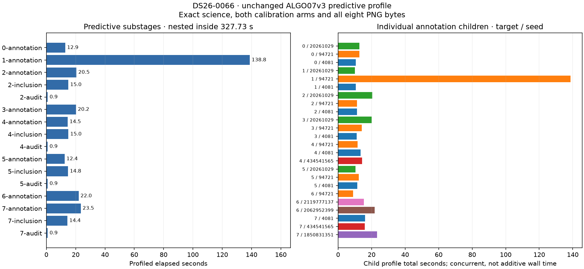
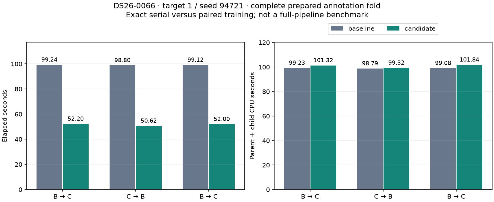

# ALGO07v3: predictive-recovery bottleneck and paired training experiment

2026-11-05. Development experiment; runtime and production unchanged.

**Complete-path candidate speedup is not yet measured.** The preceding
unprofiled DS26-0066 execution took **602.497 s** from native GLRT input through
publication. This report profiles the same implementation and tests an external
training-scheduling prototype on one complete predictive fold. Its fold timings
must not replace a fresh full-pipeline comparison or a capture-to-publication
measurement. Capture, GLRT extraction and queue delay are outside these clocks.

The profile completes with identical scientific audits, both calibration arms,
point/satellite ownership, all eight PNG bytes and public grid/path evidence
against that unprofiled execution. The only provenance differences are the
explicitly audited executable/import aliases for identical CLI bytes.

## Where predictive recovery spends time

| Measured scope | Profiled seconds |
| --- | ---: |
| Whole native-input-to-publication process | 766.112 |
| Predictive recovery | 327.726 |
| Eight annotation stages, nested inside predictive recovery | 264.864 |
| Four inclusion stages, nested inside predictive recovery | 59.199 |
| Four inclusion audits, nested inside predictive recovery | 3.640 |
| Other predictive overhead | 0.023 |



The annotation for zero-based target **1**, track `4832942b0205410f3f26`,
accounts for **138.798 s**. Its seed **94721** child takes **138.661 s**;
the other two children take about 10 seconds each. This is a training-work
imbalance inside a stage that already runs its three folds concurrently.
The target ultimately receives `prediction_mismatch`; we retain that decision
and the complete work used to reach it.

Inside the slow child, `hierarchical_bound` accounts for **132.278 s cumulative**
over 682 calls. Its 125,303 posterior evaluations preserve the existing
256-iteration ceiling and convergence rule. The major exclusive costs are the
LAPACK solve wrapper (38.788 s), posterior construction (38.369 s) and the rest
of the hierarchical bound (35.328 s). These exclusive times can describe that
child; cumulative times and concurrent child totals must not be added to wall
time. No convergence tolerance, variance update or optimizer budget was reduced.

A timestamp-mask audit finds **23 distinct calibration training masks in 24
folds**. Only target 3 / seed 20261029 repeats target 2's mask. Mask equality is
necessary, not sufficient, for reusing a complete fitted problem. Cross-target
caching therefore offers limited coverage here and is not the selected next
optimization.

## External experiment

The prototype replaces only the original fold's serial construction of the
`c0`/`fitted_c` training dictionary. Each child executes all five phase-refresh
rounds, with 48 position iterations available per round, on the original
training mask. Candidate selection, alias choice, orbit predictions, phase
mixtures, held-out scoring and result construction retain their original code.

Live likelihood objects contain closures and cannot be transported as ordinary
process results. Instead, each child returns its final reference, endpoint and
training metadata. The parent reconstructs the final problem and requires exact
fingerprints of its **entire final calculation and state** before nomination.
The complete annotation-fold output must then exactly match the serial result.
Mutable numerical-policy replay is explicitly rejected by this external tool.

Each benchmark trial reconstructs a fresh context from owned native preparation
and cavity evidence before timing. It uses the same causal catalogue, regional
search, receiver model, observations and calibration priors. GPS is not used
for training or satellite nomination. Both arms are measured together; there is
no substitution of better frequency fit for better localization accuracy.
The prototype intentionally changes neither result.

The experiment uses CPUs 0–2 and one BLAS thread, with three alternating pairs
in B/C, C/B, B/C order. Its clock includes training, child transport,
reconstruction verification, all original nomination/scoring work and complete
fold-result construction. Context reconstruction is outside the timer.

| Mean over three alternating pairs | Serial training | Paired training | Change |
| --- | ---: | ---: | ---: |
| Complete prepared fold | 99.051 s | 51.607 s | 47.90% less elapsed time |
| Parent + reaped-child CPU | 99.035 s | 100.827 s | 1.81% more CPU |

All six complete fold outputs are identical. The individual elapsed pairs are
**99.241 / 52.197 s**, **98.798 / 50.625 s** and **99.115 / 51.998 s**
(serial/paired, with the middle pair executed in reverse order). Candidate
training-arm clocks are 49–51 seconds each. This confirms independent work of
similar size, rather than a single slow arm that concurrency could not shorten.
The difference is **47.445 s per prepared fold** on this workload, not a proven
47.445-second saving in the full worker or improved scan-queue throughput.



The numerical timings and exactness receipts are in
[`experiment-summary.json`](experiment-summary.json) and
[`experiment.json`](experiment.json). Five focused tests cover unchanged AST
body extraction, exact reconstruction under serial and real child execution,
changed-reference rejection, stateful-policy rejection and failure propagation.
The initial test-fixture attempt lacked explicit previous-epoch provenance;
the fixture was corrected to declare that provenance. Runtime validation was
not relaxed and golden fixtures were not changed.

## Integration decision and remaining qualification

The measured fold imbalance and independent arm costs justify a bounded training scheduler.
It does **not** justify nesting two training workers beneath each of three
existing fold workers: that would allow six simultaneous numerical children.
The proposed integration is to schedule the six independent `(fold, arm)` fits
through one ordered queue with at most three active workers, reconstruct their
final problems, and then run the unchanged nomination/scoring for each fold.
Task completion order must not alter fold, arm or satellite-proposal order.

Before runtime integration is accepted, require:

1. Worker-limit, child-failure, cancellation and complete reaping tests for the
   queue; existing two-arm/fold execution behavior must remain covered.
2. Original serial behavior for mutable numerical policies and observational
   callbacks, preserving their ordered side effects.
3. Exact complete annotations, including insufficient-support cases, inactive
   fragments, both arms, all proposals and original holdout receipts.
4. Fresh isolated DS26-0002 and DS26-0066 baseline/candidate executions matching
   every scientific audit, all eight PNG bytes and public grid/path evidence.
5. Separate unprofiled stage/whole-process timing and CPU/RSS measurements.
   Retain regressions and source/input bindings; do not extrapolate the slow
   fold's percentage reduction to the entire pipeline.

Full DS26, ordinary production admission and a stable cumulative ratio against
original ALGO07 remain open. This report does not promote or deploy a runtime
change.

## Reproduction and evidence

The profile is at
`/srv/bulk/leo-dev/algo07v3-predictive-0066-profile-20261105`; its process exits
successfully without resuming or changing bound sources. It uses
`tools/profile_algo07v3.py --only-stage predictive --timeout 1800` with the
qualified DS26-0066 candidate request. The larger outer bound accommodates
profiling overhead and does not change the scientific iteration budgets.

The external paired-fold experiment is at
`/srv/bulk/leo-dev/algo07v3-annotation-arms-20261105`. With the pinned Python
environment, repeat it with:

```sh
PYTHONPATH=src:tools OPENBLAS_NUM_THREADS=1 timeout -k 2 900 taskset -c 0,1,2 python -B \
  tools/probe_algo07v3_annotation_arms.py --request OWNED_DS26_0066_REQUEST \
  --output FRESH_DIRECTORY --target 1 --fold 1 --repeats 3
```

`render.py` verifies the completed profile and parity receipts and exports the
child summaries and profile figure. `audit_masks.py` rebuilds the training-mask
audit without new position fits. `render_experiment.py` verifies all six exact
fold outputs, source bindings and test receipt before publishing the paired
timing figure. Raw child profiles remain at the recorded root; their hashes
and the ten largest exclusive functions per child are in `children.json`.
