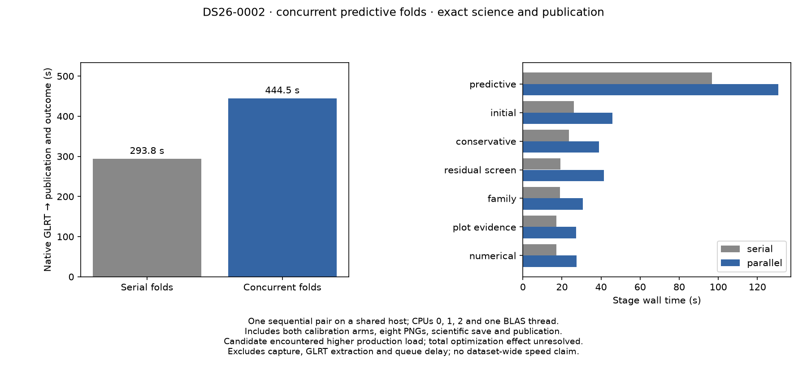
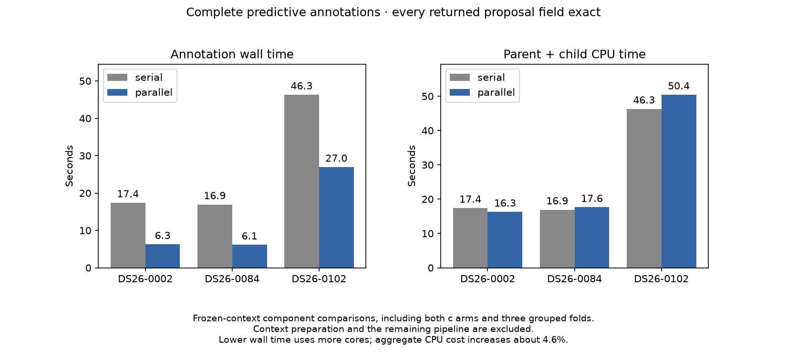

# ALGO07v3: concurrent predictive folds, exact outputs, unresolved total speed

2026-11-05. Development implementation and bounded validation; no deployment.

ALGO07v3 now executes ordinary predictive annotation's independent grouped
folds concurrently. The fresh standalone comparison preserves all persisted
scientific evidence, both calibration arms, associations, eight PNG bytes,
179 grid locations, recorded paths and atomic publication. Its serial control
also matches the previously qualified standalone result exactly.

**This experiment does not demonstrate an end-to-end speedup.** The complete
supervised process takes **293.750 → 444.458 seconds**. The candidate ran after
production load increased: observed load average rose from approximately 10
to 30, CPU pressure increased, and unchanged stages also slowed substantially.
The comparison is useful correctness evidence, but cannot isolate the effect
of fold concurrency on total latency. Both observations remain in the scorecard.

| Interval | Serial folds (s) | Concurrent folds (s) |
| --- | ---: | ---: |
| Native preparation through rendering | 271.435 | 427.021 |
| Scientific projection and save | 13.935 | 9.484 |
| Publication | 5.996 | 5.277 |
| **Complete supervised process** | **293.750** | **444.458** |
| Predictive recovery, included above | 96.692 | 130.611 |
| Initial search, unchanged in this experiment | 26.071 | 45.938 |
| Conservative recovery, unchanged | 23.590 | 38.928 |
| Residual screening, unchanged | 19.233 | 41.559 |

The two runs share CPUs 0, 1 and 2 and one BLAS thread per process. No other
local benchmark ran during either measurement. A production fast-scan process
with 16 GLRT workers and adaptive processing workers were active during the
candidate. They were not interrupted or reconfigured. The
[resource observations](resource-observations.jsonl) document shared-host load;
they do not prove that every timing difference is caused by contention.

See [all stage timings](stage-timings.md), [the exact comparison](comparison.json),
[the serial refactor check](prior-comparison.json) and [machine-readable results](summary.json).
Timing starts with native GLRT ready and ends after scientific storage,
publication and supervisor completion. Capture, GLRT extraction and queue delay
are outside this measurement. The cumulative 10× target remains unproven.

## Implementation

The numerical layer supplies one complete fold calculation. Operations owns
at most three child processes and returns results in the original seed order.
The original fold schedule is selected before workers start, using timestamps
only. Randomized 12-second blocks, guards, training/held membership, nominees,
phase support, priors, both c arms, solver budgets and acceptance gates remain
unchanged. The target never enters receiver calibration during annotation.

Each fold still computes c=0 and fitted-c sequentially. Across the pipeline,
targets, inclusion trials, numerical retries and adoption remain sequential.
Initial-arm concurrency does not overlap fold concurrency. Fork shares the
read-only scan; worker writes and temporary caches are private. Results are
collected over pipes without introducing intermediate scientific files.

Calls with a proposal callback or mutable numerical-policy receipts retain
their original serial behavior. This preserves callback side effects and
ordered replay receipts. The execution port is passed only to ordinary
predictive recovery, not to numerical replay or later recovery policies.

Child failures and cancellation terminate and reap all siblings. Review also
found that process/pipe startup errors could otherwise pass through an ordinary
`Exception` handler as a scientific rejection. The adapter now converts those
infrastructure errors to `JobInterrupted`, aborting the job. This correction
was made after the serial job finished and before the candidate started;
[plan002.json](plan002.json) records the amendment and both declared source
differences. No source was edited while its measured job was running.

## Verification and limitations

The focused suite has 703 passing tests; five additional tests cover the
full-annotation fixture comparator. Tests include ordered completion, private
worker state, three-worker cleanup, failed process startup, cancellation,
stateful serial fallback and execution-port forwarding through the application.
The existing historical annotation oracle is preserved. A separately named
frozen serial annotation is an external test reference only.

The native pair uses DS26-0002's same GLRT, causal archive, region and
presentation-only evaluation site. Both jobs hide old installations, old
results and repository reports, bind native inputs read-only and disable
external networking. The candidate reads no prior algorithm result. Source
changes are explicitly enumerated; no new loaded module is silently ignored.

Persisted recovery decisions do not contain every losing proposal's full
annotation record. A separate frozen-context comparison therefore checks
the complete annotation on DS26-0002, DS26-0084 and DS26-0102 against their
independent historical references, as well as the frozen serial implementation.
Those are fixture replays, not additional full-scan standalone qualifications.
The full proposal comparison and component timings are recorded in
[annotation-comparison.json](annotation-comparison.json).

| Frozen annotation fixture | Outcome, unchanged | Serial wall (s) | Parallel wall (s) | Serial / parallel CPU (s) |
| --- | --- | ---: | ---: | ---: |
| DS26-0002 | Supported identity | 17.420 | 6.261 | 17.413 / 16.275 |
| DS26-0084 | Prediction mismatch | 16.930 | 6.131 | 16.926 / 17.623 |
| DS26-0102 | Unstable identity | 46.320 | 26.958 | 46.312 / 50.436 |

Every returned field matches the independent historical reference in both the
serial and parallel replay, including losing nominees, schedules, training
metadata, phase diagnostics, scores and votes. Summed annotation wall time is
80.670 → 39.351 s, while parent-plus-reaped-child CPU time is 80.651 → 84.335 s.
This is a component latency improvement using more cores, with approximately
4.6% more measured CPU time across the three fixtures. It is not a reduction
in total pipeline compute, nor a full-population throughput result. The longest
fold limits concurrency; speedup need not approach threefold. Production
integration must budget aggregate worker concurrency rather than assume that
every queued scan has three idle cores.

Full DS26 equivalence, broader accepted branches, five remaining historical
audit mappings, metadata semantics and production wall-clock admission remain
open. This change is available in the development CLI; production is unchanged.
The next performance gate is a repeated comparison under comparable resource
conditions, followed by broader dataset qualification. No release or tenfold
speedup claim follows from this single, load-confounded complete-path pair.

Evidence root: `/srv/bulk/leo-dev/algo07v3-predictive-parallel-20261105`.
`render.py --root EVIDENCE_ROOT` checks source/input bindings, successful fresh
executions, comparison receipts and passing test reports before rendering.
