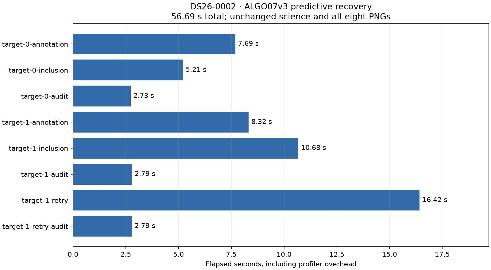

# ALGO07v3 runtime progress and predictive-recovery profile

2026-11-05. Development measurement; production unchanged.

The latest runtime optimization is already committed in `2c8a7445e`: independent
conservative c=0 and fitted-c fits run concurrently. This report adds a targeted
profile of the next expensive stage, predictive recovery. It changes profiling
instrumentation and tests, not the inference algorithm or scientific budgets.

## Measured runtime progress

| Measurement | Before | After | Interpretation |
| --- | ---: | ---: | --- |
| DS26-0002 complete native pipeline, first conservative-concurrency pair | 199.368 s | 192.892 s | Observed 1.034×; exact science and eight PNGs |
| Same scan, reverse-order pair | 320.444 s | 191.880 s | Strong host variation; not an attributable code speedup |
| DS26-0066 conservative stage, three alternating pairs, mean | 73.595 s | 46.980 s | 36.16% lower stage latency; all six stages exactly match |
| DS26-0066 reassociation screens, alternating pairs, summed target means | 16.253 s | 11.407 s | 29.81% lower screen latency; exact screens |

Complete native timing starts with already extracted GLRT and ends after owned
publication and worker supervision. Capture, GLRT extraction and queue delay are
excluded. Component timings are not full-pipeline timings. Do not multiply the
individual speedups or compare different host conditions as a controlled result.

See the [conservative concurrency report](../2026_11_05_algo07v3_conservative_arms/README.md)
for all four fresh-run measurements, CPU totals, figures and the 940-test result;
the [reassociation benchmark](../2026_11_05_algo07v3_reassociation_benchmark/README.md)
contains the screen measurements. The earlier
[original ALGO07 comparison](../2026_11_05_algo07v3_cumulative_repeat/README.md)
measured 642.886 s for the historical path, bracketed by standalone runs of
440.510 and 226.531 s. That variability prevents a stable cumulative speedup
claim. Whole-DS26 equivalence and ordinary production admission remain open.

## Next hotspot: predictive recovery

The new `--only-stage predictive` option profiles predictive recovery and its
forked children while the entire fresh owned pipeline still executes. Child
metadata identifies target, arm, annotation seed and control/new-family variant.
The tool records recovery substages outside the profiled stage too; these must
not be added to predictive recovery. It restores all hooks after execution.

The DS26-0002 run completed successfully in **207.375 s including profiling**.
Predictive recovery consumed **56.693 s**, compared with about **45.902 s** on
average in the two preceding unprofiled candidate runs. This difference is not
a regression measurement: profiling adds overhead, and the runs were not a
matched performance experiment. The source bindings stayed unchanged throughout.



| Predictive operation | Elapsed s |
| --- | ---: |
| Target 0 annotation | 7.689 |
| Target 0 inclusion | 5.212 |
| Target 0 audit | 2.730 |
| Target 1 annotation | 8.322 |
| Target 1 inclusion | 10.680 |
| Target 1 audit | 2.793 |
| Target 1 optimizer retry | 16.424 |
| Target 1 retry audit | 2.790 |

The second target's optimizer retry is the largest individual substage. The
annotation folds total 16.011 s, and three serial audits total 8.314 s. Child
profiles repeatedly identify `hierarchical_bound`, `posterior` and
`_solve_factor` among the largest self-time contributors. New-family likelihood
evaluation adds work beyond the control fit. These observations favor further
investigation of repeated likelihood calculations and audit work; they do not
justify removing retry, audit, holdout or acceptance checks.

Child profile totals overlap in elapsed time and are not additive pipeline
latency or exclusive CPU measurements. Parent-plus-reaped-child CPU per substage
is retained separately in [recovery-substages.json](recovery-substages.json).
The compact [child summaries](children.json) retain top self and cumulative
function timings, labels and raw profile filenames.

## Exactness and validation

The profiled run matches its unprofiled reference in scientific values, scientific
audits, both calibration arms, ownership and **all eight PNG bytes**. Shared
implementation modules are byte-identical; only equivalent Python entry-point
module aliases differ. Timing/accounting fields are excluded by the existing
comparison contract, not by a new exception. See [parity.json](parity.json).

Both arms retain 2,783 of 4,211 GLRT points (66.09%), 74 fragments and 28
satellites. c=0 remains at (37.854825525185696, -122.48777832614799), residual
RMS 76.3332809324593 Hz; fitted-c remains at (37.855019909306286,
-122.48823203934822), RMS 76.1981250553178 Hz. Their previously reported
evaluation errors remain 665.210 m and 697.464 m respectively. Evaluation GPS
does not enter fitting. Causal inputs, priors and holdout assignments are unchanged.

The four profiler tests pass, including real forked workers, exclusion of work
outside the selected stage, child labels, hook restoration and unchanged returns.
This is one fresh scan's profiling qualification, not a population performance
study. No production deployment is included in this commit.

## Reproduce

From the repository, with its Python environment and frozen request available:

```sh
PYTHONPATH=src:tools OPENBLAS_NUM_THREADS=1 taskset -c 0,1,2 python -B \
  tools/profile_algo07v3.py \
  --request /srv/bulk/leo-dev/algo07v3-conservative-arms-20261105/candidate-request.json \
  --output /absolute/fresh-profile-directory --timeout 900 --only-stage predictive

PYTHONPATH=src:tools OPENBLAS_NUM_THREADS=1 python -B \
  reports/2026_11_05_algo07v3_recovery_arms/profile_parity.py \
  --reference /srv/bulk/leo-dev/algo07v3-conservative-arms-20261105/candidate-request.json \
  --profile /absolute/fresh-profile-directory/request.json \
  --output /absolute/fresh-profile-directory/parity.json

python -B reports/2026_11_05_algo07v3_predictive_profile/render.py \
  /absolute/fresh-profile-directory
```

The retained raw run is `/srv/bulk/leo-dev/algo07v3-predictive-profile-20261105`.
The committed [plan](plan.json) binds sources and CPU affinity; the
[profile receipt](profile.json) records completion and publication. Raw per-PID
binary profiles remain on the analysis host; their summaries and the plot are
committed here. The next optimization should be measured in fresh unprofiled
matched runs and must pass the same exactness gates before promotion.
