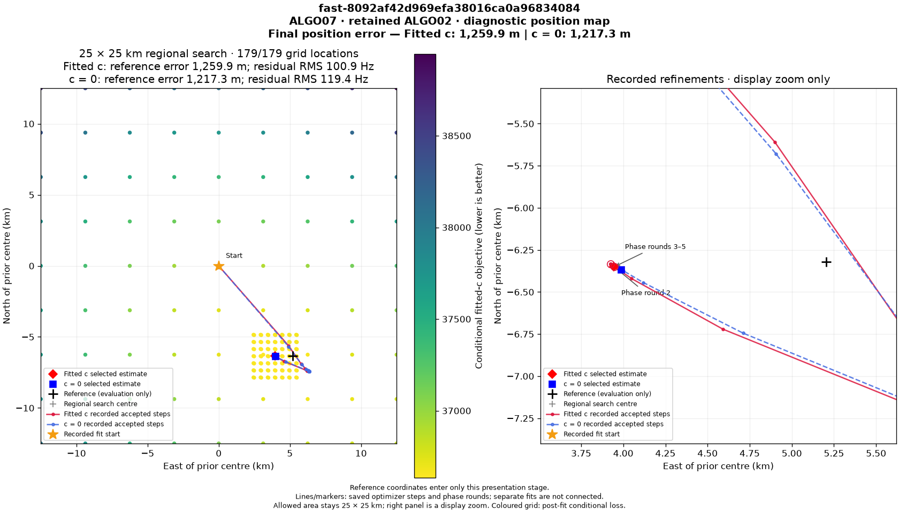
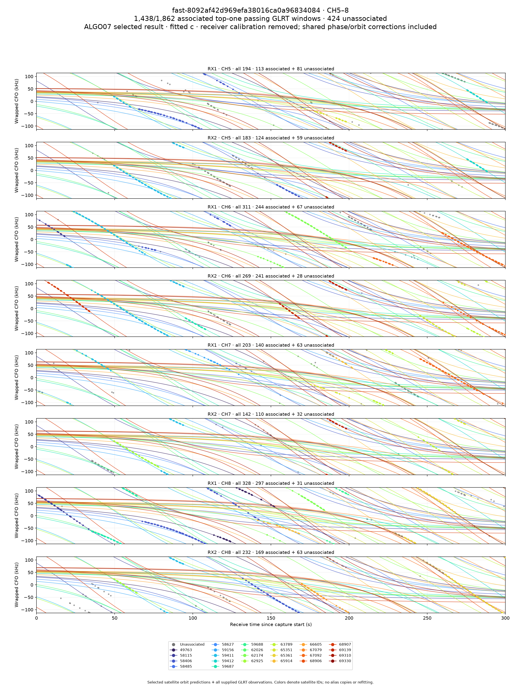

# ALGO07v3: selected-fit plot evidence and eight exact PNGs

The owned presentation adapter now takes the selected numerical likelihood,
native observations, ownership and recorded path as values. It prepares orbital
curves, point predictions, residuals, summaries and the conditional position grid
without launching older workers or reading their result directories. It reuses
the existing PNG renderer unchanged.

On the completed **DS26-0084** production-format fixture, the frozen renderer and
v3 produce exactly equal plot data, **179/179 grid locations**, and **all eight PNG
files byte for byte**. Both calibration arms retain **3,715 of 4,628 observations**
across **121 fragments and 25 satellites**. This verifies one retained-baseline
presentation branch; it is not complete native-input-to-publication qualification.

The position figure preserves the prior 25 × 25 km search layout, recorded
refinement path and final-error annotations: **1,217.3 m for c = 0**, **1,259.9 m
for fitted c**. These are the existing ALGO07 result, not new accuracy gains.
Evaluation coordinates enter only the final image renderer, after prediction
preparation and grid scoring.

## All eight figures

Every image below has an independently verified identical frozen-reference PNG.
Byte counts and hashes are in [figures.md](figures.md) and
[comparison.json](comparison.json).

| Channels | All GLRT and predicted orbits | Unassociated GLRT | Associated residuals |
|---|---|---|---|
| CH1–4 | [All](ch1-4-all.png) | [Unassociated](ch1-4-unassociated.png) | [Residuals](ch1-4-residuals.png) |
| CH5–8 | [All](ch5-8-all.png) | [Unassociated](ch5-8-unassociated.png) | [Residuals](ch5-8-residuals.png) |

The other two figures are [every-fragment RMS](track-rms.png) and the
[position map](position.png).

## Selected state stays in memory

`reassociation_fit.fit_rows` can now retain each qualified endpoint's already
constructed likelihood in a caller-owned state sink. This does not add a fit,
change a solver schedule or alter scientific output. The final controller
transfers only the selected proposal's best qualified fit in each arm through
`on_selected`; incomplete/rejected candidates cannot transfer a selected state.
The application forwards that narrow callback.

The DS26-0066 accepted-replacement comparison was rerun with retention enabled.
The complete scientific result still matches the original final worker exactly,
including **62025 → 68047**, both positions, gates, objective histories and owner
hashes. The retained likelihood's objective and endpoint are also checked against
the selected fit. There is no second optimization or historical-result export
needed to obtain that state for plots.

`leo.presentation.localization_v3.prepare_packet` accepts that state directly.
It checks the selected endpoint and objective, accounts for every published
owner, and emits conditional, predictive and phase-mixture residuals with the
original row ordering. Missing prediction coverage or duplicate native IDs
raise errors. The calibrated orbit adapter retains all 16 RX/channel lanes,
removes the fitted receiver contribution from points, and scales orbital
frequency by each lane's actual RF frequency. Empty lanes preserve the layout;
mixed RF frames in a lane are rejected.

The diagnostic grid retains fixed selected associations and phase linearization.
It evaluates the unchanged marginal likelihood in both calibration arms at the
same locations. It does **not** run the full association pipeline at every grid
point. The matched verification declares a **300-second** real grid budget on
both sides; both finish all 179 locations. Only elapsed-time metadata is omitted
from scientific packet comparison.

## What this proves, and what remains

The production-format fixture is read through the existing validated plot
evidence port. Its historical numerical state is reconstructed only inside the
external qualification harness. The new presentation module itself accepts
in-memory values and has no storage or old-worker dependencies. Candidate tests
hide `/opt` and reject legacy imports, runtime reads and worker launches.
The external harness binds and rechecks the numerical fixture, tool and module
hashes. It also compares every plot value and image, rather than checking only
the displayed endpoint.

The recorded path for this fixture comes from its existing public terminal.
Building that path directly from all owned accepted-stage audit events, wiring
the complete fresh-input engine through artifact publication, and qualifying
atomic publication/restarts remain unfinished. Accepted replacement, additional
family and conditional-gap artifact branches still need broader comparison.
No production deployment or public-contract change occurred.

The focused suite passes **496 tests**, including new tests for point coverage,
RF scaling, empty lanes, stale endpoints, matched grids, qualified state retention
and incomplete-fit fallback. The combined suite initially caught a test basename
collision; the presentation test was renamed before the clean run. The first
artifact harness also tried to read an optional screen absent from this retained
baseline; it now follows the original rule and reads it only for a qualified
additional-family trial.

Observed component durations are recorded in [comparison.json](comparison.json).
They include external fixture reconstruction and run concurrently on a shared
host. They are **not an end-to-end speedup measurement**. Full DS26 equivalence,
complete-path matched timing, standalone deployment packaging and the 10× target
remain open. Complete-path matched scans remain zero.

## Reproduction

`tools/check_algo07v3_presentation.py` accepts `--side reference|candidate`, an
explicit plot-evidence fixture and presentation authority, pinned runtime and
renderer roots, a fresh output directory and the declared grid budget. It writes
all eight PNGs, the complete scientific packet fingerprint and a receipt.
Its current external fixture adapter deliberately rejects selected recovery or
final replacement fixtures it does not yet reconstruct.

Run this report's `render.py` to verify source/input hashes, compare every packet
field and PNG, check the accepted-state retention comparison and test receipt,
and copy the verified figures into this report.
