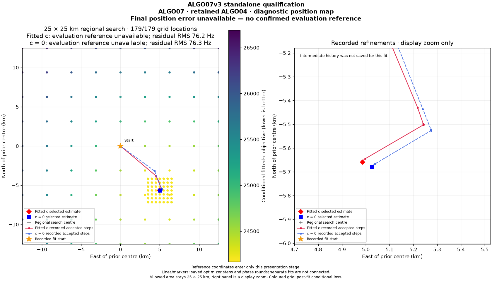
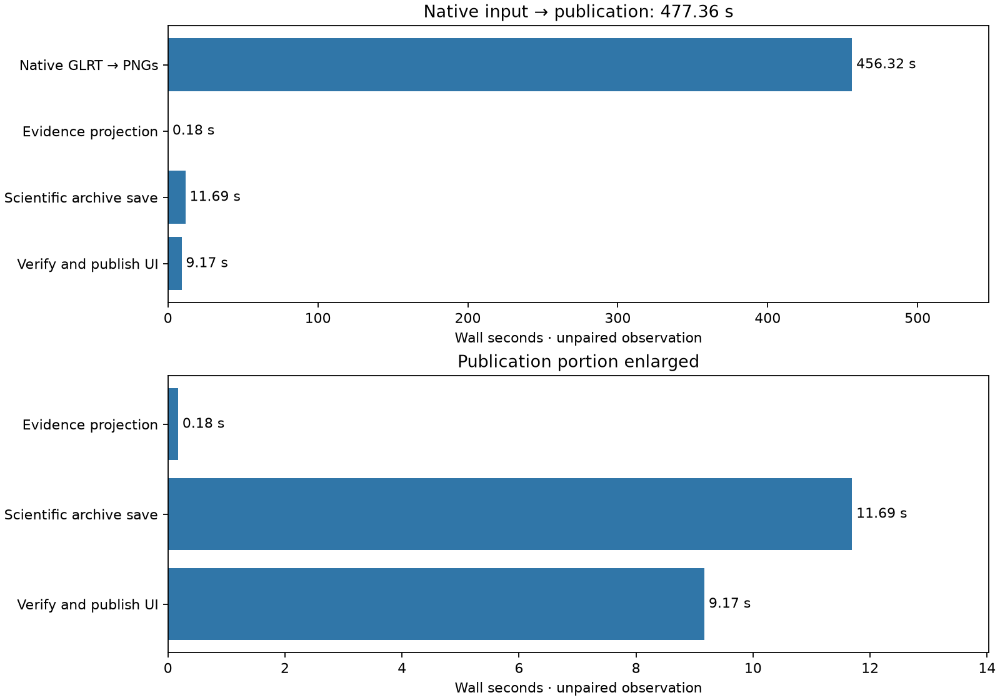
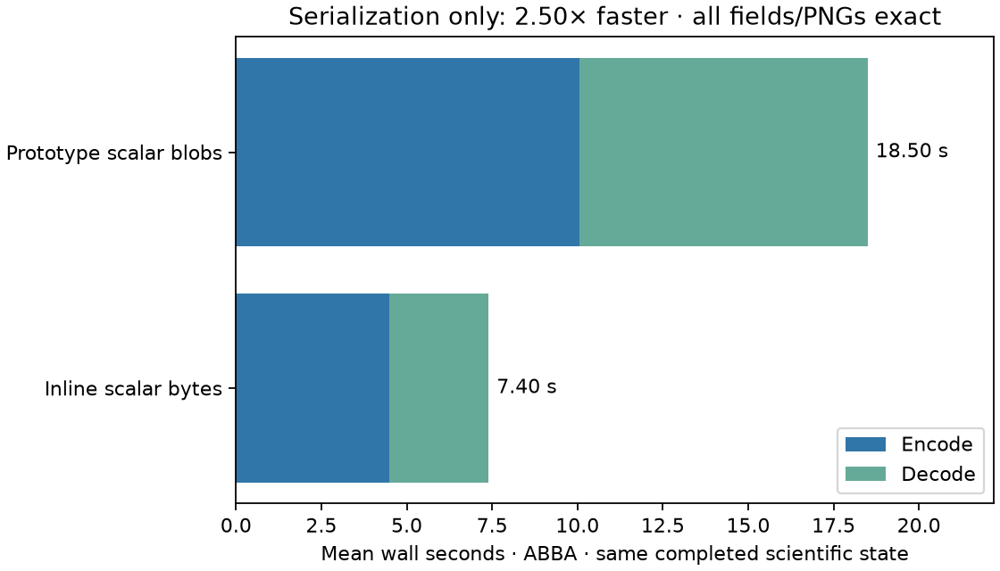

# ALGO07v3: standalone scientific persistence and atomic WebUI publication

2026-11-05. Development qualification; no deployment.

ALGO07v3 now runs from native GLRT through its own persisted scientific result
and the existing standard WebUI publication interface. On DS26-0002, the isolated
native run completes all policies, saves scientific evidence, publishes all eight
PNGs and both sidecars, reloads its evidence and preserves the entire previous
scientific/PNG comparison exactly. No older worker or scientific result is a
runtime input. Production execution controls and population qualification remain
open.

**Complete-path speedup remains unmeasured.** The first native-to-publication
candidate observation is **477.365 s**. There is no matched complete baseline,
and this run used the initial archive encoding. The subsequent encoding change
is qualified separately on the same completed scientific state, not by claiming
a synthetic new native-to-publication time.

## What now works

The owned [result application](../../src/leo/application/localization_v3_result.py)
projects completed scientific state into explicit evidence, including both arms,
every policy's audit, selected owners, coefficients, phase/state values, residuals,
input preparation, causal catalogue and plot inputs. It uses no historical
terminal. The [result store](../../src/leo/storage/localization_v3.py) writes
content-bound scientific evidence and PNGs, then commits an immutable receipt.
Only afterward does the application call the existing standard publication port.

The standard manifest remains the UI visibility boundary. PNG, grid and path
contracts are unchanged. The public `terminal_sha256` points to the new owned
scientific receipt; provenance identifies `algo07v3-exact-v1`, while the scientific
policy label remains ALGO07. The native result can repeat publication without
refitting, archive reads or rendering. A conflicting evaluation reference cannot
silently replace the reference used by the figures.

See the [result and restart-boundary documentation](../../docs/operations/algo07v3-result.md)
for contract, encoding and port details. This is final-result restart capability;
mid-optimizer restart and production cancellation remain unqualified.

## Native scan evidence

The candidate received only the native GLRT input, track configuration, explicit
search/screen centers and causal archive. The private mount/network namespace
hid `/opt`, previous bulk results and repository reports. The input bundle was
read-only and no older service was reachable over the network. These conditions
were inspected against the live process and saved in the evidence receipt.

| Quantity | c = 0 | Fitted c |
|---|---:|---:|
| Native GLRT points | 4,211 | 4,211 |
| Associated points | 2,783 | 2,783 |
| Associated percentage | 66.089% | 66.089% |
| Published polynomial components | 74 | 74 |
| Satellites | 28 | 28 |
| Residual RMS | 76.333 Hz | 76.198 Hz |

The complete comparison digest is unchanged:
`4f7c74a132b415e9bd6e130dcbc0d7082fa72c822d53f76810f8a9fa13323d68`.
This covers the earlier numerical policies, both arms, owners, full grid/path
data and PNG hashes. It is not an endpoint-only comparison. All 179 grid locations
complete. This retained-incumbent case does not prove every accepted recovery
branch from native inputs or full DS26 parity.

The report generator reads the real publication through the unchanged ASGI HTTP
routes: detail, eight digest-bound PNG URLs, grid and path all return successfully.
Stale PNG digests return 404. Every response PNG matches both the saved scientific
archive and the previously published exact image. This is local API qualification,
not live production deployment.

All [eight unchanged figures](../2026_11_05_algo07v3_connected_presentation/README.md)
are linked rather than duplicated. The qualification renderer deliberately had
no evaluation reference. The previous report also provides a separately rendered
evaluation-only position figure; no evaluation GPS enters this inference.

## Timing scope

| Stage | Observed seconds |
|---|---:|
| Native input verification/preparation → rendered PNGs | 456.325 |
| Evidence projection | 0.175 |
| Initial scientific archive save | 11.694 |
| Read/verify saved result → atomic UI publication | 9.171 |
| **Native input → UI publication** | **477.365** |
| Including subsequent external verification/comparison output | 500.504 |

The timer starts before owned adapter imports and native input verification. It
ends when the standard publication manifest is available. Acquisition, native
GLRT extraction, queue delay and later external comparison serialization are not
inside the 477.365 s. This was a shared-host run, not a controlled comparison to
the earlier 311 s rendering-only observation. There is no justified ratio between
those unequal scopes and execution conditions.

## Measured optimization: scalar evidence encoding

The initial archive had **280,867 distinct NPY entries** and occupied **211.518 MB**.
Many entries were individual NumPy scalars, each carrying a file header and ZIP
entry. Before publishing the new contract, scalar encoding was changed to inline
dtype plus exact byte hex. Structured scalars and true arrays retain NPY metadata.
The decoder still reads the initial qualification artifact. No numerical work,
dtype information, scalar bytes or audit field is discarded.

The [ABBA benchmark](codec-abba.json) uses one completed native scientific state
and compares the explicitly pinned initial codec with the revised codec. Every
restored field is independently fingerprinted outside timing; all PNG bytes are
also checked. Neither branch skips science, because no fitting occurs in this
serialization benchmark.

| Completed-evidence operation | Initial codec mean | Revised codec mean |
|---|---:|---:|
| Encode | 10.061 s | 4.490 s |
| Decode | 8.440 s | 2.910 s |
| **Encode + decode** | **18.501 s** | **7.400 s** |
| Archive size | 211.518 MB | 79.902 MB |

That is **2.50× faster serialization** and **62.2% less archive space** on this
case. These are component results, not an end-to-end speedup. A separate replay
of the optimized save and public publication succeeds in **19.780 s**, including
filesystem work, with every PNG and sidecar binding intact and idempotent retry.
Its save/publication portions are 14.592/5.188 s. These observations demonstrate
why the encode/decode ratio must not be applied to filesystem publication or to
the full pipeline. A fresh native full-path matched benchmark remains required.

## Tests, provenance and remaining gates

The current focused suite passes **588 tests**, including the original numerical
oracle/comparator tests, selected-state presentation tests, new contract/store
tests and the existing standard HTTP route tests. There is one dependency
deprecation warning from Starlette's test client; no tests fail or skip.

New checks cover lossless scalar/array round trips, shared array storage,
structured values, mutation/corruption rejection, incomplete manifest writes,
immutable retries, cross-scan/path rejection, both-arm ownership/endpoint
consistency, post-fit evaluation references and publication after an injected
interruption. A projection test compares persisted/reloaded evidence with the
unchanged prior scientific comparator, including fields outside final endpoints.

The [comparison](comparison.json), [bindings](artifact-bindings.json),
[HTTP artifact evidence](HTTP-artifacts.json) and [codec benchmark](codec-abba.json)
record exact sources and outputs. The first native run's source files are frozen
in its bound evidence directory so later codec edits cannot be mistaken for the
code that produced its timing. Configuration parameters are saved separately
and checked against the scientific evidence's configuration digest.

Still required:

1. Production run CLI and qualified cancellation/deadline behavior.
2. Accepted-recovery native cases and the full DS26 denominator comparison.
3. A matched complete baseline/current timing pair; complete-path matched scans
   remain zero despite the first completed candidate publication.
4. The 10× complete-path target and separate unchanged-detector/capture metrics.

No deployment occurred. The report's `render.py` verifies and regenerates its
tables/charts. Its `replay.py` exercises optimized publication from completed
evidence in a fresh local output tree and never starts a numerical fit.
