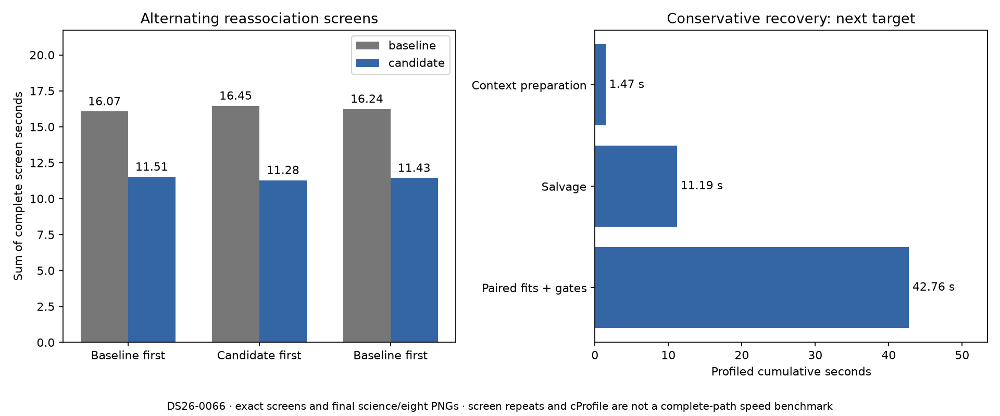

# ALGO07v3: isolate reassociation timing and profile conservative recovery

2026-11-05. Measurement follow-up to the
[reassociation interpolation change](../2026_11_05_algo07v3_reassociation_geometry/README.md).
Production remains unchanged. This iteration changes research instrumentation,
tests and documentation; runtime inference is still commit `7bc9bf937`.

Three alternating pairs over both nominated families average
**16.253 → 11.407 seconds**, **29.81% less screen wall time**. CPU time averages
**16.251 → 11.406 seconds**, also **29.82% lower**. All **12 complete screens**
match exactly. The completed instrumented pipeline also matches both calibration
arms, all scientific audits and all eight PNG bytes from the unchanged native
reference. This establishes a roughly **4.85-second component saving** on this
scan, not a 29.81% complete-pipeline gain.

## Why another measurement

The preceding fresh complete DS26-0066 pair was slower, **549.558 → 653.906 s**,
despite exact science and artifacts. CPU time also rose **747.06 → 933.05 s**.
Several unchanged stages slowed down as CPU pressure increased, but those
observations do not identify how much of the regression came from contention,
cache or frequency effects, or the edit itself. That negative result remains
part of the evidence.

This follow-up alternates complete old/new reassociation screens on the same
live native context. It also profiles the conservative stage to select the next
optimization from measured cost.



See [summary](summary.json), [every screen execution](screens.json),
[final parity check](parity.json), and [instrumented run receipt](benchmark.json).

| Pair order, repeated for each target | Baseline summed screen s | Candidate summed screen s |
| --- | ---: | ---: |
| Baseline first | 16.065 | 11.512 |
| Candidate first | 16.455 | 11.278 |
| Baseline first | 16.237 | 11.432 |
| Mean | **16.253** | **11.407** |

The targets nominated by native inference are NORAD **62025 and 63649**, each
screened against **11,131 propagated causal candidates**. The full instrumented
run takes **628.387 seconds**, including all extra repetitions and profiling;
it is not a new baseline/candidate speed pair. No runtime source changed during
the measurement. The parity check permits only the explicitly audited CLI
entry-point name aliases; their source bytes and all shared implementation
modules match.

## Measurement method

The new [benchmark tool](../../tools/benchmark_algo07v3_reassociation.py) runs a
fresh owned CLI worker from the same DS26-0066 native request in a private output
store. It uses CPUs 0–2 and one BLAS thread. At each actual reassociation screen,
it performs the normal current invocation, then runs three alternating pairs:
baseline/candidate, candidate/baseline, baseline/candidate. During these pairs
the process uses CPU 0 only. Affinity and patched call boundaries are restored
even on failure. The normal current invocation's result is returned to the
pipeline, and every repeated complete result must match it exactly.

The benchmark covers cavity refits, coarse orbital nomination, fine phase
scoring, predictive folds and proposal construction. It excludes catalogue
propagation and later admission guards, which are outside the screen function.
It uses the actual nominated targets and causal catalogue from native inference,
not a hand-picked satellite subset. Repeated executions use a warmed live
context; this is explicitly a component benchmark.

The baseline is the frozen pre-change screen, SHA-256
`1a4bdceb73c75a3638c63f0fff74ea34cf1a5b4932c54f9fd29f1cca102b8750`.
The only algorithmic difference in each pair is sharing phase interpolation
across the two independently fitted receiver positions. All fitting budgets,
nominee order, randomized folds and acceptance calculations are retained.

The full instrumented clock includes extra screen repetitions and conservative
cProfile overhead. It must not be compared with 549.558 or 653.906 seconds as a
new complete-path speed result. The earlier cumulative original-ALGO07 versus
v3 evidence also remains [separately scoped](../2026_11_05_algo07v3_cumulative_repeat/README.md).

## Conservative recovery: next opportunity

The isolated conservative profile takes **55.625 seconds wall / 55.618 seconds
CPU**. Its cumulative costs are:

| Work | Calls | Profiled cumulative seconds |
| --- | ---: | ---: |
| Paired fitting and rejection rounds | 2 | 42.765 |
| Individual arm fits, inside those rounds | 8 | 42.034 |
| Salvage, including its repair fit | 1 | 11.186 |
| Hierarchical likelihood, across the stage | 1,546 | 38.650 |

These rows overlap and must not be added. The
[portable function summary](summary.json) and [raw cProfile data](conservative.pstats)
retain the accounting. Profiling perturbs runtime; its role is identifying work,
not establishing a speed ratio.

The next prototype should map each independent c=0/fitted-c pair through the
existing ordered executor. Rejection-mask updates, salvage and phase rounds
must remain sequential. Return compact fit/metric records from children and
reconstruct the parent-side likelihood if needed, avoiding transport of the
large scan and its caches. Test union-of-rejections behavior, empty-mask handling,
callback order and child-failure propagation. Measure per-arm time to quantify
load imbalance; halving the whole stage is not a justified forecast.

After component qualification on the exported native DS26-0066 preparation,
run a fresh isolated full DS26-0002 comparison with the unchanged reference.
Require exact both-arm audit, ownership, eight PNGs and publication. Full DS26,
ordinary production admission and the tenfold goal remain open.

## Tests and reproduction

Six tool tests pass: alternating order, every-screen equality, bounded repeats,
profiling receipt, hook and affinity restoration, and mismatch failure without
a success receipt. [Test results](tests.xml) are retained. The runtime suite's
preceding 926-test result remains in the linked integration report; this
measurement iteration does not change runtime code.

From the active checkout with the pinned interpreter:

```sh
PYTHONPATH=src:tools OPENBLAS_NUM_THREADS=1 taskset -c 0,1,2 python -B \
  tools/benchmark_algo07v3_reassociation.py \
  --request /srv/bulk/leo-dev/algo07v3-reassociation-geometry-20261105/candidate-request.json \
  --output /absolute/fresh-output --timeout 1200 --repeats 3
```

The [plan](plan.json) binds all runtime source files, the request, benchmark and
oracle tools. Raw outputs remain at
`/srv/bulk/leo-dev/algo07v3-reassociation-benchmark-20261105`.
The profiling skill now includes this command and its timing limitations.
Evaluation coordinates remain presentation-only; inference uses the same causal
catalogue and regional prior as the preceding native run.
