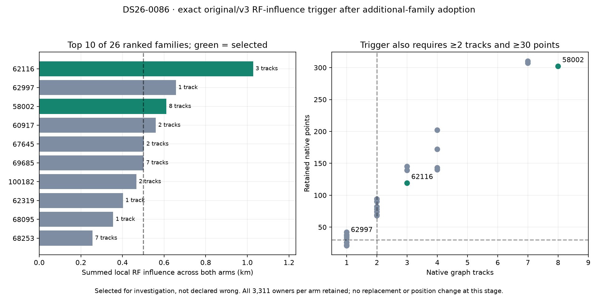

# ALGO07v3: final-stage handoff, RF influence and acceptance policy

The accepted additional-family likelihood now has an owned handoff into final
ALGO07 reassociation. On DS26-0086, the frozen engine and v3 produce identical
complete scientific outputs for reconstruction, native ownership, nearby-position
likelihood probes, family omissions and the RF-influence trigger. Both preserve
**3,311 associated points per calibration arm** and select **62116 and 58002** for
further investigation. The output SHA-256 is
`a9a8b184e86e3cf91f792ff0feedaad591968e8f6b07653ac9c73ade94a01991`.

The final acceptance policy also matches six reference decisions, including an
accepted historical identity repair, an unchanged fallback and four deliberately
invalid admissions. The focused suite passes **424 tests**.

This is not the complete reassociation pipeline. Candidate nomination, receiver-
shared predictive checking, causal-history completion and replacement fits still
need owned integration and qualification. All eight final WebUI artifacts and
whole-population equivalence remain unfinished. **No deployment or end-to-end
speedup is claimed.**

## Handoff and numerical fidelity

The handoff consumes an explicit selected-context factory, both saved arm results,
both owner maps, the selected trial descriptor, the additional-family result,
screen, catalogue and native observations. It does not search prior worker output
directories or start an older ALGO process.

For a qualified addition it reconstructs the native target and requires an exact
entry match. It restores the shared family mixture, saved phase references and
position endpoints, then recomputes the complete likelihood. Both arms of both
the original control and added-family trial must have passed. Duplicate native
owners, changed entries, incomplete pairs and objective replay mismatches are
rejected. Rejected/no-addition trials keep the previous selected arms and owners.
The caller's published owner maps are not mutated.

The frozen additional-family stage uses direct joint-density contractions, while
the frozen final ALGO07 stage uses optimized contractions. V3 preserves this
stage distinction explicitly. The existing additional-family default remains
unchanged; final reassociation requests its original contraction order. This
preserves operation ordering rather than loosening the equality comparison.

In the DS26-0086 comparison the added-family objective replay differences and
rebuilt-objective differences are **zero in both arms**. The 26 newly accepted
points from NORAD 67652 survive into the final-stage owner maps. Tests also cover
conditional shared-family attachments: omitting a family removes all its active
evidence and associated predictive terms, while retaining other conditional
attachments. Full real-fixture qualification of the gap/shared incumbent branches
in this new final-stage handoff is still outstanding.

## What the trigger computes

At each arm's retained position, central finite differences with a 50 m step
estimate the complete objective's gradient and Hessian. For each active graph
family, the engine omits that family and recomputes the gradient. Multiplying the
gradient change by the Hessian pseudoinverse estimates a local displacement.
The two arms' displacement magnitudes are summed for ranking.

The original admission criteria remain: summed influence at least **0.5 km**,
at least **30 retained native points**, and at least **two graph tracks**. At most
the top two eligible families are investigated. The computation does not use
evaluation coordinates or observed position error. Influence is a trigger for
investigation, not proof that a satellite identity is wrong.

| DS26-0086 family | Summed local influence | Native points | Graph tracks | Trigger result |
|---|---:|---:|---:|---|
| 62116 | 1.027886 km | 119 | 3 | Selected |
| 62997 | 0.656465 km | 36 | 1 | Excluded: only one track |
| 58002 | 0.611157 km | 302 | 8 | Selected |
| 60917 | 0.560033 km | 68 | 2 | Below the two-family selection cap |
| 67645 | 0.502895 km | 78 | 2 | Below the two-family selection cap |
| 69685 | 0.501597 km | 310 | 7 | Below the two-family selection cap |

All **26 ranked families**, not just these rows, match exactly against the frozen
engine. The external oracle also compares complete state/calculation snapshots
at the retained endpoint and full objectives at a nearby (+0.2, −0.1) km point,
both with and without each selected family.

## Final acceptance policy

The owned selector preserves the original physical acceptance, positive paired
RF-gain and ownership requirements. A receiver-shared guard must pass with at
least five distinct held partitions, no missing fits and a strictly positive
minimum competitor margin. Both arm fits must pass qualification, exact gates,
phase closure, optimizer completion and interior mixture support. Candidate and
control native-ID hashes must agree. Losing native points or unexpectedly
reassigning them prevents adoption.

The best admissible identity repair is chosen by summed paired penalized RF gain,
then name for a deterministic tie break. With no admissible repair, the exact
baseline is retained. Geographic errors are opaque output metadata and cannot
affect selection; tests deliberately change them to verify this separation.

The six exact external policy checks use the archived **DS26-0066 research
canary** and a real fallback record. They preserve the accepted `62025_to_68047`
choice and test four broken admissions: failed phase closure, unmatched native
evidence, insufficient distinct folds and zero gain in one arm. This replays
the selector over supplied evidence; it does not rerun that case's discovery,
guard or joint optimization, and is not new independent validation.

## Connected run and runtime limits

The application now connects additional-family fitting to final-stage restoration
and ranking through `prepare_reassociation` and `rank_reassociation_families`.
The connected DS26-0002 test starts from its owned prepared native input. It
preserves every previously validated output through additional-family selection,
and all **2,783 incumbent owners per arm** remain present. Its new handoff and
trigger are recorded separately; they do not mark recovery or publication complete.
The handoff has zero rebuilt-objective difference in both arms. The trigger ranks
27 families and nominates **69265** (128 points across four tracks; summed RF
influence 0.702423 km). This connected prefix took **381.182 seconds**. Its new
ranking has not yet received a separate original-engine comparison on the fresh
selected state; the complete original/v3 ranking comparison above is DS26-0086.

For DS26-0086, the full scoped handoff/likelihood/trigger reference and candidate
observations are **304.143 and 284.512 seconds**. Those runs overlap on a shared
host and are not a controlled speed benchmark. Exact component and connected
prefix timings are in [comparison.json](comparison.json). Native preparation,
remaining reassociation and artifact publication are excluded. Complete-path
matched scans remain **zero** and the 10× end-to-end target remains open.

## Reproduction and evidence

`tools/check_algo07v3_reassociation_context.py` runs the original `engine.load_case`
and `rank_families`, or their owned counterparts, on an explicit historical
fixture. Its fixture adapter currently supports baseline or single-new-family
incumbents; it refuses unsupported gap/joint adapters. The runtime implementation
accepts values rather than those historical paths. Candidate runs hide `/opt`
and reject legacy imports, reads and process launches.

`tools/check_algo07v3_reassociation_policy.py` independently compares the selector
and deliberate rejection cases. `tools/check_algo07v3_position.py
--reassociation-trigger` exercises the connected implemented prefix using the
same declared search region, observation inputs and budgets as preceding tests.

The evidence root is `/srv/bulk/leo/research/algo07v3-20261104/reassociation001`.
Run `render.py` in this report directory to verify input/source/output bindings,
check complete exact comparisons, verify the unchanged earlier prefix, check
the test XML and regenerate the figure. [artifact-bindings.json](artifact-bindings.json)
records the evidence hashes. Full source and report data are committed together.

Next: connect the unchanged candidate screen and receiver-shared predictive guard,
then causal history and matched replacement/control fits. Finish artifact
publication and full-DS26 qualification before claiming a standalone replacement
or a complete-path performance improvement.
