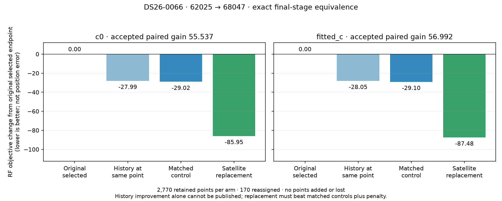

# ALGO07v3: complete guarded numerical reassociation

The remaining final-stage numerical logic now belongs to v3: causal-history
completion, family remapping, matched constrained fits, exact orbit/ownership
audits, paired score bounds, fallback and final selection. Older ALGO workers
are used only by the external comparison harness.

On the DS26-0066 research canary, the complete frozen final worker and the owned
controller choose **62025 → 68047** with exactly equal scientific outputs.
Both preserve **2,770 associated points per arm**. They reassign **170 existing
points**, add none and lose none. The predictive admission used 140 curved points
in five graph tracks; attached evidence follows the whole-family identity change.

| Quantity | c = 0 | Fitted c |
|---|---:|---:|
| Original selected objective | 26,315.279 | 26,326.577 |
| Same endpoint, completed incumbent history | 26,287.285 | 26,298.528 |
| Best matched control | 26,286.255 | 26,297.480 |
| Best qualified replacement | 26,229.331 | 26,239.102 |
| Paired improvement after shortlist penalty | **55.537** | **56.992** |
| Retained associated points | 2,770 | 2,770 |
| Reassigned points | 170 | 170 |

These are RF objectives, not localization errors. Better in-sample frequency fit
does not establish better position accuracy. The purpose of this iteration is
exact reproduction of the existing scientific decisions, not a changed model.

## What now runs independently

`reassociation_history.complete_history` accepts an explicit causal catalogue,
scan receipt and read-only collection callback. It preserves existing valid
previous epochs. Missing history is requested only after inherited predictive
admission and the primary receiver-shared uniqueness check pass. The owned
archive adapter preserves the original archive ordering and first encountered
receipt for equal epochs, within the 72-hour collection window. A prior epoch
must precede its nominal epoch by at least one second.

This case fills incumbent history for **58109, 65922 and 69841**. The proposed
satellite then receives previous evidence for **68047**. New TLE text, provenance,
phase forecasts, uncertainty caches and predictive mixtures are reconstructed
on a private scan. The original likelihood remains unchanged. All TLE collection
and nominal epoch checks remain causal; no evaluation position enters fitting.

`reassociation_remap.remap` changes the nominated graph sources and their
attached predictive evidence. Other families, native masks and ownership remain
protected. Newly required nominal satellites are propagated into the scan's
own orbit bank. New phase means are forecast from causal history; existing
family means are retained.

`reassociation_fit.fit_rows` runs both calibration arms from the same two starts:
the original selected fitted-c endpoint and the family-omitted fitted-c endpoint.
Controls and replacements use the original 15 phase-refresh rounds, 0.01-second
closure tolerance, ±30-second phase domain and 40-iteration constrained solver.
Every result includes the original residual gates, exact orbital replay,
predictive mixture checks, phase-interior mass, optimizer completion, native-ID
hashes, ownership hashes and reassignment scope. All **eight fits** match the
frozen implementation exactly, including histories and non-winning starts.

`reassociation_recovery.recover` requires all four controls and all four candidate
fits to complete. An incomplete fit retains the exact original baseline; it
cannot publish a winner from only the completed starts. Qualified controls are
bounded by the best control objective, the original published objective and the
original endpoint evaluated under matched completed history. A replacement must
beat that bound in both arms after the existing shortlist penalty. A history
change alone is never published. Proposals are compared independently against
the same incumbent; they are not chained.

The application connects these functions through `fit_reassociation`. Its
`recovery_complete` flag describes numerical recovery completion, not artifact
publication or population qualification. The external CLI exposes
`--reassociation-complete`, with an explicit history-bank input when a proposed
replacement actually needs history collection.

## Evidence and limitations

The complete final-stage test starts from an explicit selected-incumbent fixture.
It compares the frozen worker's RF influence trigger, both targets, causal
propagation classification, predictive guards, completed history, matched score
bounds, final fit records, selection and exact final positions. Candidate runs
hide `/opt` and reject legacy imports, file reads and process launches.

The research canary deliberately has **no public WebUI terminal**. Its reference
harness therefore marks public preflight unavailable and tests the complete
numerical worker only. It does not invent a terminal or claim publication parity.
Operational file paths, process elapsed time and file hash metadata are excluded
from scientific comparison and recorded separately. Diagnostic trigger arrays
are compared in the same JSON representation used by the frozen worker, without
rounding or tolerance changes.

A connected DS26-0002 prepared-input run reaches final numerical recovery in
**273.407 seconds**.
The report renderer requires every earlier scientific field to match the previous
committed run exactly. This case admits no replacement and retains **2,783 owners
per arm**. It exercises the connected unchanged-result branch; it is not an
independent original-versus-v3 replay of the entire pipeline from native input.

The component, application, archive-adapter and tool suite passes **483 tests**.
Tests cover causal boundaries, missing history, immutable incumbent state,
attached-evidence remapping, both-arm fit schedules, incomplete fits, mismatched
baseline authority and isolated callbacks. The initial extraction caught and
fixed a local variable collision before the all-eight-fit exact comparison.
The first combined test collection also caught duplicate test module basenames;
the archive test was renamed before the clean suite.

Timing observations and immutable artifact bindings are in
[comparison.json](comparison.json) and [artifact-bindings.json](artifact-bindings.json).
The reference final-worker harness reconstructs and ranks the fixture again;
the candidate uses its already restored context. These concurrent shared-host
durations are **not a controlled speed comparison**. The connected run excludes
native preparation and all WebUI artifact publication. No complete-path speedup
is established; the 10× target remains open.

No deployment occurred. Remaining work includes all eight artifact generators
and publication, cancellation/checkpoint qualification, accepted recovery from
fresh native inputs across the population, full DS26 equivalence and controlled
complete-path performance measurement. Complete-path matched scans remain zero.

## Reproduction

Run `tools/check_algo07v3_reassociation_context.py` with `--side reference` or
`--side candidate`, explicit `--input`, `--screen`, `--catalogue`, `--recovery`,
`--runtime` and a fresh `--output`. `--complete-final` compares the complete final
numerical controller. `--history-export`, `--history-screen`, `--history-proposal`,
`--proposal-history-export` and `--history-fits` additionally compare all eight
fits and complete before/after likelihood snapshots. These are external oracle
fixtures, not production dependencies.

Run this report's `render.py` to verify current source/input/tool bindings, compare
all scientific fields, check the connected earlier-output fingerprint and test
receipt, and regenerate the figure and machine-readable summary.
