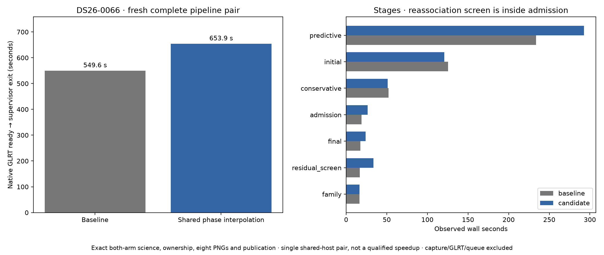

# ALGO07v3: reuse orbital interpolation during reassociation

2026-11-05. Development integration; production unchanged.

The fresh complete DS26-0066 comparison passes exactly, including both
calibration arms, scientific audits, ownership, all eight PNGs and publication.
Observed elapsed time is **549.558 → 653.906 seconds**, **104.348 seconds longer
(18.99%)**, an observed baseline/candidate ratio of **0.840×**. This pair does
**not** demonstrate a speedup. Substantial slowdowns occur in unchanged stages
alongside rising host CPU pressure; an alternating component benchmark and a
controlled complete-path repeat remain necessary for a performance claim.

This iteration extends the previously qualified residual-screen optimization to
reassociation screening. For each phase and observation-time grid, the two
calibration arms now share orbital interpolation and Earth-rotation correction.
They retain independently fitted receiver positions and the original Doppler,
visibility, score, nomination and acceptance calculations.

## Complete-path qualification

The fresh baseline/candidate pair uses **DS26-0066**, a scan that accepts guarded
satellite reassociation. The baseline is commit
`d9745f5ff0143d6246509b64c3e90b63e77bf136`; the candidate changes only
`leo.analysis.localization_v3.reassociation_screen`. Both already include the
shared `screen_geometry` helper and the preceding residual-screen optimization.

See [machine-readable summary](summary.json), [exact comparison](comparison.json)
and the runtime figure below for the measured result. Timings cover native GLRT
input through inference, all eight PNGs, private publication and supervisor exit.
They exclude capture, native GLRT extraction and queue waits.

| Measured scope | Baseline seconds | Candidate seconds |
| --- | ---: | ---: |
| Complete pipeline and publication | 549.558 | 653.906 |
| Initial fitting (unchanged) | 125.417 | 120.794 |
| Conservative recovery (unchanged) | 52.250 | 51.151 |
| Predictive recovery (unchanged) | 233.804 | 292.598 |
| Residual screen (unchanged this iteration) | 16.754 | 33.689 |
| Admission, including changed reassociation screen | 19.028 | 26.577 |
| Final fit (unchanged) | 17.681 | 23.875 |

Both runs select `algo07-causal-guarded-reassociation-v1`. Both arms retain
**2,770/3,927 GLRT points (70.54%), 89 fragments and 20 satellites**. The c=0
endpoint is **37.85971669372918, −122.49009926661317**, with residual RMS
**88.12274800877016 Hz**. The fitted-c endpoint is
**37.85958863924463, −122.4896053030657**, with RMS **86.98662872563048 Hz**.
All these values are exactly unchanged; this is a runtime edit, not a
localization-accuracy improvement.

The comparison is one sequential baseline/candidate pair on a shared host, using
CPUs 0–2, one BLAS thread, fresh output stores and a 1,200-second outer timeout
per run. It is not an alternating benchmark or a population speed estimate.
Host CPU-pressure `some avg60` was 0.18% at baseline completion; the candidate
encountered substantially higher pressure later in its execution. Retained
start/end snapshots document the changing conditions, but do not by themselves
quantify the causal contribution of contention. The slowdown remains part of
the evidence, rather than being discarded as an outlier.
GNU time reports **747.06 → 933.05 CPU seconds** (user plus system), so the
regression cannot be described solely as waiting for CPU scheduling. Maximum
reported RSS is **2,198,064 → 2,198,852 KiB**; this is the process-tree maximum
reported by GNU time, not summed concurrent memory. These measurements require
further investigation before attributing the runtime difference to the code or
the shared host.
The changed screen is within the `admission` stage; changes in other stages
cannot be attributed to this edit. The original ALGO07-to-v3 cumulative timing
remains the separately measured
[642.886-second reference and 440.510/226.531-second v3 runs](../2026_11_05_algo07v3_cumulative_repeat/README.md),
with the host-load limitations documented there. Ratios from these different
scans and runs must not be multiplied.

## What changed and why it preserves the calculation

The original screen handled each calibration arm separately. After fitting the
position with the target family omitted, it scored the two longest tracks at
31 phase values from −30 to +30 seconds. Both arms repeated orbital interpolation
for identical satellite states, times and phase values.

The new screen first calculates the two cavity fits in their original order.
It then interpolates once per track and phase, projects the resulting states at
each cavity position, and accumulates each arm's minimum scores independently.
It emits coarse nominees in the original arm-major order, including stable
handling of tied track lengths. Subsequent fine fitting, randomized holdouts,
replacement proposals, priors and guarded acceptance remain unchanged.

The helper holds only the current phase's states and projected grids. There is
no persistent cache, reduced-precision approximation, new satellite preselection
or reuse of a previous localization result. The two arms do not share their
fitted receiver position or nuisance parameters. Evaluation coordinates enter
only presentation and error reporting.

## Validation and scope

The broader component suite passes **926 tests**, with zero failures, errors or
skips. Five focused tests bind the frozen original source and compare complete
screens for retained candidates, mixed-family evidence, an invisible incumbent
and tied track lengths. These use real orbital projections and coarse/fine
screen calculations, with stubbed cavity refits at distinct receiver positions.
They check complete fingerprints, refit order and arm-major receipt order.

The native comparison additionally checks complete scientific evidence and
audits, both c=0 and fitted-c outputs, point/satellite ownership, all eight PNG
bytes, published fields and the position grid/path. Timing and declared source
provenance are compared separately. Existing random holdout seeds and groups
are unchanged. Private mount/network isolation prevents use of old installations
or stored legacy results during inference.

The frozen [serial oracle](../../tools/algo07v3_prereassociation_geometry_oracle.py)
has SHA-256
`1a4bdceb73c75a3638c63f0fff74ea34cf1a5b4932c54f9fd29f1cca102b8750`.
It is external test evidence, never a runtime import. See the
[component tests](../../tests/analysis/test_localization_v3_reassociation_geometry.py),
[test receipt](tests.xml) and [exact test command](test-command.json).

This qualifies one accepted-reassociation scan under the standalone all-work
validation policy. Full DS26 equivalence, ordinary production admission and a
stable cumulative speedup remain open. No production deployment occurred.

## Reproduction and next measurement

[run_pair.py](run_pair.py) creates fresh matched requests, runs the frozen
baseline and current candidate, verifies bound sources, and invokes the existing
exact comparator. [run_baseline.sh](run_baseline.sh) overlays only the frozen
module outside the runtime checkout. [render.py](render.py) verifies the receipts
before generating the summary and runtime figure. [plan.json](plan.json) retains
the exact commands, input/source bindings, CPU allocation and budgets. GNU time,
isolation receipts and host-pressure snapshots accompany both runs.

Raw artifacts are retained at
`/srv/bulk/leo-dev/algo07v3-reassociation-geometry-20261105`.
Native input SHA-256 is
`1445dbb1c3edd2d373a0fda15d8232044dd7c0a4d44f4100f17fb350b3729a99`;
the bundle supplies 39 causal 72-hour catalogue snapshots. The recording is
`fast8-auto-20261025-193023-02d1cb65-1-upper`.

The harder scan shows substantial work outside screening. Initial fitting,
conservative recovery and predictive recovery should guide the next profile,
with paired complete-path measurements retained alongside any component gain.
First establish whether this latest screen change saves CPU using alternating
prepared-component runs and repeat the full pair under comparable host load.
In particular, inspect whether independent conservative calibration-arm fits
can use the existing executor without changing sequential acceptance decisions.
