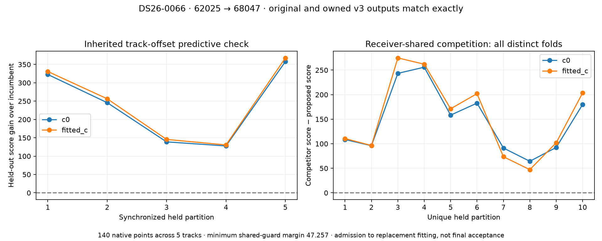

# ALGO07v3: causal candidate screen and receiver-shared admission

The final-stage causal catalogue check, family-omitted candidate screen,
receiver-shared predictive guard and admission controller now run as owned v3
components. On the DS26-0066 historical research canary, the entire scientific
comparison is exact: orbit bank, propagation audit, cavity fits, coarse nominees,
full-data fits, held-out fits, aliases, partition diagnostics, receiver-shared
competition and the admitted proposal. The output SHA-256 is
`edc9cefa7a628f6d6f3df2b8596aaa3c31d6ee3a8ca3b6f4f26faacdb01ad9e9`.

Both implementations admit **62025 → 68047** to replacement fitting using **140
native points across five tracks**. The receiver-shared guard passes **10 unique
partitions**, with minimum competitor margin **47.256530**. The focused suite
passes **449 tests** with no failures, errors or skips.

Admission is not final association acceptance. This stage changes neither the
position nor the number of associated points. Causal-history completion, matched
replacement/control fitting, final policy integration and all eight WebUI
artifacts remain unfinished. No deployment or end-to-end speedup is claimed.

## Preserved scientific sequence

The preceding owned RF-influence trigger supplies candidate families. The runtime
does not contain a scan-specific or satellite-specific roster. The external
component oracle supplies 62025 explicitly to compare the same historical case;
the connected application obtains its targets from the trigger.

The catalogue is restricted to scan-causal element epochs within 72 hours and
collection times no later than the scan cutoff. The propagation audit also checks
the epoch parsed from each TLE. Predictions span the original −40 to +340 second
bank at one-second knots. Partial failures, unknown or inconsistent errors, and
nonfinite states with successful SGP4 status block the stage. Only the original
explicit model-invalid classification over every knot can be excluded.

| DS26-0066 catalogue result | Count |
|---|---:|
| Causal candidate elements | 11,133 |
| Eligible propagated elements | 11,131 |
| Consistent model-invalid exclusions | 2 |
| Partial/unknown blocks | 0 |

The two exclusions are 46174 and 57416, each with SGP4 error code 1 at all 381
knots. The owned audit matches every original failure field, including epoch,
collection provenance, error counts, finite-state counts and element hashes.
Operational file paths/hashes are bound separately by the external oracle;
numerical components receive values and do not construct storage paths.

For each triggered family, the engine removes that family's evidence and refits
position/calibration separately in c=0 and fitted-c. It retains the original
15-phase-round maximum, L-BFGS-B settings, ±12.5 km bounds and ±30-second phase
closure. It then uses the two longest tracks, at most 16 samples per track, and
a two-second coarse phase grid to nominate alternatives from the full causal
bank. The same complete common finalist set is evaluated in both arms, including
the incumbent.

The inherited predictive screen uses five synchronized five-second time-group
partitions with one adjacent group excluded from training on either side.
Training observations determine aliases and nuisance coefficients. The model
integrates phase uncertainty with a five-second prior, per-track 300 Hz offset
priors, a shared 0.5 Hz/s rate prior and 150 Hz observation noise. A whole-family
alternative needs positive mean predictive gain and at least four wins out of
five in each arm. DS26-0066's alternative wins all five in both arms.

Diagnostic stable-partition proposals remain in the scientific output, but their
`prediction_limit` prevents admission. This matters here: the original screen
also produces `62025_stable_partition`. It is not silently promoted into a
replacement just because its inherited predictive scores pass.

## Receiver-shared competition

The stronger guard ties the constant discrepancy across tracks from the same
receiver. It uses the same common nominees and fixed physical priors, with ten
distinct randomized time-group partitions from the original seed. Every proposed
identity must beat **every common competitor in every retained unique partition
in both arms**. At least five unique partitions are required; missing matched
fits yield `not_evaluated`, and a nonpositive margin rejects the proposal.

DS26-0066's common nominees are 62025 and 68047. Both arms have strictly positive
competitor margins on all ten partitions; the smallest is 47.256530 in fitted-c.
This is conditional predictive evidence given full-data nomination, graph/alias
choices and cavity calibration. It is neither an independent satellite identity
probability nor proof that every catalogue alternative was exhaustively fitted.

The controller applies the original order: exclude diagnostic partitions, require
inherited predictive admission, reject a destination already owned by either arm,
then compute the receiver-shared table once per target and test each remaining
proposal against all competitors. It cannot collect history, fit a replacement
position or publish a result. Propagation failure returns no partial admission.

## Isolation and tests

The reference comparison executes the frozen original screen and guard. The
candidate executes the owned controller with `/opt` hidden and legacy
imports/reads/process launches rejected. Scientific fields are compared exactly;
only wall-clock `seconds` fields and separately bound operational file-path audit
metadata are removed from the comparison.

New tests verify that held-out values cannot affect training aliases, phase choice
or nuisance estimates; normalized predictive likelihood agrees with direct
Gaussian conditioning; partitions synchronize tracks and guard adjacent groups;
duplicate partitions do not manufacture independence; every competitor and both
arms are required; and noncausal/expired or partially invalid propagation cannot
authorize screening. Controller tests verify destination ownership, diagnostic
partition exclusion, reuse of the full common guard table and callback isolation.

The application connects this stage through `screen_reassociation_candidates`.
Its connected DS26-0002 run preserves the entire preceding validated prefix;
the new admission result is recorded separately with `recovery_complete=False`.
The run completes in **307.896 seconds**. It retains all 2,783 incumbent owners
per arm and evaluates 69265 versus 52113 over 128 points in four tracks. The
alternative wins none of the five inherited held-out partitions in either arm,
so it does not reach the receiver-shared guard or replacement fitting. No
replacement is admitted. The exact outcome and timing are in [comparison.json](comparison.json). That
fresh prefix is an integration check; its newly generated screen has not yet
received an independent original-engine replay on that fresh selected state.

## Timing and reproduction

The fresh scoped reference/controller observations are **19.072 / 19.975 seconds**.
These are overlapping shared-host qualification runs, not a controlled speed
benchmark. The candidate oracle performs one extra catalogue preparation solely
to fingerprint its complete orbit bank against the reference. Production
admission prepares its catalogue once. These timings cannot establish a speedup
or regression of the production path.

`tools/check_algo07v3_reassociation_context.py --screen-target 62025` runs the
external component comparison. Supply the original explicit input, residual
screen, catalogue, recovery result, runtime and a new output path. The reference
uses the frozen original code; the candidate uses the owned admission controller.
The fixture input is the existing DS26-0066 research canary under
`reports/2026_11_01_algo07_promotion/research-canary/input`.

`tools/check_algo07v3_position.py --reassociation-screen` runs the fresh connected
implemented prefix using the existing prepared native input, catalogue, search
region and budgets. The evidence root is
`/srv/bulk/leo/research/algo07v3-20261104/reassociation-screen002`.
The initial isolated numerical comparison remains in `reassociation-screen001`.
Run this report's `render.py` to verify source/input/output bindings, exact
comparisons, the unchanged earlier prefix and test XML, then regenerate the
figure. [artifact-bindings.json](artifact-bindings.json) records the evidence.

Complete-path matched scans remain **zero**. Native preparation, remaining final
reassociation fits and artifact publication must be included before claiming
whole-path performance. The standalone-engine, exact-equivalence and 10× speed
requirements remain active.
