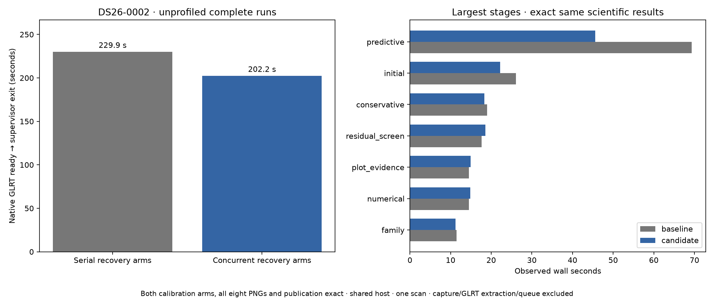
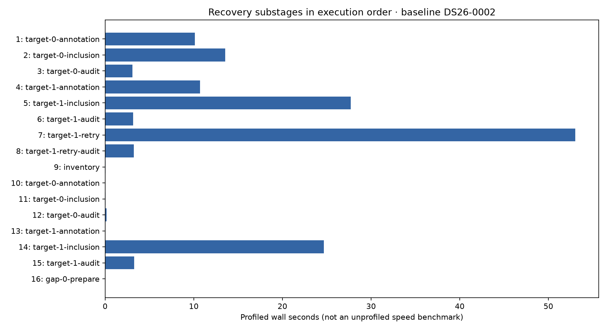

# ALGO07v3: profile-driven concurrent recovery fits

2026-11-05. Development integration; production unchanged.

The standalone native-GLRT-to-publication pipeline takes **229.888 → 202.201
seconds** on a fresh DS26-0002 comparison: **12.04% less wall time**, an observed
**1.137×** ratio. Predictive recovery takes **69.319 → 45.570 seconds**, 34.26%
less wall time. Both calibration arms, the complete scientific audit, observation
ownership, all eight PNG bytes, published fields and grid/path match exactly.
All **882 component tests pass**.

## What the profile showed

The new [profile-algo07v3 skill](../../.agents/skills/profile-algo07v3/SKILL.md)
uses [tools/profile_algo07v3.py](../../tools/profile_algo07v3.py) to run the actual
owned worker with separate profiles for the parent and forked numerical workers.
It saves stage/substage wall time, parent/child CPU, input/source bindings and
host-pressure records. It uses a fresh private publication root, preserves the
request's inference settings, and enforces the process-group deadline.

The complete profiled run takes **475.571 seconds** and produces 19 per-process
profiles. It is diagnostic, not a speed benchmark. Its scientific evidence and
eight PNGs match the previous unprofiled result exactly; the tool imports the
same CLI bytes under `leo.cli.algo07v3` instead of `__main__`/`__mp_main__`.
Those entry-point aliases are explicitly checked in [profile-parity.json](profile-parity.json).

| Original predictive substage | Profiled wall seconds | Parent CPU seconds |
| --- | ---: | ---: |
| Target 0 annotation, already concurrent folds | 10.114 | 0.073 |
| Target 0 inclusion, sequential arms | 13.560 | 13.547 |
| Target 0 audit | 3.064 | 3.054 |
| Target 1 annotation, already concurrent folds | 10.727 | 0.060 |
| Target 1 inclusion, sequential arms | 27.701 | 27.666 |
| Target 1 audit | 3.145 | 3.145 |
| Target 1 existing numerical retry, sequential arms | 53.029 | 52.807 |
| Retry audit | 3.257 | 3.257 |

The two inclusion fits and retry account for **94.290 of 124.659 profiled
predictive seconds**. Their near-equal wall and parent CPU times identify useful
independent computation to overlap. Annotation already spends most of its CPU
in children. Later numerical replay remains a separate stage.

Rows 1–8 are original predictive recovery, 9–15 are numerical replay, and 16 is
gap preparation. Near-zero replay rows reuse completed evidence. These substages
are contained in the top-level stages: adding both would double-count time.
Likewise, overlapping child profiles and parent `poll` time must not be summed
as exclusive CPU. [Profile function summaries](profile-functions.json) retain
the raw profile paths, hashes, call counts and leading functions for every PID.

The first instrumentation attempt failed because forked children inherited an
active cProfile instance. The profiler now disables that inherited instance
before starting a child profile. A regression test exercises the real two-child
executor and verifies three independently readable profiles. The failed
[receipt and logs](profile-first-attempt/profile.json) are preserved; no failed
run contributes a speed result.

## Change and safeguards

Shared-family and new-family inclusion now accept an optional arm executor.
The owned CLI supplies its existing ordered two-process executor for original
predictive recovery, including the existing Powell retry. Each child completes
one arm's five phase-refinement rounds. The parent collects results in the
original `c0`, `fitted_c` order before evaluating acceptance.

Targets, control/addition variants, joint experiments, audits and adoption stay
sequential. No hypotheses, phase samples, observations, priors, optimizer budgets
or acceptance gates are removed. Direct numerical calls default to serial.
Contexts with a mutable numerical policy explicitly retain serial execution,
preserving their ordered receipts. Later numerical replay receives no executor.

The existing execution adapter handles child crashes, cancellation, transport
failure and cleanup. An incomplete child aborts execution rather than becoming
a scientific rejection. Recovery pairs do not overlap annotation folds or other
fit stages; the existing maximum of three fit children is unchanged. This is
owned scheduling, with no earlier ALGO worker or saved result runtime dependency.

The component tests compare complete control/addition trials against a frozen
pre-change implementation, cover both optimizers and conditional shared fitting,
verify serial mutable receipts, child-failure propagation, target/retry order,
application forwarding and CLI wiring. The full suite runs **882 tests in
18.85 seconds**, with zero failures, errors or skips. See [test receipt](tests.xml)
and [command](test-command.json).

## Fresh unprofiled qualification

The baseline is commit `f4f5061c93bcacc2be5f48248ef0a70af963be9f`.
Baseline and candidate run sequentially on CPUs **0,1,2**, with **one BLAS thread**
per process and identical **1,200-second** outer bounds. Baseline modules were
frozen before editing; private read-only namespace mounts restore exactly those
five modules for the reference. Both runs hide older installations, old bulk
results and repository reports, disable network access, and bind the native
input/TLE bundle read-only. Separate output roots ensure fresh computation.

| Measurement | Serial recovery arms | Concurrent recovery arms |
| --- | ---: | ---: |
| Owned CLI process wall seconds | 229.888 | 202.201 |
| Predictive recovery wall seconds | 69.319 | 45.570 |
| User CPU seconds | 254.12 | 254.72 |
| System CPU seconds | 7.27 | 6.67 |
| Total CPU seconds, reported precision | 261.39 | 261.39 |
| Maximum reported process RSS, KiB | 2,362,700 | 2,356,824 |

GNU time covers the isolation wrapper and descendant tree; the headline wall
clock is the owned supervisor's child-process interval. Maximum RSS is the
reported maximum process value, not simultaneous aggregate memory across all
children. Capture, native GLRT extraction and queue waiting are excluded.

This is one same-scan shared-host pair. Unchanged initial fitting also improves
**26.043 → 22.236 seconds**, so the entire 27.687-second difference cannot be
attributed to recovery scheduling alone. The targeted stage accounts for
23.749 seconds of the observed difference. CPU pressure and load are recorded
for both sides. The result does not establish a population-wide ratio or a
production queue-throughput gain.

| Stage | Baseline seconds | Candidate seconds |
| --- | ---: | ---: |
| Native preparation | 8.439 | 8.329 |
| Recovery catalogue | 5.451 | 5.387 |
| Initial position | 26.043 | 22.236 |
| Conservative recovery | 18.977 | 18.304 |
| Family policy | 11.508 | 11.231 |
| Signed policy | 2.504 | 2.336 |
| Family cavity | 7.561 | 7.485 |
| Recovery inventory | 0.194 | 0.199 |
| Predictive recovery | 69.319 | 45.570 |
| Numerical replay | 14.528 | 14.824 |
| Gap recovery | 0.002 | 0.001 |
| Residual inventory | 0.188 | 0.188 |
| Residual screening | 17.670 | 18.537 |
| Additional recovery | 0.003 | 0.002 |
| Incumbent handoff | 0.275 | 0.270 |
| Reassociation ranking | 6.703 | 6.746 |
| Reassociation admission | 10.259 | 10.595 |
| Final selection | 0.059 | 0.058 |
| Plot evidence / diagnostic grid | 14.533 | 14.923 |
| PNG rendering | 5.612 | 5.592 |

The [exact comparison](comparison.json) checks both c arms, all saved scientific
values and audit sections, all PNG bytes, public result fields and grid/path.
It declares exactly five changed loaded modules, with no added modules.
[Plan](plan.json), [baseline module bindings](baseline-sources.json),
[serial supervisor](baseline-supervisor.json), [candidate supervisor](candidate-supervisor.json)
and both isolation receipts retain reproducibility evidence.
The executable recipes are [run_pair.py](run_pair.py),
[run_baseline.sh](run_baseline.sh) and [render.py](render.py).

## Interpretation and next iteration

This qualifies the scheduling change on a deliberately selected development
scan, not a random independent validation sample or full DS26. Existing grouped
scientific holdouts and their seeds are unchanged. The complete DS26 denominator
remains 159 fast members, with 158 native inputs available in the recorded
inventory. Broader accepted branches and production admission remain open.

The original-versus-v3 cumulative observations remain in the
[previous report](../2026_11_05_algo07v3_cumulative_repeat/README.md): original
642.886 seconds versus v3 440.510/226.531 seconds under different shared-host
conditions. Do not multiply that ratio by this iteration's ratio. A new original
comparison would be needed for a newly matched cumulative measurement; the
tenfold complete-path target remains unproven.

The next measured opportunity is exact reuse of orbital interpolation during
screening. In the parent profile, `phase_frequency_grid` accounts for 55.540
inclusive seconds, including 36.975 in residual screening and 13.920 in
reassociation screening. These are profiled costs, not projected savings.
Receiver-position trials often share orbit banks, observation times and phase
grids; interpolation is independent of receiver position. A bounded immutable
prepared-state prototype should retain domain validation and exact arithmetic,
then be measured and qualified in another fresh pair. General likelihood-result
caching remains a weaker option given the previous low exact-input reuse audit.

Production was not deployed or modified by this iteration.
