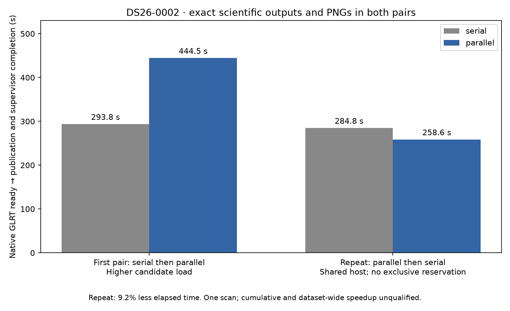

# ALGO07v3: complete-path timing repeat and 15/17 historical audits

2026-11-05. Development validation; production is unchanged.

The reverse-order repeat completes native GLRT through scientific storage,
all eight PNGs, atomic publication and supervisor exit in **284.846 s with serial
folds versus 258.638 s with concurrent folds**: **9.20% less elapsed time,
1.1013× observed**. Both runs have identical scientific outputs, c=0/fitted-c
positions, point/satellite ownership, 179 diagnostic grid points, recorded paths
and PNG bytes. This compares two standalone v3 configurations, not legacy ALGO07
against v3. Capture, GLRT extraction and queue wait are outside the clock.

The earlier pair remains part of the evidence: **293.750 → 444.458 s**, with much
higher production load during the candidate. The repeat ran concurrent folds
first and serial folds second, on the same CPUs 0–2 with one BLAS thread per
process. Initial observed load averages were 9.44 and 10.00, respectively;
the machine was shared, not reserved. The reverse order reduces one ordering
concern but does not establish dataset-wide speed or isolate every load effect.
No production worker was stopped or reconfigured. The cumulative **10× target
remains unproven**; the older 675.455 s legacy observation is not a matched
baseline for this repeat.

| Interval | Serial folds | Concurrent folds |
| --- | ---: | ---: |
| Native preparation through rendering | 274.837 s | 249.516 s |
| Scientific save | 5.024 s | 4.627 s |
| Complete supervised process | **284.846 s** | **258.638 s** |

[All stage timings](stage-timings.md), [comparison receipt](comparison.json),
[run plan](plan.json), [host observations](resource-observations.jsonl) and
[machine-readable summary](summary.json) retain the evidence. Predictive recovery
still takes 79.151 s in the concurrent run and is the largest stage. The next
performance investigation should target repeated fitting inside recovery,
with exact-output checks, before adding more fold workers.

A subsequent bounded profile of DS26-0002's complete serial annotation confirms
that direction. All proposal fields still match the frozen historical annotation.
These are nested profiler intervals, not additive stages or speedup evidence:

| Profiled work | Calls | Cumulative seconds |
| --- | ---: | ---: |
| Complete annotation, three grouped folds | 1 | 14.827 |
| Training calibration fits, both c arms | 6 | 12.228 |
| Hierarchical likelihood | 570 | 9.422 |
| Posterior updates | 6,526 | 5.673 |
| Dense linear solves | 19,175 | 3.958 |
| Satellite nomination | 3 | 2.511 |
| Phase-shifted state interpolation | 396 | 1.594 |

[Profile summary and source/input bindings](annotation-profile.json).
The profile ran serially on CPU 4 with one BLAS thread and a 300-second outer
deadline, after both timed full jobs were terminal. Context reconstruction was
outside the profiled interval; this is a frozen-context experiment. A first
non-root attempt stopped before profiling because the reference fixture is
root-readable; the completed attempt used read access via sudo without changing
fixture permissions. Raw profile:
`/srv/bulk/leo-dev/algo07v3-annotation-profile002-20261105/annotation.prof`.

Next experiments should preserve the dense solve arithmetic while reusing
identical likelihood work or factorization; the earlier exact factor-reuse
microbenchmark has not yet established a complete-path gain. Phase interpolation
also repeats across nomination positions and is a smaller reuse opportunity.
Neither optimization is enabled by this report.

## Stronger historical equivalence evidence

The fresh standalone result now matches **15 of 17 historical scientific audit
sections**, up from 12. The added checks are:

- **Recovery inventory:** every reconstructed field against the frozen original
  implementation, including ownership, selected likelihood and eligible targets.
- **Signed-prior context:** all newly computed context fields and exact values of
  persisted node and unchanged-arm fields against independently bound originals.
- **Final reassociation handoff:** both arms, all owners and replay checks. The
  original abbreviated fallback is expanded from its hash-bound preceding
  recovery decision. Accepted/additional-fit branches require separate mappings.

The first signed-context comparison rejected JSON lists/scalars versus native
NumPy arrays/scalars. The correction restores types only at the explicitly
persisted node and unchanged-arm boundaries, checks every value exactly against
the original files, then compares all remaining computed state exactly. There is
no numerical tolerance or dropped scientific field. Tests deliberately perturb
each restored block and the computed state by 1e-12 and require rejection.
The [initial failed comparison](historical-before-restoration.json) is preserved;
the [completed comparison](historical-comparison.json) has no differing checked
values and still reports the full gate incomplete.

Reference reconstruction remains external to the candidate runtime. Input hashes
are checked against the historical export descriptor; output and frozen module
hashes are rechecked before comparison. The isolated candidate cannot read
historical installations/results/reports or use the network. It starts from
native GLRT and the causal archive.

## Tests and remaining work

**725 tests pass**, covering numerical components, execution, persistence,
presentation, API, CLI and comparison tools. One earlier run had 719 passes and
one failure because the cleanup test assumed both workers could import/start in
1.5 seconds. The test now waits for bounded worker readiness before exercising
a real 0.1-second supervisor timeout. Production deadline behavior is unchanged;
the separate actual wall-clock deadline test remains. The only suite warning is
the existing Starlette/httpx deprecation. [Test results](tests.xml).

Still open: full historical `additional_recovery` and `numerical_recovery`
mappings; excluded metadata semantics; broader accepted branches; full DS26;
ordinary production admission/deadlines; and cumulative matched performance.
DS26's denominator remains 159 fast members, with 158 native inputs available
and one missing. This single-scan evidence does not qualify the remaining
members or justify deployment.

Evidence roots:
`/srv/bulk/leo-dev/algo07v3-predictive-repeat-20261105` and
`/srv/bulk/leo-dev/algo07v3-audit-mappings-20261105`.
`render.py --root TIMING_ROOT --audit AUDIT_ROOT` verifies bindings, exact checks,
successful fresh isolated runs and the test report before generating the figure.
