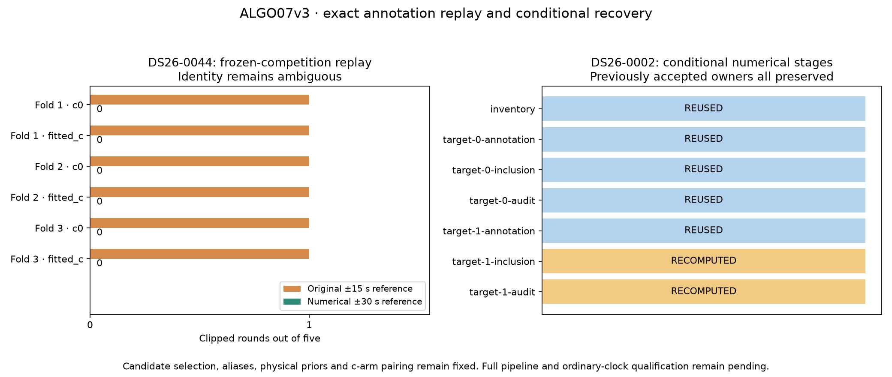

# ALGO07v3: conditional numerical replay and incumbent protection

Complete-path baseline seconds, candidate seconds, seconds saved and speedup are
**unavailable**. Complete-path matched scans: **0**. The standalone engine remains
unfinished and undeployed. This iteration implements conditional numerical
recovery and verifies two different parts of that policy against frozen science.

## Results

| Check | Evidence | Result |
| --- | --- | --- |
| Frozen-competition annotation replay | DS26-0044, target `6d704bb14ca720c16c9f` | Exact scientific fingerprint match; all three proposals in each of three folds, both calibration arms |
| Fresh predictive prefix | DS26-0002, rebuilt from owned prepared evidence | Exactly unchanged from the previously qualified complete predictive loop |
| Conditional numerical controller | DS26-0002, both selected targets | Exact selection, attempts, stage order, reuse decisions and combined optimizer/domain receipts against independent individual references |
| Additive ownership | DS26-0002 | All 2,783 previously accepted scoped owners preserved in each arm |
| Focused tests | Analysis, application, inputs and oracle comparators | 239 passed |

The DS26-0044 example clipped the numerical reference in one of five rounds for
each of its six training fits. Replaying the same competition with a ±30 s
reference removes those six clipping events. Identity remains **ambiguous**:
the leading NORAD is 59310, but the existing uniqueness test still rejects it.
No association is authorized by annotation replay alone. This is reproduction
of the frozen policy, not a new relaxation of the identity gates.

DS26-0002 reuses five stages: inventory, both annotations, and the unchanged
shared-family fit and audit. It recomputes the new-family fit and audit. The
candidate retains NORAD 69213's 35-point CH7 curve without needing the earlier
Powell retry, and the CH8 shared-family proposal remains rejected. The 2,783
scoped owners consist of 2,748 protected owners plus those 35 recovered points;
this is not a count of every incidental postfit extension or a new association
gain over the already accepted predictive result. Both c arms preserve the same
owners. The additive decision is `ALGO04_additive`.



## Implementation

`annotation_replay.py` owns the frozen-competition replay. It validates the
original target identities, point ordering, timestamps, distinct grouped
validation schedule, five-by-48 training budget, fixed noise and physical phase
support. It refits both arms on the original training masks, records each
optimizer result and recomputes every original proposal. It never nominates
replacement satellites from the new fit. Actual posterior and prediction
endpoints must stay within the supplied causal orbit bank.

`numerical_recovery.py` owns the conditional controller. It filters the original
target order to completed annotations, reuses annotations without saved phase
overflow, and reuses a shared fit only when its annotation and reference history
are unchanged. Reused shared audits require an actual completed audit. New-family
and joint work use the owned numerical policy. Each executed numerical stage
gets its own policy instance and receipts; no global aliases are patched.

Every stage, including reuse, goes through the caller's admission/execution port.
Reuse charges the original duration minus the actual reuse time to the caller's
logical clock. Inventory is charged too. The controller explicitly receives those
ports and the completed in-memory checkpoint rather than importing a worker,
opening a result store or constructing an older algorithm's storage paths.

After numerical selection, an additive gate checks every accepted observation
against the preceding owned result in both c arms. Losing or changing even one
owner rejects the update and retains the exact incumbent. Historical production
terminal/read-audit adapters remain outside these numerical functions; the new
application entry points pass the immediately preceding owned checkpoint.

The application now exposes `recover_predictive_checkpoint` and
`recover_numerical_tracks`. Both continue to report `recovery_complete=False`,
because later recovery and final publication are not implemented yet.

## Exactness and independence

Candidate qualification runs hid `/opt` behind an empty read-only mount and used
the legacy-import/process guard. The reference processes used the immutable
ALGO04 installation at:

```text
/opt/leo-fast-graph/f9e262f96b6e2e75b397f69d50a0ea9104e293ef
```

The annotation test deliberately supplies a saved numerical context and original
competition to both sides. It is a component fixture. Its exact output SHA-256 is:

```text
3a897d43c9f698e6b3b8d148c036f9d330e60a973db5c6bbf030f8e53a19ce07
```

The DS26-0002 candidate independently refits the complete implemented prefix from
owned prepared inputs, then runs both recovery policies. It reads no completed
old fit. Its predictive prefix is compared to the previously qualified output;
its conditional selection is checked against the unchanged shared reference and
a fresh frozen numerical new-family reference. The latter also provides exact
optimizer starts, endpoints, gradients, physical call counts and domain checks.
The candidate's complete output fingerprint is:

```text
9144935a99b4a877913a63a54bd825816906071faf93bf85a094c011bebc32cb
```

This proves the stated two-target controller fixture. It does not prove every
conditional replay branch or a complete native-GLRT-to-UI pipeline. The test
harness admits all predeclared work; ordinary wall-clock admission and timeout
equivalence remain unqualified. Unit tests additionally cover target-index
remapping, reused-stage admission, copy-time charging, missing audits, changed
references and ownership loss/reassignment in either arm.

## Runtime accounting

| Measured scope | Seconds |
| --- | ---: |
| Frozen annotation replay component | 76.949 |
| Owned annotation replay component | 66.798 |
| Frozen new-family numerical annotation/inclusion fixture | 71.292 |
| Owned fresh DS26-0002 fitting prefix plus predictive and numerical recovery | 399.779 |

The last two rows have different scopes and must not be divided into a speedup.
All runs occurred on a shared host with overlapping jobs. No controlled component
or complete-path speed ratio is claimed. Preparation/acquisition, later policies
and UI artifacts are outside these measurements.

The first annotation candidate was stopped before fitting because its test
loader's `algo07...` filename triggered the legacy-import guard. Renaming the
external loader to `check_algo07v3_fixture_context` corrected the harness without
weakening that guard. The interrupted attempt and first reference remain in the
research evidence root; successful paired annotation runs are in `replay002`.

## Reproduce and inspect

Working tree: `/srv/bulk/leo-dev/algo06-promotion-20261101`.
Evidence root: `/srv/bulk/leo/research/algo07v3-20261104`.

- `tools/check_algo07v3_annotation_replay.py` compares reference/candidate replay
  with explicit source, inventory and annotation fixtures.
- `tools/check_algo07v3_position.py --numerical-recovery` rebuilds the implemented
  prefix and runs the predictive checkpoint followed by numerical replay. It is
  explicitly an all-work qualification mode, not production timeout policy.
- `tools/algo07v3_numerical_inclusion_oracle.py` executes the unchanged frozen
  numerical new-family trial for the nonoverflowing DS26-0002 annotation.
- `tools/compare_algo07v3_numerical_recovery.py` verifies the complete two-target
  decision, reuse plan, previous prefix and numerical receipts.

The [comparison](comparison.json) states its scope and missing complete-path
metrics. [Artifact bindings](artifact-bindings.json) cover fresh sources, tools,
inputs and receipts. Earlier qualified outputs are checked against their
committed qualification manifests; their historical source trees are not
represented as today's code. Regenerate the figure and report evidence with:

```bash
PYTHONPATH=src:tools .venv/bin/python -B reports/2026_11_05_algo07v3_replay/render.py \
  --evidence /srv/bulk/leo/research/algo07v3-20261104 \
  --output reports/2026_11_05_algo07v3_replay
```

## Remaining work

Qualify numerical replay with successful shared recovery, inactive fragments,
joint target selection and incomplete/timeout checkpoints. Graph-bundle/native
refinement replay is explicitly unsupported by the current owned annotation
adapter. Extract the remaining conditional-gap, additional-family and guarded
reassociation policies, then final presentation. Resolve production admission,
qualify all DS26 cases with their full denominator, and measure/optimize the
complete path against the pinned baseline. The 10× complete-path target remains
unproven; no production deployment was performed.
