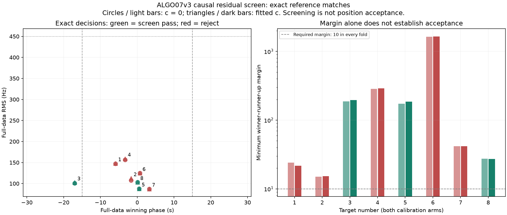

# ALGO07v3: owned selected checkpoints and causal residual screening

The standalone engine now passes its own selected likelihood from predictive,
numerical and gap recovery into residual screening. It no longer needs to search
old worker directories to find the raw trial that produced its selected result.
It also owns the 72-hour causal catalogue adapter and the production
72-hour / ±30-second residual-family screen, without a recency penalty.

The fresh DS26-0002 implemented fitting prefix preserves every earlier scientific
result and all **2,783 selected owners per arm**. Its three residual targets match
an independently executed frozen screen exactly. Two additional fixtures bring
the comparison to **eight residual tracks across three scans**, including three
screen passes and five rejections. The focused suite passes **376 tests**.

This is not a complete ALGO07v3 engine or a deployment. A screen pass is not an
accepted satellite association or a position improvement. Additional-family
position trials, final guarded reassociation and all eight UI artifacts remain
to be integrated and qualified. The 10× complete-path target remains open.

## Selected-state handoff

The predictive controller emits an explicit checkpoint only after its scientific
selection and incumbent-owner checks finish. It captures the exact selected raw
trial, its predictive-view annotations, selected arms and owners. If a retry or
joint-family experiment wins, that experiment's full likelihood is captured.
If there is no accepted addition, the checkpoint contains the original baseline
likelihood and the independently published source support.

The numerical controller replaces this state only after additive admission.
Rejected numerical proposals retain the predictive checkpoint. Gap recovery
similarly replaces it only with its qualified selected gap. The application
checks the checkpoint's ownership, kind, endpoints and available objective values
against the independently retained scientific decision before reconstruction.
Missing, stale or unrelated checkpoints fail explicitly. The existing unsupported
composition of a gap over a separately recovered family is not inferred.

Checkpoints are copied before delivery; a consumer cannot mutate the controller's
decision or its source objects. Callback failures propagate rather than being
reported as scientific rejection. Public persisted contracts are unchanged.

The fresh prefix runs initial search, conservative and family/history policies,
signed prior, family cavity, predictive recovery with retry, numerical replay,
gap recovery, selected reconstruction, residual preflight and screening. It starts
from independently owned prepared tracks/orbits/noise; native GLRT detection and
preparation are not rerun in this timing experiment. It runs with `/opt` hidden
and the existing numerical dependency guard enabled.

Every scientific field before the new preflight/screen is identical to the
previous qualified prefix. Reconstruction reproduces both selected core and
complete objectives with exactly zero difference. It finds **484 incidental
unpublished extensions per arm** and leaves every one uncredited. The three
nominated residual fragments are disjoint from both arms' adopted ownership.

This test completes the original declared work for qualification. It does not
qualify ordinary-clock omissions, cancellation/resume, every joint/gap checkpoint
branch on real data, or the full DS26 population.

## Causal catalogue and screen

The operational adapter reads through the existing read-only TLE archive port.
Both collection time and element epoch must be within the 72 hours ending at the
scan cutoff. It selects the original newest causal element per satellite, exports
the original TLE representation and validates its epoch against provenance.
For DS26-0002 the candidate and frozen adapter return exactly the same **11,144
elements**, provenance and snapshot count. One SGP4-unusable object, NORAD 45395,
is excluded identically by both screens, leaving 11,143 candidates.

The numerical screen preserves the original policy:

1. Form the full-data partition and three reproducible random whole-block
   partitions. Blocks are 12 seconds; selected held blocks exclude training points
   within the original two-second guard. Seeds are `20261031`, `94721`, `4081`.
2. Nominate independently on each partition's training points. Coarse phase
   hypotheses cover ±30 seconds and include ±15 seconds. Each calibration arm
   nominates three candidates; union the two arms' lists within a partition.
   A full-data winner is never injected into the held-out partitions.
3. Re-evaluate finalists on the original 0.1-second phase grid, alias hypotheses
   −4 through +4, a normalized truncated 5-second Gaussian phase prior, and
   integrated Gaussian constant/rate nuisance terms. Nominal scales are 150 Hz
   noise, 300 Hz bias and 0.5 Hz/s rate. Receiver calibration remains frozen.
4. Require the same identity across all four partitions in each arm, a margin of
   at least 10 everywhere, matched identity and alias across arms, noise-like
   residuals, full RMS ≤450 Hz, |bias| ≤3,000 Hz, |rate| ≤2 Hz/s, phase-boundary
   mass <0.01, and held RMS ≤450 Hz with visibility on held points.

The catalogue, geometry, phase mixtures, alias choices, residual metrics, fold
assignments, runners-up, margins and pass/reject decisions all match the frozen
reference exactly. The screen uses the explicitly supplied regional search
coordinates; no evaluation GPS is used. The tested regional search center is
37.906, −122.545, with the existing 25 × 25 km search region.

## Eight-track comparison



Numbers match the figure. RMS and minimum-margin columns show fitted-c; both arms
are checked and plotted. “Winner” describes the screening hypothesis even for a
rejected track; it does not establish the true satellite.

| # | Fixture / lane | Points | Full-data winner | Phase | RMS | Minimum margin | Screen result / limiting evidence |
|---|---|---:|---:|---:|---:|---:|---|
| 1 | Fresh-fallback, RX1 CH7 | 41 | 63439 | −5.9 s | 147.9 Hz | 21.7 | Reject: residual noise screen fails |
| 2 | Fresh-fallback, RX1 CH6 | 31 | 66498 | −1.7 s | 112.4 Hz | 15.3 | Reject: three valid partitions; noise screen also fails |
| 3 | DS26-0183, RX1 CH1 | 44 | 69833 | −17.0 s | 102.5 Hz | 195.8 | Pass |
| 4 | DS26-0183, RX1 CH3 | 35 | 67053 | −3.3 s | 159.3 Hz | 291.1 | Reject: three valid partitions; noise screen also fails |
| 5 | DS26-0183, RX1 CH1 | 53 | 63426 | +0.5 s | 88.0 Hz | 185.6 | Pass |
| 6 | DS26-0002 fresh prefix, RX1 CH8 | 64 | 69234 | +0.7 s | 124.8 Hz | 1,655.9 | Reject: residual noise screen fails |
| 7 | DS26-0002 fresh prefix, RX1 CH3 | 24 | 69213 | +3.3 s | 87.4 Hz | 41.9 | Reject: only two valid partitions |
| 8 | DS26-0002 fresh prefix, RX1 CH1 | 25 | 57809 | +0.1 s | 103.4 Hz | 27.3 | Pass |

The −17-second accepted hypothesis exercises the expanded phase range. The red
points show why a small full-data RMS or large identity margin alone does not
satisfy the policy. The extraction preserves those rejections rather than
loosening gates to increase coverage.

The three screening passes cover 122 points across the fixtures. **Zero additional
points are credited by this stage**. A subsequent shared-likelihood position trial
must protect the incumbent and pass all original gates before any are associated.
No position-error improvement has been measured in this iteration.

## Evidence and tests

| Evidence | Exact output binding |
|---|---|
| DS26-0002 newest-causal catalogue, both adapters | `c1d016766e1a99b6c437598ec08dcbe72522fe9c07aba299fac0cd20c0c2cc02` |
| Fresh-fallback two-target screen, both implementations | `d7a3f59b8bf6f279650e705ece778efc01e59482ed6a265138abefc4e7a43737` |
| DS26-0183 three-target screen, both implementations | `499cf764c276b5a5fa123c904f46c668cd1330f96bfcd0293b245f205021729b` |
| Independent DS26-0002 screen, exact embedded-prefix match | `bfd909abd7f2e5ceaa16c40f3fbd1d4ac92c5b48f16ebbb9245bf3ba4d20f8de` |
| Fresh owned implemented prefix through screen | `876bc26318fb28dc6cf6a326ead4b10c0471f1024d885a1faacdd1ee98ce0cd3` |

The external oracle uses frozen runtime
`/opt/leo-fast-graph/cf16ac5bd6a8f1ac65f626eba57326f2a2d2e6b5`.
Evidence is under `/srv/bulk/leo/research/algo07v3-20261104/` in `screen001`,
`screen002` and `checkpoint002`. The first two screen comparisons take explicit
receiver-corrected packets produced by the owned reconstruction fixture adapter.
The third uses a packet produced by the fresh integrated prefix. Reference code
is confined to the external qualification tools; it is not a runtime dependency.

The numerical checks use exact float hexadecimal representations and array
dtype/shape/content hashes. The report renderer verifies source, input and output
bindings, the pinned earlier prefix, all scientific comparisons, causal catalogue
equality and test XML. For the read-only archive adapter comparison, the owned
operational adapter is imported before the numerical-only guard because archive
access is its explicit responsibility; old installations remain inaccessible.
No guard was relaxed for numerical inference.

The focused suite passes **376 tests, zero failures/errors/skips**. New tests cover
selected-state copying and callback failure propagation, numerical rejection
retaining prior state, qualified-only gap checkpoint delivery, stale kind/owner/
position/objective rejection, unsupported composition, random whole-block guards,
training-evidence invariance to held-value changes, Gaussian nuisance evidence
against direct covariance density, normalized phase/alias weights, causal age
limits, archive-window inclusion, fixed production policy and strict comparisons.
This is not a claim that the entire repository test suite is green.

## Runtime accounting

| Scope | Reference observation | Candidate observation |
|---|---:|---:|
| DS26-0002 72-hour catalogue preparation | 6.747 s | 6.037 s |
| Fresh-fallback full residual screen | 16.311 s | 16.449 s |
| DS26-0183 full residual screen | 24.869 s | 24.326 s |
| DS26-0002 screen from fresh corrected packet | 19.007 s | Included in the prefix below |
| DS26-0002 implemented fitting prefix through residual screen | No matched full-prefix reference in this experiment | 243.577 s |

The catalogue and isolated screen pairs overlap on a shared host. They establish
parity, **not controlled speedup**. The fresh prefix excludes native preparation,
remaining additional-family position fitting, final ALGO07 reassociation and
publication. Its time cannot be compared as a speedup against an earlier run
with a different scope or host load. Complete-path matched scans remain zero;
complete-path baseline, candidate time, savings and ratio remain unavailable.

The immediate next scientific work is to implement the exact control/additional-
family position trials: preserve incumbent likelihoods, integrate shared receiver
uncertainty once, honor the two-family cap, audit exact orbital gates and ownership,
and adopt only a paired qualified addition. After final reassociation and rendering
are connected, run full-denominator equivalence and controlled whole-path timings
before optimizing or claiming the 10× result.

## Reproduction

`tools/check_algo07v3_recovery_catalogue.py` compares the two read-only catalogue
adapters. `tools/check_algo07v3_residual_screen.py` compares complete screens from
an explicit preflight packet and catalogue. Both reject existing output paths.
`tools/check_algo07v3_position.py --residual-screen` runs the fresh implemented
prefix, taking an explicit `--recovery-catalogue` and optionally exporting
`--preflight-packet` for the independent screen oracle.

The fresh candidate command uses the original 5-round/48-iteration fitting budget,
four seeds/three initial branches, and the original per-stage recovery settings:

```sh
sudo -n timeout 900 unshare --mount --propagation private sh -c \
  'mount -t tmpfs -o ro,size=1m tmpfs /opt && exec "$@"' isolated-v3 \
  env PYTHONPATH=src:tools OPENBLAS_NUM_THREADS=1 OMP_NUM_THREADS=1 \
  /home/mouse9911/gits/leo-tracker-reduxredux/.venv/bin/python -B \
  tools/check_algo07v3_position.py --side candidate \
  --source /srv/bulk/leo/research/algo07v3-20261104/inputs004/DS26-0002 \
  --output /tmp/algo07v3-residual-prefix-fresh.json \
  --search-center 37.906 -122.545 --rounds 5 --iterations 48 \
  --residual-screen \
  --recovery-catalogue /srv/bulk/leo/research/algo07v3-20261104/checkpoint002/catalogue-candidate.json \
  --preflight-packet /tmp/algo07v3-residual-packet-fresh.json \
  --scan-identities fast-af5f79e905d946a6e38f9e3e8243460c \
  --seed-budget 4 --branch-budget 3
```

Regenerate this report's machine-readable comparison and figure with:

```sh
sudo -n env PYTHONPATH=src:tools OPENBLAS_NUM_THREADS=1 \
  /home/mouse9911/gits/leo-tracker-reduxredux/.venv/bin/python -B \
  reports/2026_11_05_algo07v3_residual_screen/render.py \
  --evidence /srv/bulk/leo/research/algo07v3-20261104 \
  --output reports/2026_11_05_algo07v3_residual_screen
```

Elevated read access is needed for the sealed archive fixture. No QNAP paths are
written, and no new RF collection is involved. Later source changes require fresh
qualification or explicitly pinned archived evidence, not ignored binding failures.
