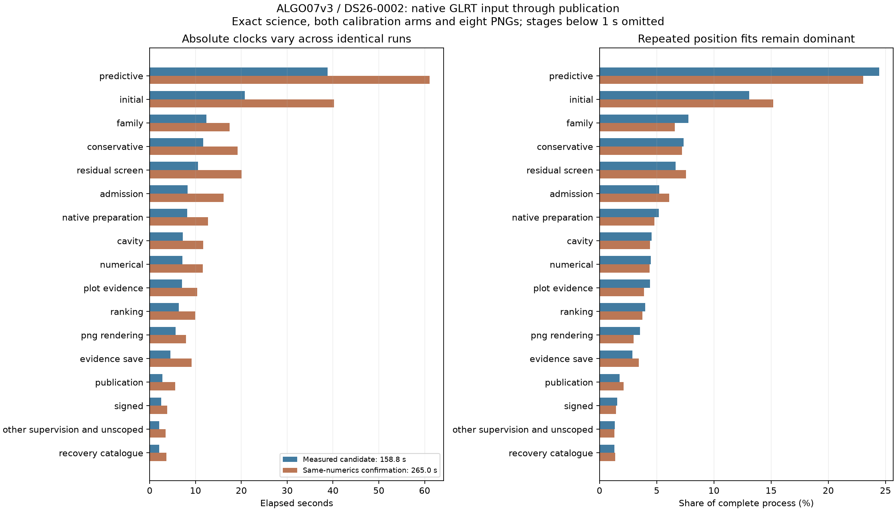

# ALGO07v3: current bottlenecks and next runtime experiments

Predictive recovery remains the largest stage, followed by initial position
search. The latest measured DS26-0002 candidate takes **158.773 seconds** from
native GLRT input through publication. An independently repeated execution of
the same numerical implementation takes **265.044 seconds**, with identical
science, both calibration arms, point ownership, diagnostic grid/path and all
eight PNG bytes. These are two observations, not population percentiles or a
stable speed estimate. Capture, detector execution and queue delay are excluded.

The second run validates whitespace-cleaned source after the matched experiment;
its complete syntax tree matches the measured candidate. Component tests ran
on CPU 4 during part of that confirmation. Both native executions use CPUs 0–2
and one BLAS thread. The variation's precise cause is unestablished: total CPU
also rises from 231.570 to 395.240 seconds, so scheduler waiting alone cannot
explain it. Do not label the entire difference as code speedup or regression.

## Where the current time goes

| Largest work | Measured candidate | Confirmation | Interpretation |
| --- | ---: | ---: | --- |
| Predictive recovery | 38.843 s | 61.074 s | Repeated fold, inclusion and retry position fits |
| Initial position search | 20.753 s | 40.265 s | Multiple starting hypotheses and paired calibration arms |
| Family recovery | 12.363 s | 17.458 s | Fit and assess shared satellite families |
| Conservative recovery | 11.648 s | 19.158 s | Fit conservative additions |
| Residual screening | 10.587 s | 20.079 s | Coarse satellite/phase search for remaining evidence |
| Candidate admission | 8.303 s | 16.126 s | Independent acceptance evidence |
| Native preparation | 8.224 s | 12.762 s | Graph/input and orbital preparation |
| Family-omitted analysis | 7.224 s | 11.676 s | Refit after removing individual families |
| Numerical-policy replay | 7.112 s | 11.594 s | Required fit under its own numerical policy |
| Diagnostic grid evidence | 7.034 s | 10.343 s | Evaluate the published position grid |
| Candidate ranking | 6.354 s | 9.957 s | Compare candidate explanations |
| PNG rendering | 5.634 s | 7.922 s | Render the eight unchanged figures |

The [complete accounting table](stage-table.md) includes every stage, evidence
encoding, publication and the remaining process/supervision time. Stage clocks
do not overlap; child CPU sums and cumulative function profiles must not be
added to this table. Predictive recovery accounts for about **23–25%** of the
complete process. Even halving it would reduce total time by only about 12%,
assuming everything else stayed fixed.

## What has just improved

The [nomination-point optimization](../2026_11_05_algo07v3_nomination_points/README.md)
computes coarse geometry only at the union of the points that the original
fold scoring already used. It retains all observations for finalist fitting.
All twelve complete prepared screens on DS26-0002/0066 match exactly; all six
alternating pairs improve. Later DS26-0002 pairs save 12.72–15.35%; DS26-0066's
mean saves 23.88%. The native screen itself falls **12.622 → 10.587 s**.

The full native pair measures **165.230 → 158.773 s**, but only 2.035 seconds
of its 6.456-second difference is in the changed stage. It is incorrect to credit
the entire difference to the optimization. **796 tests pass**, and a separate
final-source confirmation preserves all science and all PNGs. The code and
qualification report are on remote main at `8e3fb0224`; production is unchanged.

## Fresh profile after the optimization

Both new profiles run the current complete residual screen, one CPU and one
BLAS thread, with no forks. Source/input bindings, full-screen output,
callbacks, unchanged inputs and profiler accounting are checked. The saved
profile includes instrumentation overhead and is not a complete-pipeline clock.
Do not infer additional gains by comparing these sequential profile durations
with older profiles under different host conditions.

| Scoped screen work | DS26-0002 | DS26-0066 |
| --- | ---: | ---: |
| Complete profiled screen | 20.071 s | 14.729 s |
| Coarse geometry | 16.621 s | 11.772 s |
| Catalogue propagation | 1.682 s | 1.549 s |
| Coarse frequency/rate scoring | 0.803 s | 0.707 s |
| Fine finalist geometry | 0.054 s | 0.072 s |

Coarse geometry still accounts for **80–83%** of screen time. In DS26-0002,
`phase_shifted_states` has 7.195 exclusive seconds and look-angle evaluation
3.471 exclusive seconds. The common interpolator is called **99 times with
an empty request** to validate the entire bank; those calls take 3.376 cumulative
seconds. Source inspection shows the bank is constructed locally once and never
intentionally modified. Validation cost is consequently worth testing separately
from real orbital interpolation. These nested function times are not additive
with the coarse-geometry row.

## Recommended next experiments

1. **Validate the locally owned orbit bank once per screen.** Retain the complete
   initial shape, time-order and finite-state checks. Give the subsequent internal
   projection path an immutable, validated bank with a lifetime limited to that
   screen. General mutable-bank callers must retain their validation. Preserve
   per-call observation-time, phase and extrapolation checks. Test malformed banks,
   attempted mutation, empty targets and every complete output. This has a measured,
   isolated cost to address; the 3.376 profiled seconds is an upper bound on this
   component's potential saving, not a promised native-run improvement.
2. **Investigate scalar-phase interpolation setup.** Nomination applies one phase
   to the whole catalogue, while the general function constructs a satellite-by-time
   array of repeated times and search indices. A specialized internal scalar path
   could calculate common indices once, retain the original interpolation arithmetic
   and reuse them across satellites. Compare frequency and elevation bytes for every
   phase before full-screen trials. Array layouts and scalar/vector trigonometric
   paths can change rounding; mathematical equivalence is insufficient. No saving
   has yet been measured for this proposal.
3. **Return to posterior construction for the larger gain.** The difficult
   [DS26-0066 training profile](../2026_11_05_algo07v3_posterior_buffers/README.md)
   places almost all fit time in hierarchical likelihoods. It observed 220 of 350
   calls reaching the existing 256 precision-iteration ceiling. The separately
   [instrumented posterior](../2026_11_05_algo07v3_full_runtime_profile/README.md)
   attributes 36.7% to inverse solves, 15.4% to lower LU, 15.2% to covariance
   multiplication and 9.7% to Cholesky. Those historical kernel proportions need
   a fresh measurement after the recent Cholesky change. Investigate invariant
   setup or allocation remaining around those exact operations; preserve solver
   order, convergence, iterations and outputs. A new structured solver could offer
   a larger gain but is not an exact drop-in replacement and is outside this
   iteration's equivalence contract.

Test each proposal independently, alternating old/new complete components on
both scans before a fresh native pair. Keep CPU and peak memory beside elapsed
time: more workers may reduce latency while worsening aggregate throughput.
Production queue throughput is a separate measurement from these isolated CLI runs.

## What not to repeat without new evidence

- General full-input likelihood hashing: predictive repeated calls cost 1.999
  accumulated seconds while keying costs 4.200 seconds. Existing context caches
  already handle much of the easy reuse. See the
  [repeat census](../2026_11_05_algo07v3_likelihood_repeats/README.md).
- Combined right-hand-side solves and direct upper solves: failed exactness.
- Posterior scratch buffers: flat c=0 timing and a 9.33% slower fitted-c mean.
- Owner-only gradient parallelism: the targeted fits became slower and used
  72.7% more CPU; a faster overall observation did not justify integration.
- Encoding header caches: complete encoding became slower. Rendering and
  encoding are much smaller targets than repeated fits.
- Shorter iteration budgets, fewer hypotheses, omitted audits or altered priors:
  those change the algorithm and do not meet the current exact-output requirement.

No new original-ALGO07/current-v3 cumulative speedup, full-DS26 qualification,
capture-to-publication speedup or production deployment is claimed here.
The two new profiles preserve their complete results in `screen-0002.json` and
`screen-0066.json`. `render.py` checks source/input bindings and existing native
exactness receipts, then writes the table, summary and figure. This report changes
no runtime source beyond the separately qualified nomination optimization.
