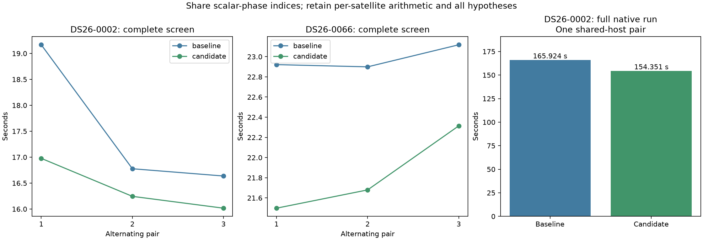

# ALGO07v3: share interpolation indices for a common orbital phase

The scalar-phase optimization is integrated in development after complete native
DS26-0002 qualification and **975 passing tests**. Twelve complete-screen trials
on DS26-0002/0066 preserve the previously qualified scientific result and every
callback; all six candidate trials are faster. Mean elapsed falls **6.36%** and
**5.00%**, with similar CPU reductions. Production is unchanged.

The fresh native pair measures **165.924 → 154.351 seconds**, an observed 1.075×
ratio. Residual screening improves **9.394 → 8.862 seconds** (5.66%). The complete
11.573-second difference cannot all be attributed to this measured 0.532-second
screen saving; other stage and system-time variation remain visible below.

This builds on nomination-point reduction and immutable-bank validation. For a
scalar phase, every satellite requests the same times and therefore the same
interpolation indices and fractions. The old function constructed those repeated
rows across the entire catalogue. The new path constructs one row and broadcasts
it while indexing each satellite's own states. Every satellite retains its own
position, velocity and original rotation calculations. No observation, satellite,
phase hypothesis, fold, prior or acceptance gate is removed.

## Fresh profile after immutable-bank integration

The current complete DS26-0002 screen was profiled on one CPU and one BLAS thread,
without multiprocessing. Its saved full screen, callbacks and input fingerprints
match; profiler accounting checks pass. The measured source is the preceding
immutable-bank version, archived as this iteration's baseline.

| Profiled work | Seconds | Calls |
| --- | ---: | ---: |
| Complete screen | 10.141 | 1 |
| Coarse geometry | 7.783 | 99 |
| Catalogue propagation | 1.167 | 1 |
| Coarse frequency/rate scoring | 0.560 | 660 |
| Fine finalist geometry | 0.050 | 18 |
| Whole-bank validation/interpolation with an empty query | 0.012 | 1 |

The last row is nested in the complete screen, not additional time. Coarse
geometry remains about **77%** of screen time. Its phase-state function takes
3.672 exclusive and 4.061 cumulative seconds; look-angle evaluation takes
2.415 exclusive and 3.689 cumulative seconds across the screen. These nested
function clocks must not be added to the coarse-geometry row. The profile
confirms bank validation now executes once, rather than 99 times. Profiling adds
overhead; these values are not normal native pipeline latencies or a controlled
before/after comparison against earlier profile clocks.

## Exact implementation boundary

Three lines change in `phase_shifted_states`. Record whether the supplied phase
is scalar and the satellite count is positive. After the original phase and
bank validations, select the first phase row for computing requested times when
that condition holds. Otherwise retain all phase rows. The existing interpolation
and per-satellite rotation expressions remain intact.

The full-length phase array is deliberately retained for sine/cosine evaluation:
switching scalar/vector trigonometric paths could change floating-point results.
Per-satellite phases retain their original path. The positive-count guard preserves
the original empty-catalogue behavior, including finite out-of-domain times and
empty phase expansion. All ordinary time/phase validation and nonempty-catalogue
extrapolation rejection remain unchanged.

An independent DS26-0066 replay compares both position and velocity arrays at
**all 99 real coarse phase calls**, including every satellite rather than just
winning candidates. Shapes, strides, dtypes and all value bytes match; the final
complete screen and callbacks also match. This doubled-calculation replay is an
exactness proof, not a speed measurement.

## Alternating complete-screen measurements

All trials include fresh catalogue propagation, immutable-bank construction,
coarse nomination, fine finalist fitting and callbacks. Loading the saved owned
evidence is outside the timer. Inputs are fingerprinted before and after every
trial. Both c arms keep the same observations, candidate catalogue, phase bounds,
priors and reproducible grouped random folds. The original source is an explicit
external oracle, never a runtime dependency.

| Scan / pair | Order | Baseline | Candidate | Exact |
| --- | --- | ---: | ---: | --- |
| DS26-0002 / 1 | Baseline first | 19.167 s | 16.977 s | Yes |
| DS26-0002 / 2 | Candidate first | 16.777 s | 16.244 s | Yes |
| DS26-0002 / 3 | Baseline first | 16.637 s | 16.016 s | Yes |
| DS26-0066 / 1 | Baseline first | 22.921 s | 21.498 s | Yes |
| DS26-0066 / 2 | Candidate first | 22.899 s | 21.679 s | Yes |
| DS26-0066 / 3 | Baseline first | 23.118 s | 22.314 s | Yes |

| Complete screen | Baseline mean | Candidate mean | Reduction | Baseline CPU | Candidate CPU |
| --- | ---: | ---: | ---: | ---: | ---: |
| DS26-0002 | 17.527 s | 16.413 s | **6.36%** | 17.522 s | 16.407 s |
| DS26-0066 | 22.979 s | 21.831 s | **5.00%** | 22.971 s | 21.825 s |

The first DS26-0002 baseline is slower than later baselines; retain it rather
than cherry-picking. Its later pairs improve 3.17% and 3.73%. The observed component
means are not dataset-wide speed percentiles. A read-only host snapshot during
the first scan records concurrent Python work and CPU-frequency/pressure values;
it does not establish the cause of timing variation. No host settings or other
jobs were modified.



## Native qualification and limits

The native pair runs baseline first, then candidate, with CPUs 0–2 and one BLAS
thread. Both start from identical frozen native GLRT inputs and causal catalogue
in separate private output stores. Read-only mount and network namespaces hide
historical installations and reports. Exactly one existing loaded module changes.
The candidate source equals the integrated module byte-for-byte, and its function
syntax tree equals the independently measured prototype.

The comparator requires complete scientific evidence, every audit, both c arms,
point ownership, all diagnostic grid/path values and eight PNG bytes to match.

| Native measurement | Baseline | Candidate |
| --- | ---: | ---: |
| Complete native process | 165.924 s | 154.351 s |
| Residual screening | 9.394 s | 8.862 s |
| User + system CPU | 241.200 s | 229.540 s |
| Maximum reported RSS | 2,420,068 KiB | 2,453,768 KiB |
| Initial search | 29.450 s | 21.698 s |
| Predictive recovery | 38.630 s | 38.370 s |
| PNG rendering | 5.619 s | 5.715 s |

Most of the complete elapsed difference occurs outside residual screening.
The phase helper serves other callers too, but their isolated contributions have
not been measured. System CPU changes 17.710 → 8.900 seconds and minor page
faults 4,898,448 → 3,554,537. Both runs have zero major faults. Retain these
observations and the slower PNG stage; this single pair does not establish a
stable population runtime ratio. The alternating complete-screen trials provide
the stronger estimate of this optimization's demonstrated scope.

See [native/comparison.json](native/comparison.json), [summary.json](summary.json)
and the two complete stage logs for evidence and full elapsed times. Capture,
native GLRT extraction and queue delay are excluded. An observed native difference
does not justify multiplying this component ratio by earlier optimization ratios
or dividing an old original-ALGO07 time by the current v3 time.

DS26-0002 retains 2,783/4,211 associated points (66.0888%), 74 fragments and 28
satellites in both arms. c=0 retains RMS 76.3332809324593 Hz and previously reported
position error 665.210 m; fitted c retains RMS 76.1981250553178 Hz and error
697.464 m. Runtime optimization does not imply a localization improvement.
Evaluation coordinates are not used for fitting or candidate selection.

Full native qualification covers DS26-0002. DS26-0066 has complete-screen and
all-coarse-state qualification in this iteration. Full DS26, production admission,
capture-to-publication latency and a fresh original-ALGO07 cumulative comparison
remain separate outstanding qualifications.

## Tests and reproduction

The 975-test suite contains 97 new external-prototype checks and 33 new owned
component checks in addition to the preceding 845 tests. Checks cover mutable
and immutable banks, empty/single/multiple satellites, scalar and per-satellite
phases, signed zero, repeated and empty observation times, different array layouts,
exact error types/messages, substitution cleanup, state layout and full orbital
projections at ordinary and polar sites. Scientific golden fixtures are unchanged.
The three existing NumPy deprecation warnings come from deliberate metadata-mutation
tests of the preceding immutable-bank change.

```sh
PYTHONPATH=src:tools OPENBLAS_NUM_THREADS=1 timeout -k 2 240 taskset -c 0 python -B \
  tools/profile_algo07v3_screen_parts.py --request REQUEST --output FRESH_PROFILE

PYTHONPATH=src:tools OPENBLAS_NUM_THREADS=1 timeout -k 2 360 taskset -c 0 python -B \
  tools/probe_algo07v3_scalar_phase.py --request REQUEST --output FRESH_BENCHMARK

PYTHONPATH=src:tools OPENBLAS_NUM_THREADS=1 timeout -k 2 240 taskset -c 0 python -B \
  reports/2026_11_05_algo07v3_scalar_phase/prove_states.py \
  --request-path REQUEST --output FRESH_PROOF
```

The probe compiles both frozen and candidate phase bodies against the same owned
snapshot class, so the reference does not accidentally revalidate a snapshot merely
because a separately imported oracle defines a different Python class object.
All source/input bindings are retained and verified by `render.py`.

The native runner overlays only phase geometry. Reconstruct the archived source
manifests/snapshots in a fresh root and use `run_pair.py --root ROOT --request REQUEST`.
`render.py --pair NATIVE_ROOT --tests TEST_XML --proof PROOF_ROOT` checks all gates
and source bindings before exporting the figures and summary. Raw roots are
`/srv/bulk/leo-dev/algo07v3-scalar-phase-{0002,0066}-20261106`,
`/srv/bulk/leo-dev/algo07v3-scalar-phase-states-0066-20261106`,
`/srv/bulk/leo-dev/algo07v3-scalar-phase-native-0002-20261106`, and
`/srv/bulk/leo-dev/algo07v3-screen-postbank-0002-20261106`.

Next investigate the repeated lower-endpoint gather in phase interpolation.
The current expression reads the same `source[rows, index]` twice for each state
array. Reusing that exact gathered array may reduce allocation and memory traffic
without reordering arithmetic. This is a source-informed hypothesis, not an
implemented optimization or measured speed claim.
