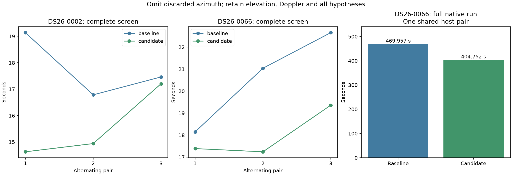
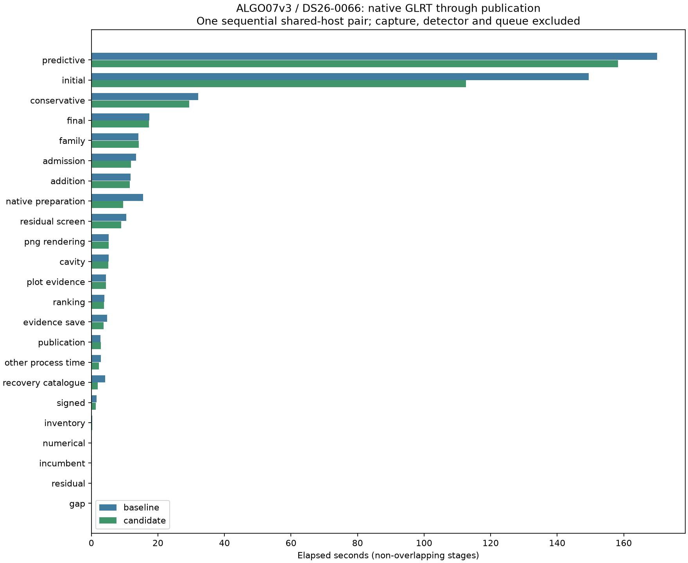

# ALGO07v3: omit discarded azimuth calculations in satellite screening

Twelve alternating complete-screen trials preserve exact results. Mean screen
time improves **12.39% on DS26-0002** and **12.70% on DS26-0066**, with comparable
CPU reductions. **1,162 tests pass**, and a separate replay verifies every
satellite's frequency and elevation at all **99 real coarse projection calls**
on DS26-0066, including array layout and every value byte.

Fresh complete native DS26-0066 time is **469.957 → 404.752 seconds**, saving
65.205 s, an observed **1.161×** ratio. Residual screening improves **10.537 →
8.903 s**, saving 1.633 s (15.50%). Most of the complete difference occurs in
unchanged stages, so it cannot all be credited to omitting azimuth. The change
is integrated in development after exact native qualification. Original-ALGO07
versus current-v3 cumulative speedup remains unavailable in this iteration.

This change affects the projection shared by residual screening and guarded
satellite reassociation. The full native qualification therefore uses
**DS26-0066**, which exercises accepted reassociation, rather than another
DS26-0002-only run. Complete native timing, publication parity and the audit
against the earlier qualified DS26-0066 output are recorded below. Production
and full-dataset admission remain outside this development qualification.

## Profiling evidence and implementation

The preceding post-endpoint profile of DS26-0002 is exact and passes profiler
accounting checks. Its complete screen takes 8.055 profiled seconds, of which
coarse geometry takes 5.804 s (**72.06%**). Look-angle calculation is the largest
exclusive function at 2.250 s (3.440 s cumulative), alongside orbital-state
interpolation/rotation at 2.229 s exclusive (2.337 s cumulative). These nested
times must not be added to stage clocks. Profiling perturbs execution, so the
unprofiled alternating comparisons below measure the optimization.

The screen asks the general sky helper for azimuth, elevation, range and range
rate but consumes only elevation and range rate. The new private projection
retains the exact relative-position subtraction, full ENU matrix multiplication,
range norm, elevation formula, range-rate einsum and zero-range handling. It
omits only `arctan2(east, north)`, conversion to degrees and modulo for azimuth.
Range is still calculated because it is necessary for Doppler rate.

The general sky helper and its public API remain intact. A component-owned
numerical comparison ties the narrow helper to that existing implementation.
All observation, satellite, phase, random-group fold, prior, search-budget and
acceptance choices are unchanged. Both calibration arms retain identical inputs
and numerical policies. No approximation, cache, extra worker or new dependency
is introduced.

## Alternating complete-screen measurements

Each trial includes fresh catalogue propagation and immutable-bank construction,
coarse nomination, fine finalist fitting and callbacks. Loading saved owned
evidence is outside the timer. Every complete screen and callback matches the
saved scientific evidence; input fingerprints remain unchanged. Trials run
sequentially on one CPU with one BLAS thread. Each scan uses baseline-first,
candidate-first, baseline-first pairs.

| Scan / pair | Baseline seconds | Candidate seconds | Exact |
| --- | ---: | ---: | --- |
| DS26-0002 / 1 | 19.139 | 14.629 | Yes |
| DS26-0002 / 2 | 16.785 | 14.941 | Yes |
| DS26-0002 / 3 | 17.463 | 17.204 | Yes |
| DS26-0066 / 1 | 18.148 | 17.389 | Yes |
| DS26-0066 / 2 | 21.039 | 17.243 | Yes |
| DS26-0066 / 3 | 22.657 | 19.361 | Yes |

| Complete screen | Baseline mean | Candidate mean | Reduction | Baseline CPU | Candidate CPU |
| --- | ---: | ---: | ---: | ---: | ---: |
| DS26-0002 | 17.796 s | 15.592 s | 12.39% | 17.769 s | 15.572 s |
| DS26-0066 | 20.615 s | 17.998 s | 12.70% | 20.593 s | 17.990 s |

All six candidate trials are faster, but their gains vary: DS26-0002's third
pair improves only 1.48%, and the first baseline is unusually slow. Keep every
trial rather than selecting the most favorable pair. These means are scoped
observations, not dataset-wide percentiles or complete-pipeline speedups.

## Full native DS26-0066 qualification

Baseline then candidate run sequentially on CPUs 0–2 with one BLAS thread and
the same 1,200-second outer supervision bound. Both start from the same native
GLRT and causal catalogue, using private output stores and read-only mount/network
isolation. Earlier installations and reports are hidden from runtime. The only
changed loaded module in this pair is `leo.analysis.localization_v3.screen_geometry`.
The integrated module must equal the qualified candidate bytes, and both changed
function syntax trees must equal the independently measured prototype.

The comparator checks complete scientific evidence, every audit, both c arms,
point ownership, all public diagnostic grid/path values and all eight PNG bytes.
It permits only the previously defined timing/accounting differences. The
historical comparison additionally declares each intervening source change;
it is an exactness audit, not a controlled cumulative speed comparison.

Both comparisons pass. The historical check preserves the earlier DS26-0066
science and eight PNGs across ten explicitly declared changed modules, including
the intervening catalogue, numerical replay, Cholesky and geometry optimizations.
It strengthens qualification on an accepted-reassociation branch; it does not
establish whole-dataset equivalence or a controlled historical speed ratio.

| Native measurement | Baseline | Candidate |
| --- | ---: | ---: |
| Complete supervised process | 469.957 s | 404.752 s |
| Residual screening | 10.537 s | 8.903 s |
| Reassociation screening/admission | 13.432 s | 11.862 s |
| User + system CPU | 744.120 s | 663.380 s |
| Maximum reported RSS | 2,269,052 KiB | 2,214,652 KiB |
| Initial position search | 149.524 s | 112.536 s |
| Predictive recovery | 170.037 s | 158.329 s |
| Final fit/reassociation stage | 17.475 s | 17.258 s |
| PNG rendering | 5.153 s | 5.193 s |

The initial and predictive fits are unaffected by this screen-only change and
account for much of the observed whole-run difference. Rendering is slightly
slower. The other affected stage, reassociation screening/admission, also improves,
but that stage contains unchanged fitting work as well. The two affected stage
clocks together fall 3.204 s; this is an observation, not an isolated estimate of
the helper's whole-pipeline contribution. Major faults increase 88 → 138; minor
faults change 4,984,403 → 4,870,265
and system CPU 13.450 → 9.810 s. These observations do not isolate the cause of
host variation. Retain all measurements and rely on alternating complete-screen
trials for the narrower improvement, rather than claiming a stable native ratio.

In the candidate, predictive recovery is **39.1%** of total time and initial
search **27.8%**, together **66.9%**. Residual screening is **2.2%**. This harder
scan reinforces fitting as the next major opportunity; small geometry savings
cannot by themselves solve the complete runtime problem.

See [native/comparison.json](native/comparison.json),
[native/history-parity.json](native/history-parity.json), [summary.json](summary.json)
and the complete [stage table](stage-table.md). The stage table includes evidence
save, publication and unscoped process time without double-counting nested work.

The fresh post-change DS26-0066 screen profile also passes exact-output and
accounting checks. It takes 14.486 profiled seconds: coarse geometry 10.028 s
(69.23%), propagation 2.467 s, coarse scoring 0.894 s and fine geometry 0.083 s.
Phase-state interpolation/rotation is now the largest exclusive function at
5.318 s (5.656 s cumulative); the new projection takes 2.401 s exclusive
(4.279 s cumulative) across 198 site calls. See [profile-after.json](profile-after.json).
The preceding profile is a different scan under different host conditions;
their absolute durations are not a before/after speed comparison.

DS26-0066 retains **2,770/3,927 GLRT points (70.5373%)**, 89 tracks
and 20 satellites, including accepted replacement of 62025 by 68047 for the same
140 points. Exact historical comparison confirms those results remain intact.
The c=0 position is (37.85971669372918, -122.49009926661317), RMS
88.12274800877016 Hz; fitted c is (37.85958863924463, -122.4896053030657), RMS
86.98662872563048 Hz. No position-accuracy improvement is inferred from runtime
changes. Evaluation GPS enters presentation only.

## Validation and reproduction

Owned projection tests cover zero/one/many satellites, C/Fortran/strided arrays,
ordinary and polar sites, zero range, zenith/nadir geometry, signed-zero velocity,
input preservation, output layouts and all value bits. Existing wrapper tests
retain empty/repeated times, scalar/per-satellite phases, two receiver positions,
nondefault RF/altitude, malformed banks and invalid parameter handling. The
external harness verifies temporary substitution is restored even on failure.

The broad suite passes **1,162 tests with no failures or skips**. Its three
warnings are existing NumPy deprecations from intentional metadata-mutation tests.
Initial harness checks exposed a missing required observer-altitude argument;
that test setup was corrected before scientific timing. Ruff also caught a missing
NumPy import in the prototype. The initial test receipts are retained under
`native/initial-test-errors.json`; no numerical tolerance or golden fixture was
changed to obtain a pass.

Run `tools/probe_algo07v3_screen_azimuth.py --request REQUEST --output FRESH_ROOT`
with one CPU, one BLAS thread and an external 360-second timeout. The frozen
screen oracle is an external benchmark reference and never a runtime dependency.
Both implementations use the same current phase interpolation. The prototype
retains all ordinary validation and final RF scaling from the original wrapper.

`prove_projections.py` compares both outputs at all real coarse calls, rather
than only comparing winning nominees. Its doubled computation is an exactness
proof, not a speed measurement. `run_pair.py`/`run_baseline.sh` run the one-module
native pair, and `verify_history.py` audits the earlier DS26-0066 publication.
`render.py` checks bindings, full comparisons, tests and proof before exporting
all figures and tables. Raw run roots and source/input digests are retained in
the committed receipts.

The profiling skill now uses progressive disclosure: its entrypoint shrinks
from **449 to 102 lines**, with every historical recipe preserved verbatim in
`references/experiments.md`. It routes to only the relevant experiment rather
than requiring the entire history each time. Skill validation passes, and
`skill-validation.json` records the preservation check.

## Scope and next action

Capture, detector/native GLRT extraction and queue delay are excluded from the
native-input-to-publication clock. Neither a component mean nor unrelated
historical clocks establish original-ALGO07/current-v3 cumulative speedup. Do
not multiply separate optimization ratios. Whole DS26 qualification and ordinary
production admission remain open; the measured requests use the existing
validation-all-work policy without changing its numerical budgets.

Use the new complete native breakdown to choose the next target. Predictive
fitting and initial search remain likely priorities based on the preceding
profiles. Preserve all precision updates, optimizer retries and hypotheses.
General likelihood hashing, variance-buffer reuse and owner-only gradient
scheduling already have negative evidence; a new proposal must address a
measured cost and pass complete-fit and native exactness checks.

Source review identifies a concrete scheduling hypothesis for initial search:
the three selected branches are fitted sequentially, with only their two arms
concurrent. All branch/arm fits have independent inputs. A bounded queue of these
six tasks could occupy the existing three-worker allowance and reduce waiting
for the slower arm before starting the next branch. Keep original branch/arm
result order, callbacks, branch selection and all budgets. The annotation stage
already has a suitable bounded-queue pattern. This has not yet been measured or
implemented for initial search; check complete-stage CPU and RSS as well as
latency before adopting it. It differs from the earlier discovery-seed scheduling
and rejected owner-gradient experiments.
