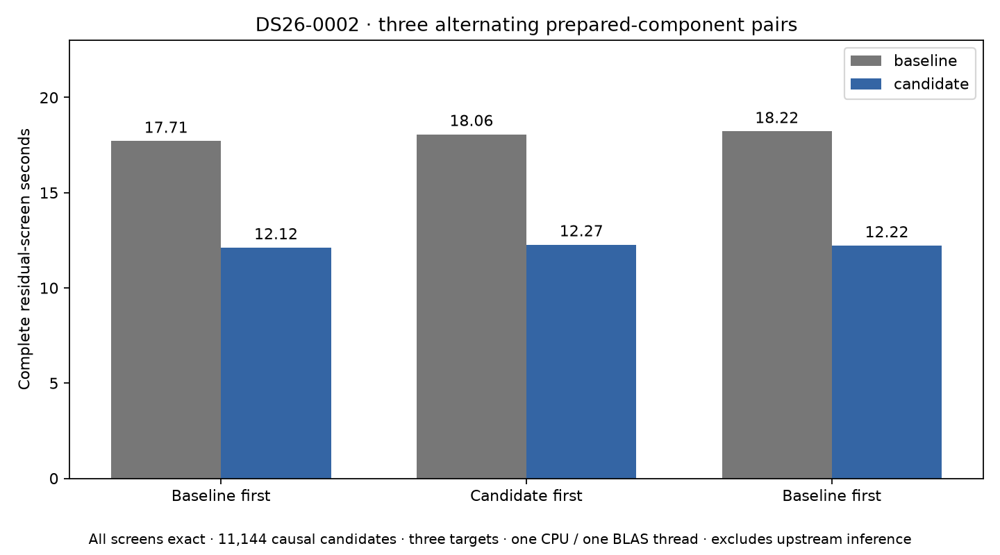
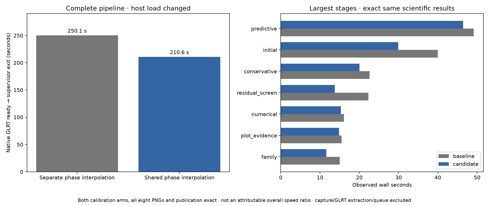

# ALGO07v3: share residual-screen orbital interpolation

2026-11-05. Development integration; production unchanged.

Residual screening now interpolates each orbital phase once and projects those
same states at the two independently fitted receiver positions. Three alternating
prepared-component pairs average **17.997 → 12.203 seconds**, **32.19% less wall
time**. CPU averages **17.984 → 12.190 seconds**. Every complete screen matches
the frozen result exactly.

A fresh complete DS26-0002 baseline/candidate comparison also passes exactly:
both calibration arms, all scientific audit sections, ownership, all eight PNG
bytes, public fields and grid/path. Its observed **250.094 → 210.621 seconds**
is affected by changing shared-host load and is **not an attributable 15.78%
pipeline improvement**. The alternating component benchmark supplies the stronger
evidence for the approximately 5.8-second saving in residual screening.



## Why this change

The [previous per-process profile](../2026_11_05_algo07v3_recovery_arms/README.md)
identified repeated phase interpolation as a substantial screening cost. Its
parent profile attributes 36.975 inclusive seconds to `phase_frequency_grid`
within residual screening. That is profiled time, not predicted savings. The
residual-screen module was unchanged by the intervening recovery-arm scheduling
optimization; this iteration freezes its original bytes at SHA-256
`c605070f6fc7433c727c6e4df746f9766570bfa9b161c18c5dc6f7a6cbc5a9b4`.

For a fixed satellite catalogue, observation times and phase, interpolation and
Earth-orientation correction do not depend on receiver position. Previously,
the c=0 and fitted-c loops repeated both operations. The new pure
`screen_geometry.phase_frequency_grids` helper validates and interpolates once,
then runs the original geodetic conversion, look-angle calculation and Doppler
arithmetic separately for each receiver position.

The residual screen streams one phase at a time. Each arm still accumulates
minimum scores in its original phase and fold order. Finalist nomination is
emitted in the original arm/fold order. Fine phase/alias integration, candidate
sets, causal TLE rules, priors, noise checks and acceptance are unchanged.

This uses no persistent cache, catalogue snapshot copy or all-phase state bank.
Only the current phase's states and the two projected grids coexist. Later
calls revalidate and recompute their inputs, so a changed or corrupted bank
cannot reuse stale states. Independent output arrays allow the existing
in-place RF scaling without changing the other arm's values.

## Exactness tests

The broader suite passes **918 tests in 28.60 seconds**, with zero failures,
errors or skips. Three additional benchmark-tool tests pass separately. The
new tests cover:

- Bitwise frequency/elevation equality with independent original calls, including
  scalar and satellite-specific phases, empty/unsorted/duplicate times, polar
  positions, nonzero altitude and different RF.
- One interpolation per helper call and no aliasing between returned arms.
- Recalculation after bank mutation, plus corrupt states, malformed shapes,
  bad time knots, invalid phases and extrapolation rejection.
- Complete screening and callback equality against a frozen implementation for
  all four age/phase/recency policies, two targets, distinct c-arm positions,
  propagation failure and all four randomized/full folds.
- Alternating benchmark order, exact checking of every result and bounded repeats.

See [suite receipt](tests.xml), [suite command](test-command.json),
[benchmark tests](benchmark-tests.xml), and the frozen
[screen oracle](../../tools/algo07v3_prescreen_geometry_oracle.py). The oracle
is external test evidence, never a runtime dependency. Existing scientific
holdout seeds and group assignments are unchanged.

## Alternating component benchmark

The benchmark reads prepared residual evidence and the causal catalogue through
`LocalizationV3Store.load`, from the fresh baseline's public owned result. It
repeats the entire residual screen, including propagation, nominations, fine
scoring and holdout checks, using **three targets and 11,144 causal catalogue
entries**. Each result is compared with the saved complete screen, and input
fingerprints must remain unchanged. The candidate does not receive known
satellite identities as fitting inputs; the saved result is used only afterward
for comparison.

| Pair | Execution order | Baseline wall s | Candidate wall s | Baseline CPU s | Candidate CPU s |
| --- | --- | ---: | ---: | ---: | ---: |
| 1 | Baseline, candidate | 17.707 | 12.116 | 17.704 | 12.110 |
| 2 | Candidate, baseline | 18.063 | 12.274 | 18.048 | 12.255 |
| 3 | Baseline, candidate | 18.219 | 12.219 | 18.200 | 12.205 |
| Mean | Alternating | **17.997** | **12.203** | **17.984** | **12.190** |

All six executions are exact. They run sequentially on CPU 0 with one BLAS
thread, under a 360-second external bound, after the full-run comparison has
finished. The 90.673-second benchmark clock includes all six screens and
comparison work. It excludes upstream localization and publication and is not
an end-to-end measurement. [Raw pairs and bindings](component-pairs.json) retain
the input receipt, source hashes and runtime scope.

Reusable command, from the active checkout with its pinned interpreter:

```sh
PYTHONPATH=src:tools OPENBLAS_NUM_THREADS=1 OMP_NUM_THREADS=1 \
  taskset -c 0 timeout -k 2 360 python -B \
  tools/benchmark_algo07v3_screen_geometry.py \
  --request /absolute/completed-owned-request.json \
  --output /absolute/new-component-pairs.json --repeats 3
```

The [profiling skill](../../.agents/skills/profile-algo07v3/SKILL.md) now includes
this command and distinguishes prepared-component evidence from complete runs.

## Fresh complete pipeline comparison

Baseline: commit `dd358f8b7bff55443795c88e4d891d7cac404a19`, including the prior
recovery-arm optimization. Only `residual_screen` changes; `screen_geometry`
is the one new loaded module. Both executions use the same native request,
causal input bundle, 25 × 25 km regional search, priors, budgets and presentation
settings, with CPUs 0,1,2, one BLAS thread per process and 1,200-second bounds.
Older installations, old bulk results and reports are hidden; network access
is isolated and the input bundle is read-only. Output stores are fresh.



| Measurement | Baseline | Candidate |
| --- | ---: | ---: |
| Owned CLI process wall s | 250.094 | 210.621 |
| Residual screen wall s | 22.304 | 13.743 |
| Unchanged initial-position stage wall s | 39.955 | 29.904 |
| Unchanged native preparation wall s | 12.845 | 8.610 |
| Unchanged catalogue preparation wall s | 9.093 | 5.698 |
| User CPU s | 302.65 | 257.13 |
| System CPU s | 13.40 | 14.74 |
| Total CPU s | 316.05 | 271.87 |
| Maximum reported process RSS, KiB | 2,462,160 | 2,523,364 |

The unchanged stages also speed up substantially. Consequently, neither the
39.473-second whole-run difference nor the entire CPU difference can be credited
to this change. Maximum reported process RSS increases about 2.5% in this pair;
it is not aggregate simultaneous memory across children. The candidate's
210.621 seconds must not be directly compared with the earlier 202.201-second
run as a regression: those were different experiments and host conditions.

The [comparison receipt](comparison.json) verifies exact scientific and published
outputs, including the c=0 versus fitted-c ablation. [Summary](summary.json)
contains every stage's duration. [Plan](plan.json), [baseline bindings](baseline-sources.json),
[serial receipt](baseline-supervisor.json), [candidate receipt](candidate-supervisor.json)
and isolation/host-pressure records preserve the execution evidence. GNU time
CPU accounting includes the isolation wrapper and descendants; the headline
wall clock is the owned supervisor's child interval. Capture, native GLRT
extraction and queue delay remain excluded.

## Limits and next iteration

This is development qualification on DS26-0002, not full DS26 or independent
population validation. The DS26 denominator remains 159 fast members, with 158
native inputs available in the recorded inventory. Ordinary production admission,
broader accepted branches and the tenfold complete-path target remain open.
Do not multiply this component gain by earlier whole-run ratios.

The same position-independent interpolation opportunity exists in reassociation
screening and multi-position nomination. Next, test streaming reuse across
reassociation arms while preserving cavity fits, coarse-row order and acceptance.
Then broaden exact qualification to a scan with accepted reassociation, including
DS26-0066. More expensive multi-position caching needs an explicit memory bound
and fresh evidence before adoption.

Code, tests, benchmark recipes and figures are published together. Production
was not deployed or modified by this iteration.
