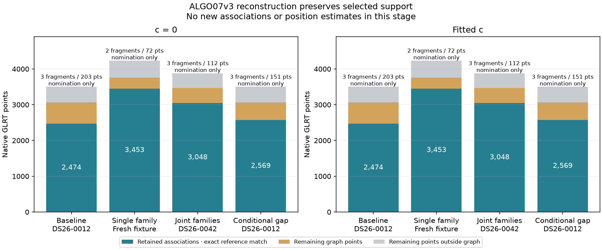

# ALGO07v3: selected likelihood reconstruction and residual preflight

The standalone engine now reconstructs the full adopted likelihood needed by
the additional-family recovery stage. It also ranks the remaining native graph
fragments and subtracts the selected receiver corrections for candidate screening.
Fresh comparisons against frozen ALGO06 match exactly in four branches on three
scans, with both calibration arms checked. The candidate runs with old installations
hidden and the existing import/process/read guard enabled.

This is an implementation and equivalence increment, not a new association method
or a complete ALGO07v3 run. Nothing was deployed. Full DS26 parity, all eight UI
artifacts and the 10× complete-path target remain unfinished.

## What changed

`selected_incumbent.py` reconstructs baseline, shared/single-family, joint-family
and conditional-gap selected states from explicit owned scientific values. It
preserves the receiver likelihood and any selected additional-family phase
mixtures. The joint branch uses the frozen ALGO06 direct contraction order.
Conditional gaps replay their source evidence and shared satellite refresh.
The new context verifies the selected core and complete objective separately,
rejects nonfinite or changed objectives, checks all independently supplied owners
and refuses duplicate additions. Incidental graph extensions are counted but
never silently adopted.

`residual_fragments.py` extracts the original native-fragment ranking. Claimed
points, source polynomial-piece boundaries and gaps strictly greater than five
seconds split fragments. Identical physical-ID alias variants collapse; partial
overlap is rejected. Graph-to-native lane/time provenance and unique-point
conservation are checked. Polynomial residuals and alias-lift diagnostics are
preserved.

`residual_preflight.py` keeps the original eligibility rule: at least 20 points,
at least 15 seconds, no overlap with either selected arm's owners; rank by decreasing
duration, decreasing point count, then fragment ID; retain at most three. It
converts in-memory NumPy scalars to their original native scalar representation
without a filesystem/JSON roundtrip. For each arm it subtracts the already-fitted
hardware term and RF-scaled receiver smooth drift. Target points do not recalibrate
the receiver. Scan metadata is an explicit argument whose origin must match the
selected likelihood.

The application exposes `prepare_additional_recovery`. The fresh candidate oracle
calls this entry point using in-memory native tracks, the independent selected
owners/arms, and the complete selected trial. It returns a reconstructed context,
residual inventory and corrected screening packet with `recovery_complete=False`.
Automatic binding of these inputs from the preceding controller checkpoints is
still to be implemented; this check explicitly supplies the selected stage data.

## Exact comparison



| Reconstruction fixture | Native GLRT | Retained points, each arm | Residual graph points | Eligible fragments | Nominated fragments / points | Reference = candidate |
|---|---:|---:|---:|---:|---:|---|
| Baseline, DS26-0012 | 3,503 | 2,474 | 589 | 7 | 3 / 203 | Exact |
| Selected new family, fresh-fallback fixture | 4,233 | 3,453 | 300 | 2 | 2 / 72 | Exact |
| Selected joint families, DS26-0042 | 3,881 | 3,048 | 416 | 7 | 3 / 112 | Exact |
| Selected conditional gap, DS26-0012 | 3,503 | 2,569 | 494 | 6 | 3 / 151 | Exact |

The baseline and gap rows are two already established states of the same scan.
The 95-point difference was recovered by the preceding gap implementation; this
iteration preserves it. Nominated points in the table are **not new associations**.
No position fit or position-accuracy improvement is claimed here.

For both c=0 and fitted-c the comparison covers:

- The reconstructed selected position, phase reference, full calculation and state.
- Newly constructed likelihood factories at the selected position and at
  a fixed perturbation of +0.2 km east / −0.1 km north.
- Predictive entries, family prior receipts and selected-likelihood replay checks.
- The complete residual inventory, source identities, eligibility/order and
  every corrected target array in the preflight packet.

Every compared floating-point scalar is represented by its exact hexadecimal
value; arrays include dtype, shape and a content hash. All eight core-objective
and all eight complete-selected-objective replay differences are exactly zero.
The joint-family fixture produces 17 incidental unpublished extensions in each
arm; both implementations leave all 17 uncredited.

| Fixture | Exact output SHA-256 |
|---|---|
| Baseline | `e72044f80552f3ee4e6f63d2e7eef459bb764c29864044d273aa6fa130ad0a9c` |
| New family | `5e5de8e85440d4eec82c5d0520ff63a4af2c5eaaf284c85ab6176294ee3eb089` |
| Joint families | `cf78f68d8215a188fde03f7fca7bf9b95c694346d73bb8818cb8e4ecff877f30` |
| Conditional gap | `cad8109b1aaefdae92c7f888d1410325c988ebb3893e66de9bb4a046afb5ce8a` |

The frozen reference is `/opt/leo-fast-graph/cf16ac5bd6a8f1ac65f626eba57326f2a2d2e6b5`.
Fresh evidence is under `/srv/bulk/leo/research/algo07v3-20261104/incumbent005`.
The oracle is an external test adapter; it reads explicitly supplied old fixtures
and translates their file references into owned values. Those readers are not part
of production inference. Candidate reconstruction executes with `/opt` replaced
by an empty read-only mount and retains the existing dependency guard.

## Validation and limitations

The focused component/application/operation/tool suite passes **332 tests** with
zero failures, errors or skips. New checks cover objective corruption, NaN,
ownership reassignment, missing calibration arms, omitted family evidence,
joint contraction order, changed gap provenance, claimed-point/source-piece/gap
boundaries, alias duplicates, provenance mismatches, both-arm exclusion, native
array/scalar equivalence, selected receiver/RF corrections and strict comparison
failures. Ruff passes on the new numerical modules, tools, tests and report renderer.

The first preflight run found an invalid assumption that the owned scan carried
the old `.receipt` attribute. The fix passes metadata explicitly and checks the
origin timestamp. No dependency guard or scientific tolerance was relaxed. The
initial baseline test adapter also assumed owners were stored in inventory policy
rows; it now reads the explicitly supplied published source support instead.

This is a focused suite, not a claim that the entire repository test suite passes.
The preceding gap-controller report documents the unrelated broader application
failures and their unchanged-eager-initializer control.

Shared-family and inactive-fragment reconstruction paths need additional real
fixtures. Graph-bundle and modified-measurement incumbent views are explicitly
unsupported in this extraction and cannot be called qualified. The end-to-end
controller must bind the selected raw trial and annotations without reading old
results. Catalogue screening, additional-family position trials, final guarded
reassociation, deadline/cancellation qualification and all UI publication remain
to be integrated and qualified across the full denominator.

## Runtime accounting

| Scope | Reference observed seconds | Candidate observed seconds |
|---|---:|---:|
| Baseline reconstruction + ranking/preflight | 3.965 | 3.304 |
| Single-family reconstruction + ranking/preflight | 5.098 | 4.255 |
| Joint-family reconstruction + ranking/preflight | 4.711 | 3.920 |
| Conditional-gap reconstruction + ranking/preflight | 4.041 | 3.323 |

These are concurrent shared-host component observations, including fixture loading
and fingerprint generation. They are **not controlled speedups**. Complete-path
baseline, candidate duration, savings and speedup remain unavailable; complete-path
matched scans remain zero. Exact reconstruction makes later optimization testable
but does not by itself meet the requested performance goal.

## Reproduce the evidence

The check tool accepts `--side reference|candidate`, `--mode baseline|selected|gap`,
`--preflight`, `--runtime` and `--output`. Selected mode takes `--input`; baseline
takes `--inventory` and `--decision`; gap takes `--inventory` and `--trial`.
All explicit fixture paths, loaded modules, tool source and outputs are recorded
in adjacent receipts. Use a fresh output location; overwrite is rejected.

For a candidate run, use the existing private mount pattern:

```sh
sudo -n timeout 240 unshare --mount --propagation private sh -c \
  'mount -t tmpfs -o ro,size=1m tmpfs /opt && exec "$@"' isolated-v3 \
  env PYTHONPATH=src:tools OPENBLAS_NUM_THREADS=1 OMP_NUM_THREADS=1 \
  /home/mouse9911/gits/leo-tracker-reduxredux/.venv/bin/python -B \
  tools/check_algo07v3_selected_incumbent.py --side candidate --preflight \
  --mode selected \
  --input /srv/bulk/leo/research/algo07-runtime-20261103/population/DS26-0042-v1/input/inputs/SCAN.json \
  --runtime /opt/leo-fast-graph/cf16ac5bd6a8f1ac65f626eba57326f2a2d2e6b5 \
  --output /tmp/algo07v3-selected-joint-fresh.json
```

From the authoritative worktree, verify all source bindings and regenerate this figure:

```sh
PYTHONPATH=src:tools OPENBLAS_NUM_THREADS=1 \
  /home/mouse9911/gits/leo-tracker-reduxredux/.venv/bin/python -B \
  reports/2026_11_05_algo07v3_selected_incumbent/render.py \
  --evidence /srv/bulk/leo/research/algo07v3-20261104/incumbent005 \
  --output reports/2026_11_05_algo07v3_selected_incumbent
```

The renderer rejects changed source/fixture bindings, any scientific mismatch,
missing branch/arm evidence, or failed focused tests. Its source check is tied to
this revision; later source changes require a fresh run or an explicitly pinned
historical comparison, not silently accepting stale receipts.
