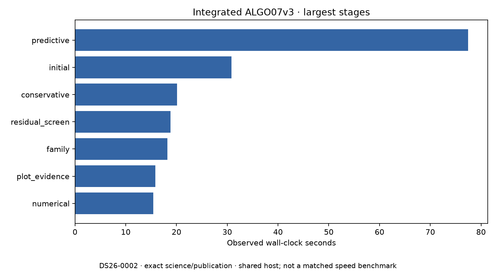

# ALGO07v3: exact solver optimizations integrated into the standalone CLI

2026-11-05. Development implementation; **not deployed**.

The owned CLI now uses the qualified upper-root solver and skips Gaussian
posteriors that are immediately overwritten. A fresh isolated native run matches
the pre-optimization implementation exactly in every compared scientific field,
both calibration arms, all eight PNG bytes, grid/path artifacts and published
document fields. **820 tests pass.** No scientific fixture or tolerance changed.

This closes development integration of these two optimizations. It does not
close full DS26 equivalence, other native accepted branches, excluded historical
metadata semantics, ordinary production admission/deadlines or the 10× target.

## Changes and independent evidence

The [hierarchical kernel](../../src/leo/analysis/localization_v3/hierarchical.py)
reuses the lower Cholesky root's LU for separate vector and matrix right-hand
sides. Its transpose is already upper triangular, so the same LAPACK solve can
consume it with identity pivots without factoring it again. Operation shapes,
precision iteration budgets, stopping rules, priors and output fields remain
unchanged. The integrated function's syntax tree must match the exact previously
qualified prototype, apart from the private helper's name.

The [normal position](../../src/leo/analysis/localization_v3/position.py) and
[discovery position](../../src/leo/analysis/localization_v3/discovery_likelihood.py)
calculations now request the existing parent geometry-only path. They previously
computed five Gaussian posterior fields and then overwrote every one with the
hierarchical result. The parent input validation remains. Other likelihood paths
already used this mode.

Before integration, an alternating full-scan probe compared every field returned
by the original and modified position calculations:

| Calculation | Exact calls | Original time | Skip discarded solve |
| --- | ---: | ---: | ---: |
| Normal position | 1,676 | 80.803 s | 73.206 s |
| Discovery position | 16 | 1.327 s | 1.283 s |
| Total | **1,692** | **82.130 s** | **74.490 s** |

The measured saving is **7.640 seconds** in these calculations. The complete
native snapshot and all eight PNG hashes remained exactly
`4f7c74a132b415e9bd6e130dcbc0d7082fa72c822d53f76810f8a9fa13323d68`.
The probe's 550.537-second process time includes duplicated calculations and
comparisons and is not normal runtime. [Probe receipt](gaussian-probe.json),
[native binding](gaussian-native-receipt.json).

## Fresh integrated execution

The development CLI ran from native GLRT, an explicit causal archive and the
unchanged regional search configuration in private mount/network namespaces.
Earlier ALGO installations, older result storage and repository reports were
hidden. Input files were read-only. The run generated a fresh scientific archive,
all eight figures and an atomic WebUI publication through the existing ports.
Evaluation coordinates were supplied only for presentation.

The comparison requires exactly three loaded source changes: `hierarchical`,
`position` and `discovery_likelihood`. It checks fresh successful supervision,
request/source bindings, all scientific evidence and presentation, published
bytes and sidecars. It passed. [Complete comparison](comparison.json),
[predeclared integration plan](plan.json), [summary](summary.json).

Both arms retain **2,783 / 4,211 GLRT points (66.0888%)**, 74 components and
28 satellites, with the same positions and residual values as before. The changes
do not gain speed by reducing evidence, hypotheses, iterations or artifacts.

| Timing scope | Observation | Interpretation |
| --- | ---: | --- |
| Earlier upper-root prototype's complete pair | 266.242 → 252.572 s | 5.13% observed reduction on one scan/shared host |
| Fresh integrated native-to-publication execution | **264.356 s** | Correctness execution; not a new matched speed pair |
| Cumulative original ALGO07 → integrated v3 speedup | **Unqualified** | Full comparable measurement remains required |

The first row is the [separate upper-root experiment](../2026_11_05_algo07v3_factor_reuse/upper-root.md).
Do not subtract the Gaussian component saving from it or infer a cumulative
ratio from runs with different host conditions. Capture, queue delay and GLRT
extraction remain outside these native-to-publication observations.

Predictive recovery remains the largest stage. This gives the next performance
investigation a measured target after numerical redundancy has been reduced.

## Tests, reproducibility and next cases

The broad suite passes **820 tests**, including the previous components, public
contracts, execution/cancellation, storage, publication and HTTP checks. New
component tests compare both calibration arms and masked observations against
frozen pre-optimization methods using a separately frozen old kernel. They also
check LAPACK errors remain numerical failures. Earlier tests retain exact byte
comparisons across zero-width, sparse, dense, C/Fortran and degenerate cases.
[Test results](tests.xml), [frozen-reference bindings](frozen-oracles.json).

The three new `tools/algo07v3_presolver_*_oracle.py` files are exact copies from
the pre-integration commit `dc8b33922`, with provenance comments. They are
external test references and are never imported by the runtime. The diagnostic
probes now use these frozen methods so they remain usable after the runtime
changes. Reproduce the older upper-root report's original source-bound experiment
at `dc8b33922`; its recorded hashes are deliberately not rewritten.

The [renderer](render.py) validates original probe source from its published
commit, old source copies, input hashes, exact integrated comparison, successful
isolated execution and 820-test receipt before producing this report's artifacts.
Raw integration evidence: `/srv/bulk/leo-dev/algo07v3-upper-integrated-20261105`.

DS26-0066 is the next native canary because its previously frozen final-stage
fixture exercised an accepted 62025 → 68047 replacement. Its fresh native
pipeline outcome is not assumed. A new bundle contains the independently bound
native input and **all 39 archive snapshots collected in its causal 72-hour
window**, without satellite preselection. Its metadata retains the full DS26
denominator: 159 fast members, 158 with native inputs and one unavailable member.

A bounded sequential comparison is running at
`/srv/bulk/leo-dev/algo07v3-cohort-canaries-20261105/DS26-0066-pair`.
The [runner](run_canary_pair.py) first executes the pre-optimization modules in
a private namespace, then the integrated CLI, and compares all owned science
and artifacts. Both use CPUs 0–2, one BLAS thread and a 1,200-second bound per run.
No result or native accepted-branch qualification is claimed before completion.
