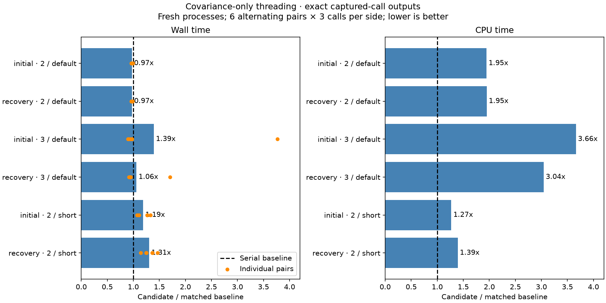

# ALGO07v3: primitive attribution and covariance-only threading

**Do not adopt covariance threading.** A two-thread covariance-only prototype
preserves complete captured outputs and reduces wall time by 2.54–2.72%, but
increases measured CPU time by about 95%. Three threads regress on average.
Shortening the helper wait reduces its CPU penalty but makes both calls slower
than baseline. Runtime, production, numerical budgets and scientific fixtures
remain unchanged; there is no newly qualified complete-worker speedup.

This follows the [broad BLAS gate](../2026_11_06_algo07v3_blas_threads/README.md),
which found inexact outputs when whole libraries used multiple threads. The new
observer identifies which operations differ, and the prototype threads only an
operation that passed that check. All experiments use the same saved DS26-0066
initial and recovery likelihood inputs, restricted to CPUs 0–2.

## Primitive attribution

The observer runs the original one-thread trajectory. Before each operation it
tests the same inputs with two or three threads, compares all returned bytes,
then returns the original result. It stops shadow-testing a primitive after its
first mismatch, while continuing the original fit. Both complete observed
likelihoods match the independent one-thread signatures from the previous report.
Every mutable LAPACK RHS is copied before the original call, and a one-thread
copy control must itself be exact before a threading comparison is accepted.

| Primitive | Initial, 2 threads | Initial, 3 threads | Recovery, 2 threads | Recovery, 3 threads |
| --- | --- | --- | --- | --- |
| Cholesky factorization | Differs at call 1 | Differs at call 1 | Differs at call 1 | Differs at call 1 |
| Lower-root LU factorization | Differs at call 1 | Differs at call 1 | Differs at call 1 | Differs at call 1 |
| Inverse-root matrix solve | Differs at call 1 | Differs at call 1 | Exact, 256 calls | Differs at call 2 |
| Coefficient vector solves | Exact, 514 calls | Exact, 514 calls | Exact, 514 calls | Exact, 514 calls |
| Covariance product | Exact, 256 calls | Exact, 256 calls | Exact, 256 calls | Exact, 256 calls |
| Feature matrix × coefficients | Differs at call 3 | Differs at call 1 | Exact, 257 calls | Exact, 257 calls |

The grouped setup products and final scalar products also remain exact on both
captures. These results describe these inputs and binaries; they are not a
general guarantee for arbitrary matrix shapes or new library versions.

One observer implementation detail matters: independently copying the operands
of `A.T @ A` can change NumPy's dispatch and resulting bytes even with one thread.
The initial width-177 component test caught this. NumPy products are read-only
here, so the corrected observer retains operand aliasing for those calls. It
still owns separate LAPACK mutation buffers. All four observations use the
corrected implementation and preserve the original full trajectory.

## Covariance-only prototype

The external candidate wraps only `inv_root.T @ inv_root`: switch NumPy's BLAS
count to two or three, compute the unchanged expression, and restore one in a
`finally` block. SciPy and every other NumPy operation remain at one thread.
Actual thread settings and both loaded library binaries are verified. The
prototype is research-only; it is not inserted into concurrent production fits.

Same-process alternating pairs initially showed a small gain, but some serial
control CPU times exceeded their wall times after a threaded call. A separate
fresh-process harness removes that carryover: every timed side gets its own
process, one warm call, and three measured calls. Six pairs alternate order.
All full returned fields remain byte-identical to the independent serial
reference, and inputs remain unchanged. The table reports means; all individual
pairs and unfavorable outliers are retained.

| Capture | Covariance setting | Baseline wall | Candidate wall | Wall change | CPU change |
| --- | --- | ---: | ---: | ---: | ---: |
| Initial | 2 threads, default wait | 0.205824 s | 0.200220 s | −2.72% | +94.55% |
| Recovery | 2 threads, default wait | 0.183807 s | 0.179131 s | −2.54% | +94.89% |
| Initial | 3 threads, default wait | 0.212041 s | 0.295476 s | +39.35% | +266.18% |
| Recovery | 3 threads, default wait | 0.190013 s | 0.201343 s | +5.96% | +204.31% |
| Initial | 2 threads, short wait | 0.206618 s | 0.245820 s | +18.97% | +26.89% |
| Recovery | 2 threads, short wait | 0.182742 s | 0.238526 s | +30.53% | +39.33% |



The three-thread means include individual large regressions. Do not discard
those samples or use their more favorable medians as evidence of a reliable
gain. Shared-host variation remains possible; this small kernel experiment
does not measure pipeline throughput or independently attribute each outlier.

The short-wait experiment sets `OPENBLAS_THREAD_TIMEOUT=4` **before** importing
NumPy/SciPy in each fresh process. Both libraries' native environment getters
return 4. This value is an exponent controlling the helper wait, not a
four-second timeout. Upstream [server code](https://raw.githubusercontent.com/OpenMathLib/OpenBLAS/develop/driver/others/blas_server.c)
contains a polling interval followed by a condition-variable wait; its
[environment reader](https://raw.githubusercontent.com/OpenMathLib/OpenBLAS/develop/driver/others/openblas_env.c)
exposes the setting. The observed CPU reduction is consistent with less waiting
activity, but these counters do not separately measure spinning and wakeup costs.
Both serial controls and candidates use the same timeout environment in each
pair. Short-wait results preserve bytes, but their wall regressions reject this
setting without further numerical qualification.

## Decision and next target

The strongest measured candidate saves only about 5 ms per captured call while
nearly doubling CPU consumption. It would require a spare-capacity policy to
avoid competing with other fits under the existing three-slot allowance. Given
the small gain, prior unsuccessful helper policies, and short-wait regression,
that added machinery is not justified here. Complete training, native subset
qualification and deployment were therefore **not attempted** for this candidate.
Captured-call equality is not a substitute for those gates.

The unchanged full profile still identifies initial search and predictive
recovery as 64.4% of a 394.960-second hard-scan worker. The next exact optimization
should census remaining duplicate complete fits across a bounded, branch-diverse
DS26 subset: shared-family, new-family and retry paths. Existing control-view
reuse already handles some duplicates. Measure incremental opportunity and key
cost before adding any cache. Retain all folds, both calibration arms, ordered
acceptance state, and full history/audit/PNG equality.

Do not repeat generic BLAS-thread or idle-helper trials based on these small
captured-call gains. A convergence redesign remains a separate scientific
candidate: the repeated 256-iteration phases offer a larger opportunity, but
changing them is outside the current identical-output optimization contract.

## Evidence and reproduction

- [Summary](summary.json), [timing table](timings.md), and [raw receipts](receipts)
  preserve all four primitive observations, two original same-process trials,
  and six fresh-process experiments. The latter contain 216 timed likelihood
  evaluations plus warmups. These are two cases from one scan, not a DS26-wide
  runtime distribution or a position-accuracy evaluation.
- [Seventeen component tests](tests.xml) cover full trajectory preservation,
  operand mutation, first-mismatch reporting, restoration after exceptions,
  fresh-process isolation, inherited-environment overrides and child failures.
  Ruff passes for the three new tools, tests and report renderer.
- [The original fresh-process runner](measured-default-benchmark.py) is retained
  because the later runner adds explicit timeout configuration. The report
  renderer verifies the exact measured source version, numerical source, input
  bindings and library hashes before rendering. Runtime source is unchanged.

```sh
PYTHONPATH=src:tools OPENBLAS_NUM_THREADS=1 OMP_NUM_THREADS=1 \
  timeout -k 2 120 taskset -c 0,1,2 \
  /home/mouse9911/gits/leo-tracker-reduxredux/.venv/bin/python -B \
  tools/profile_algo07v3_blas_primitives.py --threads 2 \
  --capture /absolute/saved-capture --output /absolute/fresh-observer

PYTHONPATH=src:tools OPENBLAS_NUM_THREADS=1 OMP_NUM_THREADS=1 \
  /home/mouse9911/gits/leo-tracker-reduxredux/.venv/bin/python -B \
  tools/benchmark_algo07v3_covariance_threads.py --threads 2 \
  --capture /absolute/saved-capture --output /absolute/fresh-benchmark
```

Add `--thread-timeout 4` only to reproduce the short-wait experiment. Each child
is bounded to 60 seconds, source/input bindings are checked, and a failed child
cannot become a successful timing sample. No RF collection or QNAP writes occur.
