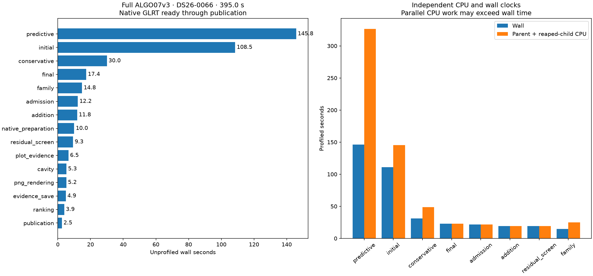
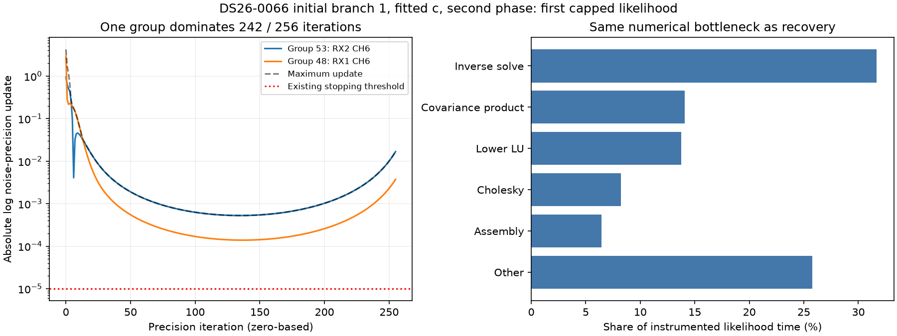

# ALGO07v3 full-profile review and BLAS threading decision

The priority remains numerical fitting: initial search and predictive recovery
take **254.225 of 394.960 seconds (64.4%)** on DS26-0066. The completed threading
experiment adds no qualified optimization. All six multi-thread configurations
fail exact output equality on at least one captured likelihood. Keep one BLAS
thread per fit. Runtime and production are unchanged.

This review reuses the complete timer profile and verifies **all 937 source/input
bindings still match**. It does not claim a newly executed whole-worker timing.
The profile includes native preparation, both calibration arms, search, recovery,
reassociation, diagnostic figures, evidence storage and publication of eight PNGs.
Capture, IQ-to-GLRT extraction and queue waiting are outside this clock. The scan
is a deliberately difficult case, not a dataset runtime distribution.

## Complete worker breakdown

| Stage | Unprofiled wall seconds | Share |
| --- | ---: | ---: |
| Predictive recovery | 145.772 | 36.9% |
| Initial regional search and branch fits | 108.453 | 27.5% |
| Conservative refits | 30.020 | 7.6% |
| Final guarded reassociation | 17.370 | 4.4% |
| Family policy fits | 14.836 | 3.8% |
| Reassociation candidate screening | 12.237 | 3.1% |
| Additional-track fitting | 11.827 | 3.0% |
| PNG rendering | 5.202 | 1.3% |
| All remaining stages | 49.243 | 12.5% |
| **Total** | **394.960** | **100%** |

The [complete stage table](../2026_11_06_algo07v3_full_profile/stages.md) itemizes
the remaining work. The instrumented run took 440.994 seconds and 690.320 CPU
seconds, recording 105 child task windows. Its complete scientific outputs,
both calibration arms, ownership, grid/path and eight PNGs match the unprofiled
run. Instrumentation and shared-host variation prevent interpreting the timing
difference as a measured profiler overhead. Nested task times overlap; they
must not be added to stage times.



## Why fitting is expensive

Each likelihood evaluation alternates between solving shared nuisance parameters
and updating track noise precisions. Every update computes a posterior covariance
as well as a mean. In the slow initial phase, **279/279 likelihood calls reach
256 iterations**. In the difficult recovery fold's first phase, **220/269 calls
per arm reach 256**; later phases generally take about ten iterations per call.
The 256 limit is an inner numerical iteration cap, not an elapsed-time timeout.

Within the captured initial call, inverse-root solves consume 31.68%, covariance
multiplication 14.07%, lower-root LU factorization 13.78%, and Cholesky 8.24%:
**67.8% together**. The recovery capture has similar proportions. These are
captured-call shares, not whole-worker shares. One shared likelihood improvement
could therefore help both major stages, but its whole-worker effect still needs
measurement.

The slow initial task takes 76.418 wall seconds. The difficult recovery fold's
two arms take 47.897 and 45.235 seconds concurrently. More workers do not simply
divide these durations. A separate inherited hardware-counter observation found
average occupancy of 1.641 of three CPU slots; spare capacity alone is not proof
that nested parallelism will help.



## Completed experiment: thread the dense numerical libraries

Fresh processes tested one, two and three threads in NumPy and SciPy together,
NumPy alone, and SciPy alone. Both loaded OpenBLAS libraries' actual settings
and binary hashes were checked through their native APIs. All processes were
restricted to the same three CPUs. The two inputs were the saved initial
2,897-point/177-coefficient call and recovery 1,560-point/175-coefficient call.

| Configuration | Initial call byte-exact | Recovery call byte-exact | Decision |
| --- | --- | --- | --- |
| Both libraries at one thread | Yes | Yes | Retain |
| Both at two threads | No | No | Reject |
| Both at three threads | No | No | Reject |
| NumPy two, SciPy one | No | Yes | Reject |
| NumPy three, SciPy one | No | Yes | Reject |
| NumPy one, SciPy two | No | No | Reject |
| NumPy one, SciPy three | No | No | Reject |

Maximum observed residual difference is only **1.42e-6 Hz**, but this fails the
agreed identical-output contract. It does not establish a meaningful position
error change: these are captured calls, not complete position fits. Both-thread
configurations also show large initial-call slowdowns. Timing varies between
experiments; do not compare different runs' controls as an optimization result.

[All wall/CPU observations](timings.md) and [machine-readable summary](summary.json)
retain the unfavorable results. Each exact case has three repetitions; a failing
case stops after its first mismatch. Rejected configurations are omitted from
the reverse order, while the final one-thread control is retained. Thus the
invalid-candidate timings are diagnostic samples, not qualified speed ratios.
Raw results, configurations and saved outputs are in [receipts](receipts).
Eight component tests pass in [tests.xml](tests.xml).

## Recommended next steps

1. **Target exact matrix work, with a short rejection gate.** Attribute the first
   differing primitive in the threaded calls before considering any narrowly
   scoped kernel threading. Start with the actual inverse solve, factorization
   and covariance inputs, compare full output bytes, and stop if no exact,
   consistently faster primitive emerges. Do not integrate the configurations
   above. Any surviving change must pass complete training histories for both
   arms and opposite-order native pairs on DS26-0002 and DS26-0066.
2. **Check remaining exact repeated work across a small, branch-diverse subset.**
   The retained control-view optimization already removes some duplicate fits.
   Its measured incidence is three duplicate pairs in the hard scan and none
   in the short scan. Census remaining exact repeats across shared-family,
   new-family and retry paths before building another cache. Charge key-building
   overhead and require complete input/state equality. This is lower-risk but
   likely a modest opportunity, not an assumed large speedup.
3. **Prepare a separate convergence candidate for larger gains.** The persistent
   256-iteration phases are the strongest mathematical opportunity. Evaluate
   damped/accelerated noise updates, scale-aware parameterization or derivatives
   that account for the inner solve on saved problems first. They may alter
   arithmetic, trajectories and scientific decisions, so they are outside the
   current byte-identical optimization path. Keep the baseline unchanged and
   compare both c arms, associations, residuals and localization on a fixed
   branch-diverse validation set; a better objective alone is insufficient.

The practical recommendation is to time-box step 1 and measure step 2 before
adding infrastructure. If they offer little, a separately qualified solver
revision is more promising than further queue permutations or tiny allocation
changes. No numerical policy change is adopted by this report.

## Avoid repeating unsuccessful work

| Direction already tested | Evidence / decision |
| --- | --- |
| Larger position cache | Only 0.0783 s available in the measured hard pair |
| Cross-target scheduling | Prepared gains, but two native regressions |
| Idle helper thread/process | No reliable native initial-stage gain |
| Covariance buffer / ordered assembly | Exact candidates, native regressions |
| Empty learned-prior shortcut | About 1.45–1.65% of captured-call work; no demonstrated full-run gain |
| Broad BLAS threading | New experiment fails exactness |
| PNG optimization | Only 1.3% of this worker; low priority |

The previous [full-profile report](../2026_11_06_algo07v3_full_profile/README.md)
and [runtime scorecard](../../docs/operations/algo07-runtime-scorecard.md) retain
the individual receipts and limitations. Shared-host variation confounds some
negative native timings; that is a reason for controlled comparisons, not a
reason to discard regressions or claim a successful optimization.

For scale, reducing both main stages' elapsed time by 25% would save **63.56 s**,
giving **331.40 s (1.19x)**. Halving them would give **267.85 s (1.47x)**. These
are arithmetic scenarios holding everything else fixed, not measured gains.

## Reproduce the completed thread gate

```sh
PYTHONPATH=src:tools OPENBLAS_NUM_THREADS=1 OMP_NUM_THREADS=1 \
  /home/mouse9911/gits/leo-tracker-reduxredux/.venv/bin/python -B \
  tools/probe_algo07v3_blas_threads.py --backend scipy \
  --capture /srv/bulk/leo-dev/algo07v3-initial-capture-20261106/fitted_c-capture \
  --capture /srv/bulk/leo-dev/algo07v3-posterior-current-profile-20261105 \
  --output /absolute/fresh-output
```

Repeat with `--backend numpy` or `both` only if a new hypothesis warrants it.
The original uniform trial used [measured-uniform.py](measured-uniform.py);
the split trials used [measured-split.py](measured-split.py). The summarizer
verifies these measured sources, numerical source, captured inputs, actual
library binaries and the full profile bindings before writing tables. No
inference source, RF collection, scientific fixture or production change is
part of this review.
