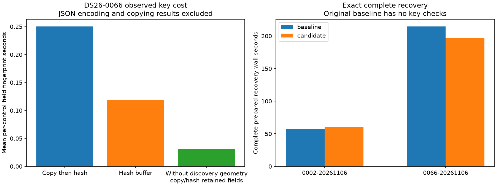
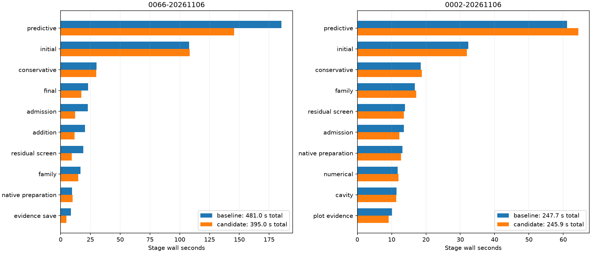

# ALGO07v3: control geometry dependency and cheaper exact reuse

This iteration follows the [broad-control-key experiment](../2026_11_06_algo07v3_inclusion_control_reuse/README.md).
That candidate removed three identical paired fits on DS26-0066, but added
unproductive key checks on DS26-0002 and regressed in both complete native pairs.
The runtime was restored. This report records a new dependency investigation
and a narrower control-view implementation, qualified on two native scans.

## Measured dependency cost

An external observer ran complete DS26-0066 recovery with original fitting and
instrumented only the four control computations. It recorded scan attribute
accesses in both arm processes and measured field-level input fingerprints.
The complete recovery audit matches the prior qualified native result exactly.
The observed 160.847 s is a profiling clock, not a speedup measurement.

The original discovery `geometry` cache costs 0.215–0.224 s to fingerprint per
control, about 87% of the field fingerprint time. None of the four control
computations reads that attribute. Hashing contiguous buffers directly preserves
every fingerprint and roughly halves this field cost, but still hashes data
unrelated to the control calculation. The observer also traces generic copying
of the scan dictionary; an access trace alone does not prove a dependency absent.

Code review finds direct scan-geometry use in initial discovery and family
weighting. The inclusion control constructs fixed-family likelihood geometry
instead. Its graph-membership extension uses the retained family orbit bank.
This supports a stronger experiment than merely ignoring a field in the key:
run the control on a scan view where `geometry` is physically unavailable.
An unexpected required read then fails instead of silently reusing a stale result.

All other scan attributes, including full orbit arrays, noise, original graph
observations, priors and mutable orbit caches, remain available and key-bound.
The view is confined to controls. Target fits keep the complete original scan.
The context is restored even on an exception. Stateful numerical policies,
custom factories, scan subclasses, instance method overrides and conditional
satellite refresh bypass this prototype. Keys still distinguish routes and
optimizers; results are copied privately.

## Qualification scope

The external prepared comparison uses an original baseline with **no key checks**,
fixing the previous census baseline's overhead ambiguity. Fresh forked trials
start from the same prepared context; both complete calibration arms, all stage
values, selected state and the saved native audit must agree. DS26-0002 tests
three distinct controls with no reuse; DS26-0066 tests repeated shared-family
controls, including an inactive fragment. Three CPU slots and one BLAS thread
remain fixed. These are subset, stage-level measurements until full native
qualification is recorded. No GPS, post-observation TLE, optimizer budget,
acceptance rule or fit tolerance changes are part of this experiment.

The prepared comparisons are now terminal and exact:

| Scan | Original recovery | Control-view recovery | Key-check cost | Reused pairs |
| --- | ---: | ---: | ---: | ---: |
| DS26-0002, candidate first | 57.720 s | 60.921 s | 0.319 s | 0 / 3 |
| DS26-0066, baseline first | 214.739 s | 196.397 s | 0.355 s | 3 / 4 |

The hard scan improves 8.54% in this prepared comparison; CPU time falls
498.383→458.644 s. The short scan regresses 5.55%, with CPU 121.955→126.672 s.
Only 0.319 s is measured key cost there; the remaining difference is not explained
by this experiment. Preserve that regression and do not claim a universal gain.
Compared with the earlier key census, checking overhead is substantially lower,
but those historical clocks are separate runs rather than a controlled pairing.

The owned candidate now constructs a separate control context instead of
temporarily editing the caller dictionary as the external prototype does.
All retained fields are fingerprinted, contiguous arrays are hashed without
first copying their bytes, and keys distinguish integer/string dictionary keys
and list/tuple values. Controls cannot access discovery geometry; every target
still receives the original context. Complete original versus cached trials,
view enforcement, both-arm histories, invalidation and unsafe-route bypasses
pass 65 focused component/tool tests. Full native qualification completed on
DS26-0066 (candidate first) followed by DS26-0002 (baseline first), with matched
frozen inputs, three CPU slots, one BLAS thread and full artifact equality gates.

| Scan | Original complete run | Control-view complete run | Predictive stage before → after |
| --- | ---: | ---: | ---: |
| DS26-0066 | 480.981 s | 394.960 s | 185.418 → 145.772 s |
| DS26-0002 | 247.723 s | 245.940 s | 61.082 → 64.357 s |

Both runs preserve the complete scientific audit, both calibration arms, ownership,
public grid/path and all eight PNG bytes. CPU time is 799.61→657.06 s on DS26-0066
and 383.77→381.46 s on DS26-0002. Complete stage, CPU and RSS receipts are in
[the native measurements](native-measurements.md) and [JSON](native-summary.json).

The control-view implementation is retained in development. Its measured key
overhead is small and it removes proven duplicate computations. This is **not**
a population speedup claim: the no-reuse scan's predictive stage is 3.275 s slower,
the prepared short scan also regresses, and unrelated stages vary materially.
The difficult scan's entire 86.021 s improvement cannot be attributed to caching.
The preceding broad-key native regressions remain evidence against broad claims.
More branch coverage and matched repeated timings are required before promotion.
Production has not changed.

The next [full timer profile](../2026_11_06_algo07v3_full_profile/README.md)
measures this exact development implementation without cProfile tracing.

The integrated candidate passes **2,012 tests**, with no failures or skips and
three existing NumPy deprecation warnings ([receipt](tests.xml)). Ruff and
`git diff --check` pass. The view/cache component tests are also archived in
`candidate-tests` alongside the exact candidate modules in `candidate-src`.

## Reproduce

Use the existing profiling skill and a frozen native request. The external
dependency observer accepts `--request`, `--helper` (the archived original key
helper), and a fresh `--output` root:
`tools/profile_algo07v3_control_dependencies.py`. The external exact prepared
comparison is `tools/probe_algo07v3_control_view.py --request REQUEST --output ROOT
--baseline-report reports/2026_11_06_algo07v3_control_geometry_view`;
add `--reverse` for candidate first. Run with three CPU slots, one BLAS thread
and a bounded outer timeout. Both tools verify source bindings after completion.

The per-field profile receipt is [dependencies.json](dependencies.json).
Its exact observer source is archived as `measured-dependency-probe.py`.
The full native equality receipts are retained under `native-0` and `native-1`.
The exact pre-integration prepared tools are archived as `measured-view-probe.py`
and `measured-control-port.py`. The current tool loads a content-bound original
baseline explicitly, so an evolving runtime cannot silently become its own
uncached baseline. Historical source bindings refer to the archived measured
versions; changing the reproduction helper does not rewrite those receipts.
