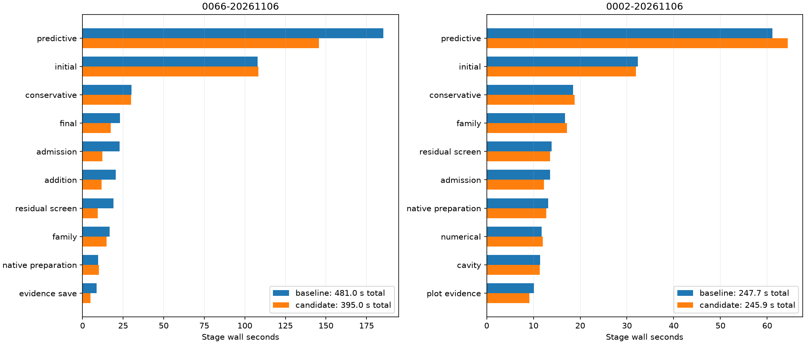

# Complete native comparisons

| Scan/pair | Baseline s | Candidate s | Reduction | Recovery baseline s | Recovery candidate s |
| --- | ---: | ---: | ---: | ---: | ---: |
| algo07v3-control-view-native-0066-20261106 | 480.981 | 394.960 | +17.88% | 185.418 | 145.772 |
| algo07v3-control-view-native-0002-20261106 | 247.723 | 245.940 | +0.72% | 61.082 | 64.357 |

All scientific audits, both c arms, ownership, grid/path and eight PNGs are exact.
Fresh isolated runs use CPUs 0–2, one BLAS thread and unchanged 1,200-second
outer bounds. Capture, detector extraction and queue waiting are excluded.
Unchanged stages and shared-host timing variation prevent attributing every
whole-process difference to this control-reuse change. CPU/RSS and complete stages
are retained in native-summary.json; RSS is a per-process maximum, not aggregate.

