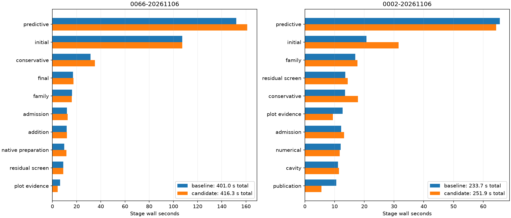
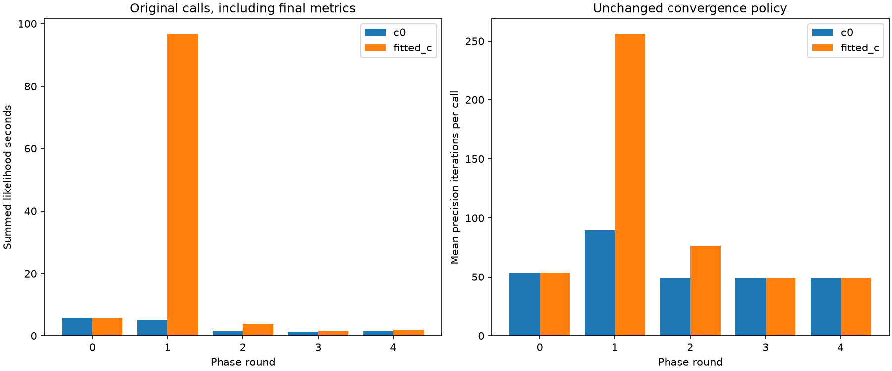
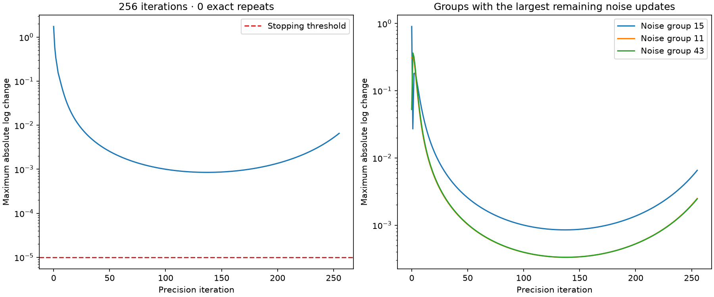

# ALGO07v3: complete-scan covariance-buffer qualification

This iteration follows the [full runtime profile](../2026_11_06_algo07v3_full_profile/README.md),
which places 64.4% of the difficult scan's wall time in initial search and
predictive recovery. It advances the existing covariance workspace experiment
from complete-fit evidence to native GLRT-through-publication qualification.

The implementation change is deliberately small: allocate a private covariance
output matrix once per likelihood call, and supply it as NumPy `matmul`'s `out`
on every precision iteration. The operation, layout, multiplication order,
observations, candidate hypotheses, both calibration arms, priors, iteration
budgets, convergence tests and acceptance decisions remain unchanged. There is
no reuse across likelihood calls or between different hypotheses.

The [preceding experiment](../2026_11_06_algo07v3_covariance_reuse/README.md)
matched all eight complete difficult training fits. Its mean timing gains were
2.47% for c=0 and 1.64% for fitted-c, with a regressing reverse c=0 pair. Those
measurements motivate a full-scan test; they do not establish a pipeline gain.
The symmetric-BLAS alternative failed exactness and is not reconsidered here.

## Qualification protocol

The candidate passes **2,027 tests**, with three pre-existing NumPy deprecation
warnings and no failures or skips ([receipt](tests.xml)). The focused suite
passes 39 tests ([receipt](component-tests.xml)), including empty/scalar/wide
designs, all returned fields, input immutability and private per-call buffers.
The broad suite also checks unchanged LAPACK failure behavior. The source-shape assertion for the
preceding inverse-workspace implementation now checks its byte-identical frozen
reference. A new assertion verifies the owned implementation against the already
measured covariance prototype. No golden numerical values are changed.

Two native comparisons use the same frozen causal inputs, region, numerical
environment, three CPU slots and one BLAS thread. DS26-0066 runs candidate first;
DS26-0002 runs baseline first. Each side uses a fresh private output store and
read-only source overlays in an isolated mount/network namespace, with the same
1,200-second supervisor bound. The only changed runtime module is
`leo.analysis.localization_v3.hierarchical`. Control-view reuse from the preceding
iteration is held fixed on both sides.

The gate requires complete scientific audits, both c arms, ownership, public
documents, grid/path and all eight PNG bytes to match. Native clocks include
startup, analysis, rendering, scientific storage and publication; capture,
detector/GLRT extraction and queue delay are excluded. Runs remain sequential.
Shared-host variation and changes in unaffected stages must remain visible;
do not convert a favorable single pair into a dataset-wide speed guarantee.

**The candidate is rejected for default integration; the original kernel is
restored.** Both complete native pairs preserve all scientific and artifact
values, but both regress:

| Scan | Order | Baseline | Candidate | Elapsed change | Predictive before → after |
| --- | --- | ---: | ---: | ---: | ---: |
| DS26-0066 | Candidate first | 400.994 s | 416.279 s | +3.81% | 152.079 → 161.072 s |
| DS26-0002 | Baseline first | 233.729 s | 251.925 s | +7.79% | 65.560 → 64.339 s |

Initial search on the hard scan is effectively unchanged, 107.267→107.304 s.
The short scan's predictive stage improves while its complete process regresses.
These observations do not prove that every difference is caused by covariance
storage, but they do not establish a useful full-pipeline benefit either. The
small prepared-fit gains are insufficient to override these native results.
No new cumulative speedup is claimed. Production is unchanged.



[All measurements](native-measurements.md), [CPU/RSS and stages](native-summary.json),
both native equality receipts and source snapshots are retained. Candidate tests
are archived under `candidate-tests`; the current runtime uses the original
NumPy allocating matrix product. The independent frozen baseline remains useful
for reproducing the external experiment without baseline drift.

The restored implementation plus observers passes **2,026 tests**, with the same
three existing warnings and no failures or skips ([receipt](restored-tests.xml)).
The owned numerical module matches the pre-experiment baseline hash exactly.
An interrupted test attempt and a detached-launch error are retained in
[the test-attempt record](restored-interruption.md); neither is counted as a pass.

## Next diagnostic: the long initial branch

The full profile identifies initial branch 1/fitted-c as a 76.418 s task. The
new external `tools/profile_algo07v3_initial_convergence.py` replays that saved
branch in both arms, with all five phase rounds and 48 available position
iterations per round. It observes likelihood calls, exact numerical input/output
signatures, phase attribution, precision iteration counts and final changes.
It compares the entire returned branch fit against the saved native evidence.
No call is skipped or replaced; input/output fingerprinting is outside the
individual likelihood timers but inside the instrumented fit's elapsed clock.

The observer's two tests verify unchanged returned-object identity, phase and
coordinate attribution, duplicate signature consistency and restoration after
an original failure ([receipt](initial-observer-tests.xml)). Any repeated-call
time is an upper bound before keying/copying costs, not a demonstrated speedup.
The older initial-cache experiment regressed in its native short-scan pair;
this diagnostic does not erase that result or presume a cache will help.

The replay is complete and exact in both arms. **The initial fitted-c bottleneck
is the second phase round, not the first:** all 279 likelihood calls in that
round reach 256 iterations and remain above the stopping threshold. They account
for 96.755 of the arm's 110.010 accumulated likelihood seconds. Its first round
has no capped calls; subsequent rounds are substantially cheaper. The matched
c=0 branch has five capped calls in the second round. Width is 176 columns for
c=0 and 177 for fitted-c, constant across phase rounds within each arm.



[All phase counts](initial-phases.md) and [raw observed calls](initial-profile.json)
retain the entire replay. Observed complete fits take 16.705 / 113.172 s on one
CPU; these include instrumentation and must not be compared as speed gains or
regressions against the earlier three-slot native task windows. The complete
returned fits, including their original histories and decisions, match saved
native evidence exactly. Source and supplied preparation remain unchanged.

There are only 18 repeated complete numerical inputs per arm, with exactly
matching outputs. Their accumulated observed work is 1.267 / 1.773 s for c=0 /
fitted-c. That is an optimistic reuse ceiling before overhead, not evidence for
another broad cache. The long fitted-c round consists primarily of distinct
likelihood evaluations with expensive precision updates.

## Does the inner loop repeat exact states?

A separate diagnostic replays the previously captured difficult 1,560-point,
175-column likelihood. It observes every incoming noise/prior rate vector without
changing any arithmetic. The entire result and input arrays remain exact. Among
256 iterations it finds **zero repeated states**. This captured likelihood has
62 noise groups and no learned coefficient-prior groups, so the unsettled updates
come from observation-noise precisions, not coefficient-prior learning.



The maximum log-precision change decreases to about **0.000850** at iteration
137, then rises to **0.006542** at the final iteration. Even the minimum is about
85 times the unchanged 1e-5 stopping threshold. This is not an exact cycle that
can be fast-forwarded. Nor does the rising update norm prove that the evidence
objective worsens; this diagnostic records update sizes, not that objective's
trajectory. It is one captured recovery likelihood, not the newly profiled
initial branch. [Complete vectors and bindings](precision-profile.json).

## Next experiment

The remaining bottleneck is repeated expensive numerical fitting, not covariance
allocation or abundant identical calls. Within the identical-output requirement,
the next useful prototype is **capacity-aware derivative parallelism for long
fits**. Previous prepared gradient-axis trials were exact and 18–21% faster on
the hard fold, but the native owner-only policy covered only short fits and
regressed. That rejected policy must remain rejected.

A different experiment would let a long initial/recovery fit borrow a genuinely
idle slot after its surrounding queue has drained. Start with one extra worker
for one derivative axis while the fit owner computes the other axis. Preserve
the original plus/minus arithmetic, outputs and histories, and enforce a shared
three-worker cap across outer and inner work. Do not simply nest an unrestricted
pool inside the existing queue. It needs explicit capacity ownership, failure
and cancellation tests, a fallback when all slots are busy, and complete native
comparison of wall time and CPU. This is a proposal, not a demonstrated gain.

If a larger improvement instead requires changing the precision solver's
initialization or updates, it belongs to a separately qualified numerical
candidate. Lowering the iteration ceiling, accepting larger residual updates,
or discarding the slow calibration arm would change the algorithm and is outside
this exact-output iteration.

## Reproduce

Copy `baseline-src`, `candidate-src` and their `*-sources.json` manifests into
a fresh local root. From this worktree, use the pinned Python and `PYTHONPATH=src:tools`:

```sh
sudo -n env PYTHONPATH=src:tools OPENBLAS_NUM_THREADS=1 OMP_NUM_THREADS=1 \
  /home/mouse9911/gits/leo-tracker-reduxredux/.venv/bin/python -B \
  reports/2026_11_06_algo07v3_covariance_native/run_pair.py \
  --root /absolute/fresh-pair --request /absolute/qualified-native-request.json \
  --candidate-first
```

Omit `--candidate-first` for the reversed order. The original numerical module
is also frozen in `tools/algo07v3_precovariance_hierarchical_oracle.py`, used only
by tests and external experiments. The external covariance probe and complete-fit
benchmark now bind that explicit baseline rather than accidentally comparing
the evolving implementation against itself.

After native timings finish, run the branch observer with one CPU, one BLAS
thread and an external 600-second bound:

```sh
PYTHONPATH=src:tools OPENBLAS_NUM_THREADS=1 OMP_NUM_THREADS=1 \
  timeout -k 2 600 taskset -c 0 \
  /home/mouse9911/gits/leo-tracker-reduxredux/.venv/bin/python -B \
  tools/profile_algo07v3_initial_convergence.py \
  --request /absolute/qualified-native-request.json --branch 1 \
  --output /absolute/fresh-initial-profile
```

Render complete comparisons with `render.py --native PAIR_ROOT` (repeat for
multiple pairs), and the initial diagnostic with `render_initial.py --profile
PROFILE_ROOT`. Both retain source/input bindings and exactness evidence.

The exact loop-state observer is `tools/profile_algo07v3_precision_trajectory.py
--capture CAPTURE_ROOT --output FRESH_ROOT`, with one CPU, one BLAS thread and
an external 60-second bound. The measured capture root is
`/srv/bulk/leo-dev/algo07v3-posterior-current-profile-20261105`; it verifies the
archive's original array digest before reading. Render with `render_precision.py
--profile FRESH_ROOT`. All four observer tests pass in [observer-tests.xml](observer-tests.xml).
