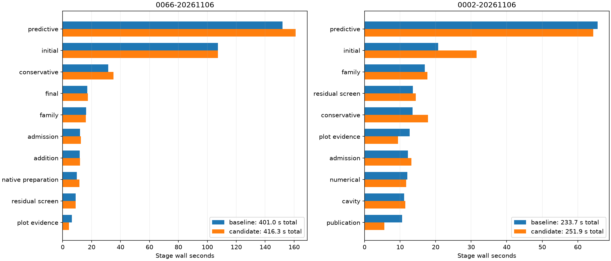

# Complete native comparisons

| Scan/pair | Baseline s | Candidate s | Reduction | Recovery baseline s | Recovery candidate s |
| --- | ---: | ---: | ---: | ---: | ---: |
| algo07v3-covariance-native-0066-20261106 | 400.994 | 416.279 | -3.81% | 152.079 | 161.072 |
| algo07v3-covariance-native-0002-20261106 | 233.729 | 251.925 | -7.79% | 65.560 | 64.339 |

All scientific audits, both c arms, ownership, grid/path and eight PNGs are exact.
Fresh isolated runs use CPUs 0–2, one BLAS thread and unchanged 1,200-second
outer bounds. Capture, detector extraction and queue waiting are excluded.
Unchanged stages and shared-host timing variation prevent attributing every
whole-process difference to this covariance-buffer change. CPU/RSS and complete stages
are retained in native-summary.json; RSS is a per-process maximum, not aggregate.

