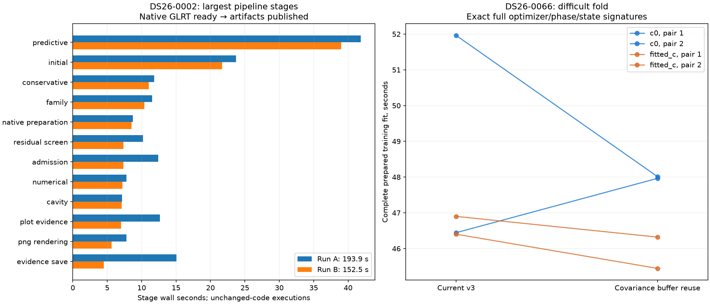
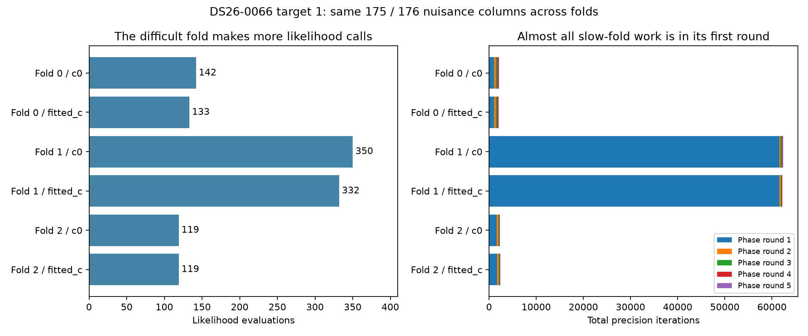

# ALGO07v3: runtime bottlenecks, reuse census and covariance experiments

This investigation targets the exact-output standalone ALGO07v3 pipeline.
The main bottleneck is repeated nuisance-model fitting, especially the first
phase of a difficult predictive-validation fold. Satellite screening, PNGs and
publication are measurable but smaller. No production changes are made here.

The fresh covariance experiments and training-mask census are recorded in
[measurements.md](measurements.md), with all individual timings and CPU costs.
The default numerical implementation remains unchanged pending a complete-scan
qualification; a captured-call improvement alone cannot authorize adoption.

The buffer candidate averages **49.203 → 47.989 s** for c=0 (2.47%) and
**46.651 → 45.884 s** for fitted-c (1.64%). All eight complete fits match the
previously qualified signatures. However, the reverse c=0 pair regresses
**46.444 → 47.965 s** (3.28%). We retain it as an external prototype rather
than infer a reliable pipeline gain from these small, order-sensitive changes.
No fresh native whole-scan comparison is claimed for this prototype.



## Where the time goes

Two unchanged-code DS26-0002 runs took **193.899 and 152.529 seconds**, using
three CPU slots and one BLAS thread per process. These are native-GLRT-ready
through artifact-publication clocks; capture, detector extraction and queue
delay are excluded. They bracket the existing original-ALGO07 comparison and
are not new runs in this iteration. The current default numerical kernel is
the same after the compiled-assembly rollback.

| Stage | Run A | Run B | Run B share |
| --- | ---: | ---: | ---: |
| Predictive recovery and validation | 41.816 s | 38.998 s | 25.6% |
| Initial position search | 23.728 s | 21.707 s | 14.2% |
| Conservative fit | 11.820 s | 11.044 s | 7.2% |
| Family fit | 11.539 s | 10.385 s | 6.8% |
| Native preparation | 8.709 s | 8.516 s | 5.6% |
| Residual satellite screening | 10.223 s | 7.360 s | 4.8% |
| Admission checks | 12.387 s | 7.361 s | 4.8% |
| Numerical refinement | 7.770 s | 7.200 s | 4.7% |
| Cavity fit | 7.158 s | 7.099 s | 4.7% |
| Diagnostic grid/evidence | 12.645 s | 7.002 s | 4.6% |
| PNG rendering | 7.787 s | 5.608 s | 3.7% |
| Evidence save | 15.067 s | 4.504 s | 3.0% |
| Publication | 5.192 s | 2.840 s | 1.9% |

Other ranking, catalogue and process costs complete the total; see the
[full stage receipts](../2026_11_06_algo07v3_training_queue/stages.json).
These are non-overlapping stage clocks. Inner numerical costs below are nested
and must not be added again. The save-time variation illustrates host effects.

On the harder DS26-0066, the earlier full run took 404.752 s: predictive recovery
158.329 s and initial search 112.536 s, together **66.9%**. That observation
predates later queue/workspace improvements and is not a current-code benchmark.
It does show why one easy scan is insufficient for profiling priorities.

## Why the difficult fit is expensive

The [controlled convergence profile](../2026_11_06_algo07v3_ordered_assembly/convergence.md)
keeps observations, priors, fold schedules and budgets matched across c=0 and
fitted-c. Folds 0 and 2 take roughly 3.3–3.5 s per arm; fold 1 takes
60.687 s for c=0 and 55.693 s for fitted-c. Nuisance width stays 175 or 176
within each arm across folds, so matrix size alone is not the explanation.



Each hard arm makes **269 likelihood evaluations in its first phase round**.
Of these, **220 reach the 256-iteration ceiling**. Almost all are still above
the original convergence threshold. This round accounts for **98.7–99.0% of
the precision iterations**; later rounds generally need about 10 iterations
per evaluation. These timings came from an instrumented candidate whose full
fit signatures matched the independent reference, not a baseline/candidate
speed comparison.

The largest components in a captured hard likelihood are inverse solve (30.8%),
covariance multiplication (14.8%), LU factorization (12.8%), Cholesky (8.3%) and
ordered assembly (6.5%). The remaining work includes residuals, precision updates
and setup. [Targeted profiler receipt](../2026_11_05_algo07v3_lapack_workspace/posterior/result.json).

This identifies the computational cause, not yet the full statistical reason
that the first phase converges poorly. Initial phase mismatch and the particular
fold's evidence/conditioning are plausible causes. More precision iterations,
warm starts, different priors or stopping rules would change the numerical
trajectory; they are separate algorithm experiments, not exact runtime fixes.

## What this iteration tests

1. **Complete-training reuse.** All selected targets in two scans were checked
   without executing new fits. DS26-0002 has six distinct calibration masks
   across six eligible folds. DS26-0066 has 23 distinct masks across 24 folds.
   Its one duplicate belongs to target 2/fold 0 and target 3/fold 0, not the
   dominant target 1/fold 1. Equal masks are necessary but insufficient for
   equal complete models. This does not support a broad fit cache.
2. **Covariance output-buffer reuse.** The external prototype keeps the exact
   NumPy matrix product and arithmetic order, supplying a private reusable
   output buffer. It passes the captured likelihood and complete difficult
   training signatures in both arms. See every timing in measurements.md;
   speed must be assessed at complete-fit and complete-scan levels.
3. **Symmetric BLAS covariance product.** It fails exact complete-likelihood
   equality on the captured case. It is rejected for the exact-output lane;
   no timing or scientific-equivalence claim is made.

The matching first-round call counts do not allow c=0 and fitted-c results to
be shared. Fitted-c includes a nonzero frequency-dependent hardware column;
that changes the joint posterior and its prior penalties. See
`JointMarginal.__init__` in the owned marginal implementation.

Earlier tempting options are also bounded by evidence: a larger position cache
saves at most 0.0783 s across the measured hard-arm fits; prescient reordering
of one target's six training jobs saves only 0.755 s in simulation. Compiled
ordered assembly improves a captured call but regresses both complete native
scan pairs and was rolled back. None establishes a new pipeline speedup.

## Recommended next experiments

**First: measure opportunities to overlap training across recovery targets.**
The controller passes the same original context to each annotation and chooses
the qualified result in canonical target order afterward. A target's two long
fits can leave the third worker idle while independent later-target work waits.
The existing queue operates within one target. Measure a whole-recovery task
timeline before designing a bounded queue spanning targets. This is a new
opportunity, not a measured speedup or an endorsement of more workers.

Such a prototype must retain three total worker slots, canonical receipts and
selection order, all data/folds/priors, cancellation and failure semantics.
Stateful numerical replay and callbacks require the existing serial fallback.
Elapsed-time admission is especially sensitive to speculative work; restrict
the initial experiment to the explicit validation-all-work policy and keep
production admission qualification separate. Whole-target result reuse and
overlapping independent work are different ideas; the negative reuse census
does not rule out scheduling gains.

**Second: inspect successful versus capped precision trajectories.** Record
group precisions and conditioning across the first phase to identify which
groups prevent convergence. This can guide exact factor/solve optimizations.
If the large gain requires a different solver or initialization, qualify it as
an algorithm change with both c arms, ownership, associations, position errors
and acceptance behavior; do not call it output-identical without proof.
Any training warm start must itself use training-only evidence. Reusing a fit
that saw held-out observations would invalidate the predictive check even if
it appears to improve convergence.

**Third: isolate serialization and artifact I/O variance.** These costs are
smaller but can create long tails. Measure encoding, hashing and filesystem time
separately before adding caches. Existing cache attempts have regressed; preserve
persisted contracts and PNG bytes.

## Scope, validation and reproduction

Nine focused tests pass: complete likelihood equality and input immutability
for buffer reuse including zero-width designs, symmetric triangle reconstruction,
invalid experiment rejection, census counts and fail-closed invalid fold handling.
[Test receipt](tests.xml). The runtime source is unchanged; this iteration does
not rerun or replace the preceding 1,444-test default-runtime qualification.

The new tools are observation/experiment helpers only. Use the pinned Python,
`PYTHONPATH=src:tools`, `OPENBLAS_NUM_THREADS=1`, `OMP_NUM_THREADS=1` and CPU 0:

```sh
python -B tools/profile_algo07v3_training_reuse.py \
  --request REQUEST_0002 --request REQUEST_0066 --output FRESH_CENSUS
python -B tools/probe_algo07v3_covariance.py \
  --capture CAPTURE_DIRECTORY --output FRESH_KERNEL_PROBE
timeout -k 5 900 python -B tools/benchmark_algo07v3_covariance.py \
  --request REQUEST_0066 --expected-root QUALIFIED_TRAINING \
  --output FRESH_TRAINING
```

Kernel measurements alternate order across six pairs (three calls per side).
Complete training alternates order across two pairs per arm; every full
optimizer/phase/state signature is compared to a previously qualified independent
result, not just the fresh baseline. Context reconstruction and signature-only
calls are outside the fit timer. No tolerance, budget, oracle or fixture changes.
Input/source hashes and runtime versions are retained in kernel.json,
training.json and reuse.json. The census fails closed if its prepared fixture
lacks the expected folds; an index error cannot silently shrink the denominator.
Exact measured tool bytes are archived under measured/. Published helpers only
adjust import order, line wrapping and equivalent local variable spelling after
measurement; render.py accepts the bound archived bytes when checking provenance.

The last matched original-ALGO07 comparison remains **886.905 s versus v3
193.899 / 152.529 s**, observed **4.57–5.81×** using one shared reference run.
There is no new cumulative speedup in this report. These observations concern
one scan and exclude capture, native GLRT extraction and queue waiting.
