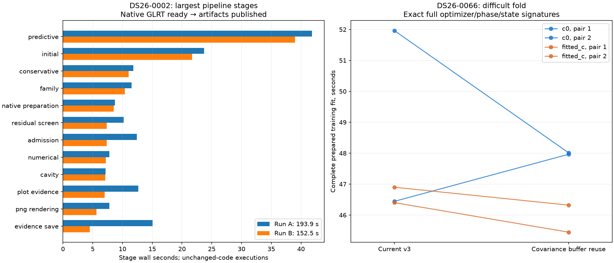

# Measurements

| Calibration arm | Baseline mean s | Buffer-reuse mean s | Time reduction |
| --- | ---: | ---: | ---: |
| c0 | 49.203 | 47.989 | +2.47% |
| fitted_c | 46.651 | 45.884 | +1.64% |

Captured 256-iteration likelihood: 0.216861 → 0.213958 s,
1.34% reduction. Six alternating pairs, three calls per side.
All 36 timed calls are exact. The separate symmetric-product candidate fails
complete likelihood equality; no speed comparison is claimed for it.

| Arm | Pair | Side | Elapsed s | CPU s |
| --- | ---: | --- | ---: | ---: |
| c0 | 1 | baseline | 51.963 | 51.945 |
| c0 | 1 | candidate | 48.012 | 47.997 |
| c0 | 2 | candidate | 47.965 | 47.956 |
| c0 | 2 | baseline | 46.444 | 46.432 |
| fitted_c | 1 | baseline | 46.402 | 46.383 |
| fitted_c | 1 | candidate | 45.446 | 45.430 |
| fitted_c | 2 | candidate | 46.321 | 46.306 |
| fitted_c | 2 | baseline | 46.900 | 46.885 |

| Scan | Targets | Fold problems | Distinct masks | Potential duplicate fits per arm |
| --- | ---: | ---: | ---: | ---: |
| DS26-0002 | 2 | 6 | 6 | 0 |
| DS26-0066 | 8 | 24 | 23 | 1 |

Mask equality is a necessary condition only. The single duplicate is target 2,
fold 0 versus target 3, fold 0. The slow target 1, fold 1 is unique. This does
not justify a general training cache, nor prove those two complete models equal.
