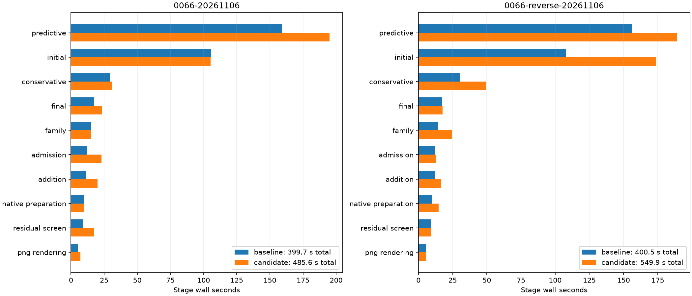
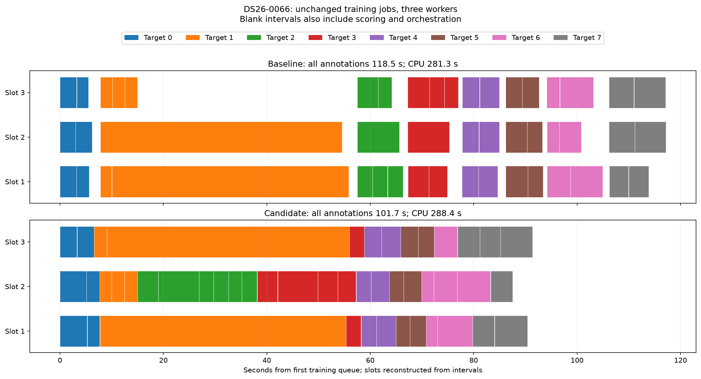

# ALGO07v3: queue independent training across recovery targets

**Decision: reject default integration and restore the existing runtime.**
Complete native DS26-0066 comparisons regress in both execution orders:

| Order | Existing v3 | Candidate | Candidate slowdown |
| --- | ---: | ---: | ---: |
| Existing first | 399.664 s | 485.562 s | 21.49% |
| Candidate first | 400.526 s | 549.862 s | 37.29% |

All scientific audits, both calibration arms, point ownership, public grid/path
and eight PNG bytes match exactly. The six runtime modules are restored to their
pre-experiment bytes; [restoration receipt](default-restoration.json). No production
change or new speedup is claimed. Candidate sources and tests are archived here.



The external scheduling prototype reduces prepared DS26-0066 annotation time in
both orders: **118.544 → 101.697 s** (14.21%) and, candidate first,
**178.954 → 138.965 s** (22.35%). All eight annotations, both calibration arms
and saved satellite decisions are exact. Three CPU slots remain the limit.
This is improved overlap of the same fits, not fewer observations or hypotheses.

On the two-target DS26-0002 workload, the prototype regresses **14.039 →
14.812 s** (5.50%). The rejected integration retained the existing per-target
queue for fewer than three targets. Larger workloads used a common training
queue. This generic workload rule does not inspect scan identity, GPS, satellite
labels or position error; it is a development choice that still needs broader
cohort qualification.

[Every prepared comparison and CPU measurement](measurements.md).
[Complete native comparisons](native-measurements.md) are the integration gate,
including exact science, ownership, public grid/path and eight PNGs.



## Why the prepared experiment looked promising

The previous queue operates within one target: six jobs for three folds and
two calibration arms, followed by scoring, then the next target. In DS26-0066,
target 1 has two roughly 46-second jobs and four roughly 2.3-second jobs. The
third slot becomes idle while independent work from later targets waits.

Across all eight targets there are 48 training jobs. In the first baseline,
the eight training queue intervals sum to 109.222 s. Simulating a shared FIFO
queue using those measured task durations gives 90.860 s. This is a post-hoc
schedule estimate, not a speed measurement. The actual candidate training queue
takes 91.393 s, and the full annotation saving is 16.847 s including scoring,
recipe reconstruction and orchestration.

The timeline depicts measured training intervals, with reconstructed execution
slots rather than physical CPU identities. Blank intervals also contain scoring
and parent work. All jobs keep their original target/fold/arm identity. No
complete fit is cached across different targets or across calibration arms.

Absolute runtimes vary substantially on the shared host. The first pair's CPU
cost rises 281.338 → 288.427 s; the reverse pair falls 413.010 → 401.888 s.
The wall reductions in both orders support overlap as an opportunity, but neither
percentage is a dataset-wide guarantee. These are matched instrumented annotation
measurements; fresh unprofiled native runs determine integration performance.

## Archived candidate implementation and preserved behavior

The archived candidate annotation component exposes its view preparation and training
plan as internal helpers. Batch preparation creates each target's original
context, timestamp-selected folds and calibration masks. It submits the original
training operation for every target/fold/arm, in canonical order, through an
explicit execution port. The operation still performs all five phase rounds,
the original optimizer budgets and the unchanged precision solver.

The operations adapter validates complete ordered c=0/fitted-c pairs and runs
at most three child processes, using the existing cancellation/failure cleanup.
No new process-pool library, threads, cache service or runtime dependency is added.
Scoring reconstructs each fitted problem from its own recipe, checks its final
objective exactly, and executes the original annotation code. Target inclusion,
audits and final selection remain in their original order.

Batch training starts lazily inside the first annotation stage. Consequently,
its wall time is charged to a real checkpoint stage rather than disappearing
outside timing receipts. Later stages charge their scoring work. The numerical
replay retains the recorded durations and its existing logical accounting.
Individual target timing attribution changes; the work is not removed.

Preparation errors are deferred to the corresponding original target stage.
Worker failures propagate as operational failures and cannot become scientific
rejection. Stateful numerical replay keeps the existing serial behavior.
The new port is supplied only by the explicit **validation-all-work** native
adapter. It is not enabled for ordinary elapsed-time admission: starting future
work early can change admission semantics, which remains a separate release gate.

Both c arms retain identical data, causal catalogue, noise model, nuisance priors,
folds, iteration budgets and acceptance gates. No evaluation GPS enters fitting.
The persisted scientific contracts and numerical oracles are unchanged.

## Tests and historical-tool repair

The archived candidate passed **1,980 tests**. After restoring the default,
**1,959 tests pass**, with no failures or skips ([final receipt](final-tests.xml)).
Both suites report three existing NumPy
shape-mutation deprecation warnings. The focused integration suite contains
171 passing tests. Coverage includes exact annotation/oracle equality, all
target/fold/arm records, canonical target decisions, three-worker limits, malformed
schedules, cancellation and child failure, deferred target errors, small-workload
fallback, stateful replay fallback, and application/operations port wiring.

The first broader run found five failures in historical initial-search tools.
All five reproduced with the six candidate runtime modules replaced by their
pre-change bytes in a private mount namespace. The historical branch-queue
experiment was incorrectly transforming the subsequently updated live search;
it now imports the existing frozen pre-queue oracle and binds those bytes.
The rejected initial-cache experiment likewise tests its frozen search input,
while retaining the checks on its unchanged runtime fitting functions and absence
of the cache from runtime. The already-integrated initial queue has its separate
behavioral tests. Oracle SHA-256 values, fixtures and numerical tolerances did
not change. Both the initial failure receipt and successful final suite are kept.

## Reproduction and evidence scope

Use the pinned project Python with `PYTHONPATH=src:tools`, one BLAS thread and
CPUs 0–2. Each output root must be fresh:

```sh
timeout -k 5 900 python -B tools/probe_algo07v3_cross_target_queue.py \
  --request PREPARED_REQUEST --output FRESH_ROOT
timeout -k 5 900 python -B tools/probe_algo07v3_cross_target_queue.py \
  --request PREPARED_REQUEST --output ANOTHER_FRESH_ROOT --reverse
```

The external prototype captures the unchanged annotation at its training port,
queues all jobs using the existing bounded adapter, then replays annotation
scoring in target order. The runtime integration uses explicit preparation
helpers instead of that external capture mechanism. The prepared benchmark
excludes context loading and later inclusion/publication; its complete annotation
fingerprints and the previously qualified native satellite votes must agree.

Published pair receipts retain all timing, source/input bindings and decisions,
plus hashes of the identical complete signatures and raw local result files.
The raw signatures repeat megabytes of optimizer metadata and remain in the
recorded local roots; the renderer verifies their full equality before compacting
the report copies. The scientific comparison is never reduced to position alone.

At measurement time, `run_pair.py` created fresh baseline/candidate stores and froze six declared
module snapshots, and runs the owned CLI in private mount/network namespaces.
Earlier installations, bulk results and repository reports are hidden from
inference. Both sides use the same causal input bundle, three CPUs, one BLAS
thread and 1,200-second outer limit. Capture, detector extraction and queue
waiting are outside its clock. GNU-time CPU/RSS and all stage clocks are retained.
To reproduce the rejected integration, restore its archived modules in a separate
experimental checkout first; the live runtime is now the baseline.

## Next diagnostic

Prepared annotation gains do not survive the complete native runs: predictive
recovery itself regresses 159.074→195.034 s and 155.939→189.111 s. Other unchanged
stages also vary substantially. Shared-host pressure is recorded, but does not
establish the cause or excuse the regression. No complete native DS26-0002 pair
was launched after these failures.

The next useful experiment is to compare complete recovery from the same native
prefix checkpoint, recording every task's CPU/wall cost, preparation, scoring and
inclusion. This avoids repeatedly paying for an unaffected initial search while
testing the actual native state. Explain the prepared/native discrepancy before
another integration attempt. Do not change fitting budgets or numerical outputs.

This is DS26 subset qualification, not full-DS26 qualification or a production
deployment. The last original-ALGO07 cumulative comparison remains 886.905 s
versus v3 193.899 / 152.529 s on DS26-0002. Do not multiply that historical ratio
by this annotation improvement or treat an unmatched newer clock as a refreshed
cumulative speedup.
