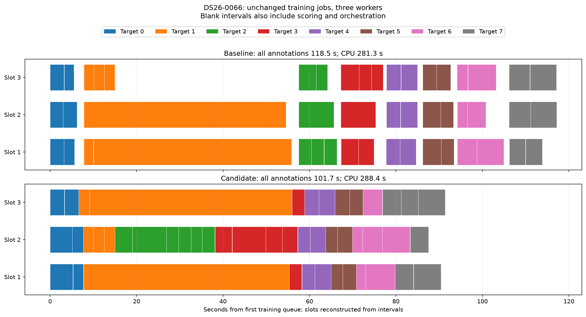

# Complete annotation comparisons

| Pair | Baseline s | Candidate s | Time reduction | Baseline CPU s | Candidate CPU s |
| --- | ---: | ---: | ---: | ---: | ---: |
| algo07v3-cross-target-0066-20261106 | 118.544 | 101.697 | +14.21% | 281.338 | 288.427 |
| algo07v3-cross-target-0066-reverse-20261106 | 178.954 | 138.965 | +22.35% | 413.010 | 401.888 |
| algo07v3-cross-target-0002-20261106 | 14.039 | 14.812 | -5.50% | 39.340 | 39.902 |

Every full annotation and saved vote is exact, and tracked input fingerprints
are unchanged. Both calibration arms, all original targets/folds/priors and
iteration budgets are retained. Three CPUs and one BLAS thread per worker.
These clocks include training, recipe reconstruction and annotation scoring;
they exclude loading the prepared context and later inclusion/publication.
Instrumentation is matched on both sides. These are not complete-scan speedups.

