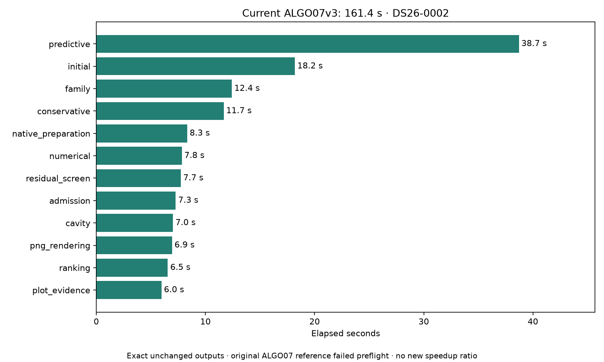
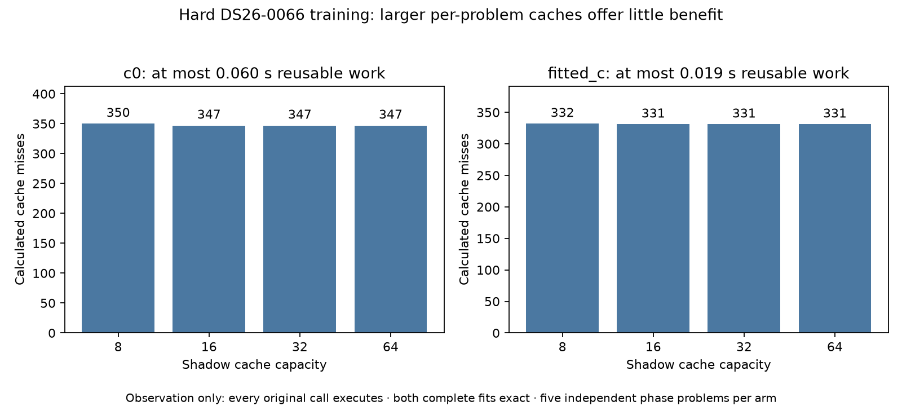

# ALGO07v3: cumulative-reference failure and position-cache census

2026-11-06. No inference changes, deployment, RF collection or golden-fixture updates.

The fresh standalone DS26-0002 run completes in **161.431 seconds**, with exact
scientific evidence, both calibration arms, ownership, diagnostic grid/path and
all eight PNGs against the previously qualified current implementation. The
original ALGO07 leg fails its frozen-runtime integrity check before executing
the first scientific worker. **There is no new original-ALGO07 speedup ratio.**

A separate observation-only experiment rejects larger position caches as a
promising next optimization on the difficult DS26-0066 training fold. Enlarging
the existing eight-entry cache to 16, 32 or 64 entries would avoid only four
calculations across both arms, representing **0.0783 seconds** of measured
calculation work. Both full fit histories and final states remain exact.

## Fresh current-v3 execution

The existing cumulative runner used a fresh native-input export and output
directory, CPUs 0–2, one BLAS thread, fixed causal TLE evidence and the unchanged
1,200-second v3 supervisor bound. The candidate ran in a private mount/network
namespace hiding old installations, bulk historical results and repository
reports. It completed normally without resuming. Evaluation coordinates enter
presentation only. Capture, detector/GLRT extraction and queue waits are excluded.

| Measurement | Current v3 |
| --- | ---: |
| Native GLRT ready through publication | 161.431 s |
| User + system CPU, including wrapper | 240.650 s |
| Maximum reported per-process RSS | 2,453,868 KiB |
| Major page faults | 1 |
| Associated GLRT points, both arms | 2,783 / 4,211 (66.0888%) |
| Published PNGs | 8, byte-identical |

[The complete unchanged-code comparison](v3-unchanged-comparison.json) declares
an explicitly empty changed-module set. This matters: its older current-v3
reference took 213.191 seconds. **213.191 → 161.431 is variation between runs of
the same code, not another optimization.** The generic comparison receipt retains
its observed ratio; it must not be presented as a code speedup. Neither clock
can be divided into an old original-ALGO07 duration to establish a fresh matched
comparison.

## Why the original reference failed

The original harness stopped after 24.643 observed in-interval seconds with
`Frozen reference changed`. It produced no complete-path timing and no fresh
original scientific result. The planned third v3 leg was not launched because
there was no successful middle reference to bracket. The failed command,
process log, summary and resource observations are retained in this report.

An audit in the frozen archive namespace checks all **72,405** reference files,
accounting for the three existing historical source overlays. Nine files differ:

| Type | Count | Finding |
| --- | ---: | --- |
| Python source | 2 | `position_grid.py` and `research/orbit_phase_geometry.py` changed during earlier v3 optimizations |
| Generated Python bytecode | 7 | Working-checkout `__pycache__` files no longer have their frozen bytes |

The bytecode differences cover `continuous_curve_fit`, `orbit_uncertainty`,
application initialization, `causal_tle_catalogue`, presentation
`fast_standard_analysis`, and storage `fast_scan` / `fast_standard_analysis`.
Every expected/current digest is in [reference-drift.json](reference-drift.json).

[A bounded installed/worktree copy search](reference-copy-search.json) finds
hash-identical archived copies of both source files, but no exact copies of the
seven bytecode files in the searched locations. This is a reference-packaging
failure; it does not establish a numerical mismatch between algorithms.
The original manifest and all golden scientific values remain untouched.

The next cumulative attempt needs reproducible reference packaging. Preserve
the exact original source, extension, input and configuration hashes; restore
historical source bytes only in the private reference namespace. Investigate
recovering the exact generated files, or explicitly version a source-verified
reference with controlled bytecode loading and tests proving that changed
source cannot pass. Do not silently rewrite the old manifest or drop its checks
to turn this failure into a successful historical run. Any revised protocol must
declare its import/timing implications and retain this failed attempt.

## Does a larger per-problem cache remove expensive repeats?

The existing `event_position.cached` keeps eight calculations per immutable
fitting problem. This experiment examines that short-coordinate cache, distinct
from the previously rejected full-input hashing cache. For each of the five
phase-refresh problems, the observer delegates to the actual existing cache and
records separate shadow LRU capacities of 8, 16, 32 and 64. It never substitutes
a cached result or skips an additional calculation. A shadow-size-eight mismatch
with the real hit/miss behavior fails immediately.

DS26-0066 target 1 / fold 1 retains seed 94721, the original random grouped
holdout, five phase rounds and 48 available position iterations per round.
One CPU and one BLAS thread are used; the two arms execute sequentially after
the historical attempt has terminated. Each fit reconstructs a fresh context.

| Arm | Calls observed | Actual misses, size 8 | Misses at sizes 16 / 32 / 64 | Potentially reusable work |
| --- | ---: | ---: | ---: | ---: |
| c=0 | 360 | 350 | 347 / 347 / 347 | 3 calls, 0.0595 s |
| Fitted c | 344 | 332 | 331 / 331 / 331 | 1 call, 0.0188 s |

Complete profiled fitting takes 59.303 / 57.973 seconds, with process CPU
59.273 / 57.924 seconds respectively. These are observation clocks, not a
baseline/candidate speed comparison. The census also sees final signature/state
checks outside the fit timer. Its reusable-work figures are measured original
calculation time, not established net savings: larger caches have memory and
maintenance costs, and scientific equivalence of actually returning older
objects has not been established. There is insufficient benefit to justify
that prototype here. Runtime capacity remains eight.

Each complete fit, including optimizer history, phase reference, final state
and likelihood, matches the prior qualified inverse-workspace training result.
Inputs remain unchanged. [Raw census and bindings](cache-census.json).

The observer's **10 component-owned tests pass**, covering real evictions,
preservation of returned-object identity, per-problem separation, the existing
signed-zero key behavior, failure propagation without caching a failure,
restoration of both function aliases and invalid capacities. No scientific
oracle or tolerance was changed. This supplements the existing runtime suite;
no runtime code changed in this iteration.

## Reproduction and next optimization

`tools/profile_algo07v3_position_cache.py` takes `--request`, `--expected-root`
and a fresh `--output`. The expected root contains each arm's previously
qualified `ARM-0-candidate.json`. Run with the pinned Python environment,
`PYTHONPATH=src:tools`, `OPENBLAS_NUM_THREADS=1`, CPU 0 and an external 300-second
bound. The current raw census is
`/srv/bulk/leo-dev/algo07v3-position-cache-census-20261106`.

The failed cumulative attempt uses the unchanged
[`run.py`](../2026_11_05_algo07v3_cumulative_repeat/run.py) at
`/srv/bulk/leo-dev/algo07v3-cumulative-current-20261106`; its complete commands
and source bindings are in [plan.json](plan.json). It was bounded to 2,400 seconds
and terminated on the reference failure. Do not rerun it unchanged: repair and
preflight the reference first, before spending another candidate execution.

`render.py --root CUMULATIVE_ROOT --census-root CENSUS_ROOT` validates source
bindings, the failed-reference state, complete current-v3 exactness, both cache
fits and the test receipt before exporting this report's JSON and figures.

The runtime base commit is `9b3a770ff`; plans bind actual source bytes, including
pre-existing unrelated worktree edits, rather than assuming a clean checkout.

For numerical speed, the next promising measurement is **predictive training
queue utilization**: timestamp the actual six fold/arm tasks and quantify idle
capacity and reconstruction cost before changing their order. Keep the existing
three-worker cap and canonical result order. Earlier fixed initial-arm priority
regressed, and wider position caching now has negligible measured opportunity;
neither should be revived without new evidence. Dense likelihood arithmetic
remains the major per-fit cost. Production and whole-DS26 qualification remain
unchanged.
