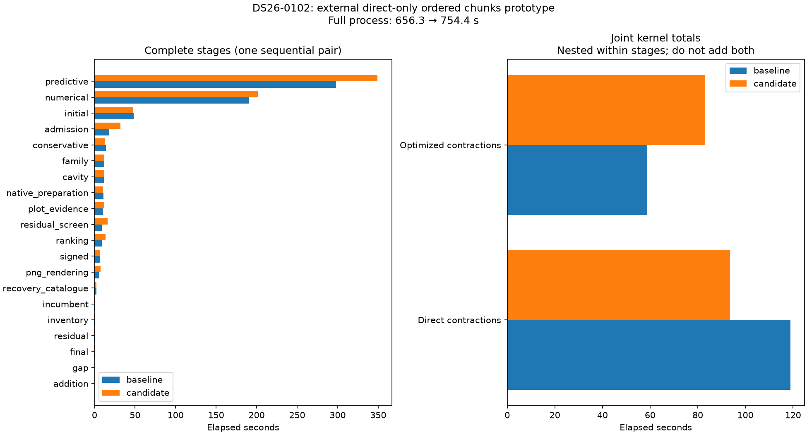
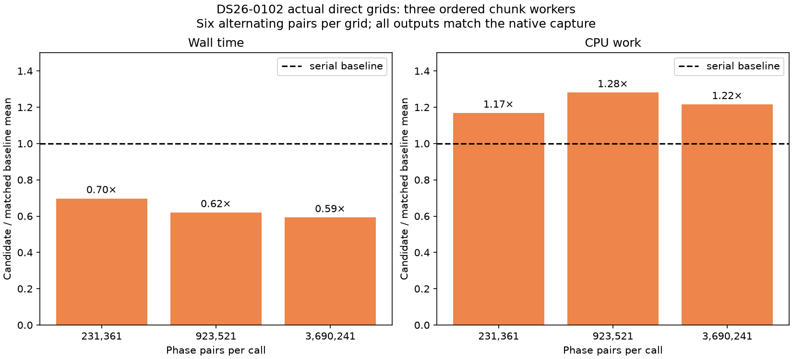

# ALGO07v3: direct-only ordered phase chunks

**Do not adopt this candidate as the default.** Complete DS26-0102 science and
all eight PNGs are exact, but the fresh pair regresses from **656.337 to 754.403
seconds**, with CPU increasing **942.403 to 1,165.804 seconds**. Direct kernel
calls do become faster; unchanged stages also slow substantially, so the whole
regression cannot be attributed solely to chunking. The repeated actual-grid
benchmark confirms a latency/CPU tradeoff, not a failed arithmetic mechanism.
Prioritize packaging the separately qualified CPU-saving LU candidate next.

Validation: 82 focused tests pass with no skips or failures; Ruff and
`git diff --check` pass. The [test receipt](tests.xml) includes dispatch,
failure restoration, input binding, exact comparison and timing-summary tests.

This iteration tests whether the captured direct-contraction gain survives the
complete DS26-0102 native pipeline. It is independent of the shared-LU and final
endpoint-reuse candidates. The numerical model, phase grids, optimizer budgets,
physical audits and both calibration arms remain unchanged.

## Why this candidate

The [preceding investigation](../2026_11_06_algo07v3_joint_phase_lu/README.md)
finds that three ordered workers improve the direct-mode captured kernel by
32.45% while increasing CPU work 34.62%. Optimized contractions regress 9.70%.
The candidate therefore leaves optimized contractions serial. It grants the
external parallel implementation only to direct calls in the owning main
process/thread, with three explicitly assigned CPU slots and both actual loaded
BLAS libraries at one thread. The chunk helper itself remains serial when only
one chunk exists. `parallel` in the kernel receipt means dispatch to the chunk
implementation, not that a one-chunk call created threads.

## Native experiment

`tools/qualify_algo07v3_direct_chunks.py` runs fresh baseline and candidate
workers sequentially from the same frozen native request. Each has its own
1,200-second process-group deadline. The detached launcher has a persistent PID
receipt/log. It records full-worker reaped-child CPU using counters around each
completed supervisor wait, rather than extrapolating from wall time. Per-kernel
CPU includes the chunk threads; top-level stage clocks remain separate.

Both sides capture the first actual direct input at each nontrivial phase-grid
size. This capture is symmetric and included in complete worker clocks; its IO
is outside the per-kernel clock and separately timed. No grid is synthesized by
resampling the earlier large-call fixture. The native gate requires matching
captured inputs and complete kernel results as well as complete scientific
evidence, both c arms, ownership, public grid/path and eight PNG bytes. All call
modes/grid sizes must remain in the same order. A candidate that is never
exercised, or parallelizes optimized contractions, fails the gate.

`tools/benchmark_algo07v3_direct_grids.py` will then test the captured actual
grids. It checks file hashes and array fingerprints and requires fresh baseline
and candidate results to match the native result exactly. Thus a capture-layout
change that affects floating-point arithmetic fails explicitly. The benchmark
retains six alternating pairs per grid, CPU/wall clocks, input immutability and
actual BLAS provider/thread bindings. It runs after the native pair, using the
same three cores, so it cannot compete with the native timing experiment.

Default runtime and production remain unchanged. The tested input is a
branch-selected DS26 case, not a
dataset-wide performance sample. Capture, GLRT extraction and queue wait are
outside the owned worker clock.

## Complete native result

| Scope | Baseline | Candidate | Change |
| --- | ---: | ---: | ---: |
| Full process wall | 656.337 s | 754.403 s | 14.94% slower |
| Full worker/descendant CPU | 942.403 CPU s | 1,165.804 CPU s | 23.71% more |
| Numerical-stage wall | 190.381 s | 201.336 s | 5.75% slower |
| Direct-kernel wall, nested | 118.852 s | 93.561 s | 21.28% faster |
| Direct-kernel CPU, nested | 118.836 CPU s | 197.829 CPU s | 66.47% more |
| Unchanged optimized-kernel wall, nested | 58.756 s | 83.145 s | 41.51% slower |

Both sides run the same 1,133 ordered kernel calls: 554 optimized and 579 direct.
The candidate's dispatch changes only direct calls in the main owner. Of those,
261 have one phase pair and therefore use the chunk implementation's serial
fallback. The direct workload contains 298 calls with 231,361 phase pairs and
ten each with 923,521 and 3,690,241 pairs. Every captured input and result agrees.
The three baseline captures take only 0.00835 seconds combined, outside kernel
clocks but inside complete-worker time.

Both c arms, scientific histories, all audits, point ownership, public grid/path
and all eight PNG bytes agree. There are no changed/added owned runtime modules;
the hook and its bindings remain explicit external research code. See the
[exact comparison](native-comparison.json), [full timing table](native-timings.md),
[summary](native-summary.json) and [source plan](native-plan.json).

The target saves 25.291 seconds of kernel wall time while complete-worker wall
increases 98.065 seconds. Predictive recovery, where the candidate does not
change the kernel path, slows 298.208→349.234 s. Admission and other unchanged
stages also vary. This is not evidence that the chunk implementation itself
caused all of the regression. Conversely, a faster isolated primitive does not
establish improved scan throughput; the recorded CPU increase and absent
native latency improvement do not justify default integration.

## Repeated actual-grid experiment

The native worker captured two families with 34 and 33 observations. Their
actual phase grids are 481×481, 961×961 and 1,921×1,921. Each complete input is
replayed six times per side in alternating order after the native pair exits;
all **36 results** match the original native result, including coefficients,
phase marginals and MAP indices. No capture-layout discrepancy appears.

| Phase pairs | Mean wall before → after | Wall reduction | Mean CPU before → after | CPU increase |
| ---: | ---: | ---: | ---: | ---: |
| 231,361 | 0.309517→0.215692 s | 30.31% | 0.308786→0.360660 s | 16.80% |
| 923,521 | 1.160637→0.719365 s | 38.02% | 1.154677→1.478796 s | 28.07% |
| 3,690,241 | 4.703253→2.784870 s | 40.79% | 4.694009→5.704686 s | 21.53% |

Thus the hypothesis that only the previous large fixture benefits is not
supported: all three actual grid sizes improve isolated wall time. The CPU
penalty persists, although its size differs from the native observation.
This experiment supports the pure-kernel concurrency mechanism but does not
overturn the native integration decision. Do not invent a scan-specific size
threshold or repeat whole scans merely to select a favorable clock. Keep the
candidate available for a later explicitly latency-focused capacity policy.

## Next: integrate CPU-saving factor reuse separately

The prior LU pair preserved all native outputs while reducing full CPU 3.01%.
A packaging smoke test now replaces runtime compilation with a Python extension
that exports the same private C loop, loaded by a small NumPy-provider adapter.
The adapter retains the original NumPy path for unsupported providers, shapes
and types. It does not substitute SciPy's different LAPACK library.

The [C source](owned-lu-draft/_joint_lu.c),
[adapter draft](owned-lu-draft/numpy_factor.py) and
[smoke receipt](owned-lu-draft/smoke.json) are archived. The smoke test exercises
dimensions 1/2/6/12/32 plus dimension-33 fallback, singular rejection and six
whole-kernel cases across both contraction modes and three chunk sizes. All
tested bytes agree. This is packaging evidence only: it is not installed in the
owned runtime and has no integrated native qualification. Next add the optional
extension through the existing build, component-owned fallback/ABI tests and
fresh isolated native comparisons. Do not combine it with chunk concurrency.

## Integration requirements established by code review

If later evidence justifies chunk integration, use the existing architecture:

1. Add an optional ordered chunk-map argument to the pure joint-density kernel.
   The serial implementation remains the reference, and optimized contractions
   retain the original serial path. Preserve chunk boundaries, arithmetic,
   combination order, visibility masks and equal-score MAP tie handling.
2. Supply concurrency through the application's existing `ExecutionPorts` and
   the numerical-recovery context. Predictive contexts remain unchanged. The
   analyzer must not discover cores or create its own unbounded pool.
3. The operation adapter owns capacity and lifecycle. Child callers, callers
   without available slots, and single-chunk calls stay serial. All worker
   threads must be joined before a later process-fork stage. Infrastructure
   failures/cancellation must abort the job through its interruption mechanism,
   not become a rejected satellite hypothesis or partial scientific result.
4. Add component-owned tests for the map port, serial fallback, ordered results,
   cancellation/failure, slot ownership and unchanged policy receipts. Retain
   existing persisted request/result contracts; execution details need no new
   scientific parameter or public schema.
5. Run fresh normal-worker qualification for the integrated code on the joint
   case and a scan without that branch. Require both-arm science and all PNG
   bytes; compare full CPU and wall clocks, retaining regressions. An external
   hook passing is not proof of a packaged default implementation.

The relevant existing ownership boundaries are
`analysis/localization_v3/joint_recovery.py::joint_density`,
`application/localization_v3_engine.py::ExecutionPorts`,
`application/localization_v3.py::recover_numerical_checkpoint`, and
`operations/localization_v3_parallel.py`. The current operation layer already
has a `ParallelFitFailure` interruption type for incomplete parallel work.

Whether lower latency is worth higher CPU depends on the complete result. Keep
that tradeoff explicit; neither an isolated kernel gain nor a favorable total
clock dominated by unchanged stages is sufficient for default integration.
