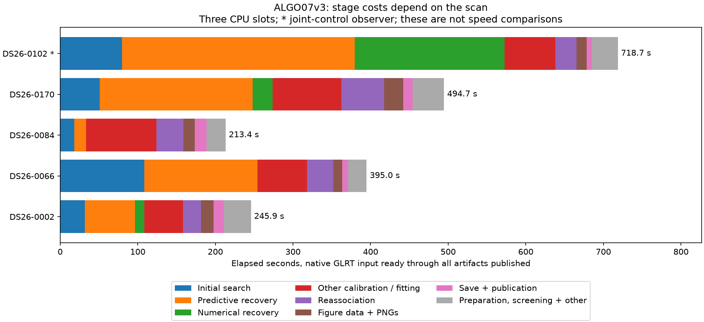

# ALGO07v3 full-profile review and bounded DS26 fit census

Initial regional fitting and predictive recovery remain the main optimization
targets. This review extends the existing complete profile with native runs on
DS26-0084 and DS26-0170, and a joint-control observer on DS26-0102. It changes no
runtime source, scientific policy, production setting or numerical budget.
There is no newly measured speedup in this report.

## Timing scope and evidence

The clock starts with a frozen native GLRT input and ends after storing science
and publishing all eight figures. It excludes radio capture, detector/GLRT
extraction, queue waiting and web-browser loading. These are standalone
development runs under the all-work validation policy, not measurements of
production admission or a dataset-wide runtime distribution.

All runs use three CPU slots (0–2), one BLAS thread and a 1,200-second supervisor
bound. Both c=0 and fitted-c paths, numerical budgets, priors, search frame and
causal TLE policy are retained. GPS is presentation-only. The new inputs are
checked against the existing DS26 native-input inventory, with read-only frozen
causal archives. Selection broadens exercised branches, not position accuracy.
An initial freeze attempt used an incorrect cutoff field and failed before
running inference; the corrected helper explicitly requires the positive
integer `causal_cutoff_utc_ns`, with tested inclusive 72-hour snapshot bounds.

The previous [full timer profile](../2026_11_06_algo07v3_full_profile/README.md)
matches complete scientific results, both arms, ownership, histories, public
grid/path and eight PNGs against an unprofiled native run. The renderer checks
that its bound sources still match before reusing that profile. Additional native
runs provide stage clocks and completed scientific receipts; they are not new
baseline/candidate equivalence comparisons. The DS26-0102 observer adds output
fingerprinting, so its elapsed time is marked separately. It uses the ordinary
standalone worker without the private mount/network namespace harness used for
0084/0170. No future TLEs or older analysis implementations enter inference.

The [complete stage table](stages.md), [summary](summary.json), and per-case
clock receipts retain each component. Nested recovery stages are not added to
their parent stage. These are different scans and historical/fresh observations
on a shared host, not paired timing comparisons or estimates of improvement.

## What the detailed profile tells us

In DS26-0066's unprofiled 394.960-second worker, predictive recovery takes
145.772 s (36.9%) and initial search 108.453 s (27.5%): together 64.4%.
Conservative refitting is next at 30.020 s (7.6%). PNG encoding takes only
5.202 s (1.3%); figure-data construction and evidence publication are distinct
additional stages and remain in the table.

DS26-0084 completes in 213.395 s and spends only 14.990 s on predictive
recovery. DS26-0170 completes in 494.698 s, with 197.060 s (39.8%) in predictive
recovery, 51.208 s in initial search and 25.249 s in numerical recovery.
It exercises eight targets, inclusion, retry and numerical replay. This
variation argues for branch-diverse qualification rather than optimizing only
the fastest or slowest scan.

The observed DS26-0102 worker finishes in **718.702 s**. Predictive recovery is
300.162 s (41.8%), numerical recovery 192.959 s (26.8%), and initial search
79.589 s (11.1%). These three stages account for 79.7% of this case. Numerical
recovery was negligible on 0066, so this broader census reveals an additional
important path. Its replay uses a centered optimizer and a 30-second reference
limit; the existing controller already reuses qualifying unchanged annotations
and shared fits. New-family and joint work can require recomputation. Therefore
the 193 seconds cannot simply be labeled duplicate work and removed. The next
profile should split this stage into its actual newly executed fits and audits,
preserving its ordered numerical receipts and adoption checks.

The detailed [initial precision investigation](../2026_11_06_algo07v3_initial_precision/README.md)
and [recovery convergence trace](../2026_11_06_algo07v3_ordered_assembly/convergence.md)
identify the same underlying numerical workload. All 279 likelihood calls in
one difficult initial phase round reach the 256-iteration ceiling. In the hard
recovery fold's first round, 220 of 269 calls per arm reach that ceiling; later
rounds generally take about ten iterations. The algorithm repeatedly rebuilds
and solves the nuisance posterior while updating observation-noise precision.
This is not primarily file I/O or plot rendering.

In a captured initial likelihood, inverse-root solving takes 31.68%, covariance
construction 14.07%, LU factorization 13.78%, and Cholesky 8.24%: 67.77% combined.
These are nested single-call shares, not full-worker shares. Recovery has a
similar breakdown. The matrices have about 175–177 nuisance coefficients;
repetition and convergence, rather than matrix dimension alone, explain the
expense. One track's precision dominates 242 of 256 initial updates, with no
identical repeated state. This does not justify discarding that track or
declaring its final association incorrect.

## Repeated complete-fit census

The training-mask census executes no new fits. Equal masks are only a necessary
condition: model, reference phases, candidate entries, priors, optimizer and all
other dependencies must also match before any complete fit can be reused.

| Scan | Recovery targets | Eligible fold problems per arm | Unique masks | Potential redundant fits per arm |
| --- | ---: | ---: | ---: | ---: |
| DS26-0002 | 2 | 6 | 6 | 0 |
| DS26-0066 | 8 | 24 | 23 | 1 |
| DS26-0084 | 2 | 6 | 6 | 0 |
| DS26-0170 | 8 | 24 | 23 | 1 |

Only two of 60 planned fold problems per arm have repeated masks in these four
cases. This is a small upper bound on fit counts, not a 3.3% time-saving estimate.
In 0066 the duplicate lies outside the slowest target. Existing inclusion-control
reuse already handles repeated controls within the same solver route.

The new observer compares fifteen fields of individual new-family and joint
control results, including complete optimization history, phase reference,
state, gates, objective and residual RMS. A matching final position alone is
insufficient. Even a complete output match does not prove equal input
dependencies or authorize caching. Joint-specific target evidence and phase
diagnostics must still be computed if a common solver core is eventually reused.

**A concrete cross-route match is present in DS26-0102.** Both joint controls
match all fifteen core fields of the target-3 and target-4 individual controls,
including byte-identical histories and phase references. The two joint stages
take 4.740 s (c=0) and 4.127 s (fitted c). Four matching pairs refer to only two
executed stages: the total is **8.867 s, not 17.735 s**. This is an upper bound
on removable stage time, since joint-specific diagnostics and any dependency-key
or reconstruction overhead remain. It is only 2.95% of this run's 300.162-second
predictive stage. There is no implemented reuse or measured saving yet.
The observer covers the initial predictive checkpoint, not a separately
instrumented numerical-replay invocation. See [joint census](joint-census.json).

## Recommended next experiments

1. **Attribute DS26-0102's 193-second numerical-recovery path.** Use the existing
   full timer observer on that branch to distinguish recomputed new-family/joint
   fits from reused checkpoints and audits. Check input equality before reuse;
   preserve centered optimization, phase bounds and stateful receipts. This is
   now a larger measured path than the original 0066 profile suggested.
2. **Time-box exact reuse between individual and joint controls.** Complete the
   dependency proof for the matching DS26-0102 cores found by this observer. Use the
   existing narrow cache interface, retain private copies and all target-specific
   diagnostics, and bypass custom/stateful numerical policies. Measure saved
   optimizer work versus key/reconstruction overhead before a full native pair.
   This is an exact-output opportunity, but its incidence may be limited.
3. **Prioritize precision convergence for a separate scientific candidate.**
   Test safeguarded damping/acceleration of the noise-precision update on the
   two captured hard problems. Record objective, residuals, group precisions,
   iterations and stability, then complete fits on both c arms. Initialization,
   convergence rules or arithmetic changes cannot silently enter byte-identical
   ALGO07v3. Lowering the cap would skip existing work rather than optimize it.
4. **After convergence is understood, examine derivatives and covariance needs.**
   Analytic/implicit derivatives or selected covariance computations could
   remove repeated finite-difference solves or dense inverse work. First establish
   which derivatives are valid when the inner fit stops at a cap; treating an
   unconverged fit as a converged optimum can give an incorrect gradient. These
   also need separate scientific qualification, including association decisions
   and localization accuracy, not just lower residuals.
5. **Keep scheduling and small kernels secondary.** Previous queue/helper and
   buffer trials improved some prepared kernels but regressed complete native
   runs. Broad BLAS threading changes bytes; covariance-only threading gives
   about 2.5–2.7% captured-call savings at roughly 95% additional CPU and remains
   rejected. More threads or another generic cache are not currently supported
   as the next large gain. Preserve those negative results.

For scale, reducing both dominant stages by 25% would save 63.6 s on the
394.960-second example, giving about 331.4 s (1.19×). Halving them would give
267.9 s (1.47×). These are arithmetic scenarios, not measured improvements.
Halving its PNG-rendering stage would save only 2.6 s.

## Qualification and reproduction

The freeze helper and joint-control comparison have thirteen focused tests:
causal-clock selection and bounds, invalid clocks, missing TLEs, complete-core
equality, differing histories/phases/state, optimizer separation and missing
fields. Tests never update scientific fixtures. Full native comparison is still
required for any future runtime patch; this report adds observation tools only.

Use `tools/profile_algo07v3.py --timers-only` with a frozen request and fresh
output root for complete stage/CPU profiling; the existing profiling skill
documents scope and strict equality gates. Use `tools/profile_algo07v3_training_reuse.py`
for the no-fit mask census. The added `tools/profile_algo07v3_joint_controls.py`
runs the complete native worker with the observation hook on CPUs 0–2, one BLAS
thread, and a hard 1,200-second bound. Its `plan.json` binds sources and request;
`result.json` retains process completion and the observed core fingerprints.

No optimization or production deployment is claimed by these observations.
