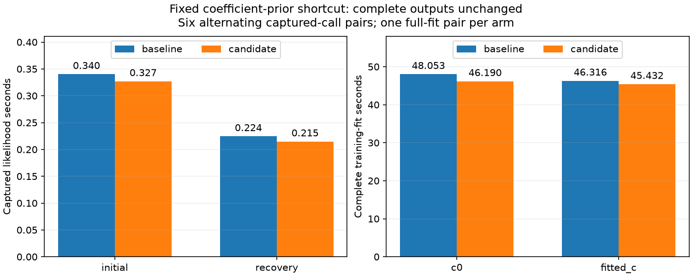
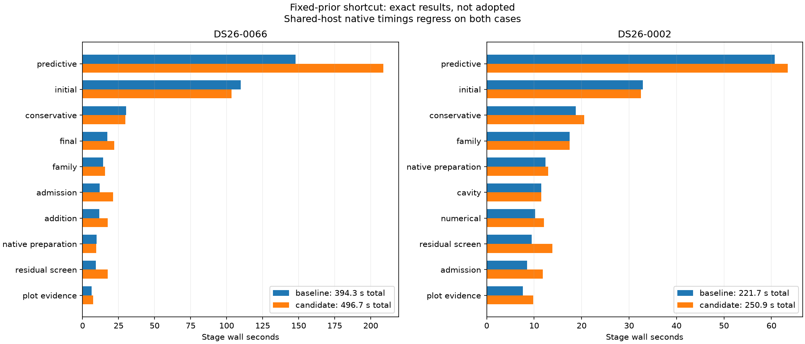

# ALGO07v3: avoid empty coefficient-prior updates

The full profile identifies initial position search and predictive recovery as
the dominant costs: together they take 64.4% of the 394.960-second DS26-0066
reference. Both repeatedly evaluate the grouped nuisance/noise likelihood. This
experiment removes redundant work from that likelihood without changing its
model, arithmetic on nonempty groups, noise convergence, iteration limits or
outputs. **The candidate is not adopted:** both complete native comparisons
preserve every scientific/artifact check but regress in elapsed time. The small
component gains do not establish a production or cumulative speedup. Runtime
and production remain unchanged.

## What changes

The likelihood supports optional learned coefficient-prior precision groups.
The normal-prior position fits supply no such groups, yet the original loop
still allocates a coefficient precision vector, calculates coefficient squares
and covariance diagonals, selects an empty subset, bins that empty subset,
updates an empty prior-rate array and computes an empty convergence reduction.
These operations are repeated on every inner iteration, including 256-step
calls in the difficult initial and recovery phases.

When the prior-group count is zero, the candidate initializes the fixed unit
coefficient precision vector once, bypasses the empty prior update and uses its
original zero convergence contribution. When groups exist, it retains the
original learned-prior computations. The final returned precision is still a
fresh array. All coefficient priors remain in the posterior solve and score.
The track-noise updates, all matrix calculations, phase refreshes, both c arms,
satellite hypotheses and acceptance gates remain unchanged.

The original implementation is preserved byte-for-byte in
`tools/algo07v3_prefixed_prior_oracle.py`, SHA-256
`c906a5992ca3428c29b5c44326264549e18dc4206653b3d6f2fd12b48638607e`.
It is an external numerical reference, never a runtime import. The candidate
and baseline full modules are retained in this report's `candidate-src` and
`baseline-src` directories. Golden numerical fixtures are unchanged.

## Captured likelihood measurements

Each row uses six alternating-order pairs, three complete likelihood calls per
side per pair, one CPU and one BLAS thread. Every returned field and every input
byte matches the original. These are component clocks, not whole-scan gains.

| Captured call | Baseline mean | Candidate mean | Observed reduction |
| --- | ---: | ---: | ---: |
| Initial branch 1, fitted-c phase 1 | 0.340336 s | 0.327056 s | 3.90% |
| Hard predictive recovery | 0.224486 s | 0.214764 s | 4.33% |

The initial-call measurements are noisy: two of six pairs regress, and another
shows an 18.37% reduction. Recovery has one slightly regressing pair. All pairs
are retained in [initial results](initial/result.json) and
[recovery results](recovery/result.json). Their means support testing complete
fits but do not establish a repeatable pipeline speedup.

A separate statement-level observer attributes **1.45%** of the initial capture
and **1.65%** of recovery to the operations being bypassed
([exact profile](empty-update-profile.json)). It preserves every complete output
over three calls per capture. These are instrumented shares including timer
overhead, not a speed forecast; the candidate also adds a branch. They suggest
a modest opportunity and reinforce that the larger raw mean reductions above
include timing variation. The measured observer is archived before formatting
and closure-binding cleanup; no scientific algorithm is changed by that cleanup.

## Complete hard-fold training

These runs use the same DS26-0066 target-1/fold-1 observations, candidate labels,
physical priors, five phase rounds and 48 position iterations per round. Each
arm is compared to an independently saved exact training signature, including
optimizer histories, final phase reference, state and full calculation output.
The node/mask inputs remain unchanged. Preparation is outside the timing.

| Arm | Order | Baseline wall / CPU | Candidate wall / CPU | Wall reduction |
| --- | --- | ---: | ---: | ---: |
| c = 0 | Baseline first | 48.053 / 48.031 s | 46.190 / 46.181 s | 3.88% |
| Fitted c | Candidate first | 46.316 / 46.299 s | 45.432 / 45.426 s | 1.91% |

Both complete fits are exact ([training receipt](training/result.json)). This
is one pair per arm, with opposite orders. No position-error improvement is
claimed: outputs are identical. The captured and training observers' exact
measured source versions are archived separately, including import-only changes
made after those measurements. Do not confuse prepared training with a native
GLRT-to-publication comparison.



## Complete native qualification and decision

| Scan | Order | Baseline wall / CPU | Candidate wall / CPU | Wall change |
| --- | --- | ---: | ---: | ---: |
| DS26-0066 | Baseline first | 394.319 / 656.35 s | 496.700 / 857.55 s | +25.96% |
| DS26-0002 | Candidate first | 221.677 / 351.84 s | 250.945 / 386.40 s | +13.20% |

CPU is user plus system time from GNU time over the isolated harness and its
descendants; it has a slightly wider scope than the supervisor's worker wall
clock. Maximum RSS is 2,212,296 → 2,284,128 KiB on DS26-0066 and
2,301,164 → 2,242,704 KiB on DS26-0002. These are process-tree maximum-RSS
statistics, not the sum of simultaneous resident memory.

Both [hard-scan](native-0/comparison.json) and [short-scan](native-1/comparison.json)
comparisons preserve complete scientific audits, both c arms, point/satellite
ownership, public grid/path and all eight PNG bytes. Full runtime source bindings
remain unchanged outside the explicitly overlaid hierarchical module. Read-only
input/namespace checks pass, and each side performs a fresh complete run without
resuming or reusing a published position.



Initial search improves 109.774 → 103.380 s on DS26-0066 and
32.899 → 32.474 s on DS26-0002. However, predictive recovery worsens
147.945 → 208.834 s and 60.713 → 63.399 s respectively. The hard scan's unchanged
residual-screening stage also worsens 9.098 → 17.423 s. Its baseline ends at
CPU-pressure avg10 0.91%, while the candidate ends at 13.98%; the candidate's
later-stage observations encounter materially higher load. The short candidate
ends at 22.22%, and pressure falls during its later baseline. The complete
[stage/CPU records](native-summary.json) and per-side resource snapshots retain
these conditions.

Shared-host effects confound causal attribution, so these comparisons do not
prove the small source edit itself causes the large regressions. They also
provide **no demonstrated complete-worker gain**. The default implementation
is therefore left untouched, and the candidate remains a separate probe and
source overlay. The entire measured empty-update fraction is only about 1.5% of
two captured calls; this is a small opportunity even before integration costs.
Do not repeat full scans merely to obtain a favorable timing pair.

## Validation and observer repair

The private candidate overlay passes **2,160 tests** ([receipt](candidate-tests.xml);
[selected test files](test-files.txt)). The focused prototype tests cover zero,
one and many coefficients, C/F layouts, sparse modes, absent/fixed/mixed/learned
priors, invalid arguments, signed zeros, ownership across successive calls,
complete training histories and every noise/prior transition.

The first broad run had 2,157 passes and one profiler failure
([original receipt, losslessly compressed](candidate-tests-before-observer-fix.xml.gz)). The precision-map
observer extracts one loop iteration into a function. Moving constant precision
initialization before the loop exposed Python's local-variable scoping: the
conditional assignment in the extracted function made precision local, but the
fixed-prior branch did not initialize it there. The observer now privately seeds
each diagnostic transition from the original pre-loop precision value when one
exists. Its tests reproduce every transition for both the previous and owned
implementations, with and without learned groups. The fix affects observation
only; no scientific computation or exactness gate is relaxed.

The default implementation plus observers passes **2,161 tests**
([final receipt](default-tests.xml), [test list](default-test-files.txt)). The
temporary candidate-owned source assertions from the private test run are
preserved under `candidate-test-src`; the ordinary inverse-workspace source
assertion is restored because the candidate is not integrated. To reproduce
the private suite, mount the candidate numerical module and substitute those
two archived test paths for their corresponding entries in `test-files.txt`.
Later tool tests also exercise the archived candidate directly, without changing
the default runtime. Ruff and whitespace checks pass. No golden fixture changed.

## Next experiment

The next target remains dense matrix solves and covariance work, which account
for roughly two thirds of the captured likelihood. Before building another
pipeline scheduling policy, test captured calls in fresh isolated processes with
one, two and three BLAS threads on the same three-core allowance. Verify actual
thread configuration, every returned byte and CPU as well as wall time. Larger
thread counts can change reduction order or add overhead; reject quickly if
either exactness or useful speed fails. This is an experiment proposal, not an
assertion that threading will help these small matrices.

Only a successful captured-call result warrants complete-fit testing and a
bounded policy that borrows already idle capacity. Never multiply outer-worker
and BLAS-thread counts beyond the existing three-slot budget. The previous
residual-axis thread/process helper results remain negative evidence; this
proposal specifically targets the underlying dense kernels. No numerical
initialization, stopping rule, tolerance or acceptance policy should change.

## Reproduction

```sh
PYTHONPATH=src:tools OPENBLAS_NUM_THREADS=1 OMP_NUM_THREADS=1 taskset -c 0 python -B \
  tools/probe_algo07v3_fixed_priors.py --capture CAPTURE --output FRESH_CAPTURE_RESULT

PYTHONPATH=src:tools OPENBLAS_NUM_THREADS=1 OMP_NUM_THREADS=1 taskset -c 0 python -B \
  tools/benchmark_algo07v3_fixed_priors.py --request NATIVE_REQUEST \
  --expected-root reports/2026_11_05_algo07v3_lapack_workspace/training \
  --output FRESH_TRAINING_RESULT

sudo -n env PYTHONPATH=src:tools OPENBLAS_NUM_THREADS=1 OMP_NUM_THREADS=1 python -B \
  reports/2026_11_06_algo07v3_fixed_priors/run_native.py \
  --request NATIVE_REQUEST --root FRESH_NATIVE_PAIR
```

Use the pinned project interpreter and content-bound native requests specified
in the profiling skill. The native wrapper reuses the existing isolated kernel
comparator, binds every runtime source, and compares both complete scientific
audits, both c arms, ownership, public grid/path and eight PNG bytes. Baseline
and candidate modules are mounted read-only in private namespaces; neither is
imported from an older runtime installation. Native runs use CPUs 0–2, one BLAS
thread and the unchanged 1,200-second outer limit per side. Capture, GLRT
extraction and production queue waits are outside their worker clock.
