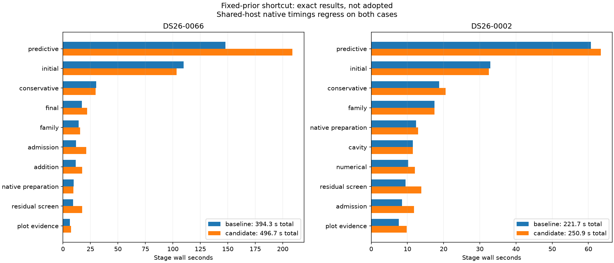

# Complete native comparisons

| Scan/pair | Baseline s | Candidate s | Reduction | Recovery baseline s | Recovery candidate s |
| --- | ---: | ---: | ---: | ---: | ---: |
| algo07v3-fixed-priors-native-0066-20261106 | 394.319 | 496.700 | -25.96% | 147.945 | 208.834 |
| algo07v3-fixed-priors-native-0002-20261106 | 221.677 | 250.945 | -13.20% | 60.713 | 63.399 |

All scientific audits, both c arms, ownership, grid/path and eight PNGs are exact.
Fresh isolated runs use CPUs 0–2, one BLAS thread and unchanged 1,200-second
outer bounds. Capture, detector extraction and queue waiting are excluded.
Unchanged stages and shared-host timing variation prevent attributing every
whole-process difference to this fixed-prior shortcut. CPU/RSS and complete stages
are retained in native-summary.json; RSS is a per-process maximum, not aggregate.

