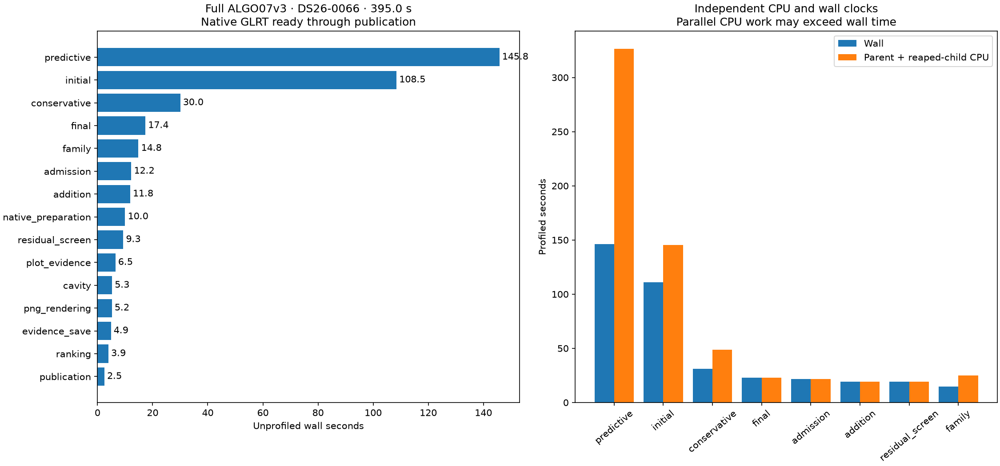
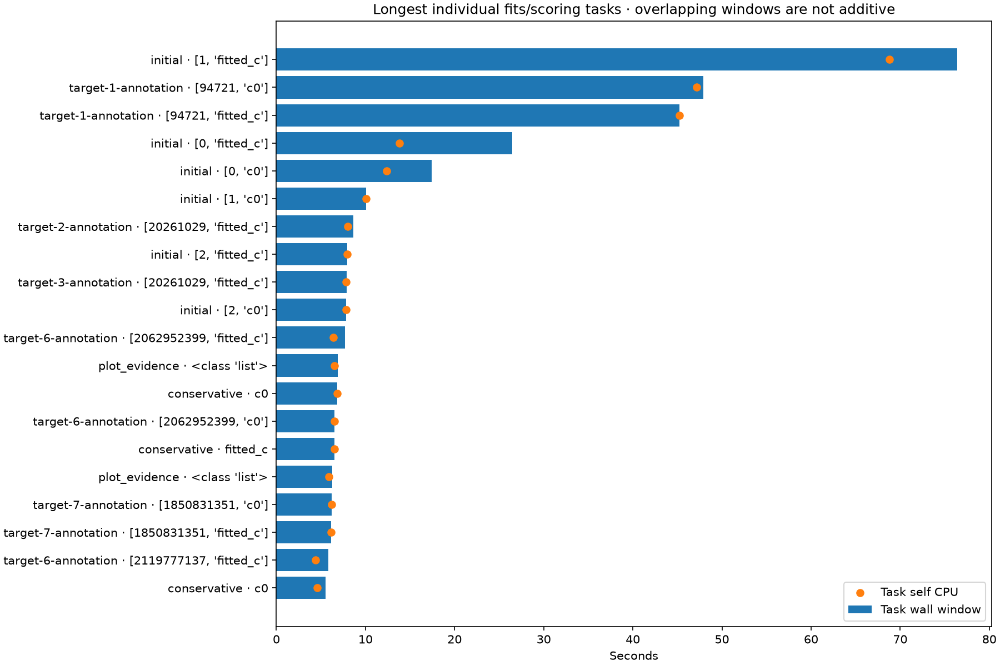

# Full ALGO07v3 runtime profile and next optimization targets

This survey covers the standalone development ALGO07v3 worker from frozen native
GLRT input through scientific evidence storage and publication of all eight PNGs.
Capture, detector/GLRT extraction and queue waiting are outside this clock. It
uses DS26-0066, a difficult scan exercising recovery and accepted reassociation,
with three CPU slots, one BLAS thread and the unchanged 1,200-second outer bound.
It is a bottleneck case study, not a dataset runtime distribution or a production
deployment benchmark.

The implementation includes the new
[exact control-view reuse](../2026_11_06_algo07v3_control_geometry_view/README.md).
The unprofiled reference takes **394.960 seconds**. Its complete independent
baseline/candidate comparison preserves both c arms, all scientific audits,
satellite/point ownership, public grid/path and all eight PNG bytes. That change
is qualified only on DS26-0002 and DS26-0066; production remains unchanged.

## Results

**Initial search and predictive recovery consume 64.4% of the unprofiled run.**
The full instrumented run completes in **440.994 s**, recording **690.320 CPU s**
and **105 child task windows**. The complete scientific evidence, both arms,
ownership, public grid/path, public documents and eight PNGs match the unprofiled
run exactly ([comparison receipt](comparison.json)). No bound source changed.
The instrumented/uninstrumented difference is not a code speedup or a measured
profiler-overhead estimate: shared-host execution also varies between runs.

| Work | Unprofiled wall | Share | Profiled wall | Profiled CPU |
| --- | ---: | ---: | ---: | ---: |
| Predictive recovery of missing tracks | 145.772 s | 36.9% | 146.355 s | 326.401 s |
| Initial regional search and branch fitting | 108.453 s | 27.5% | 111.164 s | 145.570 s |
| Conservative refitting | 30.020 s | 7.6% | 30.963 s | 48.815 s |
| Final guarded reassociation | 17.370 s | 4.4% | 22.874 s | 22.826 s |
| Family policy fitting | 14.836 s | 3.8% | 14.617 s | 24.942 s |
| Reassociation candidate screening | 12.237 s | 3.1% | 21.721 s | 21.711 s |
| Additional-track fitting | 11.827 s | 3.0% | 19.372 s | 19.365 s |
| PNG rendering | 5.202 s | 1.3% | 7.197 s | 7.192 s |

The [complete stage table](stages.md) includes preparation, causal catalogue,
residual screening, diagnostic grid, evidence save, publication and startup.
[Machine-readable summary](summary.json) retains every stage, nested recovery
substage and task counter.



The longest initial task is branch 1/fitted-c: **76.418 s wall / 68.808 s CPU**.
The difficult predictive target-1/fold-1 tasks are **47.897 / 45.235 s wall** and
**47.188 / 45.218 s CPU** for c=0/fitted-c respectively. The full target-1
annotation takes 49.984 s, so these overlapping fits dominate that substage.
They are compute-heavy; their durations should not be added to each other or to
their containing stage. Some other tasks have appreciable non-CPU time, which
may include scheduling and result transfer. These counters alone do not identify
the cause of that waiting.



## Measurement and validation

`tools/profile_algo07v3.py --timers-only` wraps the actual owned worker, records
top-level and recovery-substage wall time, self and reaped-child CPU time, and
each forked task's wall/CPU interval. It does not enable cProfile or produce
pstats. Earlier aggregate fork/render cProfile traces had inconsistent internal
accounting; they are not used to rank functions here. Frequency and host pressure
snapshots are recorded, but do not adjust measured timings or establish why an
individual timing changed.

The fresh profile changes only the request's private output root. Its renderer
requires exact scientific and artifact equality against the unprofiled candidate
and checks source bindings, completed stages and task counters. Profiled clocks
locate work; speed comparisons use separate unprofiled runs. Substages are nested
within stages, and child intervals overlap. Neither should be added to stage
wall time. Task windows include result-pipe transfer; their self CPU is measured
separately. Summed CPU can exceed elapsed wall time because fits run concurrently.

The profiler imports the same CLI module that a normal run executes with `-m`.
The ordinary comparator initially rejected the changed module names. The report
now explicitly verifies that the only aliases are `__main__`/`__mp_main__` versus
`leo.cli.algo07v3`, that their source hashes are identical, and that every shared
module record is unchanged. All other comparator checks still run. This is the
existing profiling entry-point audit, not permission to ignore source changes.
Six new tests reject unexpected additions, removals and scientific/CLI byte drift.

## What to tackle next

1. **The expensive likelihood inside predictive training.** The earlier exact
   [convergence diagnostic](../2026_11_06_algo07v3_ordered_assembly/convergence.md)
   found 269 first-round evaluations per arm in target 1/fold 1; 220 reached the
   256-iteration ceiling. Of these, 219 c=0 and 220 fitted-c evaluations still
   exceeded the original stopping threshold. Other folds have the same nuisance
   dimensions but are much cheaper. Capture the first-round precision trajectory
   and attribute time to posterior solves, covariance construction and grouped
   updates. Check for identical invariant inputs before introducing reuse.
   Matrix size alone and a generic larger position cache do not explain the cost.
2. **The long initial-search branch.** Use the same per-round likelihood and
   convergence diagnostic on the longest initial branch identified here. This
   establishes whether the bottleneck is shared with predictive recovery, so one
   exact kernel improvement could benefit both. Preserve all branches, both arms,
   five phase rounds, finite-difference order and selection policy. Initial search
   already uses a bounded six-task queue; merely increasing workers cannot split
   a single long fit.
3. **Exact duplicate-work reuse across a broader branch subset.** The current
   control view removes three duplicate paired controls on DS26-0066, while
   DS26-0002 has none. Measure incidence, key overhead and net CPU cost on scans
   exercising shared-family, new-family, retry and numerical-replay routes. Reuse
   needs complete dependency equality and private returned objects; similar
   positions or equal observation masks are insufficient. Keep this bounded and
   branch-selected, rather than launching a full dataset campaign immediately.
4. **Treat a mathematical solver change as a separate candidate.** Better
   precision initialization, damping/acceleration, analytic derivatives, or
   selected covariance computations could remove far more work than Python
   overhead. They can change arithmetic, optimization paths and decisions. They
   cannot be promoted under the current identical-output contract without the
   appropriate separate scientific evaluation. Keep matched c=0/fitted-c inputs,
   candidates, priors and budgets, and evaluate association and position effects
   independently of objective improvement.

The next implementation experiment should follow the shared likelihood
diagnostic, with one exact change at a time. Require component tests, complete
fit/history equality, then sequential unprofiled native comparisons in both
orders. Preserve regressions. A component speedup does not qualify a pipeline
speedup, and one hard scan does not qualify production throughput.

## Lower-priority or already rejected directions

- Larger position caches avoid only **0.0783 s** in the previously measured hard
  training pair. That evidence applies to that fitting cache, not every possible
  cache in the pipeline.
- Same-target job reordering offers less than one second in the prior scheduling
  bound. Cross-target queue changes improved prepared runs but regressed in both
  complete native comparisons; do not revive them on simulation alone.
- Compiled ordered assembly and broad inclusion hashing also produced complete
  native regressions. Keep those negative results in the decision record.
- PNG encoding and publication are a much smaller opportunity than fitting.
  Keep the existing figures and artifact contract; removing diagnostics would
  not satisfy the identical-output goal.

## Size of the opportunity

These are arithmetic scenarios using the 394.960 s unprofiled stage breakdown,
**not measured optimizations or predictions**. Other stages are held fixed.

| Hypothetical change | Seconds saved | New complete time | Overall speed ratio |
| --- | ---: | ---: | ---: |
| Predictive recovery 25% faster in elapsed time | 36.44 | 358.52 s | 1.10× |
| Initial search 25% faster in elapsed time | 27.11 | 367.85 s | 1.07× |
| Both stages take 25% less time | 63.56 | 331.40 s | 1.19× |
| Both stages take 50% less time | 127.11 | 267.85 s | 1.47× |

Halving the 5.202 s PNG-rendering stage would save only 2.601 s. A substantial
further reduction needs progress on numerical fitting. More available cores do
not automatically divide these times: long individual fits and sequential
dependencies remain, and CPU throughput must be measured alongside scan latency.

## Reproduce

```sh
PYTHONPATH=src OPENBLAS_NUM_THREADS=1 OMP_NUM_THREADS=1 taskset -c 0,1,2 \
  /home/mouse9911/gits/leo-tracker-reduxredux/.venv/bin/python -B \
  tools/profile_algo07v3.py \
  --request /srv/bulk/leo-dev/algo07v3-control-view-native-0066-20261106/candidate-request.json \
  --output /absolute/fresh-profile-root --timeout 1200 --timers-only

PYTHONPATH=src:tools OPENBLAS_NUM_THREADS=1 taskset -c 4 \
  /home/mouse9911/gits/leo-tracker-reduxredux/.venv/bin/python -B \
  reports/2026_11_06_algo07v3_full_profile/render.py \
  --profile /absolute/fresh-profile-root \
  --native /srv/bulk/leo-dev/algo07v3-control-view-native-0066-20261106
```

Use a new profile root for each run; the request's old output is never reused.
The profiling tool and report pass **18 tests** ([receipt](tests.xml)): 12 cover
the tool, including timer mode, task metadata and missing frequency counters,
and six cover the entry-point audit. The current runtime qualification has
2,012 passing tests; profiler cases overlap that suite, so the counts must not
simply be summed. No production, RF, prior or scientific fixture change is part
of this survey.
