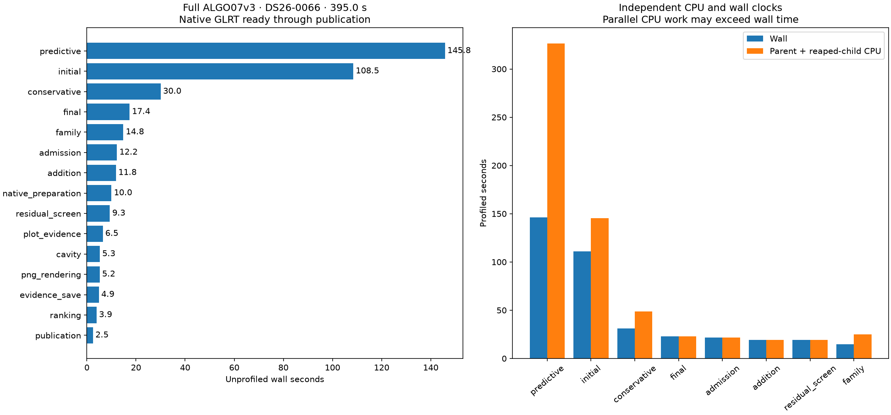
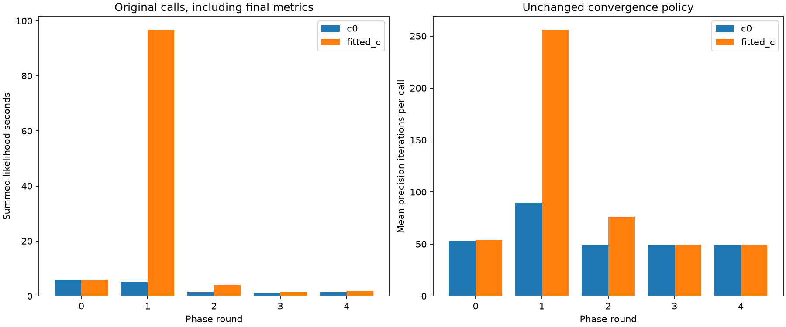
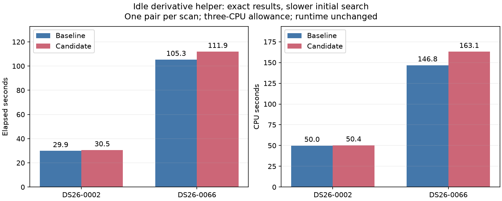

# ALGO07v3 full-profile review and idle-derivative experiment

The current full profile identifies **predictive recovery and initial position
fitting as 64.4% of elapsed runtime** on DS26-0066. The shared numerical likelihood
is the priority. A new experiment borrowing idle capacity for derivative work
preserves complete initial-search outputs but regresses on both tested scans.
It is not integrated. No production configuration or runtime source changes.

## Full pipeline and measurement scope

The [complete profile](../2026_11_06_algo07v3_full_profile/README.md) covers native
GLRT input through evidence storage and all eight published PNGs. Capture,
GLRT extraction and queue waiting are excluded. Three CPU slots and one BLAS
thread per process are used. The uninstrumented reference is **394.960 s**;
the instrumented run is **440.994 s / 690.320 CPU s**. Both scientific arms,
all audits, ownership, public grid/path and eight PNGs match exactly. These
are a difficult-scan case study, not a dataset-wide or production latency claim.
Runtime sources are unchanged by this experiment, so that full profile remains
the applicable stage survey. Profiling overhead and shared-host variation mean
the two full-run clocks are not a code-speed comparison.

| Stage | Unprofiled wall seconds | Share |
| --- | ---: | ---: |
| Predictive recovery and validation | 145.772 | 36.9% |
| Initial regional search and branch fits | 108.453 | 27.5% |
| Conservative refitting | 30.020 | 7.6% |
| Final guarded reassociation | 17.370 | 4.4% |
| Family policy fit | 14.836 | 3.8% |
| Reassociation admission | 12.237 | 3.1% |
| Additional-track fitting | 11.827 | 3.0% |
| All remaining stages | 54.445 | 13.8% |



## Why the expensive fits are slow

The initial branch-1/fitted-c task takes 76.418 s wall in the timer profile.
A separate exact [convergence observer](../2026_11_06_algo07v3_covariance_native/initial-phases.md)
finds **279/279 likelihood calls reach 256 iterations in its second phase
round**, all still above the stopping threshold. The corresponding c=0 round
has 43 calls and only five capped calls. Other rounds are much cheaper.

The hard predictive fold has **269 first-round likelihood calls per arm, 220
capped**. Its width is comparable to the inexpensive folds. This points to slow
precision updates, not simply a large number of nuisance coefficients. It does
not by itself prove the statistical cause, a bad satellite association or a bad
position. One captured recovery trajectory has 256 distinct states; there is no
exact cycle to skip. The noise-group update history, conditioning and phase
misalignment are the next diagnostics.



A prior captured hard-likelihood profile attributes 30.8% to inverse solves,
14.8% to covariance multiplication, 12.8% to LU factorization, 8.3% to Cholesky
and 6.5% to ordered assembly. These are **nested captured-call shares**, not
pipeline percentages. Refresh this attribution on the slow initial phase
before selecting a new kernel change; the two captured problems are distinct.

## New experiment: lend idle capacity to the remaining initial fit

The external probe preserves the six initial branch/arm tasks and their original
order. Only after all tasks have been launched and completed peers reaped may
the sole surviving process start one helper thread. It computes the second
central-difference axis using a separate fixed-phase problem view and mutable
geometry-cache attribute. The owner computes the first axis. Original arithmetic
and column order are retained. This uses at most two compute units while the
three-slot outer queue has drained; there is no nested process pool.

Unknown/custom residuals fall back to serial execution. Helper failure aborts
the operation. Parent cancellation terminates the outer process and its helper
together. This prototype applies only to initial search, not recovery subclasses.

| Scan | Baseline wall | Candidate wall | Change | Baseline CPU | Candidate CPU | Borrowed gradients |
| --- | ---: | ---: | ---: | ---: | ---: | ---: |
| DS26-0002 | 29.870 s | 30.543 s | +2.25% | 49.961 s | 50.376 s | 1 |
| DS26-0066 | 105.318 s | 111.901 s | +6.25% | 146.804 s | 163.112 s | 44 |

Both complete initial-search fingerprints match their independently saved native
audits, including both arms and histories. Prepared inputs remain unchanged.
There is one pair per scan: candidate first on 0002, baseline first on 0066.
These are **prepared initial-stage measurements**, not native whole-pipeline
qualification or PNG comparisons. Host pressure differs between sides; the
regressions do not isolate threading overhead from contention. They nevertheless
provide no evidence supporting integration. A full native campaign is unwarranted
for this version. Six focused tests cover exact fit output, bounded execution,
fallback, failure, cancellation and input ordering ([receipt](tests.xml)).



Raw receipts: [0002](0002.json), [0066](0066.json), [summary](summary.json).
Each receipt retains source/request bindings, expected scientific receipt,
resource observations and task telemetry. Generated and original function
sources are archived alongside it with trailing blank lines normalized.
No full-pipeline speedup is claimed.

## Ranked next steps

1. **Explain the capped precision updates in both hotspots.** Capture one slow
   initial-phase likelihood and compare it with the existing recovery capture.
   Attribute solve/covariance/update costs separately; rank which noise groups
   drive the maximum log update and inspect conditioning. Observer output must
   remain exact. This distinguishes expensive linear algebra from excessive
   iterations and prevents another allocation-only experiment with little upside.
2. **Prototype one exact kernel improvement selected by those measurements.**
   Inspect invariant index, pivot and group-layout construction outside the
   precision loop. Preserve accumulation order and all convergence history.
   Avoid repeating the rejected covariance buffer, symmetric product and compiled
   assembly experiments without a new measured explanation. A captured-call gain
   must survive complete fits and alternating native runs on both scans.
3. **Qualify existing exact control reuse across more branch types.** Measure
   duplicate incidence and key cost on a small predeclared subset exercising
   shared-family, new-family and replay paths. Similar masks are insufficient;
   all dependencies must match. This broadens evidence for retained work rather
   than inventing an unrestricted cache.
4. **Keep solver redesign as a separate scientific proposal.** Warm starts,
   acceleration, damping, analytic derivatives or reduced covariance work may
   have greater potential, but can alter histories and selected results. The
   present identical-output requirement excludes silently substituting them.
   Any future qualification must retain matched c=0/fitted-c experiments and
   report position accuracy separately from fit score.

Do not prioritize more general threading, larger position caches or PNG removal.
The tested thread helper regresses; a previous hard-pair cache census found only
0.0783 s recoverable; PNG rendering is 5.202 s. If the two major fitting stages
could each take 25% less time, arithmetic gives **331.4 s versus 395.0 s** overall
(1.19x); halving both gives **267.8 s** (1.47x). These are opportunity bounds with
other stages fixed, not demonstrated improvements.

## Reproduction

Use a fresh output root and a bound native request containing a saved audit:

```sh
PYTHONPATH=src:tools OPENBLAS_NUM_THREADS=1 OMP_NUM_THREADS=1 \
  timeout -k 2 600 taskset -c 0,1,2 \
  /home/mouse9911/gits/leo-tracker-reduxredux/.venv/bin/python -B \
  tools/probe_algo07v3_idle_derivatives.py \
  --request /absolute/native-request.json --output /absolute/fresh-output
```

Add `--candidate-first` to reverse the pair. The probe checks source bindings
after execution and rejects scientific/input differences. The figure renderer
archives the two completed local receipts; it launches no additional fits.
