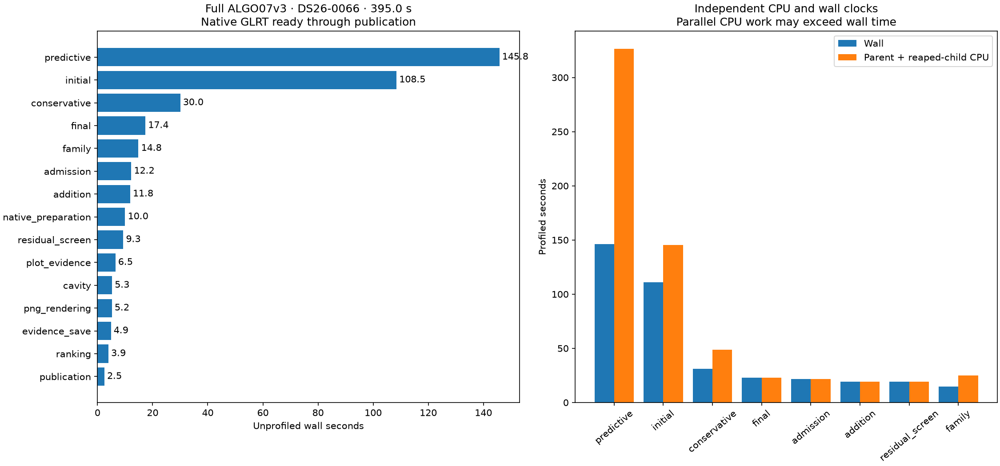
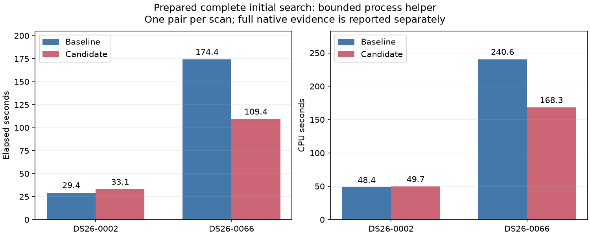
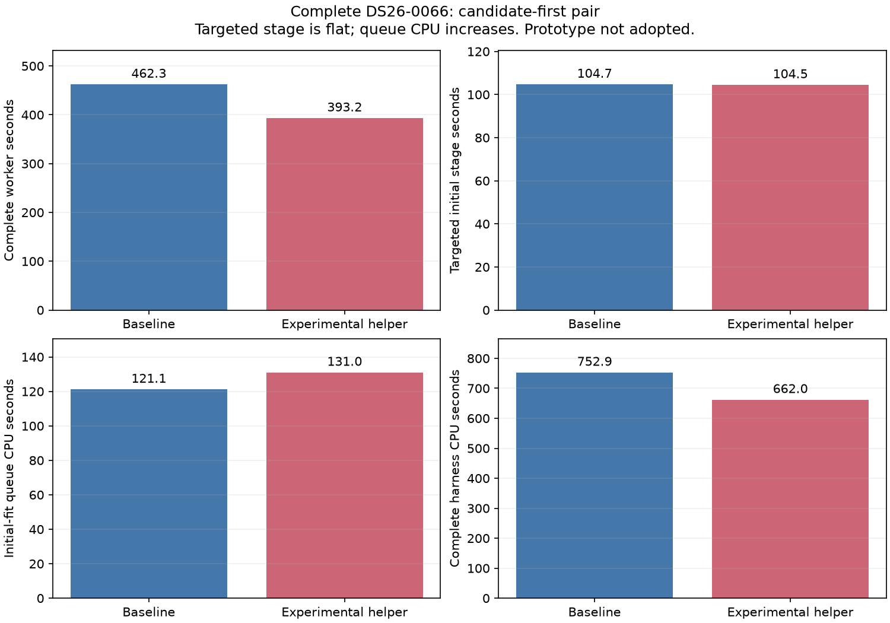

# ALGO07v3 runtime priorities and idle process-helper experiment

The dominant remaining cost is numerical fitting shared by the initial position
search and predictive recovery. Together they account for **64.4%** of the
394.960-second complete DS26-0066 worker. The unchanged hardware-counter run
independently completes in **398.576 seconds**, with exact scientific outputs
and all eight PNGs. These clocks start from frozen native GLRT inputs and end
after publication; they exclude capture, GLRT extraction and queue delay.
This is a difficult-scan case study, not a population runtime guarantee.

The process helper in this report is **not adopted** after native qualification.
Runtime source, numerical budgets, priors, both calibration arms and production
configuration remain unchanged. Its targeted stage is effectively flat while
the initial-fit queue consumes more CPU. A race found in the experiment's serial
fallback is corrected and tested, but the corrected version has no new native
timing qualification. Timings below describe the archived pre-fix version.

## Full profile and root cause

| Stage | Unprofiled wall time | Share of complete worker |
| --- | ---: | ---: |
| Predictive recovery / validation of missing tracks | 145.772 s | 36.9% |
| Initial regional search and branch fitting | 108.453 s | 27.5% |
| Conservative refitting | 30.020 s | 7.6% |
| Final guarded reassociation | 17.370 s | 4.4% |
| Family policy fitting | 14.836 s | 3.8% |
| Reassociation candidate screening | 12.237 s | 3.1% |
| Additional-track fitting | 11.827 s | 3.0% |
| PNG rendering | 5.202 s | 1.3% |



The [full profile](../2026_11_06_algo07v3_full_profile/README.md) includes every
stage, independent CPU clocks and 105 child task windows. Its instrumented run
takes 440.994 seconds and retains complete science and publication equality.
Nested tasks and stages are not additional elapsed time. The subsequent
[hardware-counter measurement](../2026_11_06_algo07v3_perf_coupling/README.md)
covers descendants correctly: 656.458 CPU seconds over 400.069 harness seconds,
or an average 1.641 occupied slots out of three. Perfectly distributing that work
would give a 218.8-second arithmetic lower bound, not a feasible speed forecast.

The slow fits repeatedly evaluate a grouped noise/nuisance likelihood. The
captured initial phase has 2,897 points and 177 nuisance coefficients; all 279
likelihood calls in that phase reach the 256-iteration ceiling. The hard
predictive fold has the same bottleneck. Its point count is close to a cheap fold
(1,560 versus 1,544), while its training is roughly twenty times longer.
Point count alone does not explain this difference.

Inside the captured initial likelihood, inverse-root solves take 31.68%, covariance
multiplication 14.07%, lower-root LU factorization 13.78% and Cholesky 8.24%.
These sum to about 67.8% of that **captured call**, not the entire pipeline.
Noise precision updates have an almost neutral local direction at the plateau,
then a locally expanding direction near the iteration cap. This explains why
convergence warrants investigation; it does not prove global divergence, a bad
final satellite association or that a looser stopping criterion is acceptable.

## Bounded process experiment

The existing three-worker initial-fit queue sometimes ends with one long fit
while the other workers are idle. This experiment lets only that final fit use
one helper process to evaluate the second position derivative axis. Both
plus/minus residual evaluations retain their original order and arithmetic.
All branches, phase rounds and optimizer budgets remain unchanged.

The helper uses forked private memory, is replaced at each phase problem, and is
reaped before its owner returns. Parent-death handling, queue cancellation and
fatal numerical errors have explicit tests. The queue temporarily owns a scoped
subreaper to reap an orphan helper after a fit worker dies. It refuses an owner
with pre-existing children; it never kills unrelated workers. This is distinct
from the earlier rejected helper-thread policy.

### Prepared initial-search evidence

| Scan | Order | Baseline wall / CPU | Candidate wall / CPU | Borrowed gradients | Helpers |
| --- | --- | ---: | ---: | ---: | ---: |
| DS26-0002 | Candidate first | 29.399 / 48.399 s | 33.061 / 49.650 s | 0 | 0 |
| DS26-0066 | Baseline first | 174.400 / 240.621 s | 109.379 / 168.272 s | 57 | 4 |

Both complete initial-search fingerprints match the independent saved native
audit; their prepared inputs remain unchanged. The short scan regresses by
12.46% despite no actual helper activation. The hard scan improves by 37.28%,
but its baseline is substantially slower than prior unchanged-code observations
near 105 seconds, and host pressure changes across the pair. It is not credible
to attribute that entire reduction to the helper. These measurements exclude
preparation, recovery and publication and are not full-pipeline speedups.



### Complete native comparison and decision

The isolated candidate-first pair passes the [strict comparison](native-0/comparison.json):
both calibration arms, full scientific audits, satellite/point ownership, public
grid/path and eight PNG bytes are identical. All runtime source bindings remain
unchanged. The [plan](native-0/plan.json) explicitly records the external function
substitution. The measured observer sources are archived as `measured-*.py`;
the earlier short-stage driver is separately archived as `short-measured-driver.py`.

| Measurement | Baseline | Experimental helper |
| --- | ---: | ---: |
| Complete worker | 462.319 s | 393.222 s |
| Complete initial stage | 104.724 s | 104.473 s |
| Initial-fit queue only | 80.439 s | 79.087 s |
| Initial-fit queue CPU | 121.134 s | 130.984 s |
| Perf scope CPU, including harness | 752.885 s | 661.965 s |
| CPU cycles | 4.01284 trillion | 3.56556 trillion |
| Instructions retired | 10.15398 trillion | 10.15057 trillion |
| Active-clock estimate | 5.330 GHz | 5.386 GHz |
| GNU time maximum RSS | 2,228,216 KiB | 2,214,784 KiB |



The helper activates for 52 gradients across four phase problems in branch 1's
fitted-c fit. Its queue takes 1.68% less elapsed time but **8.13% more CPU**.
The entire initial stage saves only **0.251 seconds (0.24%)**. The baseline is
slower in unchanged residual screening (17.843 versus 9.466 s), additional-track
fitting (20.423 versus 11.679 s), candidate admission (22.330 versus 12.337 s),
and final reassociation (22.627 versus 17.218 s). These unchanged stages cannot
be credited as helper improvements without further causal evidence.

Both counter sets run 100%. Retired instruction counts differ by only about
0.034%, while cycle and CPU costs differ materially. CPU-pressure avg10 rises
from 0.61% to 13.31% during baseline and stays below 1% at the candidate's
recorded endpoints. This supports retaining shared-host variation as a concern;
it does not identify a particular interference mechanism. The apparent 14.95%
whole-worker reduction is **not an attributable helper speedup**. Maximum RSS is
the GNU time process-tree statistic, not a sum of simultaneous resident memory.

The comparison is exact, but no stable runtime win is established and the queue
uses more CPU. The prototype stays external. No cumulative speedup or deployment
is claimed. Do not repeat a full cohort merely to seek a more favorable clock.

### Activation-race finding

The first process prototype delegates its serial fallback to the earlier thread
prototype. Both read the shared capacity flag. If it changes from unavailable
to available between reads, the parent implementation can start a thread
executor in an object whose subsequent code expects a process-helper interface.
The deterministic activation test reproduces this: the serial fallback creates
a `ThreadPoolExecutor`. This must be fixed regardless of whether native runs
happen to encounter the narrow transition.

The correction keeps the fallback local: form the original derivative pairs,
evaluate them serially, and increment only the serial counter. It does not
delegate to or reread capacity through the thread implementation. Completed
measurements made before that correction are retained as pre-fix evidence.
No default-runtime integration is justified by those measurements.

The deterministic regression test fails before the correction by observing a
thread executor, and passes after the local serial fallback is implemented.
All **21 focused tests pass** ([receipt](tests.xml)), covering original and new
observers, exact optimizer results, three-slot capacity, phase replacement,
exceptions, helper exit, owner death, cancellation, foreign-child isolation and
native-routing restoration. Ruff and whitespace checks pass. No runtime source
changed, so this is tool qualification rather than a new numerical release.

## Recommended next sections

1. **The shared likelihood kernel.** This serves both dominant stages. Preserve
   exact arithmetic while looking for demonstrably invariant setup or repeated
   complete fits. Key comparison must cost less than the work it saves. Existing
   inverse workspace and control-view reuse already cover identified savings;
   repeat incidence must be measured before adding another cache.
2. **Deprioritize queue changes unless new evidence identifies a different
   mechanism.** The bounded process helper is now essentially flat in the native
   initial stage and increases queue CPU. Its short case provides a no-helper
   overhead control. Any revival needs a concrete reason it should overcome
   this result, followed by exact complete-worker comparisons in both orders.
3. **A separate numerical-convergence candidate, if output equivalence changes
   are explicitly permitted.** Warm starts, accelerated precision updates,
   direct triangular solves or selected covariance calculations could attack
   the 256-step inner loop. They change rounding or iteration trajectories and
   cannot pass as identical-output optimizations. Qualification must separately
   assess numerical error, both c arms, association changes, position error and
   full publication behavior; lower objective alone is insufficient.

Do not prioritize PNG encoding, larger position caches, or another blind task
reordering. The measured additional cache reuse was only 0.0783 seconds in the
hard training pair. Thread helpers, covariance-buffer reuse, compiled assembly
and cross-target scheduling have already produced negative native evidence.
The current exact-output requirement substantially narrows which numerical
speedups can be integrated; that is a constraint to report, not quietly relax.

If both dominant stages took 25% less time, arithmetic gives **331.4 seconds**
instead of 395.0, a 1.19x overall speed ratio. Halving both gives **267.8 seconds**,
or 1.47x. Halving PNG rendering saves only 2.6 seconds. These are opportunity
scenarios with other work held fixed, not measured gains.

## Reproduction

Use the profile skill for the unchanged full worker and its timing-scope checks.
The current corrected experimental helper can be exercised with:

```sh
sudo -n env PYTHONPATH=src:tools OPENBLAS_NUM_THREADS=1 OMP_NUM_THREADS=1 \
  /home/mouse9911/gits/leo-tracker-reduxredux/.venv/bin/python -B \
  tools/probe_algo07v3_native_idle_process.py \
  --request /absolute/content-bound-native-request.json \
  --output /absolute/fresh-private-output --candidate-first
```

This invokes the actual owned worker in private namespaces with three fixed CPU
slots, one BLAS thread, read-only input bindings and a 1,200-second outer limit
per side. It is a research comparator, not a production CLI mode. The correction
means a future run binds a different helper hash from the measured archive here.
The report renderer validates archived measurement hashes and exact comparison
receipts before collecting completed results; no science is rerun to render it.
