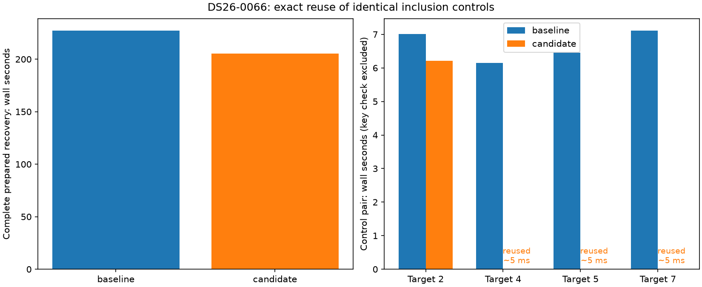
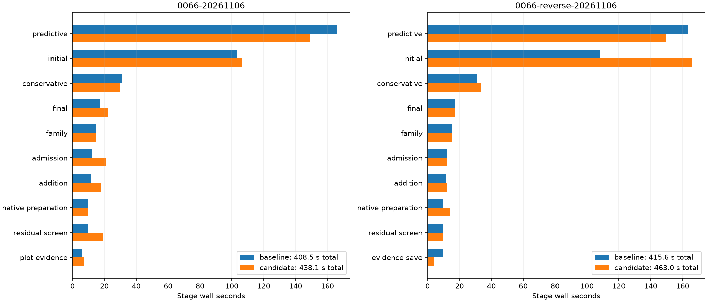

# ALGO07v3: reuse identical inclusion-control fits

The DS26-0066 recovery path repeatedly fits the same control while testing four
different proposed tracks. All four control pairs have identical scientific
input keys and complete outputs, including both c=0 and fitted-c histories.
The prototype computes the first pair and returns private copies for the next
three. Every proposed target is still fitted and audited independently.

**Prepared complete recovery improves 227.275 → 205.399 seconds (9.63%).**
Control fitting/copying falls 26.720 → 6.234 seconds; key checks cost
1.518 / 1.570 seconds. Complete stage fingerprints, selected state and the
previous qualified native recovery audit match exactly. **The candidate is not
adopted: both complete native pairs regress, and the default runtime is restored.**
No production changes or new cumulative speedup are claimed.



## Where the pipeline spends time

The first full native baseline in this report takes 408.499 s on DS26-0066.
Predictive recovery takes 165.902 s (40.6%) and initial position search takes
103.053 s (25.2%). Together they account for 65.8% of elapsed time. The previous
short DS26-0002 baseline takes 152.529 s, of which predictive recovery is
38.998 s (25.6%) and initial search is 21.707 s (14.2%). The workload mix varies
substantially by scan; a hard-scan improvement is not automatically a throughput
improvement on the whole dataset. The native-stage figure below includes every
measured large stage. These clocks start with native GLRT available and end at
publication; capture, detector extraction and queue delays are excluded.

The [convergence investigation](../2026_11_06_algo07v3_ordered_assembly/convergence.md)
explains why one predictive fold is expensive: its first phase makes 269
likelihood calls in each calibration arm, and 220 reach the 256 precision-update
ceiling. Of these, 219 still exceed the stopping threshold. Other folds have
the same 175/176 nuisance columns but converge much faster. This identifies a
numerical-convergence bottleneck, not merely too many GLRT points or too few
workers. It does not authorize shortening the fit under the exact-output rule.

Within the [captured hard likelihood](../2026_11_06_algo07v3_training_queue/README.md),
inverse solves take 30.8%, covariance multiplication 14.8%, LU factorization
12.8%, and Cholesky factorization 8.3%. Those percentages describe one nested
numerical call, not the complete pipeline. They identify worthwhile kernel
targets but cannot be multiplied into a promised scan speedup.

Recommended next experiments, preserving exact outputs:

1. Reduce the overhead of duplicate-control detection by proving and binding
   its actual immutable dependencies. The current broad key is conservative
   but costs about 1.5 s on a short scan with no duplicates. Do not omit mutable
   state or infer equality from satellite labels alone.
2. Profile repeated matrix construction and copies within the first slow phase.
   Reuse only quantities proven invariant at the same numerical inputs; preserve
   operation order and validate both arms and complete trajectories. Larger
   position caches have already shown only 0.078 s opportunity in this case.
3. Evaluate scan throughput separately from per-scan latency. A larger queue
   across independent scans may use idle CPU slots without altering any fit,
   but must be bounded by memory and tested against actual production load.
   This report measures isolated three-slot jobs, not such a throughput test.
4. Treat warm starts, alternative precision solvers and different stopping
   rules as a separate algorithm proposal. They may address the biggest cost,
   but they need a new scientific equivalence policy and dataset qualification;
   they cannot silently replace the current identical-output optimization.

Reordering only the six jobs of the slow target has less than one second of
simulated upside. Earlier compiled assembly and cross-target scheduling trials
preserved exact outputs but regressed in complete native runs; do not repeat
them without a new explanation or change. No speedup here is attributed to
dropping observations, satellites, calibration arms, phase rounds or figures.

## Repeated-control experiment

The [previous common-prefix investigation](../2026_11_06_algo07v3_native_recovery_queue/README.md)
identified four inclusion checks whose first paired fitting blocks each took
roughly 4.2–4.4 seconds. This experiment first recomputes every control to test
the duplication hypothesis. It then enables reuse under the same key and runs
all recovery stages again from a fresh child of the same prepared context.

| Quantity | Recompute every control | Reuse exact duplicate controls |
| --- | ---: | ---: |
| Complete recovery wall time | 227.275 s | 205.399 s |
| Complete recovery CPU time | 520.776 s | 483.049 s |
| Control pair computation/copy time | 26.720 s | 6.234 s |
| Input-key checks | 1.518 s | 1.570 s |
| Full control pairs computed | 4 | 1 |
| Complete arm fits avoided | 0 | 6 |

Each arm fit retains five phase-refresh rounds. Reuse removes thirty duplicate
rounds without changing any fit result, original iteration limit, observation,
prior or satellite hypothesis. The first pair is still computed normally.
Subsequent copied pairs take 5.15–5.47 milliseconds in the prototype.

Control and key clocks are nested within recovery; do not add all table rows.
This is a baseline-first prepared-stage pair with instrumentation on both sides,
not a dataset-wide guarantee. Context reconstruction, later numerical replay,
reassociation, final fitting, rendering and publication are outside this clock.
Shared-host variation affects absolute times. The repeated fits are confirmed
duplicates; the complete 21.876-second observed reduction should still not be
assumed for every scan.

## Short-scan overhead check

DS26-0002 has three distinct controls: shared-family, new-family L-BFGS-B and
new-family Powell. Their routes/optimizer keys and complete outputs differ;
**none is reused**. Candidate-first prepared recovery takes 60.291 s, followed
by 61.480 s for the recomputing census. Both match every captured stage and the
prior native audit. This difference is not evidence of a reuse speedup because
the mathematical work is unchanged and both experimental modes calculate keys.

Key checks cost 1.571 / 1.472 seconds here, without avoiding a fit. That is real
potential overhead versus the original implementation, which has no key checks;
the prepared census baseline is not an overhead-free control. This limits any
claim of universal benefit. [Short-scan receipt](short-result.json) and its
exact measured tool, `short-measured-probe.py`, are retained. Broader workload
qualification should measure how often controls repeat before claiming a
dataset-wide throughput improvement.

## Complete native qualification

The first fresh pair preserves all scientific audits, both calibration arms,
point ownership, all eight PNG bytes, and public grid/path values exactly.
Predictive recovery improves **165.902 → 149.293 s**, but total native runtime
regresses **408.499 → 438.107 s**. Several unchanged later stages slow materially:
residual screening is 9.417→18.984 s, admission 12.201→21.363 s and final fitting
17.328→22.337 s. Total CPU is 673.670→705.060 s; per-process peak RSS is
2,277,624→2,200,444 KiB. Neither an overall speedup nor a specific host cause is
established by this pair.

The reverse-order pair also preserves every output. Predictive recovery improves
163.459 → 149.473 s (8.56%), but the complete pipeline regresses
415.570 → 462.984 s (11.41%). Initial search varies 107.800 → 165.614 s,
even though this optimization runs later. This is evidence of substantial
uncontrolled variation, not proof that the cache causes the total regression
or permission to discard it. Both measured full-pipeline comparisons are slower.

The recommendation is to retain the external prototype, make dependency checking
cheaper, and qualify across scans with and without repeated controls before
default integration. Both modified runtime modules have been restored exactly
to their frozen baselines; the new helper and its tests are archived under
`candidate-src` and `candidate-tests`. The separate candidate test receipt is
retained. No default runtime or production behavior changes in this iteration.

[Native clocks and exactness receipts](native-measurements.md).



## Implementation and exclusions

In the archived candidate, `InclusionControlCache` is created inside each recovery-controller invocation.
It contains only copied complete c0/fitted-c control results. It is never global,
persisted, reused across scans or shared with target fits. On a cache miss, the
original paired execution port runs unchanged. Returns are copied so downstream
mutation cannot corrupt a later control.

The key binds the route and optimizer option, original graph count, complete
scan attributes (including orbital caches, TLE-derived geometry, region and
radio noise), incumbent node, mask, powers, phase means, model, predictive
entries and policy/ownership record. Arrays are bound by dtype, shape and exact
bytes; floating-point scalars preserve hexadecimal values. An unknown callable
or unsupported object bypasses caching rather than being omitted from the key.

Inactive and timing-gap views append target-only tracks, whitening matrices and
receiver basis rows. Only those three lists are truncated to the original graph
count for the control key, matching the existing control-membership calculation.
Original entries referencing appended rows bypass reuse. All other attributes
remain bound. The DS26-0066 duplicate group includes an inactive fragment.

Stateful numerical policies, alternative problem factories, scan subclasses and
conditional satellite-refresh controls bypass reuse. Their callbacks, physical
objective counts and numerical receipts therefore retain their original work.
Shared controls and new-family controls use separate keys; L-BFGS-B and Powell
also remain separate. Both scientific arms stay matched throughout.

The candidate's standalone inclusion functions default to no cache. Its recovery
controller supplies its scoped cache to inclusion and retry calls. No persisted
scientific contract, external runtime dependency or production configuration
changes. The earlier cross-target scheduling candidate remains outside the
default implementation; this change does not depend on it.

## Validation and reproducibility

**1,991 candidate tests pass**, with no failures or skips and three existing NumPy shape
deprecation warnings ([receipt](tests.xml)). Tests cover input-key invalidation
for radio/orbit/model/mask/ownership changes, append normalization, bypasses,
optimizer/route separation, private copies, failure propagation, and full
control/target equality. Existing independent numerical-oracle and component
tests remain unchanged. The initial focused integration suite had 55 passing
tests; the external prototype alone had nine.

After restoration, **1,973 tests pass** with no failures or skips and the same
three pre-existing warnings ([restored receipt](restored-tests.xml)). Ruff and
`git diff --check` pass. Both restored modules match their frozen baseline bytes.

The [prepared receipt](prepared-result.json) retains complete stage and selection
signatures, every training/scoring/inclusion interval, the four control keys,
full-output hashes and source/input provenance. The exact measured external tool
is archived as `measured-probe.py`; after integration the live tool recognizes
the new optional execution hook while preserving its recompute/reuse modes.

```sh
PYTHONPATH=src:tools OPENBLAS_NUM_THREADS=1 OMP_NUM_THREADS=1 \
  taskset -c 0,1,2 timeout -k 5 700 \
  /home/mouse9911/gits/leo-tracker-reduxredux/.venv/bin/python -B \
  tools/probe_algo07v3_inclusion_controls.py \
  --request /absolute/qualified-native-request.json --output /absolute/fresh-root
```

`--reverse` changes the prepared-pair order. This tool requires all-work
admission, the pinned runtime and three CPU slots. It reads the owned saved
preparation to reconstruct context and requires complete recovery-audit agreement.
Evaluation coordinates never enter fitting. The source bindings are verified
again after both sides finish.

`run_pair.py` separately runs fresh baseline/candidate native jobs in private
mount/network namespaces using the frozen causal bundle, three CPUs, one BLAS
thread and the unchanged 1,200-second bound per job. Two changed modules are
overlaid from exact snapshots. The new helper is source-bound and is loaded
only by the candidate. Full science, both arms, ownership, all eight PNG bytes
and public grid/path are the comparison gate. Capture, GLRT extraction and queue
waiting are excluded. Native qualification is a DS26 subset, not full-cohort
or production-admission qualification.

The original ALGO07 cumulative comparison remains 886.905 s versus v3
193.899 / 152.529 s on DS26-0002. Do not multiply that historical ratio by this
different scan's stage improvement.

To reproduce the archived complete native candidate, first restore its three
`candidate-src` modules in a separate experimental checkout. `run_pair.py` binds
the live candidate source and the two archived baseline modules; it intentionally
fails if the required candidate helper is absent. Never change sources during
an active bound pair. The external prepared probe supports both original and
candidate inclusion APIs and can run against the restored default directly.
