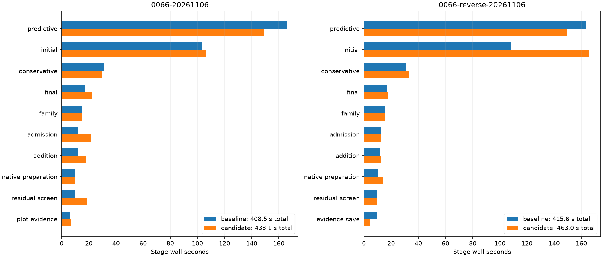

# Complete native comparisons

| Scan/pair | Baseline s | Candidate s | Reduction | Recovery baseline s | Recovery candidate s |
| --- | ---: | ---: | ---: | ---: | ---: |
| algo07v3-inclusion-control-native-0066-20261106 | 408.499 | 438.107 | -7.25% | 165.902 | 149.293 |
| algo07v3-inclusion-control-native-0066-reverse-20261106 | 415.570 | 462.984 | -11.41% | 163.459 | 149.473 |

All scientific audits, both c arms, ownership, grid/path and eight PNGs are exact.
Fresh isolated runs use CPUs 0–2, one BLAS thread and unchanged 1,200-second
outer bounds. Capture, detector extraction and queue waiting are excluded.
Unchanged stages and shared-host timing variation prevent attributing every
whole-process difference to this control-reuse change. CPU/RSS and complete stages
are retained in native-summary.json; RSS is a per-process maximum, not aggregate.

