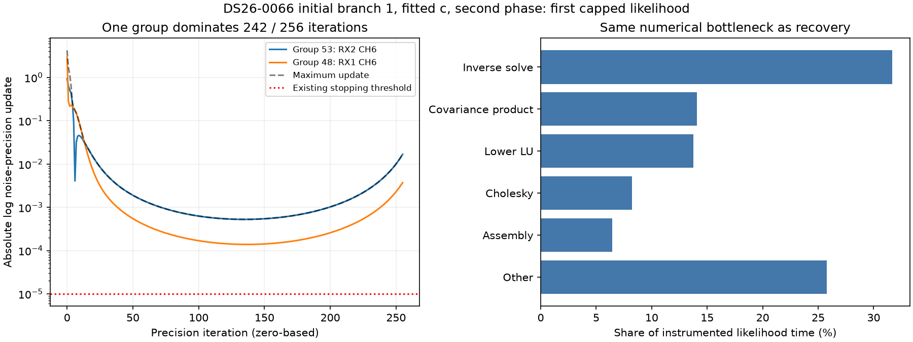

# ALGO07v3: initial precision bottleneck and Cholesky-layout trial

The slow initial fit has the same numerical bottleneck as predictive recovery:
matrix inverse solves, covariance multiplication and factorization dominate.
One noise group drives almost all of the captured initial likelihood's late
precision updates. Its exact source is RX2 CH6 T002, under the initial branch's
58109 hypothesis. This is a diagnosis of one intermediate model state, not a
claim that its association is wrong or that it is the final selected satellite.

The new layout prototype preserves all captured outputs but is **not adopted**:
initial-call mean regresses 0.60%, recovery-call mean improves only 0.96%.
There is no new complete-pipeline speedup and no runtime or production change.

## Complete-fit capture and exactness

`tools/profile_algo07v3_initial_convergence.py --capture-capped` now optionally
copies the first capped in-fit likelihood input in each arm. Selection uses
the fixed 256-iteration condition, not timing. It never alters the fit, budgets,
observations or parameters. The captured arrays own their storage.

Both complete DS26-0066 branch-1 fits match the independent saved native audit,
including histories and all returned scientific fields. The observation-only
one-CPU run takes 10.068 s for c=0 and 68.433 s for fitted-c. These are not
baseline/candidate speed measurements or directly comparable with earlier
three-slot native task clocks. See [complete receipt](initial-fit.json).

The fitted-c capture is the first likelihood in its second phase round to hit
256 iterations: **2,897 points and 177 nuisance coefficients**. The exact
input archive is retained locally at
`/srv/bulk/leo-dev/algo07v3-initial-capture-20261106/fitted_c-capture`, with array
SHA-256 `d72a34ba03a80cb439913c897b3864f9c686951928faaaecdcedddad0eb36b98`.
The reconstruction in [analyze.py](analyze.py) builds the fixed-phase problem
from the saved native preparation, branch and phase reference. Its entire
likelihood input fingerprint and returned result signature match the capture
before assigning group indices to tracks. Thus the mapping is verified, not
inferred from a similar time interval.

## Inner numerical profile

Three instrumented calls preserve every complete-likelihood output exactly.
These percentages are **nested captured-call shares**, not pipeline shares:

| Operation | Share |
| --- | ---: |
| Inverse-root solve | 31.68% |
| Covariance multiplication | 14.07% |
| Lower-root LU factorization | 13.78% |
| Cholesky | 8.24% |
| Ordered grouped assembly | 6.45% |
| Two coefficient solves | 1.42% |
| Matrix initialization | 0.73% |
| Other likelihood work and observer overhead | 23.63% |

The corresponding earlier recovery-capture shares were 30.8%, 14.8%, 12.8%,
8.3% and 6.5% for the first five operations. This confirms a common target for
optimization across initial search and predictive recovery. Exact byte and
source-bound receipts: [parts](initial-parts.json), [trajectory](initial-trajectory.json).



## Which groups prevent convergence?

| Group | Track | Time | Points | Iterations with largest update | Initial-branch hypothesis |
| --- | --- | --- | ---: | ---: | ---: |
| 53 | RX2 CH6 T002 | 55.85–86.68 s | 28 | 242 | 58109 |
| 48 | RX1 CH6 T004 | 0.23–60.81 s | 67 | 9 | 58109 |

The remaining five winning iterations belong to three other groups. The two
main groups share the same satellite hypothesis across receivers. That suggests
examining coupling through shared satellite/hardware parameters; it does not
establish causation or justify dropping either track.

The maximum absolute log precision update reaches a minimum of about 0.000525
at iteration 135, still 52.5 times the 1e-5 threshold, then rises. Group 53's
last update is 0.01677. There are **256 distinct states and zero exact repeats**,
so exact cycle skipping cannot shorten this example. No learned coefficient
precision groups are present: these changing precisions belong to observation
noise groups. An increasing update magnitude does not by itself prove a worse
objective or a diverging solution.

At this intermediate model state, group 53 has 71.47 Hz model residual RMS
versus 27.78 Hz polynomial RMS and final relative noise precision 1.1104.
Group 48 has 110.68 Hz model RMS versus 81.82 Hz polynomial RMS and precision
0.4318. Neither polynomial RMS nor the intermediate model RMS validates the
satellite label. In particular, the dominant group is not simply an extreme
low-weight rejected group.

The posterior Gram's estimated spectral condition number is 1.13e10 initially
and about 2.17e10 at iterations 135 and 255. These diagnostics use the original
coordinate/prior scaling and can reflect broad nuisance priors and redundant
columns. They do not prove numerical failure or establish that conditioning
causes the slow noise updates. No rescaling is fed into inference.

## Prototype: retain LAPACK's native Cholesky layout

The current helper turns LAPACK's Fortran-contiguous factor into a
C-contiguous array. The external candidate returns the original factor and
keeps all subsequent operations, arithmetic and stopping rules unchanged.
It trades layout conversions between downstream calls; a net benefit must be
measured rather than assumed.

| Captured likelihood | Baseline mean | Candidate mean | Change |
| --- | ---: | ---: | ---: |
| Initial branch-1 fitted-c, phase 1 | 0.205770 s | 0.207015 s | +0.60% |
| Previously captured hard recovery | 0.184398 s | 0.182629 s | −0.96% |

Each row uses six alternating-order pairs, three calls per side per pair, one
CPU and one BLAS thread. All complete returned fields and input fingerprints
remain exact. All individual clocks are retained in
[initial-layout.json](initial-layout.json) and [recovery-layout.json](recovery-layout.json).
These tiny mixed effects do not justify complete native integration or a full
dataset timing campaign. The candidate remains an external probe.

Seventeen candidate tests cover zero/one/many coefficients, C/F feature layouts,
sparsity, learned/fixed prior groups, input preservation, factor layout and
singular errors. The capture observer has three tests covering unchanged calls,
hook restoration and capture ownership/selection. See [tests.xml](tests.xml).
The measured probe's exact source is archived in [measured-root-probe.py](measured-root-probe.py);
the reusable tool differs only in line wrapping after measurement.

## Next iteration

The previous full profile still applies: initial search plus predictive recovery
are 64.4% of the 394.960 s hard-scan run. This iteration narrows the bottleneck
to shared matrix work and a track-specific noise-precision interaction.

1. Compare the local fixed-point sensitivity of groups 53 and 48 with other
   groups, and with the hard recovery capture. Keep this as an observer first:
   determine whether coupled noise updates are nearly noncontracting, and which
   shared coefficients connect them. This separates a convergence issue from a
   mere allocation cost and informs any future mathematical redesign.
2. For an exact runtime change, measure reusable invariant work around the
   matrix operations on complete calls. Retain the documented negative results
   for covariance buffers, combined RHS, layout changes and broad caches; do not
   revive them based on a small favorable component clock.
3. Preconditioning, accelerated updates or warm starts could address iteration
   count but may change outputs. They remain separate numerical candidates,
   outside the current identical-output requirement. Do not silently change
   convergence tolerance, drop a calibration arm or remove the difficult track.

## Reproduce

Use the pinned environment, one CPU and a fresh output root:

```sh
PYTHONPATH=src:tools OPENBLAS_NUM_THREADS=1 OMP_NUM_THREADS=1 \
  timeout -k 2 600 taskset -c 0 \
  /home/mouse9911/gits/leo-tracker-reduxredux/.venv/bin/python -B \
  tools/profile_algo07v3_initial_convergence.py \
  --request /absolute/native-request.json --branch 1 --capture-capped \
  --output /absolute/fresh-capture-root
```

Then run `tools/profile_algo07v3_posterior_parts.py`,
`tools/profile_algo07v3_precision_trajectory.py` and
`tools/probe_algo07v3_root_layout.py`, each with `--capture CAPTURE --output FRESH`
and a 60/60/120-second external bound respectively. The report analyzer verifies
the saved mapping and regenerates the figure; it does not rerun a full fit.
