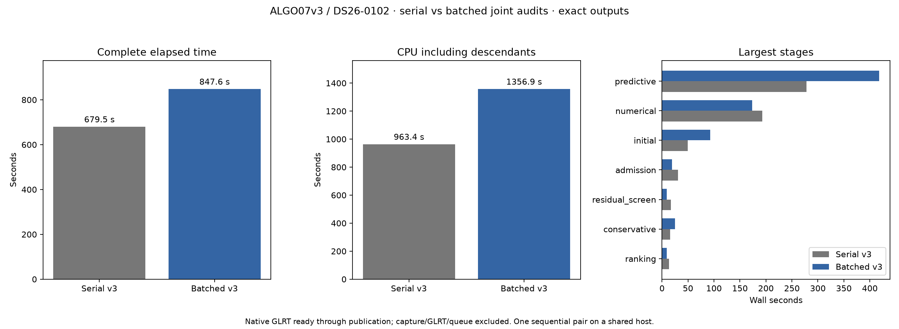
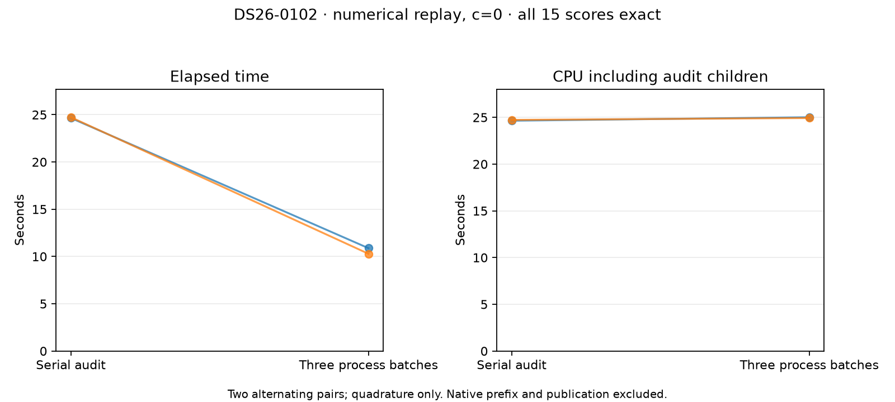
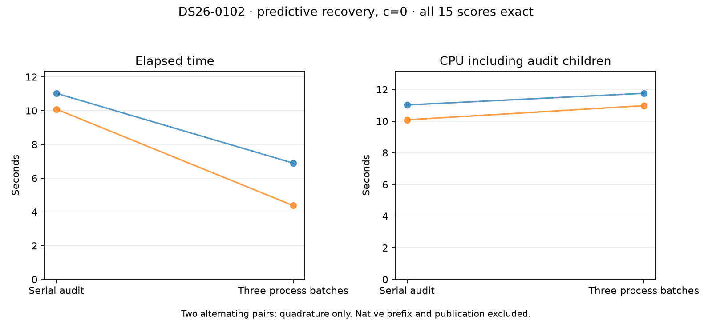

# ALGO07v3: independent joint-audit quadrature batches

**Retained in development for measured audit latency; a complete-pipeline gain
is unproven and production is unchanged.** Complete native outputs are exact,
but the full run regresses. The candidate-first,
sequential comparison on DS26-0102 is terminal. It exercises joint fits and audits
in predictive and numerical recovery. Both sides include the previously qualified
owned LU backend; this experiment changes only audit execution.

| Scope | Serial audit | Batched audit |
| --- | ---: | ---: |
| Complete native input through publication | 679.517 s | 847.613 s |
| CPU including descendants | 963.35 s | 1,356.91 s |
| Predictive recovery | 277.700 s | 417.895 s |
| Numerical recovery | 192.981 s | 173.194 s |
| Unchanged initial search | 49.347 s | 92.551 s |
| Maximum per-process RSS | 2,496,676 KiB | 2,931,260 KiB |

This is **24.74% more complete elapsed time and 40.85% more CPU**, not an
improvement. Numerical recovery falls 19.787 s, while predictive recovery rises
140.195 s. Unchanged stages vary substantially in both directions: initial search
rises 43.204 s, whereas admission falls 11.357 s. CPU pressure averaged over
60 seconds is 10.01% at candidate start versus 0.70% at baseline start. These
observations prevent attributing the entire regression to the code; they do not
erase the regression or justify normalizing it away.

[Full stage table](native/timings.md), [timing summary](native/summary.json),
[exact comparator](native/comparison.json), [execution bindings](native/plan.json).
The comparator checks complete scientific evidence, both calibration arms,
ownership, public grid/path and all eight PNG bytes. An additional
[science-only comparison](prior-qualified-science-comparison.json) against the
previously qualified owned-LU result passes independently without a timing claim.
No new cumulative original-ALGO07 speedup is established.

Both focused audit benchmarks are complete after the native pair exits. They
establish the narrower latency benefit below. No repeat of the full native pair
was selected to obtain a favorable clock. Retention is based on repeatable
same-checkpoint results in both affected routes and complete native scientific
equivalence, not on a claimed improvement in full-worker elapsed or CPU time.

## Same-checkpoint numerical audit

Each trial forks from the same original native c=0 audit state, before any trial
can warm or mutate its parent. The complete five-position, three-resolution grid
and numerical receipt agree in all four trials. The two pairs run in opposite
orders. These times exclude native-prefix computation and publication.

| Pair | Serial wall | Batched wall | Serial CPU | Batched CPU |
| --- | ---: | ---: | ---: | ---: |
| Baseline first | 24.648 s | 10.882 s | 24.643 s | 25.014 s |
| Candidate first | 24.732 s | 10.288 s | 24.730 s | 24.929 s |
| Mean | **24.690 s** | **10.585 s** | **24.687 s** | **24.971 s** |

Mean audit elapsed time falls **57.13%**, with **1.15% more CPU**. This is a
targeted latency benefit with a small measured CPU cost on this checkpoint,
not a complete-worker or throughput improvement. It does not override the
679.517→847.613-second complete-run regression. Both calibration arms remain
covered by the native scientific comparison; these repeated timing trials cover
the first numerical c=0 grid only.

[All trial scores and clocks](direct-checkpoint/result.json),
[bindings](direct-checkpoint/plan.json), [verification](direct-checkpoint/verified.json).
The predictive probe changes only the interception predicate in the
tested external harness. It retains the actual policy-free optimized-contraction
kernel, rather than simulating that route with a numerical-policy flag.

## Same-checkpoint predictive audit

The corresponding first predictive c=0 audit uses the same two alternating pairs
and the original optimized-contraction policy. All 15 scores match exactly in
every trial; the policy receipt is absent on both sides, as expected for this
route. The complete native pair covers both c arms; this focused clock covers c=0.

| Pair | Serial wall | Batched wall | Serial CPU | Batched CPU |
| --- | ---: | ---: | ---: | ---: |
| Baseline first | 11.025 s | 6.892 s | 11.024 s | 11.758 s |
| Candidate first | 10.085 s | 4.377 s | 10.083 s | 10.980 s |
| Mean | **10.555 s** | **5.635 s** | **10.553 s** | **11.369 s** |

Mean elapsed time falls **46.62%**, with **7.72% more CPU**. The absolute mean
CPU increase is 0.815 s per measured grid. This route has a larger proportional
CPU cost than direct numerical quadrature; retaining it favors lower audit
latency within the existing three-slot budget, not lower CPU consumption.

[All scores and clocks](predictive-checkpoint/result.json),
[bindings](predictive-checkpoint/plan.json), [verification](predictive-checkpoint/verified.json).

## Interpretation and limits

Both changed quadrature routes improve in each alternating pair. At the same
time, the complete worker regresses. Before recovery even begins, unchanged
stages total 109.886 s in the serial run and 194.384 s in the candidate: **84.498 s
of the difference precedes the first changed audit**. Later unchanged stages
move in the other direction. These observations demonstrate unrelated execution
variation, but do not allocate every second of the regression to host load.

Source review finds that grid evaluation warms per-family prepared geometry and
per-problem position caches local to the audit. The shared scan orbit-mode and
phase-width caches are prepared by constructors before batching. This reduces
concern that the change loses useful inter-stage cache warming; it is a source
review, not a measured attribution of the complete-worker difference.

The retained change therefore has a **scoped audit-latency qualification** and
complete scientific equivalence on one branch-rich DS26 scan. It has no qualified
dataset-wide throughput gain, production-admission equivalence or new cumulative
original-ALGO07 speed ratio. Position accuracy, associations, priors, budgets and
all eight figures are unchanged. The earlier cumulative reference comparison
remains [886.905 versus 193.899 / 152.529 seconds](../2026_11_06_algo07v3_reference_recovery/README.md)
on DS26-0002 at that earlier revision; its ratio must not be multiplied by the
audit improvements in this report.

## Why this target

The [joint-recovery profile](../2026_11_06_algo07v3_joint_phase_lu/README.md)
identifies joint fits and audits as 70.3% of the numerical-recovery stage.
Each joint audit evaluates five nearby positions at three phase resolutions.
The offsets are the endpoint and four cardinal offsets of 25 m. Every result
checks phase-resolution stability; none can be omitted to save runtime.

With the retained LU backend, the actual direct-mode grids of 481 squared,
961 squared and 1,921 squared phase pairs take approximately 0.275, 1.044 and
4.169 seconds per evaluation in the preceding alternating benchmarks. Five
positions therefore imply about 27.4 seconds of kernel work per audit, before
geometry and other audit work. This is a scale estimate from separate captured
calls, not a measured saving or a prediction of this candidate's runtime.
Duplicate final-integral reuse would remove much less work on this case and
remains a separate, unintegrated prototype.

## Execution change and invariants

The existing process execution port receives at most three contiguous batches:
positions (0,1), (2,3), and (4). Each batch evaluates its three phase resolutions
serially. Results are collected in the original position/grid order. The stage
sequence, optimizer calls, phase refresh, all observations, causal catalogue,
priors, budgets and admission gates stay unchanged. Calibration arms remain
ordered; no new CPU allowance or BLAS threads are introduced.

Factorized audits and custom problem factories or numerical policies stay
serial. The owned numerical policy's receipt must remain byte-equivalent in
every child and in its parent. Unexpected mutation, missing or reordered rows,
child crashes and transport failures abort execution rather than becoming an
association rejection. The analyzer depends on a caller-supplied execution
port and never imports the process adapter.

Unlike the rejected direct-chunk prototype, this proposal distributes complete
independent position evaluations across processes. It does not divide the
arithmetic of an individual phase integral. That distinction motivates testing;
it does not prove better latency or CPU efficiency.

## Qualification protocol

The full isolated comparison uses frozen native GLRT inputs and causal TLEs,
CPUs 0–2, one BLAS thread and a 1,200-second bound per side. Old installations,
historical bulk results and repository reports are hidden; inputs are read-only.
All five changed runtime modules are explicitly bound. Complete scientific
audits, c=0 and fitted-c outputs, point/satellite ownership, public diagnostic
grid/path and all eight PNG bytes must agree. GPS is presentation-only.

The clock runs from native GLRT input to complete publication. Capture,
detector/GLRT extraction, queue delays and browser loading are excluded. GNU
time records CPU including descendants and maximum per-process RSS. A shared
host can change unchanged-stage timings, so complete-run observations alone
cannot establish an attributable or population speedup.

The initial broad suite passes 2,324 tests with three existing NumPy deprecation
warnings. A subsequent final focused suite passes 107 tests, including the
latest controller forwarding/retry check. These counts overlap. New tests use
the real joint-density kernel, both contraction modes, serial and process
execution, malformed/missing/reordered transport, child failure and numerical
receipt mutation. Runtime modules and new tests pass Ruff; the existing
application test file retains eight unrelated line-length violations.
After the controller, profiler and external scalar-prototype additions, the
final broad suite passes **2,358 tests with no failures or skips**, and the same
three existing warnings ([receipt](final-full-tests.xml)). All preceding focused
counts overlap this total.

An additional controller regression proves that an incomplete quadrature aborts
rather than publishing an ALGO02 fallback; its final controller suite passes
13 tests. The focused timing probe has seven tests. It recomputes the native
prefix, intercepts the first direct
joint quadrature, and forks each serial/batched trial from the same unchanged
parent checkpoint in baseline/candidate/candidate/baseline order. It compares
the complete 5-by-3 score matrix and numerical receipt, records elapsed and
descendant CPU time, then stops without publishing a scientific result. This
distinguishes the targeted execution cost from unrelated full-run timing
variation; it first requires a passing full native comparison.
It verifies that comparison's bound requests match the probed scan and that
both calibration arms passed. A stale or different-scan receipt cannot qualify
the probe. This external prefix observer does not use the isolation namespace;
the ordinary complete native pair supplies the isolation and publication gate.

The full timer profiler now records integer position-batch indices instead of
an opaque tuple type, allowing its child windows to identify the longest audit
batch. All 14 profiler tests pass. This instrumentation is separate from the
unprofiled native timing pair and changes no scientific code.

## Next separate experiment

Objective-only joint evidence calls discard phase marginals, MAP indices and
orbital diagnostic means after taking the scalar likelihood. The external
`tools/probe_algo07v3_joint_scalar.py` prototype preserves validation, matrix
arithmetic and log-sum-exp order, while omitting those unused diagnostics.
Twenty-five focused prototype/benchmark tests pass across both contraction
modes, chunk sizes, invisible families and invalid inputs. It is **not integrated
or timed yet**. The full diagnostic kernel remains unchanged.

Next run `tools/benchmark_algo07v3_joint_scalar.py --native CAPTURED_NATIVE_PAIR
--output FRESH_ROOT` on one CPU with one BLAS thread. It uses the original native
481²/961²/1921² captures, four alternating pairs per size and contraction mode,
and checks each scalar against the complete reference. Direct reference results
must also match the original native captures. Measure before integrating, retain
unfavorable timings, and require real fit/audit plus complete native publication
qualification for any future runtime change. No scalar-only saving is counted
in this report's batching results.

## Reproduce

`run_pair.py --root FRESH_ROOT --request FROZEN_REQUEST` requires the exact
five-module reference in `baseline-src` with `baseline-sources.json`. It runs
candidate first and baseline second through the ordinary owned CLI, then calls
the existing full comparator. The isolated mount harness requires privilege.
`render.py --root COMPLETED_PAIR --output FRESH_SUMMARY --label DS26-0102`
rejects incomplete clocks, changed source bindings or failed equivalence before
rendering. Do not restart a live job after a tool observation timeout.

After full native qualification, run the focused probe with CPUs 0–2, one BLAS
thread and an external process-group timeout:
`tools/probe_algo07v3_joint_audit.py --request FROZEN_REQUEST
--native-comparison COMPLETED_PAIR/comparison.json --output FRESH_PROBE`.
Its clock measures audit quadrature only, not the native prefix or publication.
`probe_predictive.py` in this report uses the same arguments and changes only
the checkpoint-selection predicate and scope label. `run_probe.sh` can restore
the exact five measured candidate modules in a private read-only source overlay
for future numerical-probe reproduction; it requires privilege and changes no
host source files. Both native/phase-grid results and measured source snapshots
are retained here.
