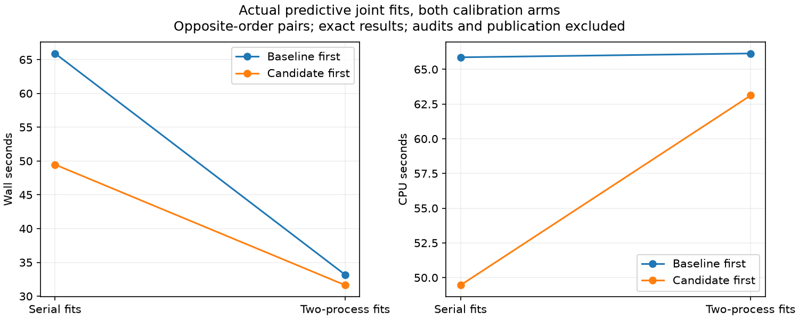
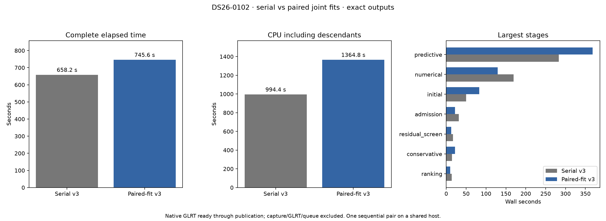
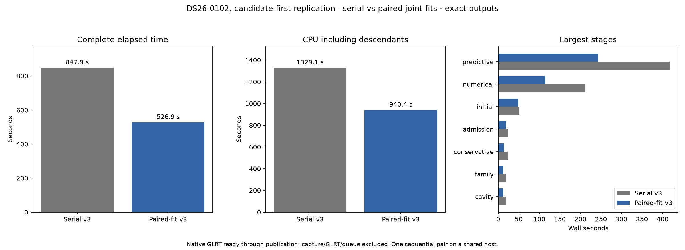
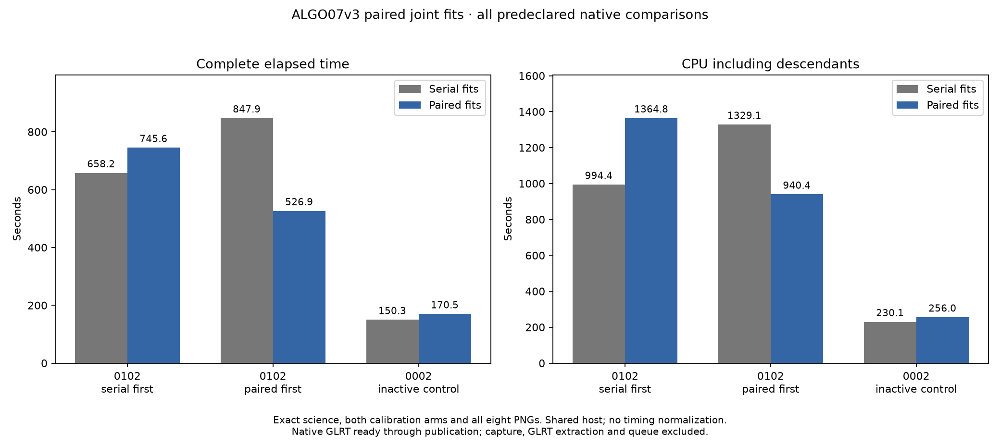
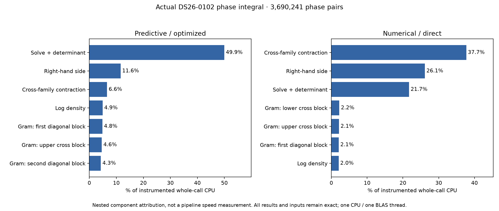

# ALGO07v3: independent joint-fit calibration arms

This iteration targets the sequential c=0 and fitted-c joint fits. It does not
change likelihood arithmetic, phase grids, priors, optimizer calls or budgets.
The preceding scalar-only and endpoint-reuse experiments remain unintegrated
after [mixed or flat measurements](../2026_11_06_algo07v3_scalar_scores/README.md).

**Retained in development for scoped fit latency; production is unchanged and
full-pipeline throughput improvement remains unproven.** All three predeclared
native comparisons pass exact complete science, both calibration arms, ownership,
ordered audits, grid/path and all eight PNGs. The full timings disagree in
direction; every result is retained below.

The actual predictive fit-pair benchmark is complete and exact. Mean elapsed
time falls **57.687→32.398 seconds (43.84%)**, while mean CPU rises
**57.662→64.633 seconds (12.09%)**. This supports the narrower latency decision;
it is not a demonstrated pipeline or throughput gain. The development candidate
passes **2,418 tests**, with no failures or skips and three existing NumPy
deprecation warnings. Production is unchanged.

| Order | Serial wall, s | Paired wall, s | Serial CPU, s | Paired CPU, s |
| --- | ---: | ---: | ---: | ---: |
| Baseline first | 65.907293 | 33.166151 | 65.868330 | 66.144061 |
| Candidate first | 49.466266 | 31.630750 | 49.455383 | 63.122845 |
| Mean | **57.686780** | **32.398450** | **57.661857** | **64.633453** |

Both pairs improve latency, but the reverse pair uses materially more CPU. The
serial baselines also vary substantially. Keep all observations; neither CPU
normalization nor a new cumulative original-ALGO07 speed ratio is justified.

[Complete scoped results](predictive-checkpoint/result.json),
[bindings](predictive-checkpoint/plan.json),
[verification](predictive-checkpoint/verified.json),
[broad test receipt](full-tests.xml), [exact test command](full-test-command.json).
The 688.499-second launcher interval includes the native prefix and four trials;
it is not a complete pipeline benchmark.

## Measurement scope

The external benchmark reconstructs the actual DS26-0102 native prefix, then
forks four trials from the same unmodified first predictive joint-fit checkpoint:
serial pair, two-process pair, two-process pair, serial pair. Each trial computes
both complete fits. It verifies both results and numerical receipts, records
wall/self-plus-reaped-child CPU, and stops without publishing a position.
Audits are excluded from these scoped clocks. Both children must exit before
the next trial starts. One BLAS thread and CPU slots 0–2 are fixed.

The predictor has no numerical-policy receipt. The numerical-mode helper tests
exercise the owned policy, but a predictive timing result cannot qualify the
actual numerical pipeline or prove a complete-scan speedup. Full native
qualification must cover both routes, every scientific audit, both calibration
arms, ownership, grid/path and all eight PNGs before runtime integration is
accepted. No production change is authorized by a component benchmark alone.

## Why receipt delivery needs care

The controller's method order remains control, factorized, joint. Within each
method, the public scientific sequence remains fit c=0, audit c=0, fit fitted-c,
audit fitted-c. Both fits start independently from the regional origin and
the same frozen probe; neither uses the other arm's endpoint.

Inspection of `numerical_recovery.stage` establishes that it installs a **new
owned numerical policy before each stage**, then saves that stage's receipt.
This is more specific than the persistent-policy ordering concern in the
preceding plan. A candidate must capture the c=0 policy only when its stage
actually starts, and populate the fresh fitted-c policy only when that later
stage requests its already completed result. Reusing the preceding stage's
policy, or appending both fits into the first stage's receipt, would be wrong.

The `DeferredJointFits` candidate keeps both child results private,
delivers each at its original boundary and validates receipt configuration,
prefixes, fields and counts before appending only that fit's delta. It supports
the actual fresh-policy lifecycle and an unchanged persistent owned policy;
unknown policy implementations or custom problem factories use serial fitting.
Malformed or incomplete execution raises an operational failure rather than
being turned into a scientific rejection. Both fitting children are reaped
before any three-worker audit batch can start, avoiding nested worker growth.

Tests cover all three methods, both optimizers, predictive and numerical modes,
real forks, interleaved audit order, fresh policies, rejected configuration
changes, missing/reordered results, nonfinite receipts and parent mutation.
The external prototype and component-owned implementation have identical logic.
Four existing runtime modules forward the optional mapper; one new owned module
implements result delivery. The engine supplies its existing two-arm process
port, and no public persisted contract or new execution resource is added. The
complete native gates pass on two DS26 scans, including both execution orders
on the active joint-recovery case. Production admission remains unqualified.

The full DS26-0102 run is declared baseline-first, with a fresh namespace and
1,200-second supervisor limit on each side. The frozen baseline contains the
four pre-change modules. The comparator declares exactly those four source
changes and the new `leo.analysis.localization_v3.joint_fits` module. Both sides
retain the preceding owned LU backend and audit batching. No scalar-only or
endpoint-reuse prototype is stacked into this comparison.

At 00:00 UTC on November 7, before the first candidate completes, its unchanged
initial-search stage is already 82.892 s versus the baseline's 50.035 s.
Native preparation, conservative and family stages also slow before the changed
code. One opposite-order **same-scan** replication is therefore declared in
[the immutable plan](replication-plan.json), followed by the inactive control.
All outcomes will be retained; the first pair is not discarded or corrected.
This fixed replication addresses an observed timing confound and is not a loop
that repeats runs until one improves. Source snapshots and per-worker budgets
remain unchanged; no overlapping timing jobs are introduced.

## First complete native comparison

The baseline-first pair completes with exact complete science, both calibration
arms, all audits, ownership, public grid/path and all eight PNG bytes. It exercises
the fresh-policy numerical route, not just the policy-free predictive checkpoint.
Only the four declared runtime modules change, with the one declared added
joint-fit module. Every namespace isolation check passes.

| Scope | Serial joint fits | Paired joint fits |
| --- | ---: | ---: |
| Complete native input through publication | **658.199 s** | **745.581 s** |
| CPU including descendants | **994.45 s** | **1,364.77 s** |
| Predictive stage | 282.967 s | 368.191 s |
| Numerical stage | 169.151 s | 129.615 s |
| Unchanged initial search | 50.035 s | 82.892 s |
| Maximum per-process RSS | 2,945,780 KiB | 2,392,948 KiB |

This pair regresses **13.28% in elapsed time and 37.24% in CPU**. Numerical
recovery falls 39.536 s, while predictive recovery rises 85.224 s. Unchanged
stages before the new code slow substantially; later unchanged ranking,
admission and publication stages get faster. These variations prevent a clean
attribution of the complete difference but do not erase it. No normalized or
new cumulative speedup is claimed. The predeclared opposite-order replication
and inactive control are reported below; this first regression remains evidence.

[Full stage table](native-first/timings.md), [summary](native-first/summary.json),
[exact comparator](native-first/comparison.json), [bindings](native-first/plan.json),
[terminal receipt](native-first/pair-terminal.json).

For profiling, the first arm's stage now includes both fit computations; the
later fitted-c stage delivers its already completed result. A near-zero fitted-c
delivery time does not mean that calibration arm was omitted. Audit order and
each numerical stage's own receipt remain exact, verified by this native pair.

## Opposite-order replication

The predeclared candidate-first replication is now complete and passes the
same full scientific/publication gate, with the identical frozen implementations
and requests apart from output directories. Serial versus paired wall is
**847.876→526.894 s**, CPU **1,329.12→940.35 s**. Predictive recovery is
417.057→243.420 s; numerical recovery is 212.154→114.667 s. Unchanged pre-recovery
work also differs: 137.787→108.348 s. This opposite-order pair improves elapsed
time 37.86% and CPU 29.25%; it does not supersede the first pair's regression.
The variation across both orders prevents assigning the entire difference to
the change or treating either single result as typical throughput. The inactive
DS26-0002 candidate-first control subsequently passes exactly. No extra repetitions
were added to find a favorable timing.

[Reverse table](native-reverse/timings.md), [summary](native-reverse/summary.json),
[exact comparator](native-reverse/comparison.json), [bindings](native-reverse/plan.json),
[terminal receipt](native-reverse/pair-terminal.json).

## Complete sequence and retention decision

| Case / order | Serial wall | Paired wall | Wall change | Serial CPU | Paired CPU |
| --- | ---: | ---: | ---: | ---: | ---: |
| DS26-0102, serial first | 658.199 s | 745.581 s | +13.28% | 994.45 s | 1,364.77 s |
| DS26-0102, paired first | 847.876 s | 526.894 s | −37.86% | 1,329.12 s | 940.35 s |
| DS26-0002, inactive control | 150.331 s | 170.455 s | +13.39% | 230.15 s | 255.98 s |

Positive wall change means slower. The inactive scan has zero joint recovery
stages on both sides ([check](native-control/joint-stage-check.json)); its 13.39%
elapsed and 11.22% CPU regression is not caused by running paired joint fits.
This shows why neither a single positive nor negative complete-run clock can
establish the code's isolated performance. It does not authorize subtracting
control timings from another scan or selecting only the favorable active pair.

[Complete table](all-native/timings.md), [all stage summaries](all-native/summary.json),
[control comparison](native-control/comparison.json),
[control terminal](native-control/pair-terminal.json).

Retain bounded pairing in the development implementation because both alternating
same-checkpoint fit pairs improve latency and complete native equivalence passes
in all three pairs. This is explicitly a component-latency decision with CPU
cost: the focused pair uses 12.09% more CPU on average. The evidence does not
establish dataset throughput, production admission, a stable full-scan speedup,
or a new ratio against original ALGO07. The prior cumulative reference remains
886.905 versus 193.899/152.529 seconds on DS26-0002 at its earlier revision.
Neither calibration arm, observation, scientific gate, search budget nor figure
is removed. All six native legs complete normally without resumption, and the
renderer verifies identical source snapshots, requests within each pair,
three CPU slots, one BLAS thread and the same 1,200-second bound.

The scoped predictive trials cover actual fitting without numerical receipts.
The native comparisons additionally exercise numerical replay's fresh policy
per stage. They verify every fit/audit receipt and both complete outputs; they
are not merely selected-position comparisons. The 2,418-test broad suite remains
the runtime test receipt; eight additional observer tests are recorded separately
in [observer-tests.xml](observer-tests.xml).

## New CPU attribution and next experiment

The new external statement observer runs on the actual 481², 961² and 1,921²
native grids in both contraction modes, with one CPU and one BLAS thread.
All six complete observed outputs match their uninstrumented counterparts,
direct-mode results also match original native captures, and input bytes remain
unchanged. Source, capture and actual native-library bindings are retained.

On the largest grid, predictive-mode solve/determinant work takes 0.729 CPU s,
49.94% of the instrumented call. In direct numerical mode, cross-family
contractions take 1.312 CPU s (37.70%), and right-hand-side construction takes
0.909 s (26.12%): together 63.82%. Solve/determinant is another 21.72%.
These are nested kernel shares, not fractions of total scan time or projected
savings. The unassigned remainder is reported rather than forced into a category.

[Six-call and statement tables](kernel-profile/timings.md),
[full results](kernel-profile/result.json), [bindings](kernel-profile/plan.json),
[next experiment](next.md).

Next test a narrow contraction-layout prototype against these frozen captures.
The hypothesis is lower data-movement cost while preserving the direct summation
order. Layout changes can change floating-point results; reject them at this
cheap exact-output gate before investing in real fits or native runs. Keep both
contraction modes and the current scientific/numerical policy. No such layout
optimization is implemented or claimed by this report.

## Qualification protocol

1. Retain every scoped timing trial and its exactness result, including slower
   pairs. Require a repeatable benefit before proceeding to integration.
2. Freeze the current runtime modules. Add only the bounded paired-fit executor
   and its narrow existing execution-port plumbing; keep audits serial in the
   parent and preserve original stage order and receipt ownership.
3. Run component-owned tests, including controller retry/failure paths and both
   policy lifecycles. Never change golden fixtures to accept a mismatch.
4. Compare fresh isolated native DS26-0102 baseline/candidate runs with all work
   enabled, both calibration arms, the same input/TLE/archive bindings and CPU
   budget. Add an inactive-joint scan to check bypass behavior. Report wall,
   total CPU, memory and stage timings separately from scientific exactness.
5. Preserve regressions and distinguish a lower-latency component from complete
   pipeline throughput. Production and ordinary-clock admission remain separate
   qualification questions.
