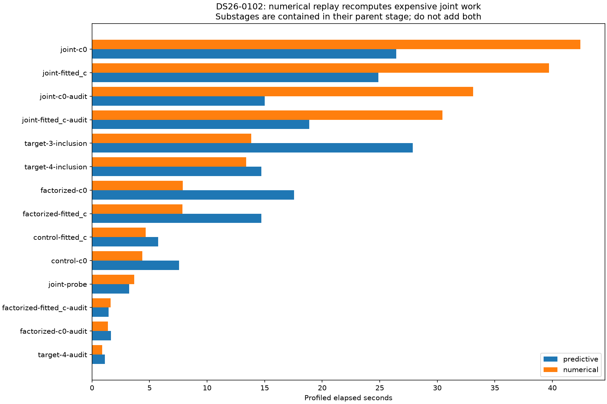
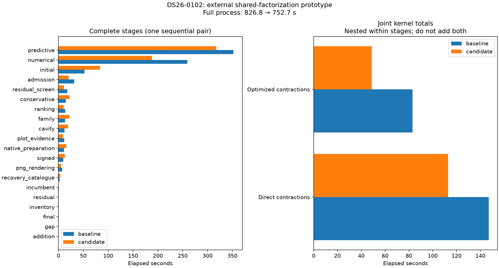
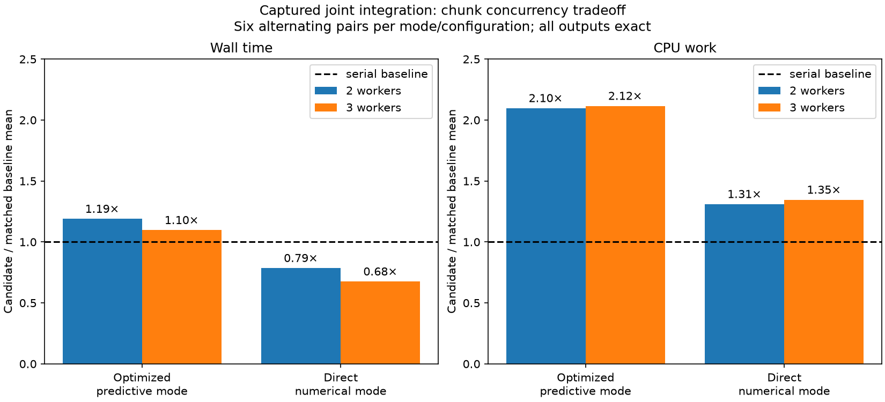

# ALGO07v3: numerical-recovery profile and exact joint-phase LU prototype

The DS26-0102 profile identifies joint phase integration as a concrete target
inside numerical recovery. Joint fits take 82.154 seconds and their audits
another 63.556 seconds: **70.3% of the 207.324-second numerical stage**. Reusing
the small-matrix LU factorization reduces a captured complete phase-integration
call by 12.3% in predictive mode and 8.5% in numerical mode, preserving every
returned byte. The subsequent full DS26-0102 external-prototype pair is exact:
**826.801→752.739 s wall, 1,135.26→1,101.05 CPU s**. This is one branch-selected
case, not a population or deployed speedup. Default runtime remains unchanged
pending an owned backend and integration qualification.

## Full profile

The profiler now records the parent stage for each recovery substage, preventing
the identical `control-c0`, `joint-c0`, etc. names in predictive and numerical
recovery from being combined. Worker and child CPU counters remain separate
from elapsed time; overlapping children are not summed into wall time.



All source bindings are unchanged during the run. The full stored scientific
evidence, all audit sections, both c arms, point ownership, public grid/path and
eight PNG bytes match the previous DS26-0102 native observation. The launcher
exited while its worker continued; no supervisor completion receipt survived.
The existing worker was allowed to complete and was never restarted. Its saved
worker/stage counters are retained for attribution, **not as a clean process
speed benchmark**. `compare_science` verifies all scientific/publication checks
without inventing an exit code or elapsed process clock. The normal `compare`
function still requires fresh successful supervisor receipts, tested explicitly.

The profile's predictive stage is 417.899 s and numerical stage 207.324 s. These
are instrumented observations, not improvement over the preceding 300.162 /
192.959 s run. Other probes ran on CPU 4 during part of profiling; the worker
used CPUs 0–2. Host load and observation overhead are not corrected away.

The saved numerical audit explains which work is recomputed: all seven target
annotations and the unchanged shared-family inclusion/audit are reused. Two
new-family inclusions and the joint experiment are rerun under centered
derivatives and a 30-second reference limit. Each numerical joint/control/
factorized arm has five optimizer rounds and 130 physical objective evaluations.
These dependencies differ from predictive recovery; wholesale reuse would be
incorrect. This experiment retains those calculations and their ordered receipts.

## Prototype and exactness

The joint-phase kernel solves each small orbital system and then obtains its
determinant, causing two LU factorizations of the same matrix. The existing
research C wrapper calls the installed NumPy ILP64 OpenBLAS `DGESV`, then computes
the determinant from its retained LU diagonal and pivots in the original scalar
order. It retains the original solve, phase grid, visibility masks, prior,
contraction mode and summation order. No approximate factorization is substituted.

This revives the bounded [November 3 prototype](../2026_11_03_algo07_runtime_iteration025/README.md)
against the **owned v3** kernel. It does not import the historical worker or the
uncommitted research implementation. A guarded source transform changes only
the solve/determinant boundary; explicit factor arguments avoid patching NumPy
process-wide. The compiler command, C source, binary, installed LAPACK library,
v3 kernel, tool and captured input are hash-bound. Unsupported matrix types and
singular systems fail explicitly in this research probe.

Both optimized and direct contractions are checked because numerical recovery
deliberately uses direct contractions. Complete result fingerprints include the
objective, phase marginals, MAP indices, orbital coefficients, visibility mass
and metadata. Inputs are also checked unchanged. Unit tests cover the explicit
boundary at several chunk sizes in both modes, source-drift refusal, native
factor bytes across dimensions 1/2/6/12/32, singular rejection, invalid types and
restoring the external hook on worker failure.

## Captured-call measurements

The historical captured call has 1,442,401 phase pairs. It is a real captured
numerical input, but is not a full DS26 pipeline run. Six alternating-order pairs
per mode use CPU 4 and one BLAS thread; all pairs are retained.

| Mode | Baseline mean wall | Candidate mean wall | Reduction |
| --- | ---: | ---: | ---: |
| Predictive / optimized contractions | 0.945671 s | 0.829195 s | 12.32% |
| Numerical / direct contractions | 1.676282 s | 1.533437 s | 8.52% |

The earlier pilot is preserved too. A diagnostic store read overlapped part of
that pilot on CPU 4: its optimized means were 1.229549→1.014725 s and direct means
2.048120→2.208940 s. The latter regresses in wall time despite reduced CPU. The
second sequence removes that same-core overlap; the independent pipeline profile
continued on CPUs 0–2. These observations do not establish population throughput.

## Full-worker qualification protocol

`tools/qualify_algo07v3_shared_lu.py` runs fresh baseline and candidate workers
sequentially, with identical frozen DS26-0102 native GLRT, causal TLE archive,
configuration, both c arms, three CPU slots and one BLAS thread. Each side has
a hard 1,200-second supervisor bound. The supervisor is detached from the tool
terminal so a terminal-session loss cannot remove its deadline. Both workers
build/load the same explicit backend; only the candidate uses it for inference.
Both record the joint-kernel call sequence and durations, and the comparator
requires the same call modes/grid sizes plus complete science, artifacts and
source/request bindings. Compilation/setup is included in these research worker
clocks. The harness does not use private mount/network namespaces.

This is an external prototype. Its backend dependencies are recorded explicitly
in the external plan/backend receipts; the owned public contract is unchanged.
It is not integrated or deployed merely because a captured call is faster.
The completed native pair passes the full gate. It still needs an owned,
supported backend interface and further native qualification before integration.

## Completed full-worker result



| Scope | Baseline | Shared-LU candidate | Reduction |
| --- | ---: | ---: | ---: |
| Full process wall | 826.801 s | 752.739 s | 8.96% |
| Reaped worker/descendant CPU | 1,135.26 CPU s | 1,101.05 CPU s | 3.01% |
| Predictive stage wall | 352.055 s | 317.484 s | 9.82% |
| Numerical stage wall | 259.300 s | 188.347 s | 27.36% |
| Optimized joint kernel, nested | 83.113 s | 48.925 s | 41.13% |
| Direct joint kernel, nested | 146.943 s | 112.984 s | 23.11% |

The [full timing table](native-timings.md) also preserves unchanged stages:
initial search regresses 52.155→83.568 s, while admission improves
31.633→20.573 s. The targeted kernel measurements also differ from the repeated
captured-call reductions. Consequently neither the entire 74.061-second wall
gain nor the 70.953-second numerical-stage gain can be assigned solely to LU
reuse. CPU drops 34.21 seconds across the full worker and its waited-for
descendants, including setup and publication. Its independent `/proc` receipt
uses the same live supervisor before/after the candidate wait, verifies both
worker PIDs and retains raw counters at 0.01-second resolution. It does not
provide stage CPU or peak RSS. No production latency is measured here.

Both workers complete successfully within their 1,200-second bounds. All
1,133 ordered joint-kernel calls retain their contraction mode and phase-pair
count; complete scientific outputs, both calibration arms, all audits, point
ownership, public grid/path and eight PNG bytes agree. Both arms retain 3,471
of 4,682 GLRT points (74.135%), with unchanged positions and residual scores.
The external backend bindings are explicit; no owned runtime module is changed.
See [comparison](native-comparison.json), [summary](native-summary.json),
[source plan](native-plan.json) and [CPU observer](native-reaped-child-cpu.json).

The result supports continued engineering of this candidate. It does **not**
yet establish a packaged default backend, ABI portability, wider DS26 coverage,
ordinary production admission equivalence or deployment. Keep one-thread BLAS,
the original integration grid and every physical audit. Independently test the
larger chunk-concurrency opportunity before deciding which backend to integrate.

## Next opportunities

Inspect exact repeated final phase-density evaluation within individual joint
fits, separately from this LU change. The current fit computes joint evidence
and later the complete joint phase result again at the same final position.
An explicit local reuse could avoid that repeated integration without a broad
cache, but full dependency/state and output equality must be verified. Preserve
both calibration arms and every audit; do not combine unqualified changes into
the current trial or infer localization improvement from reduced runtime.

An external endpoint-reuse candidate is now prepared in
`tools/probe_algo07v3_final_joint_reuse.py`. It changes only the reporting tail
of each optimizer: retain the first full joint-density result, extract its score,
then attach that same result to the diagnostics. Optimization and all five
phase-refresh rounds are unchanged. Thirteen tests exercise both optimizers,
all three fit methods and both contraction modes with the real phase kernel;
all output fields and ordered mock optimizer/refresh receipts agree, while one
joint integration is removed per fit. Source-drift rejection is covered. This is
**component evidence only**: real fit/audit and full-worker qualification remain,
and it is not enabled in the LU experiment or default runtime.

The initial combined focused suite passes **46 tests**. The full-worker summary tool
requires the ordinary fresh-process equality gate, unchanged source/backend
bindings, identical kernel-call mode/grid sequences and matching top-level stage
inventories. It keeps nested kernel totals separate from stage wall time and
does not infer CPU accounting from elapsed time. A read-only `/proc` observer
can capture the sequential supervisor's accumulated reaped-child CPU after each
worker has been waited for. The summary accepts this only with matching worker
PIDs, unchanged supervisor start ticks, the isolated candidate child and valid
counter differences; an incomplete observation remains unavailable.

The next larger candidate is ordered chunk concurrency in
`tools/probe_algo07v3_joint_chunks.py`. Each existing matrix chunk executes the
same arithmetic, then the caller combines chunk results in the original order,
including MAP tie handling. The probe permits at most three workers, leaves both
loaded BLAS providers at one thread and skips the pool for one-chunk calls.
Twenty component tests cover both contraction modes, one/two/three workers,
fully invisible grids, ties, worker errors and source-boundary drift. This is
independent of LU reuse and is not enabled in the current native experiment.
The completed captured timing/CPU gate is below; it still needs complete-worker
qualification before runtime integration.

The completed native baseline contains 633 calls with 231,361 phase pairs and
twenty calls with 3,690,241 phase pairs. Together those consume 211.49 s of the
230.06 s joint-kernel total. The small endpoint-reuse candidate removes only
twelve reporting calls across predictive/numerical fits, so prioritize testing
concurrency across the existing chunks. This preserves the audits rather than
reducing their phase-grid resolution.

## Ordered chunk timing: use a mode-specific candidate



Both bounded captured experiments complete successfully after the native pair
has exited. They use the same three CPU slots, separate two/three-worker
configurations and six alternating baseline/candidate pairs per contraction
mode. All 48 complete outputs and input bytes agree. Both actual loaded BLAS
libraries remain at one thread. These runs do not stack the LU prototype.

| Chunk workers | Contraction mode | Mean wall before → after | Wall change | Mean CPU before → after |
| ---: | --- | ---: | ---: | ---: |
| 2 | optimized / predictive | 0.755439→0.898628 s | 18.95% slower | 0.755255→1.584335 s |
| 3 | optimized / predictive | 0.713585→0.782797 s | 9.70% slower | 0.713494→1.509926 s |
| 2 | direct / numerical | 1.501730→1.179983 s | 21.42% faster | 1.501579→1.968171 s |
| 3 | direct / numerical | 1.463102→0.988355 s | 32.45% faster | 1.462904→1.969439 s |

**Reject enabling chunk concurrency for both modes.** The next candidate should
retain serial optimized contractions and test at most three ordered workers for
direct contractions, with serial fallback when the caller does not own all
three slots or when only one chunk exists. The 34.62% direct-mode CPU increase
must remain visible: faster individual jobs may consume more fleet capacity.
Require complete native both-arm equality, wall time and CPU accounting, and
measure the smaller grids actually frequent in DS26-0102 before integration.
The isolated 32.45% kernel improvement is not a 32.45% pipeline speedup.

The final focused suite has **67 passing tests**, covering the timer/comparator,
external LU hook, native factor, ordered chunks, endpoint reuse, reporting and
`/proc` counter parsing. Default runtime and production are unchanged. Publish
this evidence before the next integration trial rather than silently combining
the independently measured prototypes.

Reproduce the captured chunk checks with one BLAS thread and CPU affinity 0–2:

```sh
PYTHONPATH=src:tools OPENBLAS_NUM_THREADS=1 OMP_NUM_THREADS=1 taskset -c 0,1,2 \
  python -B tools/probe_algo07v3_joint_chunks.py \
  --fixture /absolute/captured-call.npz --output /absolute/fresh-output --workers 3
```

The measured input digest is in `chunks-workers3-plan.json`; use the same
bound fixture for comparisons. Fresh native LU qualification uses
`tools/qualify_algo07v3_shared_lu.py --request REQUEST --output FRESH` under the
same environment/affinity. All inference inputs remain frozen and causal;
evaluation GPS is presentation-only. Capture, GLRT extraction and queue delay
are outside every worker clock reported here.
