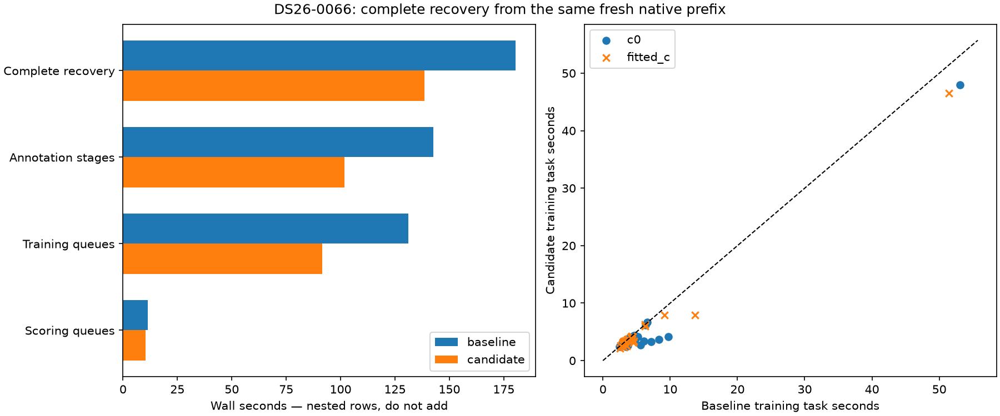

# ALGO07v3: complete recovery from one native prefix

This diagnostic investigates the discrepancy between prepared annotation gains
and complete native regressions in the [cross-target queue experiment](../2026_11_06_algo07v3_cross_target_queue/README.md).
It changes no runtime source, numerical policy, persisted contract or production
deployment. The archived candidate remains rejected pending stronger evidence.

**Result:** complete DS26-0066 recovery takes **180.483 → 138.434 seconds**
(23.30% lower), with exact full stage outputs, selected state and the prior
qualified native recovery audit. This single baseline-first diagnostic supports
the scheduling opportunity but does not overturn the two earlier whole-pipeline
regressions. No default runtime change or new cumulative speedup is claimed.



| Measured quantity | Baseline | Archived candidate |
| --- | ---: | ---: |
| Complete recovery wall time | 180.483 s | 138.434 s |
| Complete recovery CPU time | 387.359 s | 356.789 s |
| Annotation stages | 142.562 s | 101.895 s |
| Training queues | 131.124 s | 91.546 s |
| Scoring queues | 11.422 s | 10.328 s |
| Other recovery work, including inclusion/audits | 37.921 s | 36.539 s |

Training and scoring are nested within annotation; do not sum the rows.
The complete native prefix remains outside this table. Its unchanged initial
search took 175.947 s, versus 105.674/107.677 s in the preceding baseline runs.
[Full measurements](measurements.md), [all task comparisons](summary.json),
[exactness and prior native audit receipt](verified.json).

## What this resolves and what remains uncertain

The speed opportunity is present in the actual native recovery state, not only
in a context reconstructed from saved output. Both variants execute 48 training
jobs with matching targets, seeds, calibration arms, point counts and phase
changes. The stage and selection fingerprints also match exactly. Inclusion and
audits account for only 1.382 s of the measured 42.049 s total reduction.

However, unchanged task costs vary. Summed training CPU falls 291.361→266.443 s.
The difficult c=0 task falls 53.075→47.985 s, and fitted-c falls 51.464→46.536 s.
Summed task wall-minus-CPU time is 26.216 s in the baseline versus 1.276 s in the
candidate; several baseline jobs have substantial off-CPU delays. These sums
overlap in wall time and cannot be subtracted from total latency directly.
Per-task maximum RSS remains around 1.195 GB on both sides; it is not total
physical memory usage. The [process samples](process-samples.jsonl) preserve
the observed process tree and CPU/memory pressure, without asserting a thermal,
frequency, memory or particular competing-process cause.

Holding task CPU costs fixed in a three-slot FIFO simulation gives:

| Fixed task costs | Separate target queues | Common queue | Modeled saving |
| --- | ---: | ---: | ---: |
| Baseline task CPU durations | 118.690 s | 99.011 s | 19.679 s |
| Candidate task CPU durations | 108.950 s | 90.569 s | 18.382 s |

These are scheduling models, not measured speedups. They suggest a structural
opportunity near 18–20 s for this workload, rather than establishing that the
entire observed 42 s comes from the implementation. Host scheduling/task-cost
variation affects the comparison. The earlier two complete native regressions
remain contrary evidence and are not discarded.

## Next work

1. Repeat both orders from one fresh native prefix before reconsidering the
   shared queue. Keep every job and its CPU/wall accounting; do not promote on
   this single favorable order or on simulated times.
2. Investigate exact control-fit reuse across inclusion attempts. This scan runs
   four inclusion checks; their first paired fitting blocks each take about
   4.2–4.4 s. The control branch excludes the proposed target. Full input/state
   and output equality must be established before caching it, especially for
   appended fragments, conditional satellite refresh and numerical replay.
   This is a new hypothesis, not a demonstrated duplicate-fit optimization.
3. Continue numerical work on the hard first-phase precision fits. Preserve
   initialization, iteration ceilings and all scientific outputs. The previous
   cache census and rejected arithmetic variants still constrain this work.

## Measurement design

The owned native job recomputes GLRT preparation, initial position search,
conservative fitting, family policy, signed policy, cavity selection and recovery
inventory once. An external interception stops at the predictive checkpoint.
Every trial forks from that same unchanged live parent state. This retains live
solver closures, caches, matrix layouts and prior-phase history without loading
them from a published result or trying to pickle them.

Each child executes the complete recovery controller: annotation, target
inclusion, audits, retries, joint trials and final selection. The baseline uses
the live controller; the candidate uses the exact archived controller,
annotation and three-worker adapter from the preceding native experiment.
The temporary import substitution is restored before native execution begins.
Both sides retain the original ordered targets, causal catalogue, both c arms,
five phase rounds, numerical budgets and all-work admission. Evaluation
coordinates are removed from the experimental request.

Training, scoring and inclusion adapters record task wall/CPU intervals. Stage
clocks include the instrumentation equally on both sides. Full stage outputs
are retained until recovery ends and fingerprinted afterward, along with the
complete selected state and recovery audit. These checks include unsuccessful
proposals and intermediate fits, not only adopted satellite labels or position.
Node, keep-mask and inventory fingerprints also must remain unchanged.

Only after both fresh trials complete does the tool load the earlier qualified
native result to compare its entire predictive recovery audit. Source and frozen
input manifests are verified before and after the run. A separate read-only
process sampler records the process tree and host pressure; it is observational
and begins partway through the shared prefix. RSS across forked processes must
not be summed as physical memory usage because pages are shared.

These are instrumented **recovery-stage** measurements. They exclude the shared
prefix, downstream numerical replay/reassociation, rendering, publication,
capture, GLRT extraction and queue waiting. No full-pipeline speedup can be
deduced by dividing these stage clocks or adding them to a different run.

## Reproduction

Run from the active worktree with a fresh output directory:

```sh
PYTHONPATH=src:tools OPENBLAS_NUM_THREADS=1 OMP_NUM_THREADS=1 \
  taskset -c 0,1,2 timeout -k 5 1000 \
  /home/mouse9911/gits/leo-tracker-reduxredux/.venv/bin/python -B \
  tools/probe_algo07v3_native_recovery_queue.py \
  --request /absolute/qualified-native-request.json \
  --candidate-report reports/2026_11_06_algo07v3_cross_target_queue \
  --output /absolute/fresh-output
```

Use `--reverse` to run the candidate first. The input request must name an existing
qualified result for the post-inference audit check; no saved result enters the
new native computation. The tool intercepts before publication and uses a fresh
unused publication root. Its purpose is a bounded internal comparison, not a
replacement production runner or complete namespace-isolation qualification.

The test suite exercises exact stage/selection fingerprinting, fresh forked
trials, unchanged parent inputs, mismatched intermediate-stage rejection,
failed recovery rejection and stateful-policy refusal.

**19 tests pass** across the new common-prefix probe and its training/queue
instrumentation dependencies ([receipt](tests.xml)). Live tool/report code also
passes Ruff. No runtime modules changed, so this report does not claim new
full-runtime qualification. The exact measured tool is retained as
`measured-probe.py`; the live helper subsequently received only lint cleanup
(explicit loop-variable binding and line/import formatting). The renderer checks
the measured source hash through that archive when necessary.
