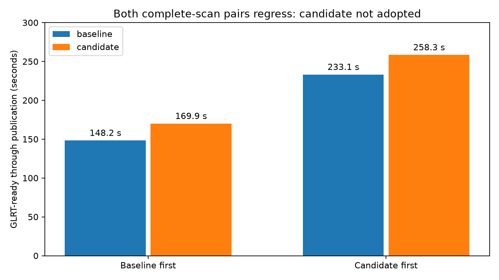
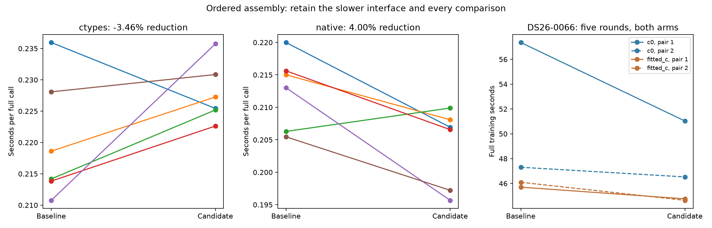
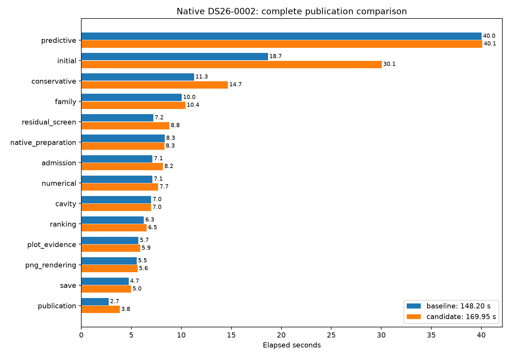

# ALGO07v3: compiled assembly rejected after complete-scan regressions

**Compiled assembly is not adopted.** It improves the difficult prepared fits,
but both complete native scan comparisons are slower. All scientific results
remain exact; exactness alone is insufficient evidence for a runtime optimization.
The existing NumPy assembly and build configuration have been restored.

| Full DS26-0002 comparison | Baseline | Compiled candidate |
| --- | ---: | ---: |
| Baseline first | 148.203 s | 169.946 s |
| Candidate first | 233.069 s | 258.349 s |

The candidate regresses by **14.67%** and **10.85%** respectively. Both runs in
each pair use CPUs 0–2, one BLAS thread, identical inputs and full budgets.
Shared-host variation is substantial, including unchanged screening/rendering
stages; production analysis jobs were observed sharing the allowed CPUs.
That observation does not prove the cause of either timed regression. We retain
the negative full-scan evidence rather than assuming it is all host noise.
[Reverse comparison](reverse/comparison.json), [post-pair host observation](host-observation.json).

The direct compiled assembly preserves scientific outputs and improves all four
complete DS26-0066 training pairs. Fitted-c averages **45.898 → 44.701 s** (2.61%).
The c=0 reverse-order pair improves **47.304 → 46.527 s** (1.64%); its first pair
57.358 → 51.031 s is much larger and should not be treated as a stable expected
gain. Both arms retain the original data, priors, random grouped holdouts, five
phase rounds and 48 available optimizer iterations per round.

The candidate passes **1,492 tests** and both complete native
DS26-0002 correctness checks with exact scientific evidence, both c arms, ownership,
grid/path values and all eight PNG bytes. [Comparison](comparison.json).
Production and full DS26 qualification remain unchanged.

## What changes

The existing likelihood creates two weighted temporary vectors and calls
NumPy scatter-add for each posterior update. The rejected compiled extension
performs the same separate multiplications and additions in the same order.
It checks vector layout, types, lengths, aliasing and bounds before mutation.
Build flags explicitly disable fast math and fused multiply-add. The posterior
iteration ceiling, stopping rule, inverse solve, covariance and all downstream
arithmetic are unchanged. No larger cache, changed scheduling, approximation
or early stopping is introduced.

The independent provenance improvement is retained: native module bytes enter
the existing implementation-provenance map, alongside
Python modules. This binds the actual compiled numerical implementation rather
than only its Python caller. The map's structure and public scientific contracts
are unchanged. Tests verify a changed native artifact changes its binding.

## Two interfaces, one arithmetic experiment

The first ctypes interface is exact but **3.46% slower** on the captured full
likelihood. Its Python validation and call overhead appear to outweigh the saved
work; this is an interpretation, not an independently timed attribution. It is
rejected. The direct extension averages **0.212564 → 0.204062 s** (4.00% faster),
with five improving pairs and one regression. Both interfaces run 60 exact
captured likelihood calls. Do not multiply this kernel gain into the pipeline.

| Arm | Pair | Side | Elapsed s | CPU s |
| --- | ---: | --- | ---: | ---: |
| c0 | 1 | baseline | 57.358 | 57.319 |
| c0 | 1 | candidate | 51.031 | 51.007 |
| c0 | 2 | candidate | 46.527 | 46.507 |
| c0 | 2 | baseline | 47.304 | 47.296 |
| fitted_c | 1 | baseline | 45.701 | 45.689 |
| fitted_c | 1 | candidate | 44.761 | 44.739 |
| fitted_c | 2 | candidate | 44.641 | 44.629 |
| fitted_c | 2 | baseline | 46.095 | 46.083 |

Every training comparison matches the previously qualified full fit signature:
optimizer history, phase reference, endpoint, likelihood and state, not merely
a newly generated baseline. Context loading and final signature checks are
outside these training timers. [Raw training](training.json).

## Complete native scan

The fresh sequential comparison observes **148.203 →
169.946 seconds** from native GLRT ready through
publication, on CPUs 0–2 with one BLAS thread and unchanged 1,200-second bounds.
The two private namespaces hide historical installations and results; all input,
source and build bindings are recorded. Capture, detector extraction and queue
waiting are outside the clock. This is one shared-host pair, not a population
speed guarantee or a new cumulative comparison against original ALGO07.

| Stage | Baseline s | Candidate s |
| --- | ---: | ---: |
| predictive | 40.021 | 40.100 |
| initial | 18.662 | 30.053 |
| conservative | 11.270 | 14.657 |
| family | 10.036 | 10.405 |
| residual_screen | 7.193 | 8.808 |
| native_preparation | 8.341 | 8.307 |
| admission | 7.118 | 8.165 |
| numerical | 7.108 | 7.686 |
| cavity | 6.988 | 6.981 |
| ranking | 6.260 | 6.542 |
| plot_evidence | 5.714 | 5.893 |
| png_rendering | 5.532 | 5.629 |
| save | 4.738 | 4.984 |
| publication | 2.738 | 3.850 |
| signed | 1.829 | 3.033 |
| other | 1.867 | 2.102 |
| recovery_catalogue | 2.089 | 2.046 |
| incumbent | 0.260 | 0.262 |
| inventory | 0.196 | 0.197 |
| residual | 0.188 | 0.191 |
| final | 0.051 | 0.052 |
| gap | 0.002 | 0.002 |
| addition | 0.001 | 0.001 |

Inspect unchanged stages and [resource receipts](candidate-process-time.txt)
before attributing the entire elapsed difference to assembly. The narrower
complete-training pairs support a modest component gain, which is insufficient
to adopt the candidate given both full-scan regressions. The last original-ALGO07
[cumulative comparison](../2026_11_06_algo07v3_reference_recovery/README.md)
remains 886.905 versus 193.899 / 152.529 s for the preceding implementation;
do not combine those historical clocks with this candidate's time.

GNU-time user-plus-system CPU is **224.190 →
246.120 s**; maximum reported per-process RSS is
2,375,504 → 2,369,840 KiB.
Major page faults are 0 →
1. CPU includes descendants and the outer
wrapper; maximum RSS is not aggregate concurrent memory. These wider resource
observations are retained separately from the supervisor's primary clock.

## Tests, build and reproducibility

The 1,492-test suite has no failures or skips. Its three warnings are existing
NumPy shape-mutation deprecations. Tests include sparse/dense and empty designs,
both prior modes, duplicate destinations, signed zeros, catastrophic cancellation,
non-fused arithmetic, non-native byte order, invalid indices, read-only output,
input aliasing, complete likelihood comparisons and all existing pipeline checks.
No numerical oracle or tolerance changes. The older inverse-workspace body proof
is retained against an exact frozen pre-assembly oracle; the new body and native
source are separately proven to match the measured prototype.

The archived candidate `measured/setup.py` declares the extension and its C dependency
using the existing build
system. The pinned runtime environment lacks setuptools, so direct `setup.py
build_ext` initially fails before compilation. It was not modified or repackaged.
[build_extension.py](build_extension.py) reproduces the recorded strict compiler
command locally; normal wheel builds use the declared setuptools build dependency.
[Build receipt](build.json). The experimental candidate library is content-bound
in the native plan and resulting scientific provenance. Do not deploy a binary
from a different toolchain without its own qualification.

The external tools are `probe_algo07v3_ordered_assembly.py` (rejected ctypes),
`probe_algo07v3_native_assembly.py` (direct extension), and
`benchmark_algo07v3_ordered_assembly.py` (complete training). Use the pinned
Python, `PYTHONPATH=src:tools`, one BLAS thread, CPU 0 and fresh output roots.
Kernel runs take `--capture` / `--output`; training takes `--request`,
`--expected-root` / `--output` and was bounded to 900 s. Exact measured helper
bytes are preserved under `measured/`; current helpers use the frozen pre-change
oracle so future runtime edits cannot silently redefine their baseline.

[run_pair.py](run_pair.py) takes a fresh prepared root with baseline/candidate
source snapshots and a native request. It runs both complete owned jobs and
declares exactly the likelihood/provenance changes and new native module to the
comparator. Source snapshots, full commands, test receipt and figures are retained.

The [completed convergence profile](convergence.md) now explains the slow fold:
matrix dimensions stay fixed, but its first phase makes 269 calls per arm and
220 calls reach the 256-iteration ceiling. Later rounds generally need only 10
iterations per call. All six full signatures remain exact. This shifts the next
investigation toward the first-round convergence trajectory and exact reusable
work across arms/targets, not larger caches or arbitrary stopping-rule changes.

The default numerical source and packaging are restored to their pre-experiment
bytes. Candidate source lives under `candidate-src/`, its integration tests under
`candidate-tests/`, and its measured binary is archived as `.so.bin`. To reproduce
the rejected native candidate, restore those files and `measured/setup.py` into
an isolated experimental checkout, build there, and use the archived source
snapshots with `run_pair.py`. They are evidence, never runtime dependencies of
the default implementation. No production deployment occurred.

After restoring the default, its broader suite passes **1,444 tests** with no
failures or skips. [Final tests](final-tests.xml),
[exact restoration hashes](default-restoration.json).
The candidate's 1,492-test receipt remains separate; tests for its removed native
runtime are archived with that candidate rather than silently reported as current.
