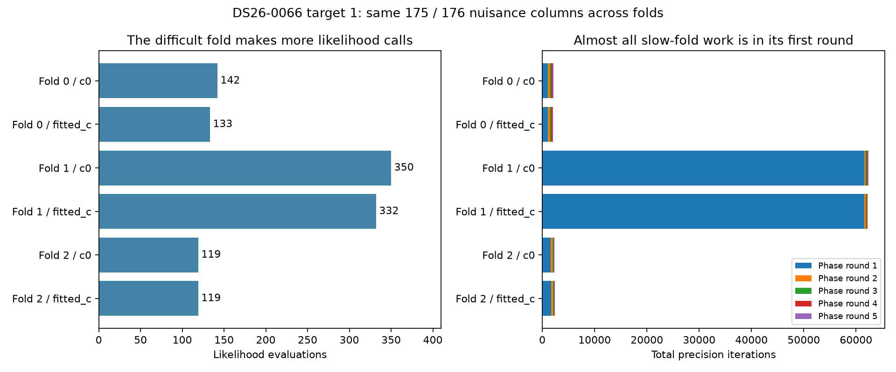

# Why one predictive fold dominates

The matrix dimensions are constant across folds: 175 nuisance columns for c=0
and 176 for fitted-c. The expensive fold evaluates more positions, and each
evaluation usually takes far more precision iterations. It spends almost all
that work in its first phase round, with a zero phase reference.

| Fold | Arm | Calls | Mean precision iterations | Reached 256 | Still unconverged | Fit s |
| --- | --- | ---: | ---: | ---: | ---: | ---: |
| 0 | c0 | 142 | 15.0 | 0 | 0 | 3.384 |
| 0 | fitted_c | 133 | 15.4 | 0 | 0 | 3.264 |
| 1 | c0 | 350 | 178.2 | 220 | 219 | 60.687 |
| 1 | fitted_c | 332 | 187.5 | 220 | 220 | 55.693 |
| 2 | c0 | 119 | 19.1 | 0 | 0 | 3.461 |
| 2 | fitted_c | 119 | 20.1 | 0 | 0 | 3.434 |

Fold 1's first phase round makes 269 likelihood calls in **each** arm. Of these,
220 reach 256 precision iterations; 219 c=0 calls and all 220 fitted-c calls
still exceed the unchanged 1e-5 stopping threshold. Reaching iteration 256 alone
does not prove nonconvergence, hence the separate counts. The maximum remaining
log-precision changes are about 0.0558 / 0.0568. Later rounds generally take
10 iterations per call. The first round accounts for 98.7% / 99.0% of all
precision iterations, and its likelihood calls consume 57.492 / 53.149 seconds
of the observed 60.687 / 55.693-second fits.

This identifies a computational bottleneck, not its full statistical cause.
The same matrix size rules out dimension alone. Fold membership changes the
evidence and conditioning; the first phase reference and initial position can
also make the provisional nuisance model difficult to fit. Distinguishing those
causes needs a further controlled diagnostic. These observations do not show
that a smaller iteration budget, warm start or altered prior preserves results.

All six observed complete fit signatures match. Folds 0 and 2 have fresh
unobserved controls; fold 1 uses the previous qualified complete signatures in
both arms. Signatures cover phase/optimizer history, endpoint and final state.
Context construction is outside fit timing. Final signature-only calls are
recorded separately and excluded from this table. Profiling timings are not
baseline/candidate speed measurements. [All calls and bindings](convergence.json).

The observer has two passing tests covering exact returned-object identity,
phase attribution, alias restoration and failure restoration; they are included
in the 1,492-test suite. It changes no source, data, split, budget, prior or
acceptance rule. The compiled-assembly candidate is active during this profile;
the full signatures still agree with the independent pre-assembly reference.

The next useful diagnostic is to retain the first-round objective/precision
trajectory and compare its successful versus capped evaluations. Check whether
the expensive trajectories repeat across both arms or different recovery
targets before implementing a cache. Any reuse must account for complete model
state and mutable audit receipts; raw position alone is insufficient. Alternative
stopping rules or initialization would be algorithm changes, outside the current
identical-output optimization contract.

Reproduce with `tools/profile_algo07v3_training_convergence.py --request REQUEST
--expected-root QUALIFIED_TRAINING_ROOT --output FRESH_ROOT`, pinned to one CPU,
one BLAS thread and an external 600-second bound. This renderer takes `--root`.
