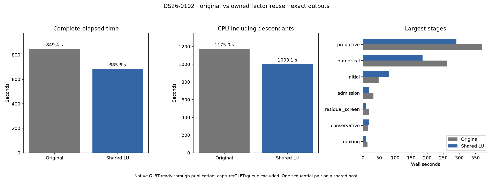
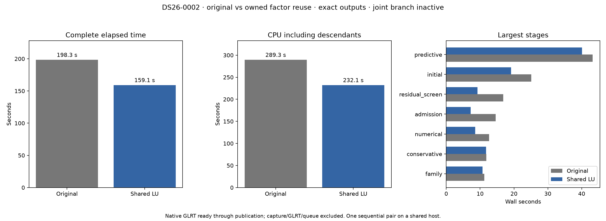
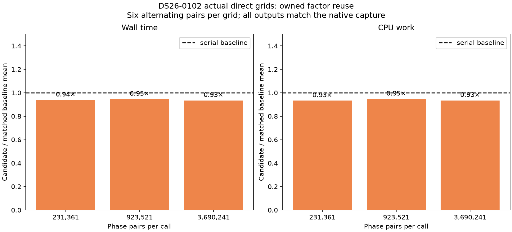

# ALGO07v3: owned NumPy-provider factor reuse

**Retained in development; production unchanged.** Two isolated native pairs
preserve complete science and publication. Eighteen alternating real-grid pairs
all favor the owned implementation, with **5.45–6.53% lower mean kernel wall
time** and **5.31–6.74% lower CPU time**. This removes a measured duplicate
factorization without changing the algorithm. It does not establish a 19%
whole-pipeline code speedup: the inactive control scan shows comparable timing
variation without ever loading the new extension.

The integrated DS26-0102 pair is now complete and exact: **849.427→685.637 s**
elapsed and **1,175.03→1,003.14 CPU s**, observed reductions of **19.28%** and
**14.63%**. This is a matched native-input-to-publication comparison against
the preceding ALGO07v3, not against the original multi-worker ALGO07 chain.
The shorter inactive-joint regression and alternating grid benchmark also pass.
All observations below retain shared-host timing limitations.

| DS26-0102 scope | Before | Owned factor reuse |
| --- | ---: | ---: |
| Complete supervisor wall | 849.427 s | 685.637 s |
| Outer command CPU, including descendants | 1,175.03 s | 1,003.14 s |
| Predictive recovery | 370.721 s | 290.500 s |
| Numerical recovery | 260.948 s | 185.384 s |
| Unchanged initial search | 48.368 s | 79.582 s |
| Maximum process RSS | 2,533,832 KiB | 2,395,960 KiB |

The [exact comparison](DS26-0102/comparison.json) passes all scientific audits,
both calibration arms, ownership, public grid/path and eight PNG bytes. Only
`joint_density` changes among previously loaded modules; the adapter and native
extension are the two declared added modules. [Full stage table](DS26-0102/timings.md),
[summary](DS26-0102/summary.json) and [execution plan](DS26-0102/plan.json).

Predictive plus numerical stages fall by 155.786 s, but unchanged stages also
vary substantially in both directions. Initial search is 31.214 s slower;
admission is 13.869 s faster, and evidence save/publication is 14.888 s faster.
Global 60-second CPU pressure rises from 0.13% at baseline start to 21.66% at
candidate start. Do not attribute the entire 163.789-second full-run difference
to factor reuse or turn one pair into a population-throughput guarantee.

## Inactive control and complete-run interpretation

| Scan | Joint branch | Original wall | Candidate wall | Original → candidate CPU |
| --- | --- | ---: | ---: | ---: |
| DS26-0102 | Active | 849.427 s | 685.637 s | 1,175.03→1,003.14 s |
| DS26-0002 | Inactive | 198.282 s | 159.087 s | 289.34→232.07 s |

The second pair runs **candidate first**, then baseline. Its complete scientific
and eight-PNG comparison is exact; only the Python adapter is added to loaded
provenance, while the compiled extension is absent. This directly confirms the
new factor path is inactive. Its apparent 19.77% wall and 19.79% CPU reductions
therefore cannot be credited to factor reuse. The 39.196-second difference is
execution/host variation on unchanged numerical work. Do not average these two
scan percentages into a claimed optimization gain, or use the control's ratio
as a correction factor for a different scan and time window.

[Control comparison](DS26-0002/comparison.json), [full clocks](DS26-0002/timings.md),
[control plan](DS26-0002/plan.json). Both jobs retain complete coverage, matched
c=0/fitted-c evidence and unchanged position outputs; neither trades scientific
work for runtime. The independent original-ALGO07 comparison remains the earlier
[886.905 versus 193.899 / 152.529-second observation](../2026_11_06_algo07v3_reference_recovery/README.md).
No new cumulative original-to-current speedup is claimed here.

## Alternating real-grid measurements

After both native pairs exit, the benchmark replays the original DS26-0102
direct-mode captures in six alternating pairs per size. It requires every
result to match the original native capture, not just agreement between two
new calls. The reference retains NumPy's original solve and determinant calls;
the candidate uses the actual packaged backend. Both are serial with one BLAS
thread, allowed the same CPU slots 0–2. No thread/chunk prototype is stacked.

| Phase pairs | Original mean wall | Owned mean wall | Wall reduction | CPU reduction |
| ---: | ---: | ---: | ---: | ---: |
| 231,361 | 0.292757 s | 0.274839 s | 6.12% | 6.74% |
| 923,521 | 1.103997 s | 1.043792 s | 5.45% | 5.31% |
| 3,690,241 | 4.460045 s | 4.168835 s | 6.53% | 6.50% |

All **36 evaluations** preserve input bytes and complete native results. All
18 paired wall differences favor the candidate; reductions range 1.20–9.88%,
with per-size paired medians 6.40%, 6.06% and 5.47%. The mean ratios above and
paired medians are different summaries; all raw rows remain available. This is
the narrower evidence for a reproducible benefit, not a full-scan speed ratio.

[Raw measurements](actual-grids-result.json), [dependency bindings](actual-grids-plan.json),
[means](actual-grid-summary.json), [CPU and wall table](actual-grid-timings.md).
The tool now accepts `--variant owned-lu`; six focused capture/summary tests pass.

## Measured reason for the change

The [joint-recovery profile](../2026_11_06_algo07v3_joint_phase_lu/README.md)
attributes 70.3% of DS26-0102's numerical-recovery stage to joint fits and their
audits. Each phase-pair matrix was factored once for its orbital solve and again
for its determinant. The external prototype removed the second factorization
and preserved every native result. Its one full pair measured 826.801→752.739 s
and 1,135.26→1,101.05 CPU s. Those results motivate this integration; they do not
establish a dataset-wide gain or replace fresh integrated qualification.

## Owned implementation

`leo.analysis._joint_lu` is an optional extension built by the existing setuptools
configuration. Its private C loop calls the exact NumPy ILP64 DGESV provider,
then calculates sign/log-determinant from the same factor and pivot vector.
It preserves scalar accumulation order and disables fast-math and contraction.
The code never compiles at runtime and never imports research tools or an older
algorithm installation. The build required installing the missing setuptools
build dependency; NumPy and SciPy versions were unchanged. The initial manual
build used setuptools 84.2.1. A subsequent isolated build with the repository's
supported **setuptools 81.0.0** produces the **identical binary SHA-256**, without
overwriting any live module. This resolves the build-version mismatch without
substituting an untested native binary. [Build comparison](supported-build-comparison.json),
[supported build log](supported-build-build.log).

`localization_v3.numpy_factor` checks the installed provider and 64-bit integer
ABI before exposing the native function. It retains both library handles for
the lifetime of its pointers. Unsupported or unavailable providers, unsupported
types, nonfinite inputs and matrices wider than 32 coefficients use the original
NumPy calls. Singular systems and backend failures propagate, rather than
becoming an association rejection. The joint kernel changes only its combined
solve/determinant boundary; phase grids, contraction modes, priors, budgets,
optimization and acceptance remain unchanged. There is no chunk concurrency or
endpoint-reuse change in this experiment.

The owned component tests compare all result bytes and input immutability across
pivoted matrices, contiguous/Fortran/strided layouts, dimensions 1–32, width-33
fallback, empty batches, singular inputs, missing libraries/extensions, rejected
ABIs, unsupported dtypes and nonfinite input. Complete joint-evidence cases cover
both contraction modes and three chunk sizes. A separate broad suite covers the
owned CLI, application, numerical components, storage, presentation and tools.
The focused check passes 68 tests; the broad suite passes **2,301 tests with no
failures or skips** (the focused tests overlap this count). Ruff and
`git diff --check` pass. The broad suite ran on CPU 4 during the first baseline
minute, outside the native worker's CPU affinity; this shared-host activity is
retained as a timing limitation rather than corrected out of the measurement.

## Native qualification procedure

The baseline kernel was frozen before editing. [run_baseline.sh](run_baseline.sh)
mounts that one module read-only inside a private namespace. [run_pair.py](run_pair.py)
runs the original and candidate sequentially through the ordinary owned CLI,
with old installations, bulk results and repository reports hidden; the frozen
input/TLE bundle is read-only and network access is isolated. The candidate
adds exactly the Python factor helper and compiled extension to loaded-module
provenance. All module changes must be explicitly declared to the comparator.

Each side uses CPUs 0–2, one BLAS thread and a 1,200-second process deadline.
Both start from native GLRT input and finish after complete publication.
Capture, detector/GLRT extraction, queue delay and browser loading are excluded.
The full comparator checks both c=0 and fitted-c results, all scientific audits,
point ownership, public grid/path and all eight PNG bytes. GNU time records CPU
including descendants and maximum per-process RSS; its outer interval includes
namespace setup/verification beyond the supervisor's processing clock.

DS26-0102 is chosen because it exercises joint fitting in predictive and
numerical recovery. DS26-0002 supplies a shorter regression case. These are
branch-selected tests, not a population sample or production-admission proof.
Evaluation coordinates affect presentation only; causal TLE policy is unchanged.

The adapter's DGESV pointer was additionally compared against the symbol resolved
through NumPy's actual `_multiarray_umath` extension, and they are identical.
This is stronger evidence for this installed provider than its filename alone.
The library bytes/configuration and pointer-equality result are recorded; raw
pointer addresses are intentionally not used as reproducibility identities.

## Next experiment after qualification

The final reporting tail of both joint optimizers currently calculates the joint
integral twice: once for its scalar score, then again for the full phase result.
The already-tested external endpoint-reuse prototype removes one integral per
fit without changing optimizer evaluations or phase refresh. Source review
confirms the factorized evidence between those calls is a separate calculation
and must remain. This is a smaller but concrete next opportunity; qualify it
against real fits/audits before integrating it. Do not assume that numerical
recovery can reuse an entire earlier predictive fit, because its derivative and
phase-reference policies differ. Do not combine endpoint reuse with this native
factor experiment or count an estimated saving as a measured result.
