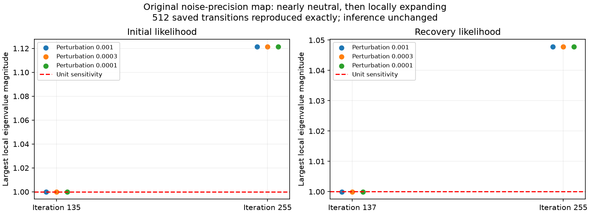

# ALGO07v3: full hardware-counter profile and precision-map coupling

The unchanged full DS26-0066 worker completes in **398.576 s**, preserving all
scientific evidence, both c arms, ownership, public grid/path and eight PNG bytes
against the saved 394.960 s reference. No source module changed. The difference
is an unchanged-code observation under counters and host variation, not an
optimization or an estimate of profiler overhead.

Hardware counters now cover the forked fits correctly. Separately, the original
precision-update map has a nearly neutral direction at the observed plateau,
then a locally expanding direction near the cap. A new inactive-column solve
prototype fails exactness and is not integrated. Runtime and production remain
unchanged.

## Full native accounting

| Measurement | Value | Scope |
| --- | ---: | --- |
| Native worker process | 398.576 s | Imports through all artifact publication |
| Worker combined internal clock | 396.995 s | Native preparation through publication, narrower startup scope |
| Perf wrapper elapsed | 400.069 s | Isolated harness, input preflight, supervisor and descendants |
| Task-clock | 656.458 CPU s | Same perf scope, inherited across fork |
| CPU cycles | 3.53656 trillion | Performance cores 0–2 |
| Retired instructions | 10.14420 trillion | Same inherited scope |
| Cycles per instruction | 0.34863 | Aggregate cycles / instructions |
| Active-clock estimate | 5.387 GHz | Cycles / task-clock; not a frequency snapshot |
| Average occupied slots | 1.641 of 3 | Aggregate task-clock / perf elapsed |

All counters report 100% running in this measurement. Core PMU events are used
explicitly because this host has distinct performance/efficiency core types.
The wrapper and scientific clocks are intentionally reported separately. Capture,
GLRT extraction and production queue waits are excluded. This is one difficult
scan under the all-work validation policy, not population throughput or production
admission qualification.

The three-slot occupancy is about 54.7%. If the same 656.458 CPU seconds could
be perfectly distributed across all three slots, arithmetic gives 218.8 s.
That is an idealized bound, **not a feasible speed prediction**: serial stages,
dependencies, overhead and potentially increased work prevent assuming it can
be reached. The current result supports measuring independent work on the
critical path. It does not establish that the earlier thread experiment was
limited by the GIL or rule out memory/scheduling effects.

Raw evidence: [counter rows](perf-native-counters.jsonl),
[native completion](native-supervisor.json), [strict comparison](perf-comparison.json),
[counter scope and command](perf-native-execution.json), [source bindings](perf-plan.json).

## Inheritance and measurement failures

The tool first runs the same deterministic Python workload in the parent, in a
forked child with inheritance, and in a child with `--no-inherit`. The inherited
child/parent instruction ratio is **1.00096**; including the child records
**51.05 times** the instructions of excluding it. This verifies child accounting
for this host/tool combination ([receipt](perf-inheritance.json)). It does not
replace the source and scientific checks on the actual pipeline.

The first attempt pinned only the measured child. The perf launcher could begin
on an efficiency core before that pin took effect, leaving the short excluded-
child test at 95% counter running time. The guard rejected it before any native
fit. The corrected command pins perf itself before creating counters. Original
failed command/counters are retained as `failed-*` receipts; the acceptance
threshold was not weakened.

After the native run completed, the first comparator invocation failed because
its CLI defaults to expecting a changed hierarchical module. This measurement
has no runtime source changes. [finish.py](finish.py) ran the same comparator
with explicit empty changed/added-module lists and verified the full result.
The scientific job was not repeated. The original error is retained in
[original-comparator-error.log](original-comparator-error.log). The reusable
counter tool now explicitly compares unchanged sources and saves resource
snapshots before comparison; the original attempt's transient resource samples
were lost and are reported as unavailable.

`measured-perf.py` archives the exact observer used during this run; its source
hash matches the plan. The subsequent corrections affect the external observer,
not the measured runtime. `finish.py` checks that archived observer and every
runtime binding. No comparison gate is removed.

## Precision-map sensitivity

The observer extracts one original precision update into a callable closure.
It reproduces **all 256 saved transitions exactly in each of two captures**,
including the update magnitude, before computing any derivatives. Observations,
coefficient priors, noise priors, initialization and stopping rules are unchanged.
The finite-difference calculations are diagnostics only and never feed inference.

| Capture | Near-plateau iteration | Largest local eigenvalue magnitude | Last iteration | Largest magnitude |
| --- | ---: | ---: | ---: | ---: |
| Initial branch 1, fitted-c phase 1 | 135 | 1.000007 | 255 | 1.121511 |
| Hard recovery capture | 137 | 0.999951 | 255 | 1.047866 |



These Jacobians are in log-rate coordinates. Perturbation steps 1e-3, 3e-4 and
1e-4 produce closely agreeing estimates and dominant directions. Near a magnitude
of one, a perturbation along that direction barely shrinks over one update.
Above one, it grows locally. This is consistent with the observed long plateau
and later growing update sizes. It is **not** a global divergence proof, a
stationary-point classification, or evidence that objective value worsens.

In the initial capture the dominant direction is concentrated on noise group 53,
with group 48's relative component about 0.264 near the plateau and 0.220 at the
last iteration. The previous [exact track mapping](../2026_11_06_algo07v3_initial_precision/README.md)
identifies RX2 CH6 T002 and RX1 CH6 T004, both under that intermediate branch's
58109 hypothesis. Recovery has a different dominant group set: 15, 43, 11 and
16 near its plateau. Those recovery indices have not been mapped to source tracks
in this report and must not be assumed to be the same 58109 family.

Simple positive under-relaxation cannot make a positive local eigenvalue above
one contractive: its linearized value becomes `1 + alpha * (lambda - 1)` for
`0 < alpha <= 1`. This local fact does not decide the best global solver.
Acceleration, block updates or warm starts need separate numerical evaluation
and can change the required exact outputs. They are not enabled here.

Raw transition/Jacobian results and arrays are archived as `initial-*` and
`recovery-*`; `measured-coupling.py` retains the measured observer before a
line-wrap-only formatting change. All input/source digests are preserved.

## Prototype: omit inactive posterior dimensions

The recovery capture contains **19 entirely zero feature columns among 175**.
The initial capture has no inactive columns. The external candidate retains
original grouped Gram/RHS accumulation, solves the active submatrix when all
coefficient priors are fixed unit normals, and restores inactive mean/covariance
entries and original logdet summation order. Learned-prior cases fall back.

Although mathematically equivalent, the real recovery case is **not byte-exact**:
maximum coefficient difference is **4.747e-10**, with differences in residuals,
noise precisions, score and other returned fields. Both still use 256 iterations.
The smaller factorization changes floating-point arithmetic. It is rejected
without timing or a full-native campaign. See [complete failed receipt](inactive-result.json).
Five synthetic/fallback tests pass; they do not override the real-input failure.

## Next optimization experiment

The remaining practical exact-output opportunity is independent derivative work
while a long outer fit is the only live task. The previous helper-thread version
regressed and stays rejected. An external successor can test **one helper
process**, only after the outer queue has drained and peers have been reaped.
It must retain the three-slot cap, original plus/minus arithmetic and all histories.

This is a hypothesis, not a promised improvement. A process helper avoids a shared
Python interpreter lock but adds startup, communication and memory costs. It
requires parent-death cleanup, failure propagation, cancellation tests, complete
initial-search equality, and matched full-native timing/counter comparisons.
Do not nest unrestricted pools or adopt a component-only speed result. Preserve
both arms and all rejection/selection semantics.

## Validation and reproduction

Nineteen focused tests cover counter availability, units, event completeness,
launcher affinity, explicit unchanged-module comparison, exact precision
transitions, an analytic Jacobian, and inactive-column fallback behavior.
See [tests.xml](tests.xml). Golden fixtures and runtime modules are unchanged.

```sh
PYTHONPATH=src:tools OPENBLAS_NUM_THREADS=1 OMP_NUM_THREADS=1 \
  /home/mouse9911/gits/leo-tracker-reduxredux/.venv/bin/python -B \
  tools/profile_algo07v3_perf.py --request /absolute/native-request.json \
  --reference-timing /absolute/supervisor.json --output /absolute/fresh-profile
```

This requires privileged `perf` and private mount/network namespaces. It first
verifies fork inheritance, then runs the actual CLI with a 1,200-second supervisor
bound. Use `--verify-only --output FRESH` for the short counter check. The
precision tool takes `--capture CAPTURE --trajectory RESULT_JSON --output FRESH`;
pin one CPU/one BLAS thread and bound it to 60 seconds. The inactive-column probe
takes `--capture CAPTURE --output FRESH`; a failed exactness receipt is a result,
not permission to relax the acceptance gate.
