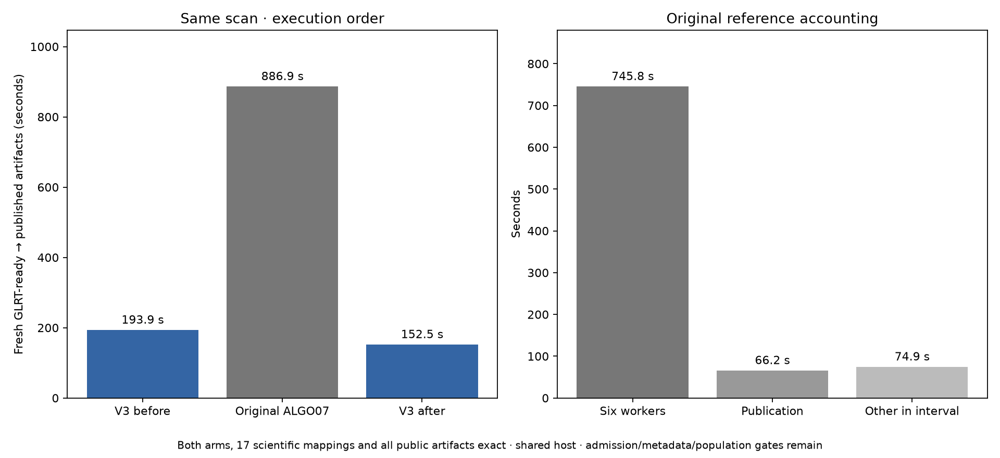

# ALGO07 versus standalone ALGO07v3: fresh cumulative timing observation

2026-11-06. No production changes, inference changes or RF collection.

All three fresh DS26-0002 executions complete, and **all public results, both calibration
arms, all eight PNG bytes, grid/path values and all 17 mapped scientific audit
sections match exactly**. The comparison retains its open historical metadata
and admission-policy gates. [Complete comparison](comparison.json).

| Path | GLRT ready through publication |
| --- | ---: |
| Standalone v3, before reference | **193.899 s** |
| Original six-worker ALGO07 reference | **886.905 s** |
| Standalone v3, after reference | **152.529 s** |

The observed ratio is **4.574×**, or
**78.14% less elapsed time**. This is a
fresh cumulative comparison on one scan, not a controlled population estimate
or a demonstrated tenfold speedup. The v3 leg ran first; both legs used CPUs
0–2, one BLAS thread per process, fixed input/archive evidence and fresh output
directories. No reference answers enter v3. The candidate hides old installations,
bulk results and reports in a private namespace. [Execution plan](plan.json).

An additional fresh v3 execution after the reference takes
**152.529 s** and again matches all 17 scientific sections and public
artifacts exactly. Relative to the intervening reference its observed ratio is
**5.815×**. This third leg was declared before
the successful sequence to bracket the original run. Both v3
observations are retained; their variation prevents treating either ratio as a
stable dataset-wide guarantee. The second comparison reuses the middle
reference, so these are three executions, not two independent pairs.
[Repeat plan](after-reference/plan.json), [comparison](after-reference/comparison.json).

## Separate algorithm work from research-harness cost

The reference's recorded interval contains **745.824 s** in its six
executed watcher/worker calls and **66.165 s** in first publication.
The remaining **74.916 s** includes orchestration, terminal checks and
frozen-runtime verification. Do not label all of this remainder scientific
computation or assume production incurs identical verification overhead.

The worker-plus-publication subtotal is **811.989 s**.
Dividing that subtotal by the complete v3 time gives
**4.188×** before the reference and
**5.323×** after it. This deliberately omits
reference orchestration gaps, so it is a separately labeled subtotal ratio,
not another continuous end-to-end measurement. Capture, GLRT extraction and
production queue delay are excluded from both paths.

| Original executed stage | Seconds |
| --- | ---: |
| ALGO02 | 214.813 |
| ALGO03 | 270.587 |
| ALGO04 | 84.518 |
| ALGO05 | 32.651 |
| ALGO06 | 58.700 |
| ALGO07 | 84.554 |

## Resource observations and limits

| Invocation | User CPU s | System CPU s | Major page faults | Max RSS KiB |
| --- | ---: | ---: | ---: | ---: |
| reference | 803.29 | 79.61 | 4 | 1966456 |
| candidate | 251.01 | 16.71 | 0 | 2341920 |
| candidate_after | 222.48 | 7.58 | 0 | 2320440 |

GNU time includes descendants and pre/post verification outside the primary
interval; CPU totals therefore have a wider scope than the primary wall clock.
Maximum RSS is per-process accounting, not concurrent aggregate memory.
The v3 runs incur 0 and
0 major page faults. Keep both observations.
Shared-host CPU, I/O, cache and frequency effects remain uncontrolled. Boundary
resource snapshots are retained rather than assuming constant load.

The original workers retain ordinary elapsed-time admission and their six
1,200-second allowances. V3 uses validation-all-work with a 1,200-second outer
bound. Exact completed science establishes agreement here; it does not prove
the admission policies equivalent under other inputs/load. Both grids complete
their requested 179 locations; original presentation has its documented 300 s
research allowance. No inference thresholds, priors or search budgets were
relaxed to make the comparison pass.

## Reference repaired without changing its manifest

The earlier [failed cumulative attempt](../2026_11_06_algo07v3_cumulative_current/README.md)
found two changed source files and seven changed generated bytecode files.
Exact archived copies restore the two source files. Historical Git source,
original compilation filenames and recovered source timestamps reconstruct all
seven bytecode files **byte-for-byte against their original SHA-256 commitments**.
The original 72,405-file runtime manifest and 2,149-file presentation manifest
pass unchanged. No source/bytecode check is dropped and no numerical expectation
or golden fixture changes.

[The recovery receipt](bytecode-recovery.json) records every historical revision,
source digest, compiled filename and timestamp. [recover.py](recover.py) accepts
a reconstruction only when its complete hash matches the old manifest.
The first reconstruction tried temporary code objects whose marshal reference
flag differed; retaining the code object reproduces the original serialization.
The first two receipts are retained under attempt1/attempt2; the measured final
helper is [measured-recover.py](measured-recover.py).

All twelve overlays (the three previously required sources plus the nine
restored files) are bound read-only **only inside the reference namespace**.
The candidate hides reports and historical installations. Host source files,
host bytecode caches and production remain untouched.

A first repaired launch passed manifests but failed before the original worker
because the harness mistakenly included bytecode in a source-only configuration
contract. Its [failure receipt](failed-repaired-reference.json) and
[log](failed-repaired-reference.log) remain recorded. The corrected runner keeps
that original contract and checks both manifests **and the full configuration**
before launching the candidate. This report's successful timings come from
entirely fresh exports and outputs, not resumed work from either failed attempt.
[Preflight](preflight.json), [exact overlays](historical-bindings.json).

## Metadata audit progress

A separate read-only verifier now checks **21 previously excluded metadata
fields across five initial policies**: exact case/algorithm identities,
radio-noise mode, source-code hashes against the frozen manifest, prior-TLE and
ordered input-read links, history/forecast/baseline digests and cavity nomination
links. Timing fields must be finite nonnegative observations; their values need
not be equal. All checks pass against this fresh export. [Audit](initial-metadata.json).

**19 component-owned tests pass**, including altered source bytes, swapped
history links, incomplete/duplicate reads, wrong scan identity, redirected TLE
links and invalid elapsed times. The earlier 1,332-test runtime suite remains
the runtime qualification; no inference code changes in this benchmark.
[Tests](metadata-tests.xml).

Later-policy metadata, broader accepted branches, full DS26 localization,
production admission/deadlines and the tenfold target remain open. The new
metadata verifier does not silently override the existing comparator's verdict.

Reproduce using [run.py](run.py) with a fresh `--root`; it prepares native-only
exports through the public store port, runs both legs, then reconstructs the
three independent scientific oracles and performs the full comparison. Run
[repeat_v3.py](repeat_v3.py) with `--parent` pointing to that root for the third
execution. The [metadata verifier](../../tools/check_algo07v3_initial_metadata.py)
takes `--evidence`, `--runtime`, `--manifest` and a fresh `--output`; its receipt
binds the exact source and exported artifacts. Raw
evidence: `/srv/bulk/leo-dev/algo07v3-cumulative-recovered-v2-20261106`. Runtime base commit: `d2c7a9316`; plans bind actual working-tree bytes.
